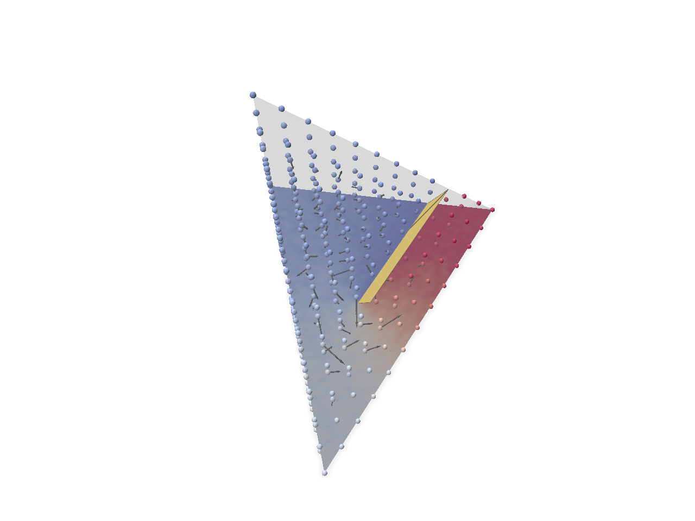
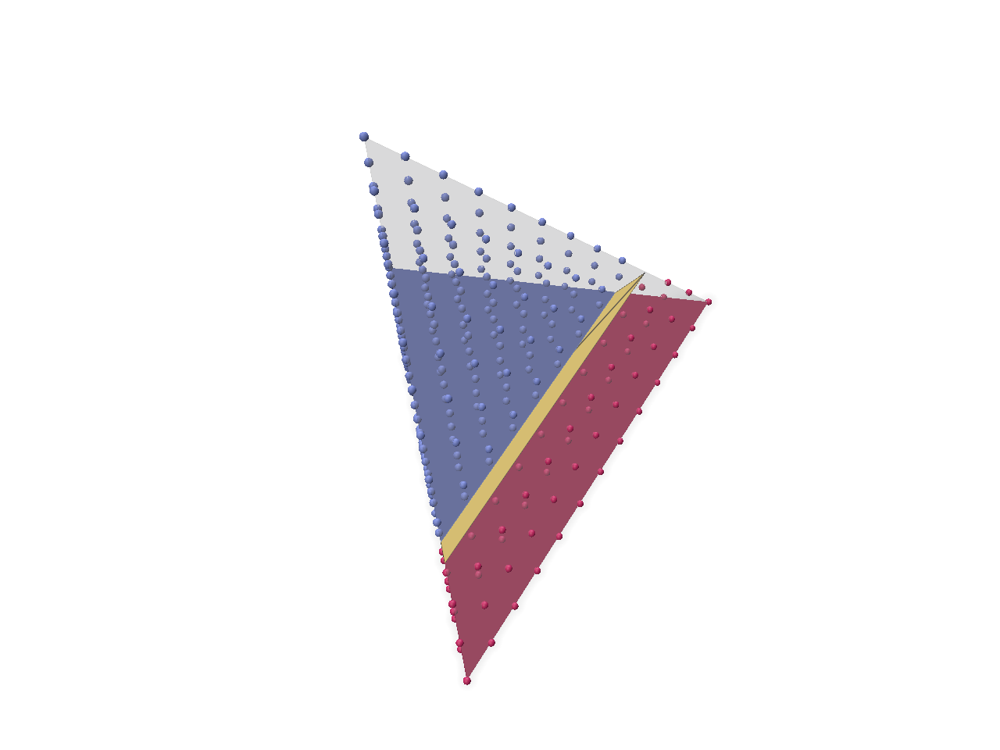
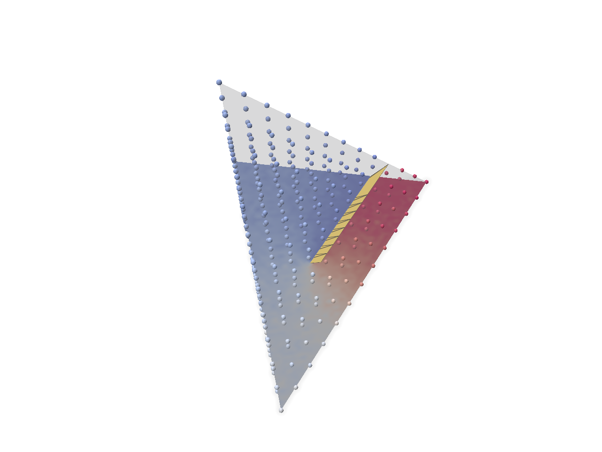
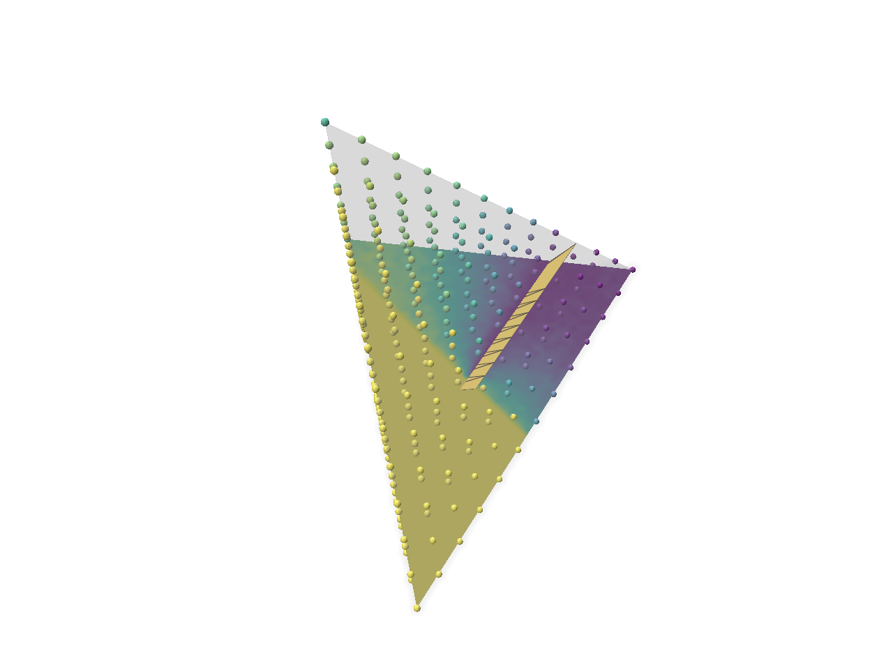
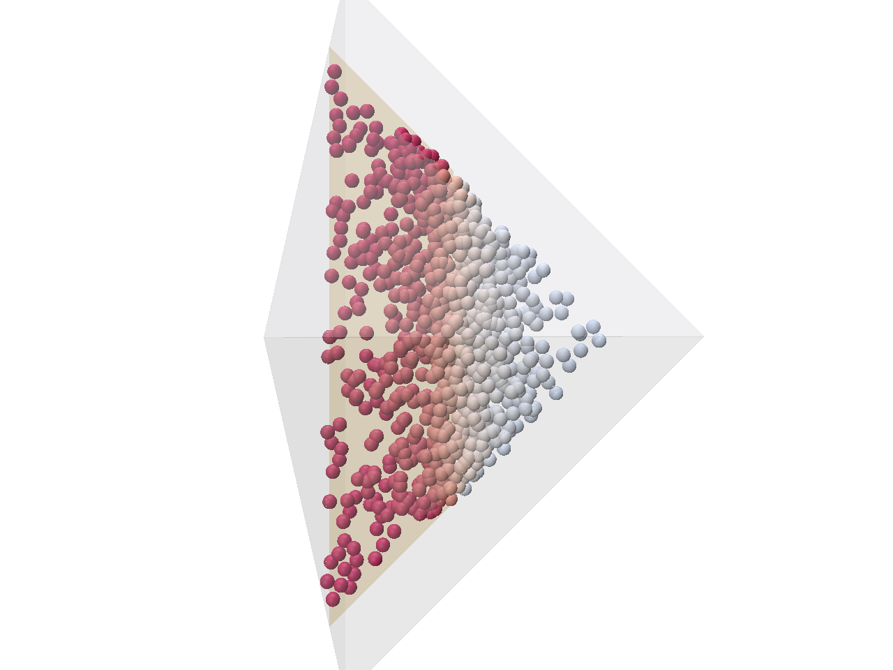
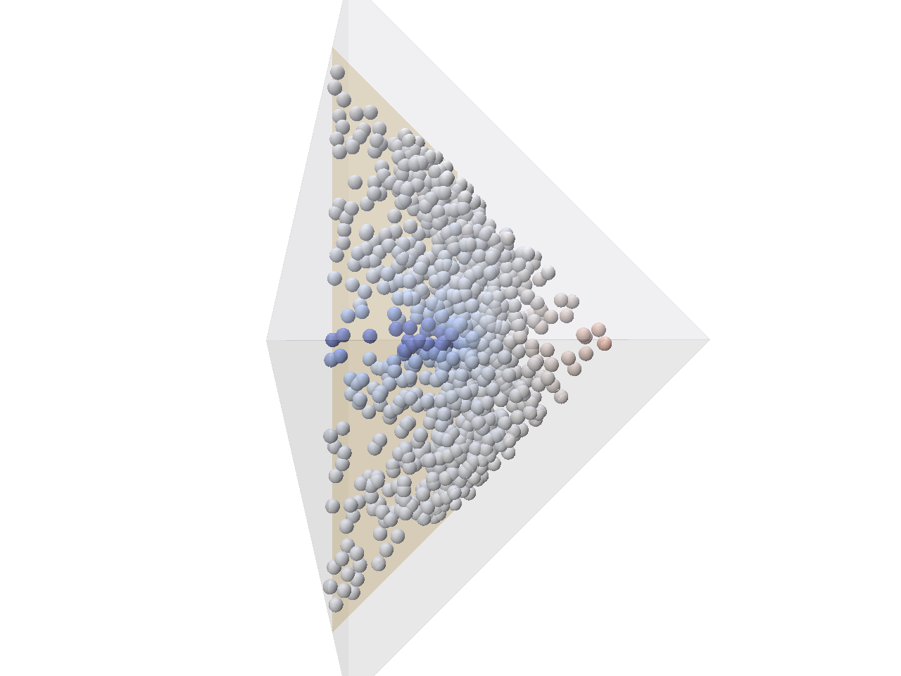
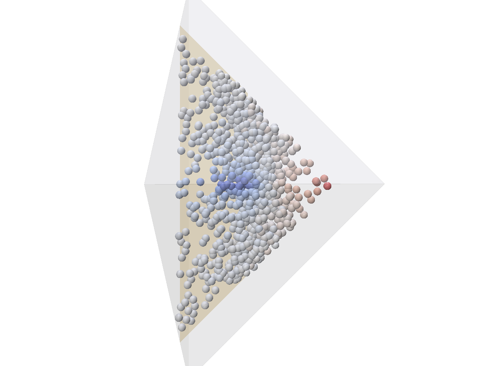

# partial_cut: harmonic partial-cut enrichment on one tetrahedron

This is a small gate experiment. It asks whether a Monte Carlo solver gives a usable
harmonic enrichment `H(ξ)` for a partial cut inside a single tetrahedron, and whether `H`
tends to the ±1 Heaviside as the cut completes. It computes `H` only: there is no
simulation, and there is only one cut. The first gate solves `H` from scratch for each
front position. The second part, [Incremental walk reuse](#incremental-walk-reuse),
caches the walks and updates them as the front advances.

- **Domain**: the tet in its local coordinates ξ, i.e. the reference tet (0,0,0), (1,0,0),
  (0,1,0), (0,0,1). `H = H(ξ)` is solved there, never in rest or deformed space. A rest tet
  only maps the cut into ξ (see [Local coordinates ξ](#local-coordinates-ξ)). The default
  rest tet is the reference tet itself, so for every result below rest space and ξ coincide.
- **Cut**: one planar, zero-thickness, double-sided cut with a straight front. The front
  position is a parameter `t` in [0,1]: `t = 0` means no cut and `t = 1` means the plane
  crosses the whole tet.
- **PDE**: `Δ_ξ H = 0` in the reference tet, with zero Neumann (reflecting) conditions on
  all four faces and Dirichlet `H = ±g` on the cut (absorbing): `+g` on the side `n·ξ > d`
  and `-g` on the other.
- **Solver**: Walk on Stars. There are two implementations:
  - The first gate (`--validate`, `--bench`) uses the
    [Zombie](https://github.com/rohan-sawhney/zombie) library, which uses
    [FCPW](https://github.com/rohan-sawhney/fcpw) for geometric queries. This is Zombie
    itself, not a reimplementation of WoSt.
  - The GUI, `--screenshot` and the reuse work (`--validate-reuse`, `--bench-reuse`) use
    our own double-precision WoSt loop (`src/walk_cache.h`). It can be replayed walk by
    walk, which Zombie's loop cannot. Check V0 compares it with Zombie.
- **Viewer**: [Polyscope](https://polyscope.run).

**Result in one paragraph.** With g = 1, Zombie's WoSt gives a usable H. The error falls
like 1/√N. The jump across the cut is 2g to within 1.1% at ε = 0.01·L, and the
shortfall is the expected O(ε) offset. At t = 1, H is exactly the ±1 Heaviside. A
separate reflected-Brownian-motion simulator agrees with Zombie at all 8 probe values to
within 1 standard error. With g_b = min(1, sqrt(r/L)), H has the right jump but can never
reach ±1 in this tet, because of how g_b is defined. A default Zombie solve takes 0.75 to
1.05 s, depending on the run. See [Validation results](#validation-results).

**Walk reuse in one paragraph.** The incremental update is exact: after every advance the
cache equals a same-seed from-scratch solve, walk for walk and bit for bit, and every
invalidated walk resumes in exactly the state it would have at that step. Reuse adds no
bias, keeps the 1/√N rate and cuts the step-to-step noise to 0.69 of fresh-seed solves.
It saves little time in this geometry, though: 1.2x over the default sweep, from 1.0x
early to 2.5x at t = 1. Here the walks a step invalidates depend on where the front is,
not on how far it moves. See [Incremental walk reuse](#incremental-walk-reuse). Of the
exact reuse schemes compared, this seed replay stays the choice here. Storing every step
gains at most 15% over it on the sweep, for 16 to 25 times the memory. It pays only when
walks are short and few are invalidated, as when the tet faces absorb (5 to 7x over a full
recompute at 16 threads). See [Choosing a reuse scheme](#choosing-a-reuse-scheme).

**Coupling gate in one paragraph.** The third part asks whether two tets can each be solved
alone, in their own ξ frame, and glued through their shared face by minimizing the energy over
the face's corner values. The machinery checks pass: S = K within 0.72 s.e., and superposition
holds, with Zombie agreeing. While the crack stays away from the shared face, the glued H has
an RMS error below 0.8% of 2g against a 100x-walk reference on the union. Where the crack
front crosses the face, the RMS error is 4.2-8.6% of 2g (g = 1) with a continuous face trace
and 2.8-5.0% with a trace that carries the jump, up to 21% near the crack. The best trace in the same space does
almost as badly, so the face trace, not the glue, is the limit. See
[Coupling gate](#coupling-gate---gate-coupling) and [`gate_report.md`](gate_report.md).

## Build

Requirements:

- CMake 3.22 or newer.
- A C++20 compiler: GCC 10 or newer, Clang 12 or newer / AppleClang, or MSVC 2022.
- git, and internet access for the first configure.

All dependencies are fetched by CMake `FetchContent` at pinned commits (see
`CMakeLists.txt`):

- Eigen 5.0.1
- fcpw `e498ca8`
- zombie `b232b1c`, with its pcg32, nanoflann and oneTBB submodules
- Polyscope v2.6.1, with its own submodules

The first configure clones everything and takes about 2 minutes (134 s on the test
machine). The first Release build takes about 40 s.

**Linux** (not tested yet). GLFW needs the X11 and OpenGL headers, e.g. on Debian/Ubuntu:

    sudo apt install build-essential cmake git xorg-dev libgl1-mesa-dev
    cmake -S . -B build -DCMAKE_BUILD_TYPE=Release
    cmake --build build --parallel
    ./build/partial_cut

**macOS** (not tested yet). Install the Xcode command line tools, then:

    cmake -S . -B build -DCMAKE_BUILD_TYPE=Release
    cmake --build build --parallel
    ./build/partial_cut

**Windows** (tested with Visual Studio 2022, MSVC 19.44, CMake 4.4):

    cmake -S . -B build -G "Visual Studio 17 2022" -A x64
    cmake --build build --config Release --parallel
    build\Release\partial_cut.exe

On Windows `tbb12.dll` is copied next to the executable after each build.

From the Visual Studio IDE, open `build\partial_cut.sln`, set the configuration dropdown
to **Release** and press Run. `partial_cut` is the startup project and runs from the
project folder. A Debug build works but is much slower: a Zombie solve took 61 s, about 60x
Release. The GUI's own loop was not timed in Debug. The window stays blank until the first
solve finishes.

## Run

| command | what it does |
|---|---|
| `partial_cut` | Opens the Polyscope GUI. It runs our own Walk on Stars loop with the walk cache (see [GUI controls](#gui-controls)). |
| `partial_cut --validate` | Runs the first gate's four validation checks headless, with Zombie, prints them and rewrites the first-gate section of `results.txt` in the current working directory. |
| `partial_cut --bench` | Runs one full default Zombie solve (lattice with gradient, plus slice) and prints wall time and walk statistics. |
| `partial_cut --validate-reuse` | Runs the reuse validation headless (V0, R1 to R4, checks 1 to 4; see [Incremental walk reuse](#incremental-walk-reuse)), prints it and rewrites the reuse section of `results.txt`. It takes about 70 s. The exit code is 1 if an exact check fails or the file cannot be written. |
| `partial_cut --validate-reuse --quick` | A reduced-size run of R1 to R4 only (k = 6, N = 32, 6 steps, both g types). It takes well under a second, prints only and writes nothing. |
| `partial_cut --bench-reuse` | The default GUI scene (all lattice points plus the slice, N = 256): a full solve at t = 0.2, then 16 incremental steps of 0.05 to t = 1, for both g types. Per step it prints the update statistics, the wall time of each pass, and the time of a same-seed full re-solve on the same cut. |
| `partial_cut --validate-reuse --dirichlet-faces`, `partial_cut --bench-reuse --dirichlet-faces` | An experiment with a different PDE: our loop's tet faces absorb with H = 0 instead of reflecting (see [The Dirichlet-faces experiment](#the-dirichlet-faces-experiment)). The validation writes its reuse section to `results_dirichlet_faces.txt`, never to `results.txt`; with `--quick` it writes nothing. The flag also works with `--compare-options`. It has no effect on `--validate`, `--bench`, the GUI or `--screenshot`. |
| `partial_cut --compare-options [--quick] [--threads T] [--repeat R] [--dirichlet-faces]` | Compares the exact reuse options 1, 2a, 2b and 3, plus the control 3q, on (i) the lattice sweep t = 0.2 to 1 in 16 steps and (ii) check 3's schedule on the default scene, for both g types. At every step it checks that they agree walk for walk. It times every pass of every update and reports memory (see [Choosing a reuse scheme](#choosing-a-reuse-scheme)). It writes `results_options.txt`, never `results.txt`. The name gets `_dirichlet_faces` with `--dirichlet-faces`, `_quick` with `--quick` (k = 6, slice res 16, N = 32), and `_threadsT` with `--threads T`, which limits TBB, so runs at several thread counts can sit side by side. `--repeat R` runs every configuration R times, all checks included. It then reports medians and [min, max] ranges, with "tie" where a ratio's range contains 1. At 16 threads `--repeat 5` took 518 s (reflecting faces) and 156 s (`--dirichlet-faces`); `--threads 1 --repeat 3` took 48 and 15 min. The exit code is 1 if a check fails. |
| `partial_cut --screenshot out.png [--t T] [--t-start T0 --steps K] [--rewalked] [--with-ui]` | Builds the GUI scene, saves a 1280×960 Polyscope screenshot and exits. Without `--steps` it runs one full solve with the front at `T` (default 0.6). With `--steps K` it runs a full solve at `T0` (default 0.2), then K equal incremental steps to `T`. `--rewalked` colours the lattice and the slice by "re-walked this step" instead of H. `--with-ui` also draws the control panels. |
| `partial_cut --check-xi` | Checks that H lives in local coordinates ξ: the cut pull-back from random rest tets, a push-forward round trip, and that two different rest tets carrying the same ξ cut give bit-identical H (Zombie and our loop). See [Local coordinates ξ](#local-coordinates-ξ). Rewrites its own section of `results.txt`; takes under a second. |
| `partial_cut --gate coupling [--check 0\|1\|2\|3\|4] [--quick]` | The coupling gate: can a tet's WoSt solve be glued to a neighbour through the shared face (see [Coupling gate](#coupling-gate---gate-coupling))? Check 4 glues the 8 tets of one nodal ring at its vertices. Prints the geometry setup, the quadrature checks, the sanity tests and the requested check (all of them without `--check`; `--check 4` alone skips the setup and sanity tests of tets A and B and leaves their sections as they are), and rewrites their sections of `gate_report.md` in the current directory (the summary at its top is rebuilt from the sections' findings, and the same findings are printed at the end of the run). The reference solves on U (checks 2 and 3) and on the octahedron (check 4) are cached in `gate_cache/` in the current directory and loaded on later runs. A full run takes about 3 minutes for checks 0 and 1, about 12 minutes for check 2 the first time (about 6 with the cache), about 18 minutes for check 3 the first time (about 11 with the cache), and about 90 minutes for check 4 the first time (5375 s; its six reference solves took 58 minutes) and about 30 with the cache; checks 0–3 with every cache present took 19 minutes (1134 s in the latest run), and 32 minutes with none (every reference recomputed). `--quick` is for development only (512 points, N = 256, reference N = 1024): every line is marked QUICK and nothing is written, not even the cache. |
| `partial_cut --gate coupling --view [--check 2\|3] [--config i] [--screenshot out.png [--with-ui]]` | The coupling gate's Polyscope view of the union U = A ∪ B for one configuration: check 3 with `i` = 0, 1, 2 for y_f = 0.15, 0.30, 0.45 (default: check 3, i = 1), or check 2 with `i` = 0, 1 for z_c = 0.60, 0.35 (default 0). It shows the reference H, the decomposed H (check 3: Level A and Level B) and their difference, for both g types, as point clouds at the sample points of A and B, plus the F points carrying the reference trace and the glued trace. The crack is drawn on U, and a slice through the crack plane is shown as the sample points within 0.05 of it, one cloud per side. The values are the stored per-point ones: the reference is loaded from `gate_cache/` in the current directory (solved and cached if missing, 2-4 min), and the decomposed field comes from the check's main recipe runs with the check's own seeds (about 20 s), so it is the field behind the numbers in `gate_report.md`. With `--screenshot out.png` it writes, for every g = 1 field, `out_<field>.png` (the union) and `out_slice_<field>.png` (the slice face-on from the +g side), rewrites this view's section of `gate_report.md` in the current directory if that file exists (the images with their colour ranges and the errors of the fields shown), and exits. The images in `screenshots/` were made from the project folder with `--check 3 --config 1 --screenshot screenshots/gate_check3_yf0.30.png` and `--check 2 --config 0 --screenshot screenshots/gate_check2_zc0.60.png`. |
| `partial_cut --gate coupling --view --check 4 [--ring 1\|2] [--config 0\|1\|2] [--fast]` | Check 4's nodal ring (default ring 2, K1) in Polyscope with a panel: the ring, the crack, the sample points per tet and the walk counts, recomputed in the background. By default it runs check 4's own path and setting, and the GT (the whole-ring reference) is loaded from `gate_cache/`. The panel's **fast method** checkbox is off by default; `--fast` turns it on from the start, at Q 32 / R 16 walks per point. It switches the per-tet runs to the fast method of [Fast ring method and the direct ring solve](#fast-ring-method-and-the-direct-ring-solve---ring-bench). The two per-tet sliders are then Q's and R's walks per point. The GT still loads from `gate_cache/` at 4096 points and 25,600 walks, whatever the per-tet walks are. |
| `partial_cut --ring-perf <parts> [--ring 1\|2] [--config 0\|1\|2]` | Profiling of check 4's ring path. It prints only and reads `gate_cache/` read-only. The parts run in the order given: `x` the J_ξ checks, `a` the current per-tet runs timed per tet, `b` the walk stop distance sweep, `c` the cost of the direct ring solve, `d` the walk step profile (per part, per logical processor, thread scaling), `e` the current path against the control-variate prototype and the direct solve for this ring and crack, `f` part `e` for all six configurations (about 250 s), `r` / `R` a review check of the fast method against check 4's two runs per tet at the same points (1024 per tet) and N = 2560 / 10240 walks: z tests of the Gram entries S_T and b_T, the glued vertex values, and P_k, H0 and the glued H with their gradients (about 20 s / 70-100 s). |
| `partial_cut --ring-bench [--ring 1\|2] [--config 0\|1\|2] [--ours LIST] [--direct LIST] [--current LIST] [--shell S] [--repeat R] [--seeds S] [--no-lean] [--no-fuse] [--tag NAME] [--quick]` | The benchmark of [Fast ring method and the direct ring solve](#fast-ring-method-and-the-direct-ring-solve---ring-bench): our fast per-tet method against the direct ring solve, and optionally check 4's current path, all timed and compared with the cached references, which are read only. Without `--ring` / `--config` it runs all six configurations (`--quick`: ring 2 K1, two settings per method, one repeat). It writes `ring_perf/<tag>_rows.csv`, `ring_perf/<tag>_summary.csv` and `ring_perf/<tag>_log.txt`, and never overwrites: a taken name gets `_2`, `_3`, and so on. |
| `partial_cut --ring-bench --selftest` | The fast method's checks: the lean walks against `solveMulti` bit for bit, J_ξ, which fields need walks, same-target z tests against check 4's runs, and determinism. It takes about 10-20 s (8.3 s measured on an otherwise idle machine). |
| `partial_cut --ring-bench --view [--fast] [--ring 1\|2] [--config 0\|1\|2] [--points P] [--walks-tet N] [--walks-r N] [--walks-ref N]` | The ring view's computation without the window. It prints the panel's lines and an FNV-1a hash of every field, for bit-identity checks. |
| `partial_cut --help` | Prints the usage. |

`--validate` and `--bench` use the first gate's Zombie solver, unchanged. The GUI and
`--screenshot` use our own loop (`src/walk_cache.h`), so screenshots now show its solution,
not Zombie's.

Timings on the 16-thread Windows test machine:

- **Full default Zombie solve (`--bench`).** 1.05 s when the first gate was validated
  (median of 3 runs). A rerun at the end of the reuse work gave 0.75 s (0.750, 0.753 and
  0.755 s) with identical walk counts. The Zombie code did not change, so the difference is
  run-to-run machine variation. The solve covers 433 lattice points, with ∇H at 156 of
  them, and 1481 slice points, at N = 256. The slice takes about three quarters of the
  time.
- **`--validate`.** 3.4 s.
- **`--validate-reuse`.** About 70 s.
- **Own loop, GUI scene** (all 455 lattice points plus the slice). A full solve takes 0.21
  to 0.33 s, depending on t (see [Reuse timings](#reuse-timings)).

**results.txt sections.** `results.txt` holds one section per validation mode, between a
`======== BEGIN <name> ========` line and a `======== END <name> ========` line. The names
are `first gate (--validate)`, `incremental walk reuse (--validate-reuse)` and `local
coordinates xi (--check-xi)`. Each mode
(and each GUI validation button) rewrites only its own section and keeps the other. The
first-gate section always comes first. A `results.txt` written before sections existed,
with no markers, is taken to be the first-gate section.

The file is read with LF line endings, so a CRLF copy also works. Git on Windows with
`core.autocrlf` checks the file out that way. A file whose markers cannot be parsed is
left unchanged, and the mode reports that it could not write it.

The GUI writes `imgui.ini` and `.polyscope.ini` into the working directory. Both are
gitignored. `--screenshot` writes neither.

## GUI controls

The GUI runs our own Walk on Stars loop with the walk cache (`src/walk_cache.h`, see
[Incremental walk reuse](#incremental-walk-reuse)), not Zombie.

- **What is cached.** Every lattice point and every slice point is cached, with N walks
  each.
- **The cut is a list of strips.** Raising t appends one strip `[s_old, s_new]`.
- **Sliders** apply their change when you release them, not while you drag them.

| control | effect |
|---|---|
| **t (front position)** | Front position in [0,1], with `s(t) = s_min + t (s_max - s_min)` over the section's extent along the front direction `u`. **Raising t** appends the strip `[s_old, s_new]` and updates the cache in the selected update mode. **Lowering t** drops the strips past the new front, appends one strip up to it, and re-solves from scratch, because retraction is not incremental. It uses the same seeds in incremental and biased modes, and a new seed in full re-solve mode. At `t = 0` there is no cut. |
| **update mode** | *incremental (resume)*: the spec's update, in order: bounding-box test, replay with the old cut, resume at the first step the new strip enters, then value updates for g type (b). *full re-solve each change (fresh seed)*: every change of t (up or down) solves the same strip list from scratch with a new seed, as the first gate's GUI did. So the step-to-step noise that reuse avoids (check 4) shows up. A same-seed full solve would reproduce the incremental cache walk for walk and bit for bit (R2). Its H would agree up to the round-off of the running sums: about 1e-15 for H and 1e-12 for ∇H, and exactly for g = 1. *biased restart (Fig. 5)*: like incremental, but invalidated walks restart from their query point. It is deliberately biased. Leaving biased mode re-solves the cache from scratch, because it holds restarted walks. *frozen seeds, full recompute (option 1)*: every change of t solves from scratch with the same seeds, the estimator that every exact option reproduces. *stored steps + front-key queue (option 2b)*: the cache also stores every step of every walk; raising t pops the walks whose front key is at or below the new front, tests their stored balls exactly and resumes them without replay (see `--compare-options`). Entering or leaving this mode re-solves the cache, which builds or drops the stored steps (about 660 MiB for the default scene at t = 0.5, more at smaller t, where walks are longer). |
| **time a same-N full re-solve after each update** | After each incremental or biased update, also times a full solve of the same points, with the same N and seeds, on the same cut. It runs in a scratch cache that is then discarded. On by default; it roughly doubles the time per update. |
| **N walks per point** | Walks per query point, 16 to 4096 (logarithmic slider). A change builds a new cache and runs a full solve. |
| **epsilon / L** | The user epsilon, in units of the longest tet edge `L`, from 1e-3 to 0.1. Lattice points within epsilon of the current cut are masked from the display and the statistics. They stay in the cache, because the masked set changes with t. A change runs a full solve. |
| **(a) g = 1 / (b) g = min(1, sqrt(r/L))** | Dirichlet data type. `r` is the distance to the front line. A change runs a full solve (same seeds, so the walks are the same and only the values change). |
| **k (lattice subdivisions)** | Barycentric lattice resolution, 1 to 30, with `(k+1)(k+2)(k+3)/6` points, all cached. A change builds a new cache. |
| **offset from centroid**, **yaw**, **pitch** | The slice plane, as in the first gate. Its points are cached too, so a change builds a new cache. |
| **Re-solve (new seed)** | New base seed, new cache, full solve. |
| **Run validation** | The first gate's four checks with Zombie, as `--validate`, with the current epsilon and k. The current N is used for checks 2 and 4. It rewrites the first-gate section of `results.txt`. The window freezes for a few seconds. |
| **Run reuse validation** | The same as `--validate-reuse`, with the current N, epsilon and k (V0 keeps its N = 1024 and check 2 its own N list). It rewrites the reuse section of `results.txt`. It runs on the GUI thread, so the window freezes for about a minute at the defaults. |

The status lines show:

- the last action: which update ran, and the front `s` before and after;
- the cut: number of strips and triangles, its area against the full section's, and the
  front position;
- for the last incremental or biased update:
  - the fractions of walks tested (bounding box hit), re-walked and value-updated;
  - the share of the re-walked walks invalidated at their first step (k = 0), and the
    mean k;
  - the escaped and capped walks among the re-walked paths, and the steps the update ran:
    replayed under the old cut, and new;
  - the wall time of each pass (bbox, re-walk, values, sums) and the total;
  - the same-seed full re-solve time on the same cut, measured right after the update
    (when the checkbox is on), and the ratio of the two;
- the lattice points cached and masked, H ± 1 s.e. at the four tet vertices, and the
  slice point count;
- the last full solve: time, walk counts (counted, escaped, capped) and mean walk length.
  Every full solve counts here, including those in full re-solve mode and the first raise
  of t from 0;
- after a validation button, where `results.txt` was written.

At `t = 0` the panel says that no walks are run and that H is set to 0.

What Polyscope shows:

- **tet**: a transparent volume mesh.
- **cut**: a surface mesh of all strips, with a face scalar `strip index` (the newest
  strip has the highest index).
- **lattice**: a point cloud of the lattice points that are not masked, with these
  quantities:
  - `H`, with the coolwarm diverging map fixed at [-1,1];
  - `H std. error`;
  - `re-walked this step`: the fraction of the point's walks that the last update
    re-walked (viridis, [0,1]). After a full solve every walk was just walked, so it is 1
    everywhere.
- **lattice grad H**: a second point cloud that holds only the interior lattice points
  that are not masked, the ones where ∇H is estimated (none for k <= 3). It has:
  - `grad H`, as vectors;
  - `|std. error of grad H|`.

  It is hidden at startup; tick it in Polyscope's structure list to show the arrows.
  Points on the tet faces have no estimate, so they are left out instead of showing a
  zero arrow. The cloud's points are drawn smaller than the lattice points, so `H` stays
  visible. To see the `|std. error of grad H|` colours, hide `lattice`.
- **slice**: a surface mesh with `H` (coolwarm, [-1,1]) and `re-walked this step`.

The control panel also shows H ± 1 s.e. at the four tet vertices (the lattice points with
barycentric index k), which a shifted enrichment N_i (H − H(x_i)) needs.

The arrows are scaled for display only: the arrow length maps to the 90th percentile of
|∇H|, never below 1/L, so the few very noisy estimates next to the cut do not shrink every
other arrow.

## How it works

This section describes the geometry and the first gate's Zombie solver. The own loop used
by the GUI and the reuse work is described under
[How the update works](#how-the-update-works).

**Geometry.** Everything is set in one place: `GeometryConfig` in `src/cut_problem.h`.
It holds the 4 rest-tet vertices `restVerts`, and in rest space the plane normal `n` and
offset `d` (with `n̂·X = d`) and the front direction `u`. Every solve runs on the reference
tet in ξ; `restVerts` is only used to pull the cut back into ξ (next section). The
coordinates below are for the default rest tet, which is the reference tet.

- The default plane is `x + y - z = 0.5`, i.e. `n = (1,1,-1)/√3`, `d = 0.5/√3`. It
  separates {v0, v3} from {v1, v2}, so it cuts the tet in a quad. This is checked and
  printed at startup.
- The default `u = (1,-1,0)/√2`. The quad's vertices, and the `t` at which the front
  passes each one, are:
  - D = (0, 0.75, 0.25) on edge v2-v3, at t = 0;
  - B = (0, 0.5, 0) on edge v0-v2, at t = 1/6;
  - A = (0.5, 0, 0) on edge v0-v1, at t = 5/6;
  - C = (0.75, 0, 0.25) on edge v1-v3, at t = 1.
- The cut starts at the single vertex D and grows towards the vertex C. One end of the
  front line is always on the face x+y+z = 1. The other end is on the face x = 0 for
  t < 1/6, on z = 0 for 1/6 < t < 5/6 (this includes the default t = 0.6), and on y = 0
  for t > 5/6.
- At t = 1 the front line only touches the polygon, at C. This is why g type (b) stays
  below 1 at t = 1 (see the caveats).
- The plane∩tet polygon is clipped by the half-plane `X·u <= s(t)` and fan-triangulated.
- Zero-area triangles are skipped. Every triangle is wound so that `((b-a)×(c-a))·n > 0`.

### Local coordinates ξ

The enrichment is `H(ξ)`, the solution of `Δ_ξ H = 0` on the reference tet in the tet's
local coordinates. It is not solved in rest space or in deformed space. With the rest
vertices `X0..X3` in their fixed order (`X0` is ξ = 0 and `Xi` is ξ = e_i), the map is
`X = X0 + J ξ`, `J = [X1−X0, X2−X0, X3−X0]`. `pullBackCut` (`src/cut_problem.cpp`) maps the
rest-space cut into ξ:

- plane: `n_ξ = Jᵀn_X / |Jᵀn_X|` and `d_ξ = (d_X − n_X·X0) / |Jᵀn_X|`. The `+g` side stays
  the same;
- front: `f_ξ = Jᵀf_X`, then projected into the ξ plane. On the plane `X·u_X` is an
  increasing affine function of `u_ξ·ξ`, so the front at `t` maps to the front at the
  same `t`.

Everything else is in ξ as well: `L = √2` in g type (b) and the distance `r` to the
front, ε, the lattice, the slice and the gradient. The reported gradient is `∇_ξ H`; the
gradient in rest space would be `J⁻ᵀ∇_ξ H`. `buildCut` refuses any domain other than the
reference tet. For the default rest tet `J = I` and the pull-back returns the inputs bit
for bit. After the change, `--validate` and `--validate-reuse` gave the same numbers as
before (only the timings differ).

`--check-xi` checks this (the run is in the `local coordinates xi` section of `results.txt`):

- **X1, pull-back geometry.** 1000 random rest tets (521 of them inverted, det J < 0) with
  random cut planes and front directions, at t = 0.05, 0.25, 0.5, 0.75 and 1 (5000 cuts).
  The ξ cut, mapped by `X0 + Jξ`, is the cut built directly in rest space. The vertex
  counts all agree, the largest vertex error is 2.5e-14·L_rest, and the `+g` side agrees
  at all 20,000 test points.
- **X2, round trip.** The default ξ cut is pushed into a skewed rest tet B and pulled back.
  It returns to within 2.5e-16.
- **X3, the solve sees only the ξ cut.** Rest tet C is B rotated by 180° about y and
  scaled by 2, carrying the same cut. Sign flips and factors of 2 are exact in floating
  point, so B and C give bitwise the same ξ cut at every t. Zombie (both g types, all
  lattice and slice points) and our loop (a full solve plus 4 incremental steps, both g
  types) give bit-identical results for B and C. B against the default rest tet, whose ξ
  cut agrees with B's only to round-off, also gave identical Zombie estimates at every
  lattice point.

**Solver (Zombie WoSt).**

- The four tet faces, oriented outward, are the reflecting boundary. The cut triangles
  are the absorbing boundary.
- The PDE is Laplace with zero source and zero Neumann data.
- `solveDoubleSided = true`, because the cut is an open two-sided surface.
- Each solve runs in parallel over query points with Zombie's TBB `parallel_for`. All
  walks of one point run on one thread.
- Settings, all scaled by `L`:
  - walk termination shell 1e-4·L. Zombie is given distances to the cut that are smaller
    than the true ones by a face-offset margin of 4.3e-5·L, so walks stop within
    1.43e-4·L of the cut (see "Epsilons and the face-offset margin");
  - minimum star radius 1e-5·L;
  - walk-length cap 4096.
- Zombie's default escape test only checks the bounding box. It is replaced by exact
  tet containment, because walks leaking through the slanted face otherwise kept walking
  outside the tet.
- Walks that leave the tet through float round-off are discarded by Zombie and reported
  as "escaped". This is about 0.13% of walks. The worst point is the lattice point at the
  apex (0,0,1), at 5.5%.
- Walks that hit the cap are reported as "capped". They still count, with value 0. None
  hit the cap at the default settings.

**Which side, +g or -g.**

- Zombie calls the Dirichlet callback with the walk's end point *projected onto the cut*,
  so `sign((x-p)·n)` at that point would be meaningless.
- It also passes a flag. The flag is true when the unprojected end point lies on the side
  that the nearest cut triangle's normal points to.
- Since every cut triangle is wound with normal `+n`, the flag means "the walk ended on
  the `n·X > d` side". The callback returns `+g(x)` if the flag is set and `-g(x)`
  otherwise, with `g` evaluated at the projected point.

**Epsilons and the face-offset margin.**

- The *user epsilon* (UI) excludes lattice points near the cut and sets the jump-check
  offset.
- The *walk termination shell* is a fixed 1e-4·L, at least 10x smaller. If it were not,
  the jump-check points would terminate immediately and the check would be trivially exact.
- **Face-offset margin.** A step that starts on a tet face starts from a point that Zombie
  pushes slightly off the face (`offsetPointAlongDirection`: 2^-16, or 256 float ulps, per
  coordinate, about 1.5e-5 here). The step's ball radius, however, is 0.99x the distance
  to the cut measured at the un-pushed point. Close to the cut the 1% safety margin (about
  1.4e-6 at the shell) is smaller than the push. So a walk that is on a face within about
  6e-4·L of the cut can step across the cut and end on the wrong side.
- To prevent this, the solver gives Zombie distances to the cut that are smaller by twice
  the largest possible push for the tet's coordinates (6.1e-5 = 4.3e-5·L for the default
  tet). Every ball then stays on its own side of the cut. Walks stop within shell + margin
  = 1.43e-4·L. The measurements that led to this are under
  [Fixes made during validation](#fixes-made-during-validation).
- The minimum star radius is kept below the shell. Zombie shrinks the star radius to 0.99x
  the distance to the cut only while that distance is at least the minimum star radius;
  below that the radius equals the distance.

**t = 0.** With no Dirichlet boundary, Laplace with zero Neumann data on every face fixes
H only up to a constant. No walks are run and H is set to 0. The UI says so.

**Gradient.** ∇H comes from Zombie's gradient estimator (control variates plus antithetic
pairs).

- The estimator starts with a ball of radius min(distance to cut, distance to faces), and
  its noise grows like 1/radius.
- ∇H is therefore estimated only at *interior* lattice points, those not on a tet face,
  edge or vertex. On the faces it would be useless (s.e. about 600 at N = 256). This is a
  deviation from the spec, which asks for ∇H at the lattice points; 277 of the 433 default
  lattice points are on a face.
- Even at interior points it is noisy at N = 256: in `--bench`, median |∇H| is 1.66 and
  the median standard error is 1.59. Raise N to see a clean field.

**Query points.**

- Every lattice and slice point is pulled 0.1% of the way towards the centroid, a uniform
  shrink, so that walks start strictly inside. Points exactly on a slanted face otherwise
  lose all their walks to round-off.
- The slice is a square grid (64 cells across) over the plane∩tet section. Cells with a
  corner inside are kept, and their outside corners are snapped onto the section boundary.

**Random numbers.** Point `i` of a solve uses its own pcg32 stream `i`, with a state
derived from the solve's seed. This replaces Zombie's clock-based seeding. The validation
is therefore reproducible for a given build and base seed, and every point, repeat and
solve is independent. The seeds are recorded in `results.txt`.

## Validation

`--validate` (or the **Run validation** button) prints the following and writes the same
text into the first-gate section of `results.txt`, together with all settings and seeds.

1. **Convergence.** Four fixed probes near or ahead of the front at the default t = 0.6.
   Walks there end on both sides of the cut, so the estimate is genuinely random. For
   N = 16, 64, 256, 1024 and 4096, with 8 independent repeats each, it prints:
   - mean and std of the 8 repeat means;
   - std·√N;
   - the std predicted from the per-walk variance;
   - the number of distinct repeat values;
   - the log-log slope of std against N (1/√N gives −0.5).

   This is done for both g types.
2. **Complete-cut limit, t = 1.** For each side of the cut, over all lattice points, both
   g types:
   - max and mean |H − sign((X−p)·n)|;
   - the number of points above 0.1;
   - max |H|;
   - for g = 1 (when no walk hit the cap), the exact number of walks that ended on the
     other side of the cut.
3. **Jump.** 20 points X sampled uniformly on the cut (t = 0.6) at least max(0.05 L, 2ε)
   from its edges, evaluated at X ± ε·n with N = 4096. Per pair it prints H+, H−, the jump
   and 2g(X), then the mean jump, mean 2g and mean jump/2g. Both g types.
   - The deepest point of the default t = 0.6 cut is only 0.108·L from its edges. The
     margin is capped at 0.8x that depth (0.087·L), so for ε/L above about 0.043 the cap
     applies, the output says so, and all X lie near the cut's deepest point.
   - If no admissible X exists, the check prints that it was not run instead of printing
     means.
4. **Progressive sweep.** For t = 0.2, 0.4, 0.6, 0.8 and 1.0, the fraction of lattice
   points with |H| > 0.9, for both g types, plus the maximum of g_b on the cut.

## Validation results

All numbers below come from the first-gate section of `results.txt`, which is the source of
truth. It was last written by `--validate` on 2026-10-31 at 19:02, by the final Release
build of the reuse work (MSVC 19.44, 16 threads). The run used the defaults: t = 0.6,
N = 256, ε = 0.01·L = 0.01414, k = 12 and base seed 20261031. Over all solves, 2,001,409 of
2,003,968 walks were counted. 2,559 (0.128%) escaped and were discarded, and none hit the
cap. Wall time was 3.36 s. Every number in this section equals the earlier runs from
before the reuse work (15:54 and 17:03); only the date and the timings changed.

| check | key number | agrees with theory? |
|---|---|---|
| 1. convergence, both g | mean log-log slope −0.488 over 8 fits (range −0.64 to −0.39) | yes |
| 2. t = 1, g = 1 | max \|H ∓ 1\| = 0 on both sides; 0 of 107,651 walks on the wrong side | yes, exactly ±1 |
| 2. t = 1, g_b | max \|H\| = 0.811, below the bound 0.866 | yes, but no ±1 limit (by construction) |
| 3. jump, g = 1 / g_b | mean jump/2g = 0.9887 / 0.9844 | yes, the shortfall is the O(ε) offset |
| 4. sweep, g = 1 | fraction with \|H\| > 0.9 rises from 0.002 to 1.000 | yes |
| 4. sweep, g_b | 0 at every t | yes, but the test cannot detect a front here |
| extra: independent simulator | 8 of 8 probe values within 1 s.e. of Zombie | yes |
| solve time at defaults | 1.05 s (0.75 s in a later rerun) | under the ~2 s target |

No check disagreed with theory. The one stated expectation that does not hold is the
spec's ±1 limit for g type (b). That is a property of the spec's g_b, not a solver error
(see the caveats).

### 1. Convergence

Std of the 8 repeat means, at the smallest and largest N:

| probe | g = 1, N = 16 | g = 1, N = 4096 | g_b, N = 16 | g_b, N = 4096 |
|---|---|---|---|---|
| P1 | 0.135 | 0.0175 | 0.057 | 0.0050 |
| P2 | 0.160 | 0.0080 | 0.040 | 0.0058 |
| P3 | 0.133 | 0.0137 | 0.049 | 0.0034 |
| P4 | 0.229 | 0.0140 | 0.080 | 0.0015 |

- **Slopes.** The log-log slopes are −0.387, −0.503, −0.463 and −0.532 for g = 1, and
  −0.460, −0.430, −0.493 and −0.638 for g_b. Their mean is −0.488 with a standard error of
  0.022, within 0.6 s.e. of −0.5.
- **Scatter.** The std from 8 repeats is only known to about ±27%, so a single slope has an
  s.e. of about 0.06. The 8 slopes have an sd of 0.075. The extremes, −0.39 and −0.64, are
  1.9 and 2.3 s.e. from −0.5.
- **Measured against predicted.** The ratio of measured std to the std predicted from the
  per-walk variance has a median of 0.92 over the 40 (probe, N, g) cells. 5 of the 40 fall
  outside the 90% band [0.56, 1.42], where 4 are expected. So the repeats are
  independent: correlated RNG streams would give a std well below the prediction.
- **Distinct values.** At N = 16 only 4 of 8 repeat values are distinct at some probes.
  This is quantization: with g = 1 and 16 walks, H is a multiple of 1/8. It does not mean
  duplicate streams.
- **Means.** The means are stable across N. For example, P3 with g = 1 stays between 0.797
  and 0.830.

The estimator behaves like plain Monte Carlo, with error ∝ 1/√N.

### 2. Complete-cut limit (t = 1)

The lattice has 455 points. 34 lie within ε of the cut and are excluded, which leaves 126
points on the + side and 295 on the − side.

- **g = 1:** max |H − 1| = 0 and max |H + 1| = 0. All 107,651 counted walks ended on the
  side they started on, none hit the cap, and 125 (0.116%) escaped and were discarded.
  At t = 1 the sides are disconnected, so this is exactly what theory requires. There is
  no ε bias, because the exact solution is constant on each side.
- **g_b:** H does not approach ±1. On the + side H lies between 0.281 and 0.811 (mean
  |H − 1| = 0.419). On the − side max |H| = 0.811 and mean |H + 1| = 0.404. At t = 1 the
  front line still touches the section at C, and the farthest cut point is only 0.75·L
  from it. So g_b ≤ sqrt(0.75) = 0.866 on the whole cut, and by the maximum principle
  |H| ≤ 0.866. The results satisfy this bound.

### 3. Jump across the cut (t = 0.6, X ± ε·n, N = 4096)

- **g = 1:** mean jump 1.9773 against 2g = 2, so mean jump/2g = 0.9887 (per pair 0.9687
  to 0.9980).
- **g_b:** mean jump 0.8396 against a mean 2g of 0.8526, so mean jump/2g = 0.9844 (per
  pair 0.9773 to 0.9890).
- **The shortfall is real.** Per-point standard errors are 0.0006 to 0.004, and the noise
  in the mean ratio is about 0.0007, far below the 1.1 to 1.6% shortfall.
- **The shortfall is expected.** The check measures at a distance ε from the cut, where
  H(X ± ε·n) ≈ ±g ∓ ε·|∂H/∂n|. A 1.1% shortfall for g = 1 means a mean |∂H/∂n| of about
  0.8 on each side.
- **It grows towards the front.** There ∂H/∂n is singular (∝ r^−1/2). The lowest g = 1
  ratios are at the pairs nearest the front: 0.969 at r/L = 0.083, 0.979 at 0.092 and
  0.977 at 0.096. The highest is 0.998 at r/L = 0.308.
- **Termination contributes little.** Walks stop within 1.43e-4·L of the cut, 70x closer
  than ε.

The solver reproduces the prescribed jump 2g for both data types, up to the expected O(ε)
offset.

### 4. Progressive sweep (fraction of lattice points with |H| > 0.9)

| t | 0.2 | 0.4 | 0.6 | 0.8 | 1.0 |
|---|---|---|---|---|---|
| (a) g = 1 | 0.0022 (1/449) | 0.0975 (43/441) | 0.1894 (82/433) | 0.7330 (313/427) | 1.0000 (421/421) |
| (b) g_b | 0 | 0 | 0 | 0 | 0 |
| max g_b on the cut | 0.387 | 0.548 | 0.671 | 0.775 | 0.866 |
| cut area (of 0.271) | 0.038 | 0.103 | 0.168 | 0.233 | 0.271 |

- **g = 1.** The fraction never decreases and reaches exactly 1 at t = 1. The big step
  between t = 0.6 and 0.8 comes from the geometry. At t = 0.8 the cut already covers 86%
  of the section, and only a thin uncut ligament near A and C connects the two sides.
- **g_b.** The fraction must be 0: max g_b < 0.9 at every t, and |H| ≤ max g_b. The
  |H| > 0.9 test therefore cannot show a saturation front for g_b with this g_b and
  geometry.

### Extra: independent cross-check (not part of the spec)

None of the spec's checks compares H at a partial cut with an independent method; check 2
is trivially piecewise constant. So a separate numpy reflected-Brownian-motion simulator
was written that shares no code with Zombie. It uses:

- Gaussian steps with σ = clip(0.25·dist, 5e-4, 0.02);
- mirror reflection on the tet faces;
- absorption when a step crosses the cut polygon, with a Brownian-bridge correction;
- 40,000 walkers per probe.

The Zombie values are the check-1 means pooled over all N and repeats (43,648 walks per
probe).

| probe | g = 1, simulator | g = 1, Zombie | g_b, simulator | g_b, Zombie |
|---|---|---|---|---|
| P1 | −0.1490 | −0.1527 | −0.0568 | −0.0581 |
| P2 | +0.4247 | +0.4267 | +0.0849 | +0.0856 |
| P3 | +0.8247 | +0.8229 | +0.2012 | +0.2019 |
| P4 | −0.3482 | −0.3546 | −0.1180 | −0.1164 |

All 8 differences are below 1 combined s.e. (the largest is 0.98 s.e.). With a coarser
step, all are within 1.75 s.e. So Zombie's H at the partial cut is unbiased to within
about 0.005 for g = 1 and 0.0015 for g_b. This covers the reflecting faces, the ±g side
assignment and data type (b). The script was a one-off and is not in this repository, and
these numbers are not in `results.txt`.

### Solve time

`--bench` ran one full default solve three times. Totals were 1.073, 1.042 and 1.052 s,
median 1.052 s. Of that, the lattice took 0.25 to 0.28 s and the slice 0.79 to 0.80 s. The
solve covers 433 lattice points (156 with ∇H) and 1481 slice points, at N = 256.

Walk counts were identical across the three runs:

- lattice: 110,682 counted of 110,848;
- slice: 378,595 counted of 379,136;
- none capped, and an escape rate of 0.14 to 0.15%.

The machine was the Release build, MSVC 19.44, 16 hardware threads. That is under the
spec's ~2 s target. A rerun at the end of the reuse work (unchanged Zombie code) gave
0.750, 0.753 and 0.755 s (lattice 0.18 s, slice 0.57 s), with the same walk counts and the
same ∇H statistics.

### Screenshots

Made with `--screenshot` with a real OpenGL 3.3 window (`screenshots/`), when the GUI and
`--screenshot` still used Zombie (before the walk cache existed):

| t = 0.6 | t = 1.0 |
|---|---|
|  |  |

- **t = 0.6.** The slice shows the red (+) / blue (−) split ending at the front, with a
  smooth transition and ∇H arrows ahead of it.
- **t = 1.** The two sides are uniformly +1 and −1, and the arrows have zero length,
  consistent with check 2.
- **`screenshots/t060_ui.png`.** The same view with the control panel and status lines.

### Caveats

#### Fixes made during validation

- **Final validation pass.** This `results.txt` needed no code change. One README number
  was corrected: the median measured/predicted std ratio, from 0.93 to 0.92.
- **Wrong-side walks.** An earlier validation run found walks ending on the wrong side of
  the cut at t = 1:
  - 10 of 6.89M walks at N = 4096;
  - at the default N, one wrong walk, which gave max |H − 1| = 0.0078.

  Instrumenting such walks showed that each started its last step on a tet face, close to
  the cut. The cause is the face push-off described above. The fix is the face-offset
  margin. After it, 0 of 13.8M walks at N = 4096 and 0 of 107,651 here ended on the wrong
  side, with the same mean walk length and run time.
- **Minimum star radius.** In the same investigation it was lowered from 1e-3·L to
  1e-5·L. Before the margin existed, the 1e-3·L value put 91 of 1.72M walks on the wrong
  side.
- **First smoke tests.** These fixes came earlier:
  - an exact tet-containment escape test (the bounding-box test gave H = 0.911 instead of
    1 at the apex);
  - `solveDoubleSided = true` (otherwise H = −g everywhere);
  - the 0.1% pull of query points (points on the slanted face lost all their walks);
  - ∇H only at interior points;
  - the t = 0 special case;
  - per-point pcg32 streams instead of clock seeding.

#### Zombie, not a plain WoSt

All results validate Zombie's `WalkOnStars` (commit `b232b1c`) as configured here, not an
independent implementation.

- Zombie works in float32, with FCPW BVH queries for distances and ray hits. The 0.13% of
  walks that escape come from that round-off.
- This code overrides four things: the escape test, the distance to the cut (shrunk by the
  margin), the seeding, and the side-dependent ±g callback.
- ∇H uses Zombie's control-variate and antithetic estimator.
- No plain textbook WoSt was written for comparison. The independent check is the
  Brownian-motion simulator, which checks the PDE solution, not WoSt as such.

#### g type (b) at t = 1

The spec's g_b = min(1, sqrt(r/L)) uses r from a front line that still exists at t = 1:
it touches the section at C, and r ≤ 0.75·L on the cut.

- So g_b ≤ 0.866 and |H| ≤ 0.866 everywhere.
- Check 2(b) can never approach ±1, and check 4(b) can never exceed 0.9.
- A ±1 limit for (b) would need a different definition, for example a length scale well
  below 0.75·L, or g := 1 once the cut is complete.

#### ε bias

- **Jump check.** Measuring at X ± ε·n understates the jump by ε·(|∂H+/∂n| + |∂H−/∂n|):
  1.1% (g = 1) and 1.6% (g_b) at ε = 0.01·L. The earlier run measured jump/2g = 0.932 at
  ε = 0.06·L and 0.895 at ε = 0.1·L. That is roughly linear in ε, but it was not
  rerun for this `results.txt`, and at those ε the margin cap moves all X near the cut's
  deepest point.
- **Lattice exclusion.** Lattice points within ε of the cut are excluded, so checks 2 and
  4 never test the near-cut region.
- **Termination.** Walks stop within 1.43e-4·L of the cut and take ±g at the projected
  point. This adds an O(1.4e-4·L) bias.

#### Other limitations

- **Escapes.** Escaped walks (0.128% overall, 5.5% at the apex lattice point) are
  discarded, so H at such points is a conditional average. The size of that bias was not
  measured separately. Check 2a stays exact despite 125 escapes, but it cannot show such a
  bias, because H is constant on each side there.
- **∇H.** It is estimated only at the 156 interior lattice points, and it is noisy at
  N = 256 (median s.e. ≈ median |∇H|).
- **Cosmetic.** When the max deviation in check 2 is exactly 0, the line prints
  "at (0.0000, 0.0000, 0.0000)". That is the initial value of the location, not a lattice
  point; the deviation itself is correct.
- **Platforms.** The Linux and macOS builds have not been tested; only Windows/MSVC has.

## Incremental walk reuse

This part extends the gate with walk reuse under a progressively growing cut. It follows
Saeed, Lambiri, Schneider, Nowrouzezahrai and Kry, "Fast Cutting of Cage Based Deformation
with Walk on Spheres" (SIGGRAPH 2026), and the logic (not the code) of its reference
implementation, [wos_cutting_siggraph26](https://github.com/hoskillua/wos_cutting_siggraph26).

- **Code.** `src/walk_cache.h/.cpp` holds:
  - the cut as an ordered list of strips (one strip per advance of the front);
  - our own Walk on Stars loop, in double precision, with exact brute-force distances;
  - the per-walk cache and the per-point running sums;
  - the full solve, the incremental update and the biased-restart variant;
  - the other exact reuse options (see [Choosing a reuse scheme](#choosing-a-reuse-scheme)).

  `src/validation_reuse.h/.cpp` holds the checks, `--bench-reuse` and `--compare-options`.
- **Why not Zombie.** Zombie's walk loop cannot be replayed walk by walk: all walks of a
  point share one random number generator, and a walk cannot be stopped and resumed at a
  given step. The first gate's Zombie solver is unchanged and is still used by
  `--validate` and `--bench`.
- **Build.** Nothing changes: the new files are part of the same `partial_cut` target.

### How the update works

- **Replayable walks.** Walk j of point i draws from its own `pcg32(mix(seed_i, j), j)`:
  exactly 2 numbers per move and none at termination, so its RNG at step k is the seed
  advanced by 2k. Step k computes the exact distance d_k to the cut, in double, by brute
  force over the strip triangles. Whole strips are skipped when a safe lower bound rules
  them out. The minimum is taken over (d², triangle index), so ties do not depend on the
  evaluation order.
  - If d_k < 1e-4·L, the walk lands at the closest cut point, with value side·g. The side
    is taken at the walk's position, not at the projected point.
  - Otherwise it takes a star step. The tet is convex, so the star is ball(x, d_k) ∩ tet.
    A ray along a uniform direction stops on the first face plane closer than d_k. On a
    face, the direction is flipped into the tet (the reflection).
  - At gradient points, step 0 is a full ball of radius R0 = 0.99·min(d_0, distance to the
    faces), with the first-step weight w = 3·dir0/R0.
- **The cut is a list of strips.** Strip m is the plane∩tet section between the front
  positions s_(m−1) and s_m, fan-triangulated. The two front vertices come from one
  function of s, so adjacent strips share them bit for bit. Old triangles never change, so
  the cut before an advance is a prefix of the cut after it, and the new strip is the
  whole change.
- **The cache.** Per walk, 72 B:
  - the float bounding box of all its balls ball(c_k, d_k), the terminal one included,
    rounded outward and clipped to the tet's padded box;
  - the landing point, value = side·g, step count, side and status;
  - an RNG offset, used only by the biased mode.

  Gradient points also store w (24 B). Per point there is one seed and the double sums n,
  ΣH, ΣH², Σw, Σwu, Σw², Σw²u and Σw²u², so H = ΣH/n and ∇H = (Σwu − H·Σw)/n. The 495,616
  walks of the default GUI scene take about 37 MB.
- **The update** (one new strip) runs four timed passes:
  1. Every walk's box is tested against the strip, with separating axes x, y, z, n, u and
     w, padded by 1e-9·L.
  2. Each box hit is replayed from its seed under the old strips. At the first step k
     whose ball the strip enters (squared distance to the strip below d_k²), the old
     contribution is saved. The walk then continues from that exact state (position,
     face, RNG, step counter k, box of balls 0..k−1) under the new strips. A walk whose
     balls the strip never enters is kept unchanged.
  3. For g type (b), every landed walk that was not re-walked gets side·g(landing) for
     the new front. g = 1 values never change.
  4. One task per point subtracts the old and adds the new contributions in walk order,
     so the sums do not depend on the thread count.

  Lowering t runs a full re-solve with the same seeds. The biased mode (paper Fig. 5)
  restarts an invalidated walk from its query point instead. Its RNG continues from step
  k, and its RNG offset grows by 2k, so it stays replayable.

### Reuse validation (`--validate-reuse`)

It prints the following and writes it into the reuse section of `results.txt`, with all
settings and seed tags. Each statistical check prints a verdict line with its criterion;
an unmet one prints `NO` and the reason.

- **V0.** Our loop against Zombie at t = 0.6, N = 1024, both g types, on the 433 lattice
  points that are not excluded. Both loops stop at the same distance (shell plus Zombie's
  face-offset margin). It prints the mean z² of the differences for own − Zombie and for
  two calibration pairs, own − own and Zombie − Zombie. The pairs are needed because
  Zombie's s.e. is off at its gradient points (its antithetic pairs share random numbers).
- **The sweep.** t goes from 0.2 to 1.0 in 16 steps on the lattice, for both g types with
  the same seeds (so the walk sets are the same; checked). It runs an incremental chain
  and a biased-restart chain from the same initial cache. After every step:
  - **R1, replay exactness.** Every cached walk is replayed from its seed and compared bit
    for bit, on both chains.
  - **R2, resume = same-seed fresh solve.** The cache is compared walk by walk and point
    by point with a from-scratch solve on the same strips with the same seeds. The biased
    chain is compared too, as the contrast.
  - **R3, resume state.** Every invalidated walk is rerun from scratch under the new cut.
    It must reach step k in exactly the replayed state, its earlier steps must be
    unchanged by the strip, the strip must change step k, and the RNG must be exactly 2k
    draws (plus the offset) past the seed.
  - **R4, prefilter and ball test.** Independently of the update's own test, every walk
    is replayed under the old cut and each ball(c_k, d_k) is tested against the strip's 3D
    triangles (Ericson's closest point on a triangle). It counts the walks that the box
    test rejected although the strip enters one of their balls, and the walks where the
    update's choice (re-walk or not, and from which k) differs. Steps within 1e-12·L of
    d_k are ties.
  - **Check 1, unbiasedness.** The error against a 16 N reference with independent seeds,
    for the incremental chain, a fresh same-N solve with independent seeds and the biased
    chain, over all points and near the cut.
- **Check 2.** The convergence ladder N = 16 to 4096 at t = 0.6 after 8 incremental steps,
  at the first gate's 4 probes (ahead of the front) and at 4 probes behind the initial
  front, where most walks are kept.
- **Check 3.** Reuse statistics and update time against a same-seed full re-solve, for
  strips of 1/8 to 1/64 of the front's travel, on the default GUI scene.
- **Check 4.** Temporal coherence at 6 probes over the sweep: the incremental cache against
  fresh-seed solves, with a 64 N reference to separate the true change from the noise.

### Reuse results

All numbers come from the reuse section of `results.txt`, written on 2026-10-31 at 19:13
(wall time 69.4 s) with the defaults: lattice k = 12 (455 points, 165 with ∇H), N = 256,
ε = 0.01·L, base seed 20261031. Only the timings come from `--bench-reuse`.

| check | key numbers | verdict |
|---|---|---|
| R1 replay exactness | 0 mismatches in 1,863,680 replayed walks per chain (incremental and biased), both g types | PASS |
| R2 cache = same-seed fresh solve | 0 of 1,863,680 walks differ; max \|dH\| 0 (g = 1) and 3.6e-15 (g_b), max \|d∇H\| 2.3e-12 and 5.3e-12 | PASS |
| R3 resume state | 0 violations in 1,030,042 resumes per g type; 74.5% resume at k = 0, mean k = 1.7 | PASS |
| R4 prefilter and ball test | 0 missed walks, 0 disagreements beyond 12,550 tie walks; box false positives 4.0% to 85.5% | PASS |
| V0 own loop vs Zombie | own − Zombie z² between the two calibration pairs in all 6 columns | yes |
| 1. unbiasedness | MSE / expected noise, g = 1 / g_b: incremental 1.05 / 1.04, fresh 0.95 / 0.97, biased 2.40 / 24.9 | yes |
| 2. 1/√N under reuse | mean slopes −0.466 / −0.478 (front probes), −0.455 / −0.457 (behind the front) | yes |
| 3. re-walked fraction shrinks with the strip | the first step is identical for every strip size | **NO** |
| 3. update cheaper than a full re-solve | 1.1x to 1.3x | yes |
| 4. smaller step-to-step change, raw | incremental / fresh 0.92 (g = 1), 1.01 (g_b) | yes / **NO** |
| 4. the same, noise part only | 0.69 for both g types | yes |

#### Exact checks and V0

- **R1.** After each of the 16 steps, on both chains, every cached walk replayed from its
  seed reproduced its landing point, side, value, step count, box and gradient weight bit
  for bit.
- **R2.** After each step the incremental cache equalled a same-seed full solve on the same
  strips, walk for walk. H agreed to 3.6e-15 and ∇H to 5.3e-12. That is round-off of the
  running sums, which are subtracted from and added to (|w| = 3/R0 reaches about 100); no
  walk differed. The biased chain differs from the same oracle, as intended: in 5,591
  walks after step 1 and 71,889 after step 16, with an RMS dH of up to 0.079 (g = 1) and
  0.084 (g_b).
- **R3.** Every invalidated walk, rerun from scratch, reached step k in exactly the
  replayed state. Its earlier steps had the same distances and closest triangles under
  both cuts, the strip changed step k, and its RNG was exactly 2k draws past the seed. So
  walks resume; they are never restarted. 74.49% resumed at k = 0 (median k = 0, mean
  k = 1.7; on average 4.3% of the old path was kept). That is geometric, see check 3.
  Behind the front it is the other way round: at check 2's reuse probes, none of the
  invalidations were at k = 0.
- **R4.** The independent 3D ball test found no walk that the box test wrongly rejected
  and no walk where the update chose differently. 12,550 walks had a tie step (a step
  centre on the old front's plane). The box false-positive rate rises from 4.0% at
  t = 0.25 to 85.5% at t = 1. The strip-skipping closest-point search also matched a brute
  force over all triangles at 200,000 random points.
- **Fault injection.** During development, temporary faults (each reverted) made the
  exact checks fail: resetting the step counter at a resume (R1, R2), adding ball k to the
  box before the stop test (R1 to R3), halving the box test's extent along n (R4: 68 to 76
  missed walks; R2), and boxes covering only the step centres or a ball test that skipped
  step 0 (R4).
- **V0.** Mean z² of own − Zombie at points without ∇H / at gradient points / of the ∇H
  components was 1.064 / 1.144 / 0.803 for g = 1 and 1.134 / 1.234 / 0.982 for g_b. Each
  lies between own − own (0.872 / 0.900 / 1.033 and 0.972 / 1.195 / 1.143) and
  Zombie − Zombie (1.079 / 1.197 / 0.870 and 1.164 / 1.380 / 0.707) within 3 s.e., so both
  loops estimate the same H and ∇H. Our loop had 0 escapes (Zombie 0.15%) and a mean walk
  length of 33.4 against 50.4, because Zombie shrinks its star radii. It took 0.17 s
  against 0.81 s for the same 443,392 walks.

#### 1. Unbiasedness

Means over the sweep's steps of the error against the 16 N reference. "Expected" is the
noise of an unbiased N-walk estimate, so an unbiased solve has MSE / expected and mean z²
near 1.

| MSE / expected (mean z²) | g = 1, all points | g = 1, near the cut | g_b, all points | g_b, near the cut |
|---|---|---|---|---|
| incremental | 1.049 (1.04) | 0.942 (1.07) | 1.037 (1.03) | 1.051 (1.09) |
| fresh same-N solve | 0.954 (0.96) | 0.914 (0.98) | 0.971 (0.97) | 1.006 (1.01) |
| biased restart | 2.403 (3.55) | 2.615 (3.58) | 24.88 (35.97) | 20.19 (30.10) |

- The incremental cache is as accurate as a fresh independent solve: its mean z² is within
  1 ± 3 s.e. in all four groups. Reuse adds no bias.
- The biased restart is measurably worse, but not mainly near the cut, where the spec
  expected its error. Its excess z² is 2.58 near the cut against 2.55 over all points for
  g = 1, and 29.1 against 35.0 for g_b. In one tet, walks from almost anywhere pass near
  the front.

#### 2. Convergence under reuse

Log-log slope of the std of the repeat means against N (± bootstrap s.e.), at t = 0.6
after 8 incremental steps from t = 0.2:

| probes | g = 1 | g_b | control (g = 1, g_b) |
|---|---|---|---|
| first gate's P1 to P4, ahead of the front (95% to 100% re-walked per step, 98% from k = 0), 8 repeats | −0.466 ± 0.036 | −0.478 ± 0.033 | first gate (Zombie): −0.471 ± 0.089, −0.505 ± 0.035 |
| P5 to P8, behind the front (21% to 87% of walks kept since t = 0.2), 32 repeats | −0.455 ± 0.019 | −0.457 ± 0.016 | fresh own solve: −0.526 ± 0.022 (3 probes), −0.478 ± 0.014 |

All group means are within 3 s.e. of −0.5, and single slopes range from −0.388 to −0.614.
The behind-the-front means are 2.4 and 2.7 s.e. shallower than −0.5, close to the bound.
By R2 a reused cache has the distribution of a fresh solve, so this is read as noise: at
those probes H is near ±1 for g = 1, and the bootstrap s.e. is optimistic there. It is
still the weakest statistical result.

#### 3. Re-walked fraction and cost against strip size

- **The re-walked fraction does not shrink.** From the same cache at t = 0.5 (default GUI
  scene, 495,616 walks), the first step tested 390,356 walks and re-walked 329,832 (236,288
  at k = 0) for strips of 1/8, 1/16, 1/32 and 1/64 of the front's travel, with mean strip
  areas from 12.5% down to 1.9% of the full cut. A scratch rerun down to 1/4096 gave the
  same counts (not in `results.txt`).
- **Why.** Every ball touches the old cut at its closest point. A new strip can enter the
  ball only if that point is on the front edge or at a front corner, and then any strip,
  however thin, enters it. Balls touching the cut's interior or a lateral edge can never
  be entered. So the invalidated set depends on where the front is, not on how far it
  moves. The cut is the only absorbing boundary (the faces reflect), so every point ahead
  of the front loses its first ball at every advance.
- **Cost.** Over 4 steps the update was 1.1x to 1.3x faster than a same-seed full
  re-solve: t_update / t_full was 0.77 to 0.92, with 63% to 77% of the walks tested. A
  tested walk is replayed from its seed, which costs about as much as walking it.

#### 4. Temporal coherence

Mean |H(t_i) − H(t_(i−1))| over the 16 steps at 6 probes, N = 256. The noise part is the
mean |dH − dH_ref|, with dH_ref from a 64 N reference.

| | incremental | fresh seeds | ratio | 64 N reference |
|---|---|---|---|---|
| g = 1, raw | 0.0608 | 0.0664 | 0.92 | 0.0552 |
| g = 1, noise part | 0.0278 | 0.0403 | 0.69 | |
| g_b, raw | 0.0380 | 0.0375 | 1.01 | 0.0365 |
| g_b, noise part | 0.0070 | 0.0101 | 0.69 | |

The incremental cache is smoother: its step-to-step noise is 0.69 of that of fresh-seed
solves, for both g types. For g_b the raw metric cannot show this: the true change per
step (0.0365) is 5.2x the noise, so both modes mostly measure the true change.

#### Reuse timings

`--bench-reuse`, medians of 3 runs on the 16-thread test machine. Default GUI scene (455
lattice and 1481 slice points, N = 256, 495,616 walks): a full solve at t = 0.2, then 16
steps of 0.05. After each update, a same-seed full re-solve of the same cut is timed.

| t | 0.25 | 0.40 | 0.60 | 0.80 | 0.90 | 1.00 |
|---|---|---|---|---|---|---|
| tested / re-walked | 97% / 91% | 89% / 80% | 75% / 61% | 59% / 33% | 48% / 19% | 29% / 9% |
| update, g = 1 | 0.315 s | 0.260 s | 0.210 s | 0.155 s | 0.130 s | 0.084 s |
| full re-solve | 0.308 s | 0.268 s | 0.244 s | 0.214 s | 0.216 s | 0.209 s |
| speed-up | 0.98x | 1.03x | 1.16x | 1.38x | 1.67x | 2.49x |

- The initial full solve takes 0.333 s. Over the 16 steps the updates took 3.26 s against
  3.90 s of full re-solves (1.19x) for g = 1, and 3.20 s against 3.83 s (1.20x) for g_b.
  The updates ran 80.3% of the full re-solves' walk steps.
- At t = 0.6 the update spends 0.0006 s on the boxes, 0.209 s on the replays and resumes
  and 0.0006 s on the sums, so the replay of the tested walks is the whole cost. For g_b
  the value pass (8.6% to 91% of the walks) takes at most 0.0013 s.
- In `--validate-reuse`, the sweep's t_update also includes collecting R3's resume
  records, so that lattice-only sweep shows the update slower than the full solve until
  t ≈ 0.8.

#### Reuse screenshots

t = 0.6, reached by 8 incremental steps of 0.05 from t = 0.2 (g = 1, N = 256), made with
`--screenshot screenshots/reuse_t060_H.png --t-start 0.2 --steps 8`, plus `--rewalked`
for the second:

| H | re-walked this step |
|---|---|
|  |  |

- **Left.** H from the incremental cache: the red/blue split ends at the front. The cut
  (yellow, seen at a grazing angle) shows its strips' triangles.
- **Right.** The fraction of each point's walks that the last step re-walked (viridis:
  yellow = all, purple = none). It is 1 ahead of the front and low beside the cut behind
  it: the effect behind check 3.

### Reuse caveats

- **Little time is saved here.** The update is 1.2x faster over the default sweep: 1.0x
  early and 2.5x at t = 1. Most invalidated walks lose their first ball (check 3). Here the
  cut is the only absorbing boundary; in the paper all cage faces absorb too, so a ball
  far from the cut is usually limited by the cage rather than by the front. With
  absorbing tet faces (`--dirichlet-faces`) the same update is 3.9x faster than full
  re-solves (see [The Dirichlet-faces experiment](#the-dirichlet-faces-experiment)).
- **Two spec expectations are not met.** Check 3's shrinking re-walked fraction fails for
  the geometric reason above. Check 4's raw step-to-step change fails for g_b because the
  true change masks the noise; its noise part is met.
- **Check 2's first-gate probes lie ahead of the front.** Their walks are re-walked at
  every step, 98% from k = 0, so that ladder tests resumes more than reuse. The probes
  behind the front cover reuse.
- **Box false positives** reach 85% at t = 1, so most box hits late in the sweep are
  replayed in vain. A k-DOP or a first-ball test could reduce this; neither is
  implemented. Option 2b's front-key queue, and the control 3q, remove almost all of
  them, because the future cut is known here (see
  [Choosing a reuse scheme](#choosing-a-reuse-scheme)).
- **Retraction is not incremental.** Lowering t runs a full re-solve with the same seeds.
- **GUI.** Each released raise of t appends a strip, so the triangle count grows over a
  long session; lowering t truncates the list. "Run reuse validation" freezes the window
  for about a minute. The interactive GUI was not exercised; only `--screenshot` was,
  which runs the same update code and, with `--with-ui`, draws the panel.
- **Cosmetic.** In check 2, probe P8's fresh control prints the slope `nan`, because all
  32 repeats gave exactly +1 at N = 16 (std 0). Its group mean therefore uses 3 probes.
- **Platforms.** Only Windows/MSVC was built and run.

### Where our update differs from the paper

The paper works on a deformation cage whose faces are all Dirichlet, with Walk on Spheres
and nested 2D walks on N-gon faces (Sec. 5.1); here there are no N-gon faces and no nested
walks. The tet faces reflect, so the walks are Walk on Stars (star = ball ∩ tet, a ray cast
to the face planes, the direction flipped on a face, as in Zombie). That is also why reuse
saves little: the balls are sized by the distance to the cut alone, so the first ball of
every point ahead of the front touches the front edge (check 3). The paper's on-face updates follow topology
changes of the faces that walks land on. Our old triangles never change, and the only
value update is for the sqrt(r) data, whose g moves with the front: a reused walk keeps its
landing point and gets the new side·g. The cache stores value and side instead of a face
id, so this needs no old geometry. With the cut as a strip list, the paper's cut delta is
just the newest strip and the old geometry is a live prefix, with no face splitting,
ancestry or merging. The walks run in our own double-precision WoSt loop with brute-force
distances instead of Zombie/FCPW: Zombie shares one RNG across a point's walks and cannot
stop and resume a walk, and float BVH queries replay exactly only with machinery like the
reference's tie windows, inherited planes and padding, while doubles with a strict
(d², lowest index) rule replay bit for bit. The bounding volume is an AABB over the balls
ball(c_k, d_k) with d_k the distance to the cut, so the balls reach outside the tet and the
box is clipped to the tet's box. It is tested on the axes x, y, z, n, u and w instead of the
paper's 26-DOP (n is a 26-DOP axis for the default plane). We implement the explicit
variant of Sec. 4.2 (replay under the old cut, test each ball, resume at the first hit);
the reference code instead re-walks every bounding-volume hit from the origin on the new
cut. Ours separates box hits from re-walks and gives the resume step for R3. Gradient
points cache the first-step weight w = 3·dir0/R0, like the reference's gfac, but with
R0 = 0.99·min(distance to the cut, distance to the faces), so the first ball stays inside
the reflecting tet; a resume at k = 0 recomputes w. Retraction is not incremental: the
paper names it only as future work, the reference code ignores it, and after a retraction
the kept walks would be valid but no longer maximal, so the cache could not equal a fresh
solve. Smaller differences: capped walks count with value 0 (the reference drops walks
that never land; none were capped here); query points never move (points near the cut are
masked, not relocated with fresh seeds); the sums are applied per point in walk order, not
with atomics, so they do not depend on the thread count; the biased restart keeps an RNG
offset to stay replayable; and the reference has no automatic replay or equality checks
like R1 to R4.

## Choosing a reuse scheme

Which exact implementation of walk reuse under an advancing cut suits our setting best?
`--compare-options` runs the three candidates and one control on the same seeds. Every
number below comes from the four `results_options*.txt` files, which are the source of
truth. They were written on 2026-10-31 between 22:10 and 23:25 by
`--compare-options --repeat 5` (16 threads) and `--compare-options --threads 1 --repeat 3`,
each with and without `--dirichlet-faces`. The machine was an Intel Core Ultra 9 386H with
16 cores of two efficiency classes (12 + 4) and 18 MiB of L3. Times are medians over the
samples, for g type (a). The ratios for g type (b) are also in the files. With Neumann faces
they are within 4% of these. With Dirichlet faces the update ratios are within 10%. One
total that includes the initial solve differs more: 2a's on the Dirichlet sweep is 4.69x for
(b) against 3.98x for (a).

### The options and the checks

**Why they give the same estimator.**

- With frozen seeds, walk j of point i draws the same random numbers under any cut. Step k
  is fixed by those numbers and by its radius r_k, the distance to the absorbing boundary.
- If the new strip does not enter ball k, step k is bit-identical. At the first ball the
  strip enters, the walk continues as a walk in the new domain, from the same position and
  RNG state.
- So a same-seed full recompute, a resume from stored steps and a resume after replay give
  the same walk. R2 already shows that the incremental cache equals a same-seed full solve
  bit for bit.
- The value updates for g type (b) and the per-point sums run the same code, in walk order,
  in every option. The sums therefore agree up to accumulation round-off.

The options:

- **1. Frozen seeds, full recompute** (`solveSums`). Each advance solves from scratch with
  the same seeds and keeps only the per-point sums. There is no per-walk state and no cache
  logic, and it runs every step of every walk.
- **3. Seed replay** (`WalkCache::advance(Incremental)`: Saeed's layout, the update under
  [How the update works](#how-the-update-works)). A box hit is replayed from its seed under
  the old cut, up to the first ball the strip enters, and resumed there. It stores the least
  and replays the most.
- **2a. Every step stored, exact test** (`StepStore::Paths`, `UpdateMode::StoredBox`).
  - Per step it stores 33 B: the centre exactly as the walk had it, the key, and one byte of
    flags (onFace, face closer). The key is d², or dF²(1+1e-12) when a Dirichlet face is
    closer.
  - After option 3's box test, the stored balls are tested in step order with runWalk's own
    criterion, `stripDist2(c_k) < key_k`.
  - The walk resumes from stored step k. Its RNG is the seed's generator advanced by
    rngOffset + 2k draws (`pcg32::advance`), w comes from the cache, and the box of balls
    0..k−1 is rebuilt.
  - Its stored steps from k on are rewritten. Nothing is replayed.
- **2b. Stored steps and a front-key queue** (`StepStore::PathsAndKeys`,
  `UpdateMode::StoredQueue`). The front moves along u inside the fixed section polygon, so
  the future cut is known.
  - For each stored ball, `StripCut::entryFront` computes s*_k, the front position at which
    the future cut first enters the ball. It is the minimum of X·u over the ball's disk in
    the plane, within the part of the section not yet cut.
  - Margins of 1e-9 make it conservative: relative on the key, and times L on the radius and
    on s*.
  - A walk's key is min_k s*_k, kept in a sorted vector.
  - An advance to s_new pops only the walks with key ≤ s_new. Each is confirmed with 2a's
    exact test, resumed as in 2a and re-keyed. Walks that are not popped are never touched.
- **Control 3q** (`StepStore::Keys`, `UpdateMode::ReplayQueue`), not one of the three. It is
  option 3's replay and resume, but only for the walks popped from 2b's queue. The walks
  compute their keys as they run, so no step is stored. 3q separates what 2b gains from its
  filter from what it gains by storing steps.

**How it was measured.** There are two runs, each for both g types:

- (i) the lattice sweep: k = 12, 455 points and N = 256 (116,480 walks), t = 0.2 to 1 in 16
  steps, with the validation sweep's seeds;
- (ii) check 3's schedule: the default scene (1,936 points, 495,616 walks), a full solve at
  t = 0.5, then 4 steps of dt = 1/8, 1/16, 1/32 or 1/64, one run per dt.

Each option does its own same-seed initial solve; these are checked to be identical. The
four timed updates run back to back, in a random order per step. Every sample checks, at
every step:

- that every option's walks are bitwise equal to option 1's same-seed walks, and that 2a's
  and 2b's stored paths are bitwise equal to a fresh recorded solve;
- that the sums of 2a, 2b and 3q are bitwise equal to option 3's, and that every option's H
  and ∇H are within a worst-case round-off bound of option 1's (H exactly for g = 1);
- that every option's re-walked set equals a brute-force test of every stored ball, which
  also checks that 2b's queue misses no walk, and that 3q's keys equal 2b's.

All 40 run blocks (10 per file) pass with 0 mismatches. The largest differences are |dH| = 3.6e-15 (0 for
g = 1) and |d∇H| = 6.4e-12: sum round-off. 2b never missed a walk. Its false alarms were 0.16%
of its pops on the Neumann sweep and 0.8% on the Dirichlet sweep. The files also give, per
run:

- the time of every pass, and the steps run, new and replayed;
- totals that include each option's initial solve;
- the updates split by the share of walks re-walked;
- memory, computed from sizes and capacities and as OS private bytes. The OS figure can read
  low after the process's first run, because the heap reuses freed memory.

### The Dirichlet-faces experiment

Reuse saves little in the real problem because the cut is the only absorbing boundary (check
3); in the paper all cage faces absorb. `--dirichlet-faces` tries that regime in our own
loop. It is a different PDE, not our enrichment:

- the tet faces absorb with H = 0;
- the ball radius is min(distance to the cut, distance to the faces);
- the stop test uses dF²(1+1e-12) when a face is closer.

To reproduce it, run `partial_cut --validate-reuse --dirichlet-faces`, which writes
`results_dirichlet_faces.txt`, and `partial_cut --bench-reuse --dirichlet-faces`. That file
is not in the repository. The Dirichlet numbers below come from those commands, run on
2026-10-31 at 20:44. The Neumann numbers come from runs of the same commands without the flag.

| | Neumann faces (the real problem) | Dirichlet faces |
|---|---|---|
| mean walk length at t = 0.2, lattice / default scene | 54.3 / 52.8 | 10.1 / 15.3 |
| sweep: walks re-walked, of 1,863,680 | 1,030,042 | 66,447 |
| sweep: replayed + new steps of the updates | 12.0M + 42.2M = 84.7% of the full solves' 64.0M | 2.54M + 1.32M = 21.4% of 18.0M |
| check 3: first step re-walked, strips 1/8, 1/16, 1/32, 1/64 | 66.6% at every size | 10.3%, 8.2%, 7.0%, 6.4% |
| `--bench-reuse`, 16 updates against 16 same-seed full re-solves, g = 1 | 3.29 s against 3.97 s (1.2x) | 0.42 s against 1.63 s (3.9x) |

- **Why the experiment changes the picture.** With absorbing faces, most balls are limited by
  a face rather than by the front. So few walks are invalidated, the invalidated set shrinks
  with the strip (check 3's expectation is then met), and the walks are short.
- **Replay dominates option 3.** It is 2.54M of option 3's 3.86M update steps.
- **The exact checks.** R1, R2 and R4 pass. R3's resume-state, prefix and RNG counts are 0.
  R3 still reports FAIL, on one count: in 512 of the 66,447 re-walked walks the strip did not
  change step k. These are conservative re-walks, attributed to the stop test's 1e-12 face
  margin; this was not investigated further. R2 shows that the result is still exact.

### Decision table and memory

Updates only, as option 1's time divided by the option's time. The first value is at 16
threads; the value in brackets is at 1 thread. Row 1 gives option 1's time. The check-3
runs give the range over the four dt runs of 4 updates each. With Neumann faces the largest
values are always at dt = 1/8 and the smallest at 1/64.

| option | Neumann sweep | Neumann check-3 runs | Dirichlet sweep | Dirichlet check-3 runs | assumes |
|---|---|---|---|---|---|
| 1 full recompute | 1.03 s [12.6 s] | 0.81-0.99 s [10.0-13.6 s] | 0.295 s [3.51 s] | 0.38-0.41 s [4.97-5.72 s] | nothing |
| 3 seed replay | 1.17x [1.14x] | 1.12-1.30x [1.13-1.33x] | 4.21x [4.30x] | 2.82-3.77x [2.93-3.86x] | nothing |
| 2a stored steps, box | 1.33x [1.31x] | 1.14-1.60x [1.17-1.66x] | 6.53x [8.00x] | 5.12-6.21x [5.83-6.97x] | nothing |
| 2b stored steps, queue | 1.29x [1.31x] | 1.09-1.54x [1.15-1.67x] | 6.75x [9.20x] | 5.47-6.14x [6.61-7.74x] | known future cut |
| 3q control | 1.44x [1.45x] | 1.22-1.76x [1.24-1.85x] | 8.89x [10.90x] | 6.57-7.66x [7.56-9.24x] | known future cut |

- **With each option's own initial solve** (the stored options record every step, which
  costs 8-10% more in a Neumann solve and 13-21% more in a Dirichlet one), at 16 threads:
  - Neumann sweep: 3 1.16x, 2a 1.27x, 2b 1.23x, 3q 1.39x. Neumann check-3 runs: 3 1.09-1.21x,
    2a 1.06-1.32x, 2b 1.03-1.30x, 3q 1.14-1.45x.
  - Dirichlet sweep: 3 3.63x, 2a 3.98x, 2b 4.53x, 3q 6.19x. Dirichlet check-3 runs: 3
    2.09-2.47x, 2a 2.38-2.54x, 2b 2.51-2.60x, 3q 3.04-3.20x.
- **By the share of walks re-walked** (Neumann sweep, 16 threads, per-update medians):
  - The 6 updates that re-walk at least 75% of the walks: 3 1.02x, 2a 0.97x, 2b 0.91x,
    3q 1.03x. So 2a and 2b are slower than option 1 there.
  - The 4 updates below 25%: 3 1.63x, 2a 4.10x, 2b 5.11x, 3q 5.54x.
  - Every Dirichlet update re-walks under 25% of its walks, and no option was slower than
    option 1 in any of them.
- **Threads.** Option 1 runs 12.3x faster at 16 threads than at 1 (11.9x with Dirichlet
  faces). With Dirichlet faces the reuse options do relatively better at 1 thread, probably
  because their passes over the whole walk array (filter, sums, merge) scale worse than
  walking does.

Memory in MiB, computed from sizes and capacities. Each cell gives the value after the
initial solve, then the peak including the update's temporaries. The peak is higher although
the walks shorten as the cut grows: each stored path keeps the largest capacity it has had,
74 steps per walk at the Neumann sweep's peak for 34 in use. The lattice sweep has 116,480
walks and starts at t = 0.2. The default scene has 495,616 walks and starts at t = 0.5.

| option | per walk | Neumann lattice | Neumann default scene | Dirichlet lattice | Dirichlet default scene |
|---|---|---|---|---|---|
| 1 | nothing (per-point sums only) | 0.08 | 0.33 | 0.08 | 0.33 |
| 3 | 82 B (72 B entry + 10 B scratch) | 11.1 → 12.2 | 41.0 → 44.6 | 11.1 → 11.3 | 41.0 → 42.1 |
| 3q | 122 B (option 3's + key and queue) | 15.6 → 18.1 | 59.9 → 67.6 | 15.6 → 15.7 | 59.9 → 60.7-61.1 |
| 2a | 130 B (option 3's + two path vectors) + 33 B per stored step | 219 → 298 | 638 → 728-768 | 57 → 62 | 313 → 323-329 |
| 2b | 170 B (2a's + key and queue) + 33 B per stored step | 224 → 303 | 657 → 750-790 | 62 → 67 | 332 → 342-348 |
| stored steps after the initial solve | | 6.45M (55.3 per walk), 203 MiB | 18.23M (36.8), 574 MiB | 1.29M (11.1), 41 MiB | 7.92M (16.0), 249 MiB |

- **Per-walk sizes.** Gradient-point walks (42,240 of them) add 48 B in every option that
  keeps per-walk state.
- **The OS count.** A stored step takes about 39 B (Neumann lattice) to 43 B (Dirichlet
  lattice), heap block headers included. This is 2a's OS private bytes minus option 3's,
  less the fixed part, divided by the steps stored.
- **The largest case was not measured.** That is the default scene at t = 0.2. Its mean walk
  length of 52.8 gives about 27M stored steps, about 0.82 GiB of payload, and more once
  allocated.

### Which predictions held

1. **"Neumann: new steps are about 2/3 of a full solve, so no scheme can beat option 1 by
   more than about 1.5x over the sweep." Held.**
   - New steps are 42.18M of option 1's 63.96M (66.0%), so the ceiling is 1.52x.
   - Measured: 2a 1.33x, 2b 1.29x and option 3 1.17x (1.31x, 1.31x and 1.14x at 1 thread).
     Even 3q reached only 1.44x.
   - The same bound holds per check-3 run. At dt = 1/8 new steps are 47.3% (ceiling 2.1x;
     best measured 1.60x, 1.67x at 1 thread). At dt = 1/64 they are 73.7% (ceiling 1.36x;
     measured 1.14-1.17x).
2. **"Option 2 should beat option 3 by roughly the replay share (about 22%)." Did not
   hold.** Replay is 22.1% of option 3's sweep steps (11.97M of 54.15M). But 2a and 2b beat
   option 3 by only 1.12-1.15x on the sweep, by 1.19-1.27x at dt = 1/8, and by 0.97-1.05x at
   dt = 1/32 and 1/64. Three things eat the saving:
   - 85% of the replay (10.20M steps) is full replays of box false positives. 2a swaps them
     for 13.35M exact ball tests. Only 1.77M replayed steps are prefixes of walks that are
     really re-walked.
   - The new steps cost more, because they are recorded into the paths (+8-10% in a full
     solve).
   - Rebuilding the resume states costs about 0.04 s per sweep at 16 threads (0.2 s at 1).

   The control 3q beats option 3 by 1.24x on the sweep (1.26x at 1 thread) with no stored
   steps. That is more than 2a or 2b gain: the gain comes from the tighter filter, not from
   storing steps.
3. **"Dirichlet: replay is about 2/3 of option 3's update cost, so option 2 should win
   clearly; 2b removes the box false positives." Held, with a caveat.**
   - Replay is 2.54M of option 3's 3.86M sweep steps (65.8%), and 2.36M of it is full replays
     of box false positives.
   - 2a beats option 3 by 1.56-1.83x (1.81-2.04x at 1 thread), and 2b by 1.60-1.99x
     (2.02-2.46x).
   - 2b's queue cuts the sweep's candidates from 172,336 (box) to 66,975, for 66,447 walks
     really entered. That is 528 false alarms instead of 105,889 box false positives, and
     its ball tests drop from 2.71M to 0.25M.
   - That buys little over 2a: at most 9% at 16 threads and 11-20% at 1 thread. A box false
     positive costs 2a only cheap ball tests, not a replay.
   - The caveat: 3q, with no stored steps, beat both. It is 2.1-2.4x faster than option 3
     (2.4-2.7x at 1 thread).
4. **The advisor's claim: "store every step: about 60 MB, and it saves a few x over option 1
   in a single tet."**
   - **Memory.** A stored step is 33 B of payload (24 B centre, 8 B key, 1 B flags), about
     39-43 B by the OS count. About 60 MB matches only the Dirichlet-faces lattice: 41 MiB of
     payload, 57-62 MiB allocated. The real Neumann problem needs 203 MiB of payload on the
     lattice sweep (219-298 MiB allocated) and 574 MiB on the default scene at t = 0.5
     (638-790 MiB allocated). That is 3.5-5x the claim on the lattice and 10-14x on the
     default scene.
   - **Speed.** "A few x" holds only with Dirichlet faces. There 2a and 2b are 6.5x and 6.8x
     faster than option 1 on the sweep updates (8.0x and 9.2x at 1 thread), and 4.0x and
     4.5x with their initial solve. On the real problem they gain 1.29-1.33x on the sweep and
     1.09-1.67x in the check-3 runs, or 1.03-1.38x with their initial solve.

### Recommendation

**(a) This single-tet gate (Neumann faces, interactive slider): option 3, the existing
update.**

- **Speed.**
  - 2a beats option 3 by 1.14x on the sweep and by 1.23-1.26x at dt = 1/8.
  - At dt ≤ 1/32 it gains 1.00-1.05x, and 0.97-1.02x once its larger initial solve is
    counted.
  - 2b is no faster than 2a here.
  - Per update of the default scene at 16 threads: option 3 takes 155-220 ms, 2a 125-220 ms
    and option 1 202-248 ms.
- **Big slider jumps.** In updates that re-walk at least 75% of the walks, 2a and 2b are
  slower than option 1 (0.91-0.97x) and option 3 ties it (1.02x). Lowering t is a full
  solve in every option.
- **Memory.** 2a and 2b need 16-25x option 3's memory: about 300 MiB on the lattice and
  730-790 MiB on the default scene at t = 0.5, and an estimated 0.9 GiB or more at t = 0.2.
  The GUI's 2b mode allocates the same.
- **Code size.** The stored-step code that 2a and 2b share is about 290 lines (230 in
  `walk_cache.cpp`, 60 in the header). 2b adds about 150 more.
- **Fallback.** Option 1 is the simplest choice, with no per-walk state. Its updates take
  1.12-1.33x option 3's time.
- **If more speed is wanted.** Storing steps is not the way. The measured gain comes from
  adding 2b's front-key queue to option 3 (the control 3q): 1.08-1.39x over option 3, for
  40 B more per walk. That is valid only because the future cut is known.

**(b) A Neumann-bounded XFEM nodal ring with many fronts at once: option 1 by default, and
option 3 where about 0.1 kB per walk is affordable. Not 2a or 2b.**

- **Memory.** Neumann walks are long, so stored steps cost 1.35-2.0 kB per walk after the
  initial solve and up to 2.7 kB at the peak. That is 1.35-2.7 GB per million walks, against
  about 0.1 GB for option 3 and almost nothing for option 1. It grows with ring nodes ×
  points × N.
- **Speed.** Their gain is capped at 1 / (the share of new steps): 1.4-2.1x in our
  single-front runs. The best measured was 1.1-1.7x.
- **Many fronts were not measured.** Each update would re-walk the union of the walks that
  the fronts invalidate. That pushes the updates into the regime of at least 75% re-walked,
  where 2a and 2b were slower than option 1 and option 3 only tied. This is an
  extrapolation.
- **Assumptions.** 2b and 3q need every front's future surface in advance, which an XFEM cut
  generally does not provide. Option 1 needs nothing, is trivially parallel per node, and
  has no per-walk state to keep in sync with mesh changes.

**(c) A fixed-domain or mostly Dirichlet formulation (proxy: the Dirichlet-faces runs):
option 2. Use 2b if the future cut surface is known, otherwise 2a.**

- **Why replay hurts here.** Walks are short (11-16 stored steps) and few are re-walked (at
  most 10.3% per update). So about two thirds of option 3's update steps are replay, mostly
  of box false positives, and option 2 removes it.
- **2a** gains 5.1-6.5x over option 1 (5.8-8.0x at 1 thread) and 1.6-1.8x over option 3
  (1.8-2.0x), with no assumption.
- **2b** gains 5.5-6.8x over option 1 (6.6-9.2x) and 1.6-2.0x over option 3 (2.0-2.5x). It
  needs the future surface, and is at most 9% faster than 2a at 16 threads (11-20% at 1
  thread).
- **Memory** is affordable: 560-730 B per walk (62-67 MiB on the lattice, 323-348 MiB on the
  default scene), against about 0.1 kB for option 3.
- **The initial solve.** Theirs costs more, because it records every step. Counted in,
  they beat option 3 by only 1.01-1.22x over the 4-advance check-3 runs at 16 threads
  (1.16-1.33x at 1 thread), and by 1.10x (2a) and 1.24x (2b) over the 16-step sweep. They
  pay off over longer sweeps.
- **The caveat.** When the future surface is known, the control 3q was faster still:
  6.6-8.9x over option 1 (7.6-10.9x at 1 thread) and 1.1-1.3x over 2b. It uses about
  130-140 B per walk, about a fifth of 2b's memory, and less code. It is not one of the three
  options, but in this regime it is the measured best. Among the three, use 2b when the
  surface is known and 2a when it is not.

### Comparison caveats

- **One machine, one tet, one straight front.** The ratios depend on the CPU and the thread
  count, so each figure above is given at both 16 threads and 1.
- **Timing noise.** The machine is a laptop CPU with some background load; the files give
  the [min, max] range of every ratio. In the Neumann check-3 runs at dt ≤ 1/32, options 3,
  2a and 2b are within a few percent of each other, and some ratios are ties.
- **2b's key.** It is conservative by the margins above and passed the brute-force check in
  every run (0 missed walks), but it is not proven for arbitrary geometry.
- **Not measured.** Case (b)'s many fronts are extrapolated, and the memory of the largest
  case is an estimate.
- **The Dirichlet-faces runs solve a different PDE.** They serve only as a cost proxy for
  case (c).

## Coupling gate (`--gate coupling`)

**What it tests.** Can H over a cluster of tets be avoided by solving inside each tet
separately, in its own ξ frame, and gluing the per-tet solutions on the shared face by energy
minimization? The glue is a 3×3 or 4×4 system (check 4: 7×7); the question is its accuracy.
- Tet A is the reference tet. Tet B is its mirror image across z = 0, ordered (0,0,0),
  (0,1,0), (1,0,0), (0,0,−1) so that X = J_B ξ with J_B = [[0,1,0],[1,0,0],[0,0,−1]] and
  det J_B = +1. They share the face F (z = 0, corners v0, v1, v2).
- A cut tet runs one WoSt solve with F Dirichlet. It gives a particular solution H0 (crack ±g,
  F a fixed trace) and one response P_k per corner of F (crack 0, F = hat_k), so
  H = H0 + Σ c_k P_k, and the tet's energy is a quadratic in the corner values c (S and b from
  quadrature). An uncut tet is linear, with energy ½ cᵀKc. The glue minimizes the total energy
  over the corner values.
- The reference is one WoSt solve on the union U = A ∪ B = conv{v1, v2, v3, v4}, itself a
  tetrahedron, with 100x the default walk count.
- Check 0: S = K without a crack. Check 1: superposition with the crack. Check 2: B uncut, the
  crack away from F. Check 3: both tets cut, the crack front crossing F, with a continuous
  face trace (Level A) or a trace J carrying the jump (Level B). Both g types throughout.
- Check 4: one nodal ring. The 8 tets around a node, every tet with all four faces Dirichlet
  (the production setting), glued at the ring's 7 vertices, against a reference solve on the
  ring itself, the octahedron |x| + |y| + |z| ≤ 1 (see [Check 4](#check-4-one-nodal-ring)).

**How to run.** From the project folder, `partial_cut --gate coupling --check 0|1|2|3|4` runs
one check; without `--check` it runs all of them (checks 0–3: 19 minutes with the reference
caches in `gate_cache/`, 32 without; check 4 alone: about 90 minutes the first time, of which
58 are its six reference solves, and about 30 with their caches). The results go to [`gate_report.md`](gate_report.md). It starts with a Summary, then
gives per check its findings, a main table (errors of H and ∇H relative to 2g, energies, S
eigenvalues, the noise floors of the reference and of the decomposition, wall clock per run),
the trace-fit diagnostics and the Zombie cross-checks. Then come the Polyscope views and, as
appendices, the quadrature and the full geometry printout. `partial_cut --gate coupling --view
[--check 2|3] [--config i]` opens the Polyscope view of the union. See [Run](#run) for every
option.

**Headline numbers** (from `gate_report.md`). H error of the glued decomposition against the
reference over A ∪ B: RMS divided by 2g_max = 2, the noise-corrected value in brackets.
"noise" is the combined RMS standard error of the reference and the decomposition.

| check | configuration | g = 1 | ramp g = min(1, √(r/L)) |
|---|---|---|---|
| 0 | A, no crack, all faces Dirichlet | PASS: S = K within 0.72 s.e. | (g does not enter) |
| 1 | A, crack x = 0.3, F Dirichlet | PASS: superposition holds; Zombie agrees on all 11 fields | PASS |
| 2 | z_c = 0.60 | 0.43% (0.00%); noise 0.56% | 0.08% (0.00%); noise 0.16% |
| 2 | z_c = 0.35 | 0.76% (0.66%); noise 0.37% | 0.35% (0.33%); noise 0.12% |
| 3, Level A | y_f = 0.15 / 0.30 / 0.45 | 4.18% / 6.93% / 8.56% | 0.92% / 2.30% / 3.41% |
| 3, Level B | y_f = 0.15 / 0.30 / 0.45 | 2.76% / 4.08% / 4.99% | 0.49% / 1.03% / 1.50% |
| 4, Level A | ring 1: K1 / K2 / K3 | 16.2% / 9.7% / 26.1% | 6.8% / 3.6% / – |
| 4, Level C | ring 1: K1 / K2 / K3 | 1.38% / 1.75% / 1.09% | 1.16% / 1.54% / – |
| 4, Level A | ring 2: K1 / K2 / K3 | 17.4% / 10.0% / 26.3% | (not run in ring 2) |
| 4, Level C | ring 2: K1 / K2 / K3 | 1.40% / 1.82% / 1.11% | (not run in ring 2) |

Check 4's rows are over the 8 tets of the ring, with the physical-energy glue; the noise is
0.27-0.35% for g = 1 (0.04% at Level C in K3) and 0.09-0.12% for the ramp.

**The answer.**
- While the crack stays away from the shared face, gluing works (check 2). The RMS error of
  the glued H is at most 0.76% of 2g (max 4.1%); at z_c = 0.60 it is within the noise of one
  run. The error that is left comes mostly from the glue with the linear B: the 3-hat trace
  space accounts for only 1% to 28% of the glued trace error on F. At z_c = 0.60 the error is
  only 2.4x (g = 1: 0.43% against 0.18%) and 1.3x (ramp: 0.08% against 0.06%) the largest
  reference-vs-Zombie discrepancy that the cross-check does not exclude over all points, and
  not above that bound in the worst region (0.49% and 0.08%). So there the reference is not
  independently confirmed at the level of the error.
- Where the crack front crosses the face, it does not (check 3). The error is 2.3 to 18 times
  the noise, up to 21% of 2g within 0.1 of the crack's segment on F, and the energy is 16% to
  238% too high at Level A. The best trace in the same space accounts for 91% to 99% of the
  glued trace error on F, so the face trace (3 hats, or 3 hats + J) is the limit, not the glue.
  The trace that carries the jump (Level B) cuts the error to 0.44-0.66 of Level A, but does
  not remove it. Here every error is at least 4.5 times the Zombie cross-check's bound on the
  reference.
- Over a whole nodal ring (check 4), with every tet clamped on all four faces and the crack's
  own front solution as the face function J (Level C), the glued per-tet solves reproduce the
  ring solve to 1.1-1.8% of 2g RMS (g = 1), with the energy 2.5-9.4% too high. With a
  continuous face trace (Level A) the error is 10-26% and the energy 2.9-4.6 times the
  reference's. The non-congruent ring 2 is within 1.02-1.08 times ring 1 with the physical
  glue. This is a planar crack with a straight front, for which J alone is already exact off
  the crack (see [Check 4](#check-4-one-nodal-ring)).

**Screenshots** (`screenshots/`, check 3 at y_f = 0.30, g = 1; the slice through the crack
plane seen face-on from its +g side, the crack in tan; colour ranges and the other views are
in `gate_report.md`):

| reference H | decomposed − reference, Level A | decomposed − reference, Level B |
|---|---|---|
|  |  |  |

The reference rises to +1 on the crack (left) and fades beyond the front. Both errors sit where
the crack meets F (the horizontal line through the middle), at a smaller colour range for
Level B (±0.26 in H against ±0.53).

### Details

**Solver changes.** Both are off by default, so every other mode's walks are unchanged (the
logs of `--validate`, `--check-xi` and `--validate-reuse`, with and without `--quick` and
`--dirichlet-faces`, match the pre-change binary apart from timings and dates).
- Per-face flags: `WalkParams::faceBC[f]` is Neumann or Dirichlet with
  `faceData(f, x)`, and `cutData = false` puts H = 0 on the cut.
  - Our loop extends the `dirichletFaces` branch: the nearest Dirichlet face limits the ball
    and absorbs.
  - Zombie gets the Dirichlet faces in its absorbing mesh and the Neumann faces as the
    reflecting mesh. Its Dirichlet callback tells the cut from a face by the nearer of the
    two. With a Dirichlet face it now runs walks at t = 0.
- `solveMulti` (`walk_cache.h`) scores one set of walks against K boundary data at once. H0
  for both g types and the response functions P_k all come from the same walks. The walks of
  a point are split into 64 independent batches.
- The mirror ball (`WalkParams::mirrorGradBall`, gate only). Next to a Neumann face the
  gradient's first ball has radius ~ the face distance δ, so its variance grows like 1/δ²,
  which no volume quadrature integrates. The first ball may therefore cross the nearest
  Neumann face into the mirror image of the tet, where the even extension of H is harmonic.
  A landing point beyond the face is reflected back; the weight 3 dir/R is unchanged. On the
  exact problem H = x (sanity test (c)) the energy was 0.16744 ± 0.00097 against 1/6 with this
  mirror ball alone (stage 1), is 0.16673 ± 0.00037 with the odd mirror ball below added, and is
  −0.12 ± 0.90 with neither. In development runs (check 1's P1, independent
  seeds), H with the mirror ball matched the plain ball (mean z +0.007, −0.029) and walks
  without a gradient step (−0.012, −0.011), within the noise of about 0.012.
- The odd mirror ball (`WalkParams::oddMirrorDirichlet`, gate only, `solveMulti` only). Next to
  a Dirichlet face the plain first ball is just as bad: a walk from distance δ leaves the
  face's neighbourhood with probability ~δ/0.3, with weight 3/δ, so the gradient is
  heavy-tailed. The noise of S then sits in the few points closest to a face, and the jackknife
  s.e. of check 0's S_00 ranged from 0.0023 to 0.019 over 8 seeds (true sd 0.0065). The first
  ball may therefore also cross the nearest Dirichlet face. If Φ is harmonic everywhere and
  equals the face data there, H − Φ vanishes on the face and its odd extension is harmonic
  (Schwarz reflection). A walk landing at y beyond the face goes on from My and is scored
  Φ(y) + Φ(My) − u. Every face datum of checks 0 and 1 and of the sanity tests is linear, so it
  is its own Φ (`FieldSpec::faceHarmonic`). Data without a known harmonic extension (check 3's
  Level B trace) switch it off for their run. In development runs it was unbiased on exact
  linear problems: all faces Dirichlet, mean z −0.32 ± 0.35 over 8 seeds; sanity (c), −0.17 ±
  0.41 over 6. The s.e. of S_00 became 0.0004-0.0005 at every seed, with the across-seed sd
  0.57-1.09 times the jackknife s.e.
- Only `solveMulti` honours the gate's flags. `WalkCache::configure`, `solveSums` and
  `solveSumsOnly` throw if one is set (`WalkParams::usesGateFlags`). The cache keeps one
  side·g value per walk, runs no walks at t = 0, and its update test knows only the plain
  balls.
- The gate's walks stop at 1e−6·L instead of 1e−4·L. The quadrature points come arbitrarily
  close to the Dirichlet faces, and a walk ending within the shell takes the data at its
  projection.
- Check 4's reference runs our loop on a convex polyhedron, the octahedron O, in physical X:
  `solveMulti(const ConvexDomain&, ...)` builds the walk from up to 8 face planes
  (`FacePlanes::nf`, `kMaxDomainPlanes`), every face Neumann, with the same star step and
  mirror ball (both arguments only need convexity). A tet keeps its 4 planes in the same order,
  so every per-tet walk is unchanged. `buildCutOnDomain` clips the crack plane by O's
  half-spaces; Zombie gets O's own mesh through `CutSolver(const ConvexDomain&, ...)`. Every
  per-tet solve stays on the reference tet in ξ.

**Recipe and estimators.**
- Quadrature: one fixed point set per tet and configuration. The tet is split into leaves by
  Bey's refinement: 64 leaves at depth 2, and leaves at depth 3 and 4 near the front. Each leaf
  gets Halton points, uniform in the leaf, with the exact weight V_leaf/m_leaf.
  - The density is 8x higher at depth 4, and uniform without a crack.
  - Points within ε = 0.01·√2 of the crack are dropped.
  - Σw equals vol T exactly. The tube volume comes from QMC.
  - Test integrals of constants and quadratics are within 1.3e−3 (no crack) and 3.9e−3 (check
    1's set, against T minus the tube).
- The gradient of a batch uses w(u − c) with a leave-one-out control variate. It is unbiased
  for any batch size; H of the same walks would bias it by 1 − 1/n.
- S_ij = Σ_p w_p · (sum over pairs of different batches a ≠ b of g_i^a·g_j^b)/(B(B−1)), and
  b likewise. Only products of independent estimates enter. In check 0 the naive product of
  the full means exceeds this estimate by at most 1.4e−3 (by +0.048 on S_00 in stage 1, with
  the plain first ball next to the Dirichlet faces).
- Standard errors: delete-one-batch jackknife over the 64 batches. Check 0 checks them against
  8 independent replicate runs (the sd of S over the runs against the jackknife s.e.).
- Comparisons of *different* estimators (the own loop against an exact solution or against
  Zombie) use the pooled difference: Σ_p ΔH_p / sqrt(Σ_p var_p) must be within 3, and |z| < 3
  must hold at ≥ 99% of the points. The mean of the per-point z is shown but not used, because it
  is biased. Each z is divided by its own sample s.d., which is correlated with its mean when
  the walk values are skewed. To first order E[z] = −(γ/2)(1/N_a² − 1/N_b²)/(1/N_a + 1/N_b)^(3/2),
  which is +0.008γ for N = 2560 against 1024. Stage 1's own-vs-Zombie offsets (+0.02 to +0.05 on
  P1 and P2, +0.09 near the crack-F segment) were this effect. On check 1's P_k, own N = 2560
  against own N = 1024 showed the same offsets (+0.02 to +0.05), equal-N comparisons showed
  none, and the pooled differences were within noise. Check 1 prints that own-own control. The
  spec's check 1 criterion (one estimator against itself, the same N) keeps its mean z, which is
  unbiased there by symmetry.

**Results** (`gate_report.md`; own loop in double, N = 2560, ~4000 points; Zombie in float, N = 1024):
- Check 0 (A, no crack, all four faces Dirichlet): PASS.
  - The verdict needs five things: the spec's S = K test over A, the same test over the points
    farther than 0.01 from every face (against K·vol/V, exact because P_k = λ_k), row sums and
    PSD, bitwise identical g modes, and Zombie agreeing.
  - S = K within max |S − K|/s.e. = 0.72, and 0.66 far from the faces. The s.e. of S_00 is
    0.0005; stage 1, with the plain first ball, had 0.019. The eigenvalues are 0, 0.1666,
    0.1667, 0.6663 (K: 0, 1/6, 1/6, 2/3).
  - The row sums (6e−17) and the zero eigenvalue hold by construction: Σ_k λ_k = 1 on every
    face, so Σ P_k = 1 walk by walk. They only confirm that the hats sum to 1.
  - s.e. check: the test passes at all 8 replicate runs, with the sd over the runs 0.41-0.99
    of the jackknife s.e. (an sd from 8 runs scatters by ~27%). In development runs with 24
    replicates the pooled ratio was 0.99 for check 0's S, and 0.93 for check 1's S and b (16
    replicates had given 1.19). The jackknife over i.i.d. batches is conservative in
    expectation (Efron-Stein).
  - Zombie's S agrees with ours, on the same points, within 1.14 combined s.e.
- Check 1 (A, crack x = 0.3 with y_f = 0.30, the crack of check 3; F Dirichlet): PASS.
  - The spec's superposition criterion passes for 3 random c and both g types: |z| < 3 at
    99.65-99.88% of 4011 points, |mean z| ≤ 0.033 (bound 0.047), and mean |z| 0.78-0.79 (a
    guard fails it below 0.5, i.e. shared walks).
  - That criterion cannot fail on a face-code bug. All runs share one walk process, so z ~
    N(0, 1) whatever the face code does: a reviewer's harness passed it with the wrong face
    flagged and with swapped hats. The verdict therefore also needs the Zombie cross-check.
  - S is PSD (eigenvalues 0.0838, 0.1614, 0.5009, s.e. ≤ 0.0032).
- Zombie cross-check of check 1: all 11 fields agree. Pooled z is within ±1.5 overall and
  within ±1.6 over the 533 points within 0.15 of the segment where the crack meets F.
  - The own loop's skew control (N = 2560 against N = 1024) gives mean z −0.023 to +0.016 with
    pooled z within ±1.6.
  - The shells: H_Z(stop 2.0e−4) − H_Z(stop 6.2e−5) = +1.6e−5 ± 5.0e−5 on P1.
- Per-point z tests between *different* estimators (against exact solutions, or against
  Zombie) leave out the points within 0.01 of a Dirichlet face. There a walk leaves the face's
  neighbourhood with probability ~δ/0.3, so for N·δ/0.3 ≲ 10 the sample variance (and z) is
  unreliable, down to all N walks giving one value. Check 1's own test and all integrals use
  every point.

**The reference on U** (checks 2 and 3).
- One own-loop solve on U in X, the physical ground truth on the union. All four faces of U
  (the exterior faces of A ∪ B) are Neumann. The crack is built on U with `buildCutOnTet` (the
  plane clipped to U and at the front), with L overridden to √2 (U's own longest edge is 2).
  The walks use the per-tet runs' absolute shell 1e−6·√2 and the mirror ball. It is the only
  solve of the gate that is not in a tet's ξ frame: its entry point is
  `StripCut::physicalUnionReference`, and `buildCut` keeps its guard.
- N = 25,600 per point (100x the default) in 64 batches. H and ∇H are computed at every point
  of A (≈ 4000), B (4096) and F (1024), with both g types from the same walks.
- A timing pilot at N = 256 runs first, and a run extrapolated beyond 3 hours would not start.
  Check 2: the pilot predicted 208 s and 151 s, and the runs that made the current caches took
  211.5 s and 158.1 s (mean walk length 71 and 54, no capped or escaped walks). All five configurations of checks 2 and 3
  extrapolate to about 11 minutes.
- Cache: `gate_cache/ref_<configuration>.bin` (about 56 MB each) holds the batch sums. The key
  string names the configuration, seed, N, batches, the points' count and FNV-1a hash, the
  live values the walks use (U's vertices and L, every walk parameter of
  `referenceWalkParams`, `kGradFirstBallShrink`, and the crack frame of `unionStrips`: plane,
  front direction, extent, L of g, the strips' front), all printed with `%.17g`, and a
  hand-kept tag for the walk code itself (`kRefSolverVersion`). A file with another key is
  recomputed. A later run loads it and gives identical numbers. Quick runs neither read nor
  write it.
- Per-point s.e. of H, RMS over A ∪ B and divided by 2g_max = 2: 2.0e−3 for g = 1, and
  5-6e−4 for the ramp.
- Zombie cross-check (float, N = 1024 for H; 16 × 64 walks for ∇H at the points more than
  0.05 from U's faces): it agrees in every case. Pooled z of H is +1.68, −0.34, +2.18 and
  +0.70; of ∇H it is within ±2.25 per component.
  - At 4x more Zombie walks (a development run), g = 1 shows a real offset, own − Zombie
    = +5.9e−4 ± 1.1e−4 at z_c = 0.60 and +2.4e−4 ± 1.1e−4 at 0.35, about 1-3e−4 of 2g. The ramp
    shows none.
  - The offset scales with Zombie's discarded escapes (0.32% and 0.12% of its walks on U; the
    own loop has none). Own walks without the gradient step agree with the reference (pooled z
    −0.87 and +1.37).
  - A length-proportional escape model gives the right sign and ratio, but only 1/7 of the
    size. The rest is unexplained.
  - What the verdict can see. Zombie's per-point s.e. of H at N = 1024 dominates the combined
    one (about 2e−2 for g = 1), so |z| < 3 at ≥ 99% flags only per-point differences of several
    percent of 2g, and the pooled z only a mean offset. A local or zero-mean discrepancy (+ in
    A, − in B) passes both. The report therefore adds, as a diagnostic outside the verdict, the
    pooled z and the dispersion per region (A, B, F, near F, near the crack), and the RMS
    discrepancy beyond the noise, sqrt(max(0, mean(ΔH² − var)))/2, with its 2-s.e. upper bound.
    mean(ΔH² − var) estimates the mean squared discrepancy without bias.
  - Result, as a fraction of 2g: the comparison excludes an RMS discrepancy (reference and
    Zombie together) above 0.18% (check 2) and 0.18-0.24% (check 3) over all points for g = 1,
    and above 0.05-0.08% for the ramp. Per region the bounds are at most 0.49% (g = 1, near the
    crack at z_c = 0.60) and 0.11% (ramp). The point estimates are 0-0.32% (g = 1) and 0-0.07%
    (ramp). The ramp at z_c = 0.35 shows a marginal excess over all points (0.063%, about 2.6
    s.e.; mean z² 1.044 ± 0.016).
  - So for check 3 (errors 1-9% of 2g) and for check 2 at z_c = 0.35 (0.76% and 0.35%) the
    reference is confirmed well below the decomposition error. At z_c = 0.60 the g = 1 error
    (0.43%) is only 2x the overall bound and about equal to the bound near the crack, and the
    ramp's error (0.08%) is at the bound, so there the cross-check cannot confirm the reference
    at the level of the error.
  - mean z² is 1.007-1.044 in most cases but 1.163 ± 0.031 at y_f = 0.45, g = 1 (1.34 near the
    crack), where the unbiased mean(ΔH² − var) is ≤ 0. mean z² is biased upward by the noise
    of the per-point variances (most where nearly all of a point's walks give the same value),
    or a tiny discrepancy sits at the points of smallest variance. Either way the absolute
    bound (0.18%) holds.

**Check 2** (B uncut, crack z = z_c with y_f = (1 − z_c)/2, z_c = 0.60 and 0.35).
- A runs the Level-A recipe (N = 2560). B is the linear interpolant of its corners. The glue
  is the 4 × 4 system [S_A + K_cc, K_cd; K_dc, K_dd][c; d] = [−b_A; 0], written out in
  `glueCheck2`. The spec sets no pass threshold. The verdict covers the geometry assertions and
  the reference's cross-check.
- Errors against the reference, as the RMS over A ∪ B divided by 2g_max = 2, with the
  noise-corrected value in brackets (`gate_report.md` has the tables):

  | z_c | g | H RMS (nc) | H max | near F, H RMS (nc) | noise floor of H (dec / ref, RMS) |
  |---|---|---|---|---|---|
  | 0.60 | 1 | 0.43% (0) | 2.5% | 0.41% (0) | 0.52% / 0.20% |
  | 0.60 | ramp | 0.08% (0) | 0.58% | 0.07% (0) | 0.15% / 0.05% |
  | 0.35 | 1 | 0.76% (0.66%) | 4.1% | 1.05% (1.00%) | 0.32% / 0.20% |
  | 0.35 | ramp | 0.35% (0.33%) | 1.1% | 0.49% (0.48%) | 0.10% / 0.06% |

- The trace-fit diagnostic, which least-squares fits the reference trace on F to the 3 hats
  and runs A with it:
  - At z_c = 0.35 (g = 1) the best 3-hat trace leaves 0.66% (nc) on F and 0.29% (nc) in A.
    The glued c leaves 1.23% on F and 0.71% in A. So the 3-value trace and the glue
    contribute about equally.
  - At z_c = 0.60 the best fit leaves 0.07% (nc) on F.
- Eight replicate recipe runs:
  - The jackknife s.e. of c and d is conservative at z_c = 0.60, with the sd over the runs at
    0.47-0.58 of it. That makes the noise-corrected values there lower estimates. At z_c =
    0.35 the ratio is 0.61-1.09.
  - The replicate mean of the glued c differs from the fitted c by many s.e. At z_c = 0.60
    (g = 1) the difference is (+0.016, +0.019, +0.009) ± 0.002, giving a trace error of 0.74%
    (nc) on F, against 0.07% for the fit. At z_c = 0.35 it is up to 0.053 (1.25% on F).
  - So at z_c = 0.60 nearly all of the error comes from the glue, and one run's noise (s.e. of
    c ≈ 0.01) hides it.
  - In every case the glued trace is flatter than the fitted one: the spread of c is 0.018
    against 0.028 at z_c = 0.60, and 0.175 against 0.27 at 0.35. This is consistent with the
    linear B being too stiff. Its energy penalizes trace variation more than the harmonic
    extension into B with Neumann faces would.
- ∇H errors and the energies are noise-limited. The gradient estimator's variance at points
  near the edges of A and U (two Neumann faces within δ; the mirror ball crosses only one)
  dominates their RMS. E_dec − E_ref is within 1 s.e. in all four cases (s.e. 2-5% of E for
  the decomposition), so the energy comparison cannot resolve the glue error.
- The report also shows ½∫|∇e|² (e = H_dec − H_ref, noise-corrected) next to E_dec − E_ref.
  E_dec − E_true = ½∫|∇e|² + ∮_tube e ∂_n H_true holds for *any* H_dec that carries the crack
  data and is continuous across F: the cross term ∫∇H_true·∇e has no other boundary part,
  because H_true has zero flux on U's faces and e = 0 on the crack. H_dec is continuous across F
  for every c and d (A's face data and B's interpolant are both c·hat there), so the two
  columns agreeing checks the energy and error estimators against each other, not the glue.

**Check 3** (both tets cut: crack x = 0.3, +g for x > 0.3, front y = y_f ∈ {0.15, 0.30, 0.45},
crack region y < y_f; the front pierces F at (0.3, y_f, 0)).
- Both tets run the recipe in their own ξ frame; B's crack is pulled back through J_B⁻¹. The
  glue is (S_A + S_B) c = −(b_A + b_B) for the three shared corners, written out in
  `glueCheck3`. The hats are physical functions evaluated at X = J ξ, so S and b of both tets
  are indexed by the global corner and add directly.
  - Level A: H0 with F = 0.
  - Level B: H0 with F = J = σ·g_face·bump·fade (the same physical J in A and B), one more run
    per tet; the P_k are Level A's, reused. J has no harmonic extension, so its runs use the
    plain first ball at F.
  - Each configuration also runs 7 replicate sets of the four runs, and B's two runs once
    more on A's points mirrored into B (a mirror and quadrature diagnostic). The spec sets no
    pass threshold; the verdict covers the geometry assertions and the reference's Zombie
    cross-check, which agrees in all six cases (pooled z of H within ±1.54).
- Geometry, printed before each configuration's first solve:
  - A's and B's crack polygons (ξ and X) and U's;
  - the union check: area(A) + area(B) − area(U) = 0 exactly, every vertex lies in U's
    polygon, the shared segment on F matches, and 0 of 20,000 random points of the plane
    disagree;
  - B's ξ crack is exactly A's with ξ_x and ξ_y swapped (the mirror symmetry z → −z);
  - J is the same physical function through both frames.
- Errors against the reference, divided by 2g_max = 2 (RMS over A ∪ B, quadrature-weighted;
  "seg" = the points within 0.1 of the crack's segment on F). Noise-corrected values are
  within 10% of these. The decomposed noise floor (RMS s.e. of H) is 0.42-0.94% for g = 1
  and 0.13-0.30% for the ramp. The reference's is 0.14-0.28% and 0.05-0.06%.

  | y_f | g | Level A: H RMS (seg) | Level B: H RMS (seg) | E_dec / E_ref − 1, Level A / B |
  |---|---|---|---|---|
  | 0.15 | 1 | 4.2% (15.1%) | 2.8% (5.8%) | +17% / +6% |
  | 0.30 | 1 | 6.9% (19.9%) | 4.1% (7.4%) | +84% / +19% |
  | 0.45 | 1 | 8.6% (21.3%) | 5.0% (8.2%) | +238% / +47% |
  | 0.15 | ramp | 0.92% (3.4%) | 0.49% (0.77%) | +16% / +8% |
  | 0.30 | ramp | 2.3% (6.7%) | 1.0% (0.73%) | +87% / +14% |
  | 0.45 | ramp | 3.4% (8.8%) | 1.5% (0.92%) | +238% / +26% |

- The glue is not what limits the accuracy; the trace space is. The best least-squares trace
  in the same space (3 hats, or 3 hats + J) gives volume errors only 3-17% lower. Its residual
  on F is only 1-5% below the glued trace's error.
  - Level A, g = 1: the fit residual on F is 10.3%, 16.6% and 21.0% (RMS / 2g). 54-55% of it
    lies within 0.1 of the segment, which holds 8-19% of F's area.
  - Level B moves the remainder away from the crack. For g = 1 (5.7-11.8% on F) 72-76% lies
    farther than 0.1 from the segment: J's shape (the bump, the g = 1 fade) does not match
    the true trace there. For the ramp (1.1-3.6%) at y_f ≥ 0.30 only 3% lies near the segment;
    the rest is the linear 3-hat part.
- The energies diverge at the edge where the crack meets F. Where the face data disagree with
  the crack's ±g along that edge, the field there is the right-angle-wedge solution,
  |∇H| ~ (2/π)·jump/r. Its energy outside the ε-tube is (1/π)·jump²·ln(1/ε) per unit length
  and side, so it is unbounded as ε → 0. Level A (trace 0 or Σc·hat, crack ±g) has this edge.
  So does Level B with g = 1, through the fade, but the ramp's J matches ±g there.
  - Test: the energy between ε and 2ε from the crack, decomposed minus reference (summed over
    A and B), against the edge model 2·(ln 2/π)∫(jump₊² + jump₋²) dy. The edge has four
    right-angle wedges, one on each side of the crack in A and in B (both tets carry the same
    trace on F), and each holds (ln 2/π)·jump² per unit length in that slab.
  - Measured against the model, y_f = 0.15, 0.30, 0.45:
    - Level A, g = 1: 0.071, 0.196, 0.304 against 0.133, 0.267, 0.398 (ratio 0.53, 0.73,
      0.76).
    - Level A, ramp: 0.0038, 0.022, 0.052 against 0.0070, 0.028, 0.063 (0.55, 0.77, 0.81).
    - Level B, g = 1: 0.0066, 0.031, 0.049 against 0.022, 0.045, 0.067 (0.30, 0.69, 0.74).
    - Level B, ramp: 0.0000-0.0005 against a model value of about 0.
  - So the leading-order model over-predicts the slab excess by 1.2-1.9x (3.4x for Level B with
    g = 1 at y_f = 0.15), and the ratio rises toward 1 as y_f grows. It is the 2D
    leading-order term only. A likely reason, not tested: the 2D wedge picture holds only
    farther than a few ε from the ends of the segment (the front corner and y = 0), and those
    ends take a larger share of a short segment. The mechanism stands: there is no slab excess
    where the jump vanishes (Level B, ramp).
  - So the glued energy, and through S and b the glued c, depend on ε. The edge also explains
    most of the energy excess: at y_f = 0.45, Level A, g = 1, 0.58 of the +0.84 sits within
    0.1 of the segment.
  - ½∫|∇e|² would equal E_dec − E_ref for any c up to the term on the ε-tube's surface (see
    check 2). Here they differ: 0.223 against 0.138, 0.601 against 0.526, 0.906 against 0.844
    (Level A, g = 1). The gap is that surface term ∮ e ∂_n H_true (plus noise and quadrature
    error), which need not be small: e vanishes on the crack but not at distance ε from it, least
    of all along the crack–F edge, where H_dec is singular.
- Mirror check. B's ξ problem is A's up to the swap, which leaves the reference tet and F
  invariant, so S_B = S_A and b_B = b_A in expectation.
  - On common points (B's runs repeated on A's mirrored points) the largest difference is
    1.91 s.e.
  - On B's own point set the difference reached 5.3 s.e. at y_f = 0.30. B's own points
    against A's mirrored points differ in S by 4.6% and 5.9% (6.2 and 5.2 s.e.) at y_f = 0.30
    and 0.45, and by 1.6% (1.1 s.e.) at 0.15. That is quadrature error,
    which the jackknife (Monte Carlo noise only) does not contain. The integrands are ~1/r² at
    the crack–F edge, while the point sets refine only around the front.
  - Its effect on the glued c is a trace change of 0.1-1.6% RMS on F.
- Replicate sets: the sd of the glued c over 8 sets is 0.42-1.15 times the jackknife s.e., so
  the decomposed noise floor is conservative. The replicate-mean c differs from c_fit by up
  to 0.22, many s.e. The energy minimizer is not the L2-best trace, but either one gives
  nearly the same volume error.
- Cost per configuration:
  - reference on U: 119-139 s (N = 25,600, about 9,000 points; the pilot extrapolated
    123-138 s). The current caches were made when a change of the cache key forced every
    reference to be recomputed, and their batch sums came out bit-identical to the previous
    caches. The latest full run loaded them;
  - Zombie cross-check: 47-62 s for its 34 solves, of which each H solve (N = 1024 at every
    point) takes 15-19 s and each gradient solve (64 walks at the points away from U's faces)
    0.5-0.8 s;
  - each own-loop run: about 5 s.

### Check 4: one nodal ring

`--gate coupling --check 4`; everything is in the check4 section and Appendix E of
[`gate_report.md`](gate_report.md).
- The ring of a node c is the 8 tets (c, s_x e_x, s_y e_y, s_z e_z), s ∈ {±1}³, ordered so that
  det J_T > 0. Their union is the octahedron O = {|x| + |y| + |z| ≤ 1}.
  - Ring 1: c = 0, every J_T orthogonal, so each tet's ξ problem is the physical one.
  - Ring 2: c = (0.12, −0.08, 0.10), 8 different tets (|JᵀJ − I| up to 0.70), as in a real
    mesh.
- O and the cracks are the same in both rings, so both approximate one physical problem per
  crack. The cracks are planar with a straight front: K1 (normal ∝ (1, 0.5, 0.2), front at
  half the section's extent, 6 or 7 of the 8 tets cut), K2 (normal ∝ (0.3, −1, 0.6), front at
  30%, 3 or 4 tets) and K3 (K1's plane cut through O, exact solution ±1).
- Every tet runs the production recipe in its own ξ frame with all four faces Dirichlet: H0
  (crack ±g, faces J) and P_k for its 4 corners (crack 0, faces λ_k). Level A has J = 0; Level C
  uses J = the crack's 2D front solution, θ/π for g = 1 (check 3's `--face-trace tip`).
- The glue is the 7 × 7 system for the vertex values (`glueCheck4`). O's faces are Neumann,
  imposed weakly: the outer vertices are free unknowns. S_T and b_T come from the physical or the
  ξ energy of the same estimates.
- The reference is our loop on O in X: 8 Neumann faces, N = 25,600 at about 32,000 points,
  460-700 s each, 58 min for all six. Zombie on O agrees with it in 8 of 8 cases. In K3 the
  reference is exactly ±1, with zero variance.
- Point sets: 3,756-4,266 points per tet, refined around the front and around the lines where
  the crack meets the tet's faces (at least 1 point per leaf, so that the many leaves along
  those lines do not starve the rest of the tet). The quadrature error on quadratics is 8e−4
  to 8.8e−3 (check 3's sets: up to 1.1e−2).

Results (g = 1, physical glue, H RMS / 2g over the ring; the noise is about 0.3%):

| crack | ring 1: Level A / C | ring 2: Level A / C (ξ glue) | Level C energy vs reference: ring 1 / ring 2 |
|---|---|---|---|
| K1 | 16.2% / 1.38% | 17.4% / 1.40% (2.45%) | +3.0% ± 1.0% / +2.5% ± 0.8% |
| K2 | 9.7% / 1.75% | 10.0% / 1.82% (3.10%) | +4.1% ± 5.1% / +9.4% ± 1.0% |
| K3 | 26.1% / 1.09% | 26.3% / 1.11% (1.12%) | 0.0115 / 0.0117 (exact: 0) |

The ramp (ring 1 only) gives Level A 6.8% / 3.6% and Level C 1.16% / 1.54% for K1 / K2, with
the Level C energy 14% and 32% too high.

- **With J the crack's front solution (Level C), the glued per-tet solves reproduce the ring
  solve to 1.1-1.8% of 2g RMS**, 4.8-26 times the noise (max error 10-14%). The energy is 2.5% to
  9.4% too high for g = 1. With a continuous face trace (Level A) the error is 10-26% and the
  energy is 2.9-4.6 times the reference's. 87-101% of that excess (g = 1) lies within 0.1 of
  the lines where the crack meets a tet face: the face/crack data mismatch of check 3.
- **J does much of the work here.** For a planar crack with a straight front, J (g = 1) is
  exactly harmonic off the crack and carries exactly the crack data. In ring 1 each tet's
  Level-C H0 is J itself (tested: pooled z ≤ 1.73), so the glue only corrects J's mismatch
  with O's Neumann boundary. A curved crack or front would not get this for free.
- **Where the Level C error sits.** It is not at the crack-face lines: the RMS there is
  0.8-1.1 times the ring's. The largest vertex errors are at outer vertices next to where the
  crack reaches O's boundary: v5 = +e_z in K1 (0.782 against 0.894); v3 = +e_y in K3 (0.773
  against the exact 1).
  - Putting the reference's own vertex values into the same per-tet fields makes the H error
    larger (1.05-1.40 times in K1, K2; about 2 times in K3). So the glue's vertex values are not
    the limit; the per-tet space is (J plus linear vertex hats on every face, clamped also on
    O's faces).
  - A separate effect: P_k has crack data 0 but face data λ_k. Any nonzero vertex value next to
    a crack-face line therefore adds an edge mismatch. At g = 1 that is where most of the K1
    Level C energy excess sits (+0.032 of +0.045 in ring 1), not in H.
- **Ring 2 against ring 1**: 1.02-1.08 times the ring 1 error with the physical glue, at both
  levels. The ξ-energy glue is 0.94-1.75 times the physical one (1.70-1.75 at Level C, K1
  and K2).
  In ring 2 each tet solves Δ_ξ H = 0, and J, harmonic in X, is not ξ-harmonic: the Level-C H0
  differs from J by 0.35% RMS. In ring 2, K1's node is 0.008 from the crack (inside the
  ε-tube), with no visible effect (1.40% against 1.38%).
- **Speed of the production setting** (all four faces Dirichlet, about 4,000 points × 2,560
  walks per tet run, 16 threads):
  - 3.8-5.1 s per run, mean walk length 34, 0.39-0.51 µs per walk (wall clock);
  - the 7 × 7 glue: about 5 µs per solve (0.1 ms with its 64 jackknife re-solves);
  - the Zombie cross-check of each reference: 2-8 min.

### Fast ring method and the direct ring solve (`--ring-bench`)

`--ring-bench` solves check 4's nodal ring in two ways and compares both with the cached reference (the GT). Both are
evaluated at check 4's point sets (about 32,000 points in the 8 tets, plus the 7 vertex probes), and both produce H
and ∇H there.

**A, our fast method** (`runRingFast` in `src/coupling_gate.cpp`). Every tet still solves Δ_ξ H = 0 in its own ξ
frame on the reference tet, with the crack pulled back into ξ and all four faces Dirichlet. The glue is check 4's.
What changes is that the exactly known parts of the per-tet fields are taken out of the walks (control variates):
- **P_k = λ_k + Q_k.** Q_k has crack data −λ_k and face data 0. Its walks use the odd-mirror first ball, with the
  harmonic extension 0. Where the crack misses the tet, Q = 0 exactly and the tet runs no Q walks.
- **H0 = J_ξ + R.** J_ξ is Level C's J built in the tet's own ξ frame: θ/π about the crack's front line mapped into ξ
  (for the ramp, sqrt(r/L) sin(θ/2)). It is exactly ξ-harmonic off the crack and ±1 on it. R has crack data 0 and
  face data J − J_ξ, with the plain first ball. In ring 1, J_T is a rotation, so R = 0 exactly and ring 1 runs no R
  walks.
- **The glue is unchanged.** Then come the same Gram estimator (physical energy), the same 7 × 7 glue, and
  H = H0 + Σ c_v P_v, with H, ∇H and their jackknife variances at every point.
- **Lean walks.** The walks run through `solveMultiLean` (`src/walk_cache.h`). It is `runWalk` without the walk's
  bounding box (only `WalkCache` reads it) and, since every face absorbs, without the face ray tests. The walks are the
  same bit for bit (`--selftest`). All tets' Q runs share one parallel loop and all R runs a second one.
- **Defaults and seeds.** By default Q gets 32 and R 16 walks per point, in 8 batches. The seeds are
  mixSeed(seed, 21000 + 1000 ri + 100 ki + 10 t + 100000 rep) for Q and mixSeed(that, 77) for R.

**B, the direct ring solve** (`runRingDirect`). This is the reference's own solver: `solveMulti` on O with 8 Neumann
faces, the mirror first ball, crack ±g, and both g types from the same walks.
- It runs at N walks per point, with its own seeds 17000 + 10 ri + ki + 1000 rep (the reference's are 14000 + 10 ri
  + ki).
- It uses the same stop distance, 1e−6 √2, and the lean walks: no box, but O's faces are Neumann, so the face tests
  stay.

**Check 4's current path** (`--current`) is the baseline: two runs per tet with `runWalk`, and seeds 12000 + 1000 ri +
100 ki + 10 t. At `2560/64` it is check 4's own run, walk for walk.

Speed-ups that only one side can use:
- Ours only: the control variates and the skipped face tests.
- The direct only, but not implemented: a J control variate would need walk on stars with nonzero Neumann data
  (−∂J/∂n on O's faces), which the solver does not support.
- The box removal and the stop distance apply to both.

**Rows** (`ring_perf/<tag>_rows.csv`, one row per method, setting, g type and seed set):
- **Times.** The median total wall time over the repeats (a run over 30 s runs once). Ours is split into setup (the ξ
  cracks, J_ξ, which fields walk), Q walks, R walks, Grams, glue and fields; the direct into walks and field
  extraction. Reference loading and the error computation are not timed. Walks, moves and mean walk length are listed
  too.
- **H.** RMS (quadrature-weighted), noise-corrected RMS and max, all divided by 2g, plus the field's and the
  reference's own s.e.
- **∇H.** Error RMS over the reference's gradient RMS, raw and noise-corrected, overall and per region: within 0.1 of
  the front line or not, within 0.1 of the interior faces, and within 0.1 of the crack-face lines. Also the absolute
  RMS / 2g (for K3, whose reference gradient is 0).
- **Energy.** (1/2)∫|∇H|² over the ring minus the ε-tube, and within 0.1 of the crack-face lines: relative error against
  the reference's, with jackknife s.e.
- **Vertex values.** The 7 vertex values (ours: J(v) + c_v; the direct: its probes), their largest error against the
  reference's probes, and our c s.e.

**Summary** (`ring_perf/<tag>_summary.csv`), per configuration and g type:
- the best H RMS each method family reaches within 0.25 to 120 s;
- the time each family needs for 3%, 2%, 1.5% and 1% (the first measured setting, and a log-log interpolation
  between grid points).

The log (`ring_perf/<tag>_log.txt`, the console output) also prints a **DERIVED, not measured** per-node cost for a real
mesh. Each tet's local solves serve the 4 rings of its vertices, while a direct ring solve serves one node, so at
n_r tets per ring ours costs (n_r/4)(T_ours/8) per node and the direct (n_r/8) T_direct.

**Defaults.**
- Ours: `16/16/8,32/16/8,32/64/8,64/32/16,64/256/16,128/64/16,256/128/16,1024/256/16,2560/640/64` (nQ/nR/B).
- Direct: `16,32,64,128,256,512,1024,2560`, with B = 8 up to 32 walks, 16 below 1280 and 64 from 1280.
- Current: `256`.

**Options.**
- `--shell S` sets the stop distance of ours and the direct to S √2. It is opt-in and biased; those rows get a `-loose`
  family.
- `--no-lean` runs `runWalk` for both methods.
- `--seeds S` runs S independent seed sets and prints their spread.

**Smoke test, ring 2 K1, g = 1.** 32,453 points, 16 threads, medians of 3 (`ring_perf/smoke_r2k1_*`); the current
path is one run (`ring_perf/regress_current_check4_*`). This is not the full benchmark. Errors are divided by 2g.

| method, setting | wall time | H RMS / max | ∇H error / GT ∇H RMS: raw, noise-corrected | largest vertex error |
|---|---|---|---|---|
| ours, Q 16 / R 16 / B 8 | 0.19 s | 1.44% / 13.9% | 48%, 21% | 0.124 |
| ours, Q 32 / R 16 / B 8 | 0.27 s | 1.39% / 13.9% | 48%, 21% | 0.117 |
| ours, Q 32 / R 64 / B 8 | 0.53 s | 1.38% / 13.8% | 31%, 21% | 0.120 |
| ours, Q 2560 / R 640 / B 64 | 18.2 s | 1.39% / 14.0% | 27%, 21% | 0.123 |
| direct, N 256 | 3.7 s | 2.50% / 11.5% | 152%, 0 (noise only) | 0.109 |
| direct, N 1024 | 14.4 s | 1.28% / 6.1% | 83%, 22% | 0.034 |
| check 4's current path, N 2560 / B 64 | 71.1 s | 1.40% / 14.0% | 38%, 22% | 0.122 |

- **Our method sits at the Level C floor.** It is 1.35-1.38% noise-corrected from Q 16 walks up, so more walks buy
  only lower noise. The noise in its gradient comes mostly from R's plain first ball: Q 32 / R 64 cuts the raw
  gradient error from 48% to 31% at twice the time.
- **The direct solve has no glue error but is noisy.** Its noise-corrected H error is 0 to 0.12%, and its error falls
  like 1/sqrt(N).
- **Lean walks.** On the same walks, Q 32 / R 16 takes 0.27 s with `solveMultiLean` and 0.60 s with `solveMulti`
  (`--selftest`).
- **Non-regression.** The current path at check 4's own setting reproduces gate_report.md's 7 × 7 glue system for ring
  2 K1 row for row. The default ring view still prints `glued H (g = 1): error RMS 1.40%, max 14.0%` with the same vertex
  values.

## Files

- `CMakeLists.txt`: the project and its pinned FetchContent dependencies.
- `src/cut_problem.h`, `src/cut_problem.cpp`:
  - the geometry config;
  - tet and cut geometry;
  - the Zombie solver wrapper;
  - the lattice and slice;
  - the full-scene solve.
- `src/validation.h`, `src/validation.cpp`: the first gate's four checks, and the writer
  of the `results.txt` sections.
- `src/walk_cache.h`, `src/walk_cache.cpp`: the strip-list cut, our own replayable WoSt
  loop, the walk cache with its full solve, incremental update and biased restart. Also
  the other reuse options: `solveSums` (option 1) and the stored-step modes of the cache
  (`StepStore`, `UpdateMode::StoredBox` and `StoredQueue`, options 2a and 2b, with
  `StripCut::entryFront` for 2b's keys), and the control 3q (`StepStore::Keys`,
  `UpdateMode::ReplayQueue`).
- `src/validation_reuse.h`, `src/validation_reuse.cpp`: the reuse validation,
  `--bench-reuse` and `--compare-options`.
- `src/validation_xi.h`, `src/validation_xi.cpp`: `--check-xi`, the local-coordinates checks.
- `src/coupling_gate.h`, `src/coupling_gate.cpp`: `--gate coupling`. It holds the frames of A
  and B, the union U, the quadrature point sets, the multi-data solves, the S / b / energy
  estimator, K, the sanity tests, checks 0 and 1, the reference on U with its cache and its
  Zombie cross-check, checks 2 and 3, check 4 (the nodal ring, its reference on the
  octahedron and the 7 × 7 glue `glueCheck4`), and the `gate_report.md` writer.
- `gate_report.md`: output of `--gate coupling`, one marked section per part: the header,
  the Summary (rebuilt from the sections' findings whenever the file is written), the sanity
  tests, checks 0 to 3, the Polyscope views (written by `--gate coupling --view ...
  --screenshot ...`) and the appendices (quadrature, the geometry printouts). `gate_cache/`
  (ignored by git) holds the reference solves on U, one binary file per configuration (about
  55 MB each), and check 4's on the octahedron (`ref_check4_ring*_K*.bin`, about 200 MB each).
- `src/main.cpp`: the CLI modes, the Polyscope GUI, and the coupling gate's Polyscope view of
  the union (`runGateView`, from the data of `gateView` in `src/coupling_gate.cpp`).
- `ring_perf/`: output of `--ring-bench`, as `<tag>_rows.csv`, `<tag>_summary.csv` and `<tag>_log.txt`. The fast ring
  method (`runRingFast`), the direct ring solve (`runRingDirect`), the benchmark and the ring view's fast option
  (`gateRingViewFast`) are at the end of `src/coupling_gate.cpp`. The lean walks (`solveMultiLean`,
  `solveMultiLeanJobs`) are in `src/walk_cache.cpp`.
- `results.txt`: output of the validation runs, one section per mode.
- `results_options.txt` and `results_options_threads1.txt`: the `--compare-options` output
  with reflecting faces, at 16 threads (`--repeat 5`) and at 1 thread (`--threads 1
  --repeat 3`). `results_options_dirichlet_faces.txt` and
  `results_options_dirichlet_faces_threads1.txt` hold the same with `--dirichlet-faces`.
  These are the source of [Choosing a reuse scheme](#choosing-a-reuse-scheme).
  `--validate-reuse --dirichlet-faces` writes `results_dirichlet_faces.txt`, which is not
  included.
- `screenshots/`: `t060.png`, `t100.png` and `t060_ui.png` (first gate, Zombie),
  `reuse_t060_H.png` and `reuse_t060_rewalked.png` (walk cache, after 8 incremental steps),
  and the coupling gate's views of the union: `gate_check3_yf0.30_*.png` (check 3, y_f = 0.30,
  g = 1: the reference H, the decomposed H and their difference at Level A and Level B) and
  `gate_check2_zc0.60_*.png` (check 2, z_c = 0.60, g = 1), each as the union and as the
  `_slice_` through the crack plane.
