<!-- BEGIN header -->
# Coupling gate report (`--gate coupling`)

Can one tet's WoSt solve be glued to a neighbour through the shared face? Tet A (the reference tet) and its mirror image B across z = 0 share the face F. Each tet is solved in its own xi frame, with F Dirichlet: a particular solution H0 (crack +-g, F = a fixed trace) and one response P_k per corner of F (crack 0, F = hat_k). The tets are glued by minimizing the total Dirichlet energy over the corner values on F, and the result is compared with a reference solve on the union U = A u B (itself a tetrahedron). Check 4 glues the 8 tets of one nodal ring (every tet with all four faces Dirichlet) at the ring's 7 vertices and compares with a reference solve on the ring, the octahedron O. The answer per check is under Summary and in each check's Findings.

Last run: 2026-11-02 13:14:35, `partial_cut --gate coupling --check 4`, 1824 s, every check run passed or was done. A run rewrites only the sections of the checks it ran; each section ends with the date of its run. The Polyscope views are written by `--gate coupling --view ... --screenshot ...`.

Conventions. Errors of H and grad H are divided by **2 g_max = 2** in both g modes (g = 1, and the ramp g = min(1, sqrt(r/L)) whose local 2g vanishes at the front). RMS is quadrature-weighted over the sample points, max is over the points. Noise floors are per-point standard errors (RMS and max over the points): the reference's from its batch spread, the decomposed field's from the delete-one-batch jackknife, which includes the noise of the glued corner values. "nc" = noise-corrected RMS, sqrt(max(0, mean e^2 - mean(var_ref + var_dec)))/2. The own loop runs in double precision; Zombie, the independent cross-check, runs in float. Checks 0 and 1 have no reference solve: they compare with exact answers (S = K, P_k = lambda_k) and with a direct solve. `--check 4` alone leaves the sections of tets A and B (sanity tests, Appendices A and B) as they are.

Contents: Summary; Sanity tests; Check 0; Check 1; Check 2; Check 3; Check 4; Polyscope views; Appendix A (quadrature of the sanity tests and checks 0, 1); Appendix B (geometry setup); Appendices C, D and E (geometry per configuration of checks 2 and 3, and of check 4).
<!-- END header -->

<!-- BEGIN summary -->
## Summary

Copied from the "Findings" of the sections below when this file was written; each section ends with the date of the run that wrote it.

- Sanity tests (tet A, no crack): PASS. (a) H = 1 on F, the other faces Neumann (every walk ends on F): PASS, max abs(H - 1) = 0.0e+00 (own) and 0.0e+00 (Zombie); (c) the exact mixed problem H = x (two faces Dirichlet, two Neumann): PASS, H against x pooled z -1.70, grad H against (1, 0, 0) pooled z +0.39, energy 0.16673 +- 0.00037 against 1/6 (without the mirror balls of the gradient: -0.119 +- 0.898).

- Check 0 (machinery: tet A, no crack, all four faces Dirichlet): PASS. The verdict needs S = K over A within 3 s.e. (the spec), the same over the points farther than 0.01 from every face, row sums ~ 0 and S PSD, identical g modes, and Zombie agreeing.
- S against K: max abs(S - K) = 0.00027, at most 0.72 s.e. (0.66 far from the faces). Eigenvalues of S 0.0000, 0.1666, 0.1667, 0.6663 (K: 0, 1/6, 1/6, 2/3), so S is PSD; the row sums (5.8e-17) and the zero eigenvalue hold by construction.
- The s.e. are calibrated: over 8 independent runs the sd of S_ij is 0.41 to 0.99 times the jackknife s.e. (an sd from 8 runs scatters by ~27%), and the S = K test passes at 8 of 8.
- H0 = 0 at every point (max 0.0e+00). P_k = lambda_k: RMS abs(P_k - lambda_k) 2.8e-03 against its noise 2.8e-03; per point abs(z) < 3 at 99.77%, pooled z -0.00.
- Zombie (float, independent) agrees: max abs(S_Z - S_own) = 1.14 combined s.e.; H of the P_k pooled z +1.13.
- Wall clock per own-loop run (4096 points, N = 2560, 5 fields): 3.53 s.

- Check 1 (superposition: tet A, crack x = 0.3 with y_f = 0.30, F Dirichlet, the other faces Neumann): PASS (the spec's criterion: pass; Zombie cross-check: agrees).
- The spec's criterion, 3 random c x 2 g modes: abs(z) < 3 at 99.65% or more of 4011 points (needed: 99%), abs(mean z) <= 0.0329 (bound 3/sqrt(M) = 0.0474), mean abs(z) 0.781 to 0.793 (0.80 for independent runs). H_direct - H_combo has an RMS of 3.2e-03 to 7.2e-03 of 2 g_max, against a noise RMS of 3.2e-03 to 7.4e-03.
- What that shows: the recipe and the direct runs share one walk process, so the criterion confirms that the scoring is linear and the seed streams independent; it cannot detect a wrong face path. The face path is checked by sanity (a) and (c), check 0 and the Zombie cross-check.
- Zombie (float, independent) agrees on 11 fields (H0 x 2, P_k x 3, 6 direct solves): pooled z -1.06 to +1.49 over the points farther than 0.01 from F (abs(z) < 3 at 99.49% or more), -1.53 to +1.05 near the segment where the crack meets F.
- S of A's recipe is positive definite: eigenvalues 0.08377, 0.16140, 0.50093 (s.e. 0.00047, 0.00070, 0.00317).
- Wall clock per own-loop run (4011 points, N = 2560): recipe 4.97 s (5 fields), direct 4.89 s (2 fields).

- Check 2 (two tets, B uncut and linear, the crack z = z_c does not reach F): done. The spec sets no pass threshold; the geometry assertions hold, and Zombie agrees with the reference in 4 of 4 cases.
- The glued decomposition against the reference, over A u B, divided by 2 g_max = 2. noise = the combined RMS s.e. of H, sqrt(ref^2 + dec^2), where dec includes the noise of the glued c and d; error/noise ~ 1 means the error is not resolved above the Monte Carlo noise of one run.

```
configuration   g       H RMS (nc)      H max   noise   error/noise   near F: H RMS (nc)   E dec - E ref (s.e.)   ref check: bound (worst region)
z_c = 0.60      g = 1   0.43% (0.00%)   2.51%   0.56%   0.77          0.41% (0.00%)        +0.00402 (0.00554)     0.18% (0.49%)
z_c = 0.60      ramp    0.08% (0.00%)   0.58%   0.16%   0.49          0.07% (0.00%)        +0.00036 (0.00050)     0.06% (0.08%)
z_c = 0.35      g = 1   0.76% (0.66%)   4.06%   0.37%   2.03          1.05% (1.00%)        -0.00213 (0.00482)     0.18% (0.31%)
z_c = 0.35      ramp    0.35% (0.33%)   1.12%   0.12%   3.00          0.49% (0.48%)        +0.00024 (0.00055)     0.08% (0.10%)
```

- Resolved above the noise of one run (nc > 0): z_c = 0.35 g = 1, z_c = 0.35 ramp. Within it (nc = 0): z_c = 0.60 g = 1, z_c = 0.60 ramp. abs(E dec - E ref) is at most 0.73 s.e., so the energy comparison does not resolve the error. grad H over A u B: RMS error 5.3% to 20.9% (nc 0.0% to 5.5%) against a noise RMS of 4.5% to 21.0%.
- What "Zombie agrees" can see: the last column is the largest RMS discrepancy between the reference and Zombie that their comparison does not exclude (2-s.e. bound, / 2 g_max, over all points; the worst of the regions A, B, F, near F and near the crack in brackets). Where the H error is not well above it, the cross-check does not confirm the reference at the level of the error. Noise calibration: over the replicate runs the sd of the glued c and d is 0.47 to 1.09 times their jackknife s.e. (1 expected; the sd of 8 runs scatters by ~27%).
- Trace-fit diagnostic: A run with the best 3-hat fit of the reference trace on F, against the glued run. On F, the fit's residual against the error of the glued trace with c averaged over the replicate runs (one run's c is too noisy to show it); "trace space" = the fit residual's share of that error in mean square, the rest comes from the glue with the linear B. All nc, / 2 g_max.

```
configuration   g       A: H RMS, fitted / glued   F: fit residual / glued mean c   trace space   mean glued c - c fit: max (s.e.)
z_c = 0.60      g = 1   0.00% / 0.00%              0.07% / 0.73%                    1%            0.0185 (11.3)
z_c = 0.60      ramp    0.01% / 0.00%              0.02% / 0.11%                    5%            0.0038 (8.6)
z_c = 0.35      g = 1   0.29% / 0.71%              0.66% / 1.25%                    28%           0.0529 (33.9)
z_c = 0.35      ramp    0.12% / 0.34%              0.30% / 0.58%                    26%           0.0277 (52.3)
```

- The 3-hat trace space accounts for 1% to 28% of the glued trace error on F, the glue with the linear B for the rest, so the glue / linear-B approximation is the larger part in every case. In the replicate mean the glued c sits 8.6 to 52.3 s.e. from the fitted c.

- Check 3 (both tets cut by the crack x = 0.3, its front crossing F at (0.3, y_f, 0)): done. The spec sets no pass threshold; the geometry assertions hold, and Zombie agrees with the reference in 6 of 6 cases.
- The glued decomposition against the reference, over A u B, divided by 2 g_max = 2. near seg = the points within 0.1 of the crack's segment on F; noise = the combined RMS s.e. of H, sqrt(ref^2 + dec^2), where dec includes the noise of the glued c; error/noise ~ 1 means not resolved above the Monte Carlo noise of one run.

```
y_f    level       g       H RMS (nc)      near seg: H RMS   H max   noise   error/noise   E dec / E ref - 1 (s.e.)   ref check: bound (worst region)
0.15   A (J = 0)   g = 1   4.18% (4.06%)   15.11%            37.7%   0.98%   4.3           +17.5% (3.0%)              0.24% (0.44%)
0.15   B (J)       g = 1   2.76% (2.58%)   5.82%             18.4%   0.97%   2.8           +5.8% (4.0%)               0.24% (0.44%)
0.15   A (J = 0)   ramp    0.92% (0.89%)   3.39%             9.8%    0.22%   4.2           +16.2% (2.8%)              0.05% (0.11%)
0.15   B (J)       ramp    0.49% (0.44%)   0.77%             2.8%    0.22%   2.3           +8.0% (3.9%)               0.05% (0.11%)
0.30   A (J = 0)   g = 1   6.93% (6.91%)   19.91%            50.1%   0.47%   14.7          +84.2% (0.9%)              0.21% (0.36%)
0.30   B (J)       g = 1   4.08% (4.04%)   7.39%             20.6%   0.54%   7.6           +18.6% (0.7%)              0.21% (0.36%)
0.30   A (J = 0)   ramp    2.30% (2.30%)   6.67%             20.9%   0.14%   16.0          +87.4% (1.2%)              0.07% (0.11%)
0.30   B (J)       ramp    1.03% (1.02%)   0.73%             6.0%    0.16%   6.3           +13.7% (0.6%)              0.07% (0.11%)
0.45   A (J = 0)   g = 1   8.56% (8.54%)   21.32%            48.2%   0.47%   18.3          +237.8% (3.4%)             0.18% (0.32%)
0.45   B (J)       g = 1   4.99% (4.95%)   8.24%             35.0%   0.67%   7.5           +47.2% (4.5%)              0.18% (0.32%)
0.45   A (J = 0)   ramp    3.41% (3.40%)   8.80%             25.8%   0.25%   13.9          +237.9% (5.8%)             0.05% (0.10%)
0.45   B (J)       ramp    1.50% (1.47%)   0.92%             12.1%   0.30%   5.0           +26.0% (8.4%)              0.05% (0.10%)
```

- The error/noise ratio is 2.3 to 18.3: every case is resolved above the noise (nc > 0), so these are decomposition errors, not Monte Carlo noise. Level B over Level A, H RMS over A u B at y_f = 0.15, 0.30, 0.45: g = 1 0.66, 0.59, 0.58; ramp 0.53, 0.45, 0.44.
- What "Zombie agrees" can see: the last column is the largest RMS discrepancy between the reference and Zombie that their comparison does not exclude (2-s.e. bound, / 2 g_max, over all points; the worst of the regions A, B, F, near F and near the crack in brackets). The H error is 4.5 or more times the larger of the two. Noise calibration: over the replicate sets the sd of the glued c is 0.42 to 1.15 times its jackknife s.e. (1 expected; the sd of 8 sets scatters by ~27%).
- Trace-fit diagnostic: both tets run with the best fit of the reference trace on F in the same space (3 hats; Level B: 3 hats + J), against the glued runs. On F, the fit's residual against the error of the glued trace with c averaged over the replicate sets; "trace space" = the fit residual's share of that error in mean square, the rest comes from the glue; "near seg" = the share of the fit residual's mean square within 0.1 of the segment. All nc, / 2 g_max.

```
y_f    level       g       A u B: H RMS, fitted / glued   F: fit residual / glued mean c   trace space   near seg
0.15   A (J = 0)   g = 1   3.73% / 4.06%                  10.27% / 10.61%                  94%           55%
0.15   B (J)       g = 1   2.23% / 2.58%                  5.73% / 5.99%                    91%           24%
0.15   A (J = 0)   ramp    0.84% / 0.89%                  2.33% / 2.39%                    95%           57%
0.15   B (J)       ramp    0.42% / 0.44%                  1.14% / 1.17%                    95%           17%
0.30   A (J = 0)   g = 1   6.13% / 6.91%                  16.56% / 17.02%                  95%           54%
0.30   B (J)       g = 1   3.64% / 4.04%                  9.21% / 9.43%                    95%           25%
0.30   A (J = 0)   ramp    2.03% / 2.30%                  5.44% / 5.61%                    94%           54%
0.30   B (J)       ramp    0.94% / 1.02%                  2.34% / 2.38%                    97%           3%
0.45   A (J = 0)   g = 1   7.76% / 8.54%                  21.02% / 21.48%                  96%           54%
0.45   B (J)       g = 1   4.66% / 4.95%                  11.84% / 12.02%                  97%           28%
0.45   A (J = 0)   ramp    3.16% / 3.40%                  8.48% / 8.64%                    96%           54%
0.45   B (J)       ramp    1.45% / 1.47%                  3.58% / 3.60%                    99%           3%
```

- The trace space accounts for 91% to 99% of the glued trace error on F, and the volume error over A u B with the best trace in the same space is 0.86 to 0.99 times the glued one: the limit is the face trace (3 hats, or 3 hats + J), not the glue.
- grad H over A u B: RMS error 13% to 121% of 2 g_max against a noise RMS of 7% to 46% (per case in the main table).
- The edge where the crack meets F: the energy between eps and 2 eps from the crack, decomposed minus reference, at y_f = 0.15, 0.30, 0.45, with the four-wedge edge model in brackets (2D leading order; log-divergent as eps -> 0 where the face data and the crack's +-g disagree): Level A (J = 0), g = 1: 0.0708 (0.1328), 0.1957 (0.2671), 0.3036 (0.3980); Level A (J = 0), ramp: 0.0038 (0.0070), 0.0219 (0.0284), 0.0516 (0.0634); Level B (J), g = 1: 0.0066 (0.0221), 0.0306 (0.0446), 0.0492 (0.0665); Level B (J), ramp: -0.0000 (0.0000), 0.0004 (0.0000), 0.0004 (0.0000).
- S_A + S_B is positive definite: smallest eigenvalue 0.1602 to 0.1771 (s.e. <= 0.0028). Quadrature: B's own point set and A's points mirrored into B give S differing by up to 5.9% of S (up to 6.2 s.e.), a quadrature error the noise floors do not contain; it moves the glued trace on F by 0.11% to 1.58% RMS.

- Check 4 (one nodal ring: the 8 tets around a node glued at its 7 vertices, every tet with all four faces Dirichlet, O's faces free): done. No pass threshold; the geometry assertions hold, and Zombie agrees with the reference in 8 of 8 cases.
- Ring 1 (congruent, c = 0: every tet the reference tet up to a rotation, so any error is decomposition error). The glued decomposition against the reference on O, / 2 g_max, physical-energy glue (the xi glue is identical here); noise = the combined RMS s.e. of H; E = (1/2) int abs(grad H)^2, decomposed / reference - 1 (s.e.); last column: H RMS with the reference's own vertex values in place of the glued ones:

```
crack   g       level   glue       H RMS (nc)        error/noise   near int. faces   near crack-face lines   H max   E dec / E ref - 1 (s.e.)   ref. vertex values
K1      g = 1   A       physical   16.15% (16.14%)   48.8          16.90%            27.56%                  52.1%   +293.8% (1.0%)             18.26%
K1      g = 1   C       physical   1.38% (1.35%)     4.9           1.46%             1.41%                   13.8%   +3.0% (1.0%)               1.67%
K1      ramp    A       physical   6.80% (6.80%)     54.7          6.90%             11.14%                  33.4%   +381.4% (1.4%)             7.01%
K1      ramp    C       physical   1.16% (1.16%)     9.7           1.15%             0.95%                   6.4%    +13.7% (1.3%)              1.23%
K2      g = 1   A       physical   9.72% (9.72%)     28.2          10.39%            27.63%                  49.3%   +191.5% (5.1%)             11.10%
K2      g = 1   C       physical   1.75% (1.71%)     5.2           1.60%             1.83%                   12.2%   +4.1% (5.1%)               2.07%
K2      ramp    A       physical   3.58% (3.58%)     39.5          3.93%             10.84%                  25.4%   +285.8% (3.0%)             4.39%
K2      ramp    C       physical   1.54% (1.53%)     12.6          1.46%             1.57%                   7.2%    +31.8% (3.8%)              2.15%
K3      g = 1   A       physical   26.10% (26.10%)   97.4          27.17%            32.69%                  54.6%   E dec 11.2206 (E ref 0)    27.88%
K3      g = 1   C       physical   1.09% (1.09%)     26.1          1.15%             0.41%                   9.9%    E dec 0.0115 (E ref 0)     2.11%
```

  - K1 and K2 (the front inside the ring), physical glue: H RMS 3.58% to 16.15% at Level A, 1.16% to 1.75% at Level C (Level C / Level A 0.09 to 0.43); energy +192% to +381% at Level A, +3.0% to +31.8% at Level C (relative to the reference's), of which +193% to +319% (Level A) and -3.7% to +2.1% (Level C) lie within 0.1 of the crack-face lines (same scale). Near the crack-face lines the H RMS is 1.64 to 3.03 times the ring's at Level A and 0.82 to 1.05 times at Level C.
  - With the reference's own vertex values in place of the glued ones (no new walks; K1, K2, Level C) the H RMS is 1.05 to 1.40 times the glued one. Level C, g = 1: the glued vertex values J(v) + c_v differ from the reference's probes by up to 0.112 (at v5 = +e_z).
  - K3 (cut through O; exact solution +-1): max abs(H_dec - (+-1)) = 1.092 at Level A, 0.198 at Level C (the reference: 0 exactly); with the reference's vertex values the H RMS is 27.88% at Level A and 2.11% at Level C.
  - The physical and xi glues coincide, as they must with J_T orthogonal: max abs(S_phys - S_xi)/max abs(S) = 1.5e-16, max abs(c_phys - c_xi) = 1.1e-16.
- Ring 2 (real mesh, c = (0.12, -0.08, 0.10)), g = 1, both glues (physical / xi energy), the same columns:

```
crack   g       level   glue       H RMS (nc)        error/noise   near int. faces   near crack-face lines   H max   E dec / E ref - 1 (s.e.)   ref. vertex values
K1      g = 1   A       physical   17.43% (17.43%)   52.6          18.60%            29.46%                  50.8%   +360.2% (0.8%)             25.64%
K1      g = 1   A       xi         16.39% (16.39%)   49.3          17.56%            28.94%                  50.8%   +362.1% (0.8%)             -
K1      g = 1   C       physical   1.40% (1.37%)     4.8           1.48%             1.48%                   14.0%   +2.5% (0.8%)               1.64%
K1      g = 1   C       xi         2.45% (2.43%)     8.4           2.52%             1.44%                   14.8%   +3.6% (0.8%)               -
K2      g = 1   A       physical   9.98% (9.97%)     28.6          10.68%            29.34%                  49.1%   +189.3% (0.9%)             11.68%
K2      g = 1   A       xi         10.13% (10.12%)   29.1          10.79%            29.38%                  49.2%   +189.6% (0.9%)             -
K2      g = 1   C       physical   1.82% (1.79%)     5.3           1.63%             2.04%                   11.6%   +9.4% (1.0%)               2.14%
K2      g = 1   C       xi         3.10% (3.08%)     9.0           2.98%             2.20%                   12.9%   +9.8% (1.0%)               -
K3      g = 1   A       physical   26.29% (26.29%)   96.7          27.56%            32.85%                  52.8%   E dec 11.7912 (E ref 0)    33.62%
K3      g = 1   A       xi         26.35% (26.35%)   97.3          27.62%            32.86%                  50.8%   E dec 11.8241 (E ref 0)    -
K3      g = 1   C       physical   1.11% (1.11%)     25.9          1.17%             0.38%                   10.7%   E dec 0.0117 (E ref 0)     2.20%
K3      g = 1   C       xi         1.12% (1.12%)     26.1          1.18%             0.39%                   10.7%   E dec 0.0117 (E ref 0)     -
```

  - K1 and K2 (the front inside the ring), physical glue: H RMS 9.98% to 17.43% at Level A, 1.40% to 1.82% at Level C (Level C / Level A 0.08 to 0.18); energy +189% to +360% at Level A, +2.5% to +9.4% at Level C (relative to the reference's), of which +181% to +333% (Level A) and +1.4% to +1.7% (Level C) lie within 0.1 of the crack-face lines (same scale). Near the crack-face lines the H RMS is 1.69 to 2.94 times the ring's at Level A and 1.06 to 1.12 times at Level C.
  - With the reference's own vertex values in place of the glued ones (no new walks; K1, K2, Level C) the H RMS is 1.17 times the glued one. Level C, g = 1: the glued vertex values J(v) + c_v differ from the reference's probes by up to 0.122 (at v5 = +e_z).
  - K3 (cut through O; exact solution +-1): max abs(H_dec - (+-1)) = 1.057 at Level A, 0.213 at Level C (the reference: 0 exactly); with the reference's vertex values the H RMS is 33.62% at Level A and 2.20% at Level C.
  - The xi glue against the physical glue: H RMS ratio 0.94 to 1.75, the glued vertex values differ by up to 0.1987.
- Ring 2 against ring 1 (the same O and cracks, g = 1, physical glue):

```
crack   level   ring 1: H RMS   ring 2: H RMS   ring 2 / ring 1
K1      A       16.15%          17.43%          1.08
K1      C       1.38%           1.40%           1.02
K2      A       9.72%           9.98%           1.03
K2      C       1.75%           1.82%           1.04
K3      A       26.10%          26.29%          1.01
K3      C       1.09%           1.11%           1.02
```

- Sanity of the production recipe (all four faces Dirichlet): where the crack misses a tet, P_k = lambda_k (largest abs(pooled z) of a corner 1.77, abs(z) < 3 at >= 99.70% of the points); in ring 1 the Level-C H0 = J in every tet (largest abs(pooled z) 1.73, abs(z) < 3 at >= 99.67%). In ring 2 the Level-C H0 is the xi-harmonic extension of J's data (each tet solves Delta_xi H = 0) while J is harmonic in X; they differ by up to 0.35% RMS (max 3.9%), / 2 g_max.

<!-- END summary -->

<!-- BEGIN sanity -->
## Sanity tests (tet A, no crack)

### Findings

<!-- findings -->
- Sanity tests (tet A, no crack): PASS. (a) H = 1 on F, the other faces Neumann (every walk ends on F): PASS, max abs(H - 1) = 0.0e+00 (own) and 0.0e+00 (Zombie); (c) the exact mixed problem H = x (two faces Dirichlet, two Neumann): PASS, H against x pooled z -1.70, grad H against (1, 0, 0) pooled z +0.39, energy 0.16673 +- 0.00037 against 1/6 (without the mirror balls of the gradient: -0.119 +- 0.898).
<!-- /findings -->

| test | faces | solver | result | verdict |
|---|---|---|---|---|
| (a) H = 1 on F | F D, rest N | own / Zombie (float) | max abs(H-1) = 0.0e+00 / 0.0e+00 | PASS |
| (b) H = x + y on F | F D, rest N | own | values printed (mixed problem) | not asserted |
| (c) exact H = x | x=0, x+y+z=1 D; y=0, z=0 N | own | H: 99.65% abs(z)<3, pooled z -1.70; grad: 99.57%, pooled z +0.39; energy 0.16673 +- 0.00037 vs 1/6 (without the mirror balls: -0.1189 +- 0.8984) | PASS |


_Written by the run of 2026-11-02 00:28:02 (`partial_cut --gate coupling`)._
<!-- END sanity -->

<!-- BEGIN check0 -->
## Check 0: machinery (tet A, no crack, all four faces Dirichlet)

S = int grad P_i . grad P_j over A, P_k = response to lambda_k on all faces; must equal K = (1/6)[[3,-1,-1,-1],[-1,1,0,0],[-1,0,1,0],[-1,0,0,1]]. Own loop (double), 4096 uniform points, N = 2560 in 64 batches, mirror balls across the Neumann and (odd, the face data are linear) the Dirichlet faces. S from products of different batches; s.e. = delete-one-batch jackknife, checked against independent replicate runs. Pass: max abs(S - K)/s.e. < 3 over A (the spec) and over the points farther than 0.01 from every face (S against K vol/V there, exact since P_k = lambda_k), row sums ~ 0, S PSD, both g modes bitwise identical, and Zombie agrees. There is no reference solve here: the exact answers are K and P_k = lambda_k, and g does not enter (no crack).

### Findings

<!-- findings -->
- Check 0 (machinery: tet A, no crack, all four faces Dirichlet): PASS. The verdict needs S = K over A within 3 s.e. (the spec), the same over the points farther than 0.01 from every face, row sums ~ 0 and S PSD, identical g modes, and Zombie agreeing.
- S against K: max abs(S - K) = 0.00027, at most 0.72 s.e. (0.66 far from the faces). Eigenvalues of S 0.0000, 0.1666, 0.1667, 0.6663 (K: 0, 1/6, 1/6, 2/3), so S is PSD; the row sums (5.8e-17) and the zero eigenvalue hold by construction.
- The s.e. are calibrated: over 8 independent runs the sd of S_ij is 0.41 to 0.99 times the jackknife s.e. (an sd from 8 runs scatters by ~27%), and the S = K test passes at 8 of 8.
- H0 = 0 at every point (max 0.0e+00). P_k = lambda_k: RMS abs(P_k - lambda_k) 2.8e-03 against its noise 2.8e-03; per point abs(z) < 3 at 99.77%, pooled z -0.00.
- Zombie (float, independent) agrees: max abs(S_Z - S_own) = 1.14 combined s.e.; H of the P_k pooled z +1.13.
- Wall clock per own-loop run (4096 points, N = 2560, 5 fields): 3.53 s.
<!-- /findings -->

By region (S against K vol/V): farther than 0.01 from every face (volume 0.1440) max abs(S - K vol/V)/s.e. = 0.66; within it (volume 0.0227) 0.45. Jackknife s.e. of the diagonal: far 0.00045 0.00015 0.00014 0.00016; near 0.00019 0.00007 0.00006 0.00006. (Stage 1, with the plain first ball next to the Dirichlet faces, had near-face s.e. up to 0.019 on S_00.)

s.e. check over 8 independent replicate runs: sd of S_ij over the runs / rms jackknife s.e. = 0.41 to 0.99 (1 expected, the sd of 8 runs scatters by ~27%); the full-domain test passes at 8 of 8 runs; max abs(mean S - K)/(sd/sqrt(8)) = 2.28. Per entry:

```
0.67  0.56  0.64  0.82
0.56  0.67  0.66  0.41
0.64  0.66  0.99  0.85
0.82  0.41  0.85  0.87
```

Row sums and the zero eigenvalue hold by construction (sum_k lambda_k = 1 on every face, so sum_k P_k = 1 walk by walk); they only confirm that the hats sum to 1.

| g mode | solver | max abs(S-K) | max abs(S-K)/s.e. | far from faces: max abs(S-K vol/V)/s.e. | max abs(row sum) | eigenvalues of S (s.e.) | max abs(naive-split) | wall clock (s) | verdict |
|---|---|---|---|---|---|---|---|---|---|
| (a) g = 1 | own loop (double), N = 2560 | 0.00027 | 0.72 | 0.66 | 5.8e-17 (by construction) | 0.0000 (0.0000), 0.1666 (0.0001), 0.1667 (0.0002), 0.6663 (0.0006) | 1.37e-03 | 3.53 | PASS |
| (b) g = min(1, sqrt(r/L)) | own loop (double), N = 2560 | 0.00027 | 0.72 | 0.66 | 5.8e-17 (by construction) | 0.0000 (0.0000), 0.1666 (0.0001), 0.1667 (0.0002), 0.6663 (0.0006) | 1.37e-03 | 3.55 | PASS |
| both (g does not enter) | Zombie (float), N = 1024 | 0.00097 | 1.07 (vs K vol/V) | - | 3.3e-09 | -0.0000 (0.0000), 0.1654 (0.0007), 0.1660 (0.0006), 0.6680 (0.0033) | 2.66e-02 | 18.18 | agrees with own |

S (own loop) and its s.e.:

```
+0.49973  -0.16662  -0.16658  -0.16653    0.00049  0.00024  0.00023  0.00025
-0.16662  +0.16670  -0.00005  -0.00004    0.00024  0.00017  0.00012  0.00012
-0.16658  -0.00005  +0.16661  +0.00002    0.00023  0.00012  0.00016  0.00011
-0.16653  -0.00004  +0.00002  +0.16654    0.00025  0.00012  0.00011  0.00017
```

H0: max abs(H0) = 0.0e+00; P_k vs lambda_k per point: 99.77% with abs(z) < 3, pooled z -0.00 (points farther than 0.01 from the faces); over all points RMS abs(P_k - lambda_k) 2.8e-03 (its noise, the RMS s.e., 2.8e-03), max 2.2e-02; the two g modes give bitwise identical sums: yes. Zombie vs own: max abs(S_Z - S_own)/s.e. = 1.14 (same points); H of P_k: 99.74% with abs(z) < 3, pooled z +1.13; Zombie works in float.

**Check 0: PASS**

_Written by the run of 2026-11-02 00:28:02 (`partial_cut --gate coupling`)._
<!-- END check0 -->

<!-- BEGIN check1 -->
## Check 1: superposition (tet A, crack x = 0.30, y_f = 0.30, F Dirichlet, other faces Neumann)

Recipe run: H0 (both g modes) and P_0..P_2 from the same walks. Direct runs: F data sum_k c_k hat_k, crack +-g, independent seeds. z = (H_direct - H_combo)/sqrt(var_direct + var_combo), var_combo = per-walk variance of the combined value / N. Spec criterion: abs(z) < 3 at >= 99% of points and abs(mean z) < 3/sqrt(M); a guard fails it if mean abs(z) < 0.5 (0.80 for independent runs; ~0 if the direct run reused the recipe's walks). Own loop (double), 4011 points, N = 2560. There is no reference solve here; the error columns compare the direct solve with the recombined fields, divided by 2 g_max = 2.

### Findings

<!-- findings -->
- Check 1 (superposition: tet A, crack x = 0.3 with y_f = 0.30, F Dirichlet, the other faces Neumann): PASS (the spec's criterion: pass; Zombie cross-check: agrees).
- The spec's criterion, 3 random c x 2 g modes: abs(z) < 3 at 99.65% or more of 4011 points (needed: 99%), abs(mean z) <= 0.0329 (bound 3/sqrt(M) = 0.0474), mean abs(z) 0.781 to 0.793 (0.80 for independent runs). H_direct - H_combo has an RMS of 3.2e-03 to 7.2e-03 of 2 g_max, against a noise RMS of 3.2e-03 to 7.4e-03.
- What that shows: the recipe and the direct runs share one walk process, so the criterion confirms that the scoring is linear and the seed streams independent; it cannot detect a wrong face path. The face path is checked by sanity (a) and (c), check 0 and the Zombie cross-check.
- Zombie (float, independent) agrees on 11 fields (H0 x 2, P_k x 3, 6 direct solves): pooled z -1.06 to +1.49 over the points farther than 0.01 from F (abs(z) < 3 at 99.49% or more), -1.53 to +1.05 near the segment where the crack meets F.
- S of A's recipe is positive definite: eigenvalues 0.08377, 0.16140, 0.50093 (s.e. 0.00047, 0.00070, 0.00317).
- Wall clock per own-loop run (4011 points, N = 2560): recipe 4.97 s (5 fields), direct 4.89 s (2 fields).
<!-- /findings -->

**What this criterion can and cannot show.** H0, the P_k and the direct runs share the walk process (same geometry and face flags, the lead's note 6), and each walk's direct value is exactly sum_k coef_k u_k of its recipe values. So H_direct and H_combo are two independent samples of the same random variable and z ~ N(0,1) whatever the face code does: a wrong face flagged, or the hats evaluated in the wrong frame, would pass too (reviewer's harness). The own-loop test only confirms that the scoring is linear and the seed streams independent. The Dirichlet-face path is validated by sanity (a) and (c), check 0 (S = K and P_k = lambda_k with all faces Dirichlet) and, here with the crack, by the independent Zombie cross-check below, which is part of the verdict.

| g mode | c | M | frac abs(z)<3 | mean z | 3/sqrt(M) | max abs(z) | mean abs(z) | H_direct - H_combo: RMS / max / 2 g_max (noise RMS) | wall clock direct (s) | verdict |
|---|---|---|---|---|---|---|---|---|---|---|
| (a) g = 1 | (-0.039, -0.966, -0.992) | 4011 | 0.9970 | +0.0176 | 0.0474 | 3.77 | 0.786 | 7.0e-03 / 4.0e-02 (7.1e-03) | 4.95 | PASS |
| (b) g = min(1, sqrt(r/L)) | (-0.039, -0.966, -0.992) | 4011 | 0.9975 | +0.0145 | 0.0474 | 3.63 | 0.784 | 3.9e-03 / 2.5e-02 (4.0e-03) | 4.95 | PASS |
| (a) g = 1 | (+0.645, -0.759, -0.584) | 4011 | 0.9988 | +0.0264 | 0.0474 | 4.03 | 0.781 | 7.2e-03 / 3.5e-02 (7.4e-03) | 4.86 | PASS |
| (b) g = min(1, sqrt(r/L)) | (+0.645, -0.759, -0.584) | 4011 | 0.9978 | +0.0329 | 0.0474 | 4.00 | 0.783 | 3.4e-03 / 1.5e-02 (3.5e-03) | 4.86 | PASS |
| (a) g = 1 | (+0.654, +0.473, -0.441) | 4011 | 0.9965 | +0.0282 | 0.0474 | 3.62 | 0.793 | 7.1e-03 / 4.1e-02 (7.1e-03) | 4.85 | PASS |
| (b) g = min(1, sqrt(r/L)) | (+0.654, +0.473, -0.441) | 4011 | 0.9978 | +0.0293 | 0.0474 | 3.40 | 0.785 | 3.2e-03 / 1.8e-02 (3.2e-03) | 4.85 | PASS |

S and b of A's recipe (split-sample, jackknife s.e.):

```
S  +0.42280  +0.12514  +0.07061    s.e. 0.00278  0.00118  0.00070
S  +0.12514  +0.18440  +0.07297    s.e. 0.00118  0.00096  0.00044
S  +0.07061  +0.07297  +0.13890    s.e. 0.00070  0.00044  0.00062
b (a) +0.16963 -0.10398 +0.04389    s.e. 0.00380 0.00202 0.00144
b (b) +0.05684 -0.03205 +0.01320    s.e. 0.00147 0.00071 0.00045
eigenvalues of S: 0.08377 0.16140 0.50093  (s.e. 0.00047 0.00070 0.00317)
```

Zombie cross-check (Zombie works in float, N = 1024; own loop N = 2560). Agree: abs(z) < 3 at >= 99% and abs(pooled z) < 3 over the 3897 points farther than 0.01 from F, and abs(pooled z) < 3 over the 533 of them within 0.15 of the segment where the crack meets F. pooled z = sum(dH)/sqrt(sum var). Mean z is reported but not used: between unequal N it is offset by the skewness of the walk values (each z is divided by its own sample s.d., which is correlated with its mean); the skew control column compares the own loop with itself at N = 2560 and 1024 and shows the same kind of offset without any solver difference.

| field | frac abs(z)<3 | pooled z (mean dH +- s.e.) | mean z | near crack-F: pooled z, mean z | skew control own-own: mean z, pooled z | Zombie wall clock (s) | verdict |
|---|---|---|---|---|---|---|---|
| H0 g1 | 0.9972 | -0.86 (-2.6e-04 +- 3.0e-04) | -0.0159 | -1.53, -0.0751 | -0.0134, -0.42 | 5.80 | agree |
| H0 g2 | 0.9969 | -0.29 (-2.4e-05 +- 8.4e-05) | -0.0082 | -0.66, -0.0153 | -0.0233, -1.53 | 5.74 | agree |
| P0 | 0.9956 | -1.06 (-1.3e-04 +- 1.3e-04) | +0.0012 | +1.05, +0.0637 | -0.0149, -1.59 | 5.79 | agree |
| P1 | 0.9974 | +0.53 (+4.5e-05 +- 8.4e-05) | +0.0176 | +0.98, +0.0350 | +0.0082, +0.00 | 5.74 | agree |
| P2 | 0.9949 | +1.49 (+1.5e-04 +- 9.8e-05) | +0.0330 | +1.03, +0.0375 | +0.0164, +0.01 | 5.74 | agree |
| direct c1 g1 | 0.9979 | +0.55 (+1.8e-04 +- 3.2e-04) | +0.0306 | +0.38, +0.0243 | - | 5.80 | agree; Zombie's superposition: 0.9978, pooled z -1.34 |
| direct c1 g2 | 0.9967 | -0.19 (-3.2e-05 +- 1.7e-04) | -0.0024 | -0.78, -0.0183 | - | 5.83 | agree; Zombie's superposition: 0.9970, pooled z -0.32 |
| direct c2 g1 | 0.9964 | +0.07 (+2.2e-05 +- 3.3e-04) | +0.0048 | -0.36, -0.0055 | - | 5.77 | agree; Zombie's superposition: 0.9978, pooled z -0.05 |
| direct c2 g2 | 0.9974 | +0.58 (+8.2e-05 +- 1.4e-04) | +0.0139 | -0.09, +0.0058 | - | 5.80 | agree; Zombie's superposition: 0.9965, pooled z -0.38 |
| direct c3 g1 | 0.9962 | +1.42 (+4.6e-04 +- 3.2e-04) | +0.0248 | -0.41, -0.0377 | - | 5.82 | agree; Zombie's superposition: 0.9978, pooled z -1.16 |
| direct c3 g2 | 0.9967 | +1.16 (+1.5e-04 +- 1.3e-04) | +0.0216 | +0.68, +0.0189 | - | 5.72 | agree; Zombie's superposition: 0.9970, pooled z -0.65 |

Termination bias of Zombie (P1, 4 seeds per shell): mean H_Z(stop 2.0e-04) - H_Z(stop 6.2e-05) = +1.6e-05 +- 5.0e-05; own - Zombie pooled z +1.87 (gate's shell), +1.60 (first gate's).

Recipe run wall clock: 4.97 s (4011 points, 10268160 walks counted of 10268160, 0 escaped (0.000%, discarded), 0 hit the walk-length cap, mean walk length 40.0, 4.972 s).

**Check 1: PASS** (spec superposition criterion: pass; Zombie cross-check of the face path: agrees)

_Written by the run of 2026-11-02 00:28:02 (`partial_cut --gate coupling`)._
<!-- END check1 -->

<!-- BEGIN check2 -->
## Check 2: two tets, B uncut, the crack does not touch F

Crack plane z = z_c (+g above), front {z = z_c, y = y_f}, crack region y < y_f, y_f = (1 - z_c)/2. A: Level A recipe (F Dirichlet; H0 and P_v0, P_v1, P_v2 from the same walks; own loop, double, N = 2560 in 64 batches). B: uncut, no WoSt, the linear interpolant of its corner values with energy (1/2) e^T K_B e. Glue: [S_A + K_cc, K_cd; K_dc, K_dd][c; d] = [-b_A; 0] (unknowns c_v0, c_v1, c_v2, d = c_v4). Reference: one own-loop solve on U = A u B in X (all four faces Neumann, the crack clipped to U, L = sqrt(2)), N = 25600 in 64 batches, cached in gate_cache/.

All errors and noise levels are divided by **2 g_max = 2** in both g modes (the ramp's local 2g vanishes at the front). RMS is quadrature-weighted over the points, max is over the points; grad H errors are vector norms. "nc" = noise-corrected RMS, sqrt(max(0, mean e^2 - mean(var_ref + var_dec)))/2. The decomposed field's noise is the delete-one-batch jackknife over the recipe's batches, with the glued c and d recomputed in every replicate (so it includes the noise of c and d). Energies are E = (1/2) int abs(grad H)^2 over A minus the eps-tube and over B, from split-sample products (all pairs of different batches), jackknife s.e.; E_B of the decomposition is exact given c, d. Energy identity: for any H_dec that carries the crack data and is continuous across F, E_dec - E_true = (1/2) int abs(grad e)^2 + int over the eps-tube's surface of e dH_true/dn (e = H_dec - H_true; the cross term int grad H_true . grad e has no other boundary part, since H_true has zero flux on U's faces and e = 0 on the crack). Here H_dec is continuous across F for every c and d (A's face data and B's interpolant are both c . hat there), so the identity holds whatever the glue gives: (1/2) int abs(grad e)^2, shown noise-corrected next to E_dec - E_ref, checks the energy and error estimators against each other (up to the tube term), not the glue.

### Findings

<!-- findings -->
- Check 2 (two tets, B uncut and linear, the crack z = z_c does not reach F): done. The spec sets no pass threshold; the geometry assertions hold, and Zombie agrees with the reference in 4 of 4 cases.
- The glued decomposition against the reference, over A u B, divided by 2 g_max = 2. noise = the combined RMS s.e. of H, sqrt(ref^2 + dec^2), where dec includes the noise of the glued c and d; error/noise ~ 1 means the error is not resolved above the Monte Carlo noise of one run.

```
configuration   g       H RMS (nc)      H max   noise   error/noise   near F: H RMS (nc)   E dec - E ref (s.e.)   ref check: bound (worst region)
z_c = 0.60      g = 1   0.43% (0.00%)   2.51%   0.56%   0.77          0.41% (0.00%)        +0.00402 (0.00554)     0.18% (0.49%)
z_c = 0.60      ramp    0.08% (0.00%)   0.58%   0.16%   0.49          0.07% (0.00%)        +0.00036 (0.00050)     0.06% (0.08%)
z_c = 0.35      g = 1   0.76% (0.66%)   4.06%   0.37%   2.03          1.05% (1.00%)        -0.00213 (0.00482)     0.18% (0.31%)
z_c = 0.35      ramp    0.35% (0.33%)   1.12%   0.12%   3.00          0.49% (0.48%)        +0.00024 (0.00055)     0.08% (0.10%)
```

- Resolved above the noise of one run (nc > 0): z_c = 0.35 g = 1, z_c = 0.35 ramp. Within it (nc = 0): z_c = 0.60 g = 1, z_c = 0.60 ramp. abs(E dec - E ref) is at most 0.73 s.e., so the energy comparison does not resolve the error. grad H over A u B: RMS error 5.3% to 20.9% (nc 0.0% to 5.5%) against a noise RMS of 4.5% to 21.0%.
- What "Zombie agrees" can see: the last column is the largest RMS discrepancy between the reference and Zombie that their comparison does not exclude (2-s.e. bound, / 2 g_max, over all points; the worst of the regions A, B, F, near F and near the crack in brackets). Where the H error is not well above it, the cross-check does not confirm the reference at the level of the error. Noise calibration: over the replicate runs the sd of the glued c and d is 0.47 to 1.09 times their jackknife s.e. (1 expected; the sd of 8 runs scatters by ~27%).
- Trace-fit diagnostic: A run with the best 3-hat fit of the reference trace on F, against the glued run. On F, the fit's residual against the error of the glued trace with c averaged over the replicate runs (one run's c is too noisy to show it); "trace space" = the fit residual's share of that error in mean square, the rest comes from the glue with the linear B. All nc, / 2 g_max.

```
configuration   g       A: H RMS, fitted / glued   F: fit residual / glued mean c   trace space   mean glued c - c fit: max (s.e.)
z_c = 0.60      g = 1   0.00% / 0.00%              0.07% / 0.73%                    1%            0.0185 (11.3)
z_c = 0.60      ramp    0.01% / 0.00%              0.02% / 0.11%                    5%            0.0038 (8.6)
z_c = 0.35      g = 1   0.29% / 0.71%              0.66% / 1.25%                    28%           0.0529 (33.9)
z_c = 0.35      ramp    0.12% / 0.34%              0.30% / 0.58%                    26%           0.0277 (52.3)
```

- The 3-hat trace space accounts for 1% to 28% of the glued trace error on F, the glue with the linear B for the rest, so the glue / linear-B approximation is the larger part in every case. In the replicate mean the glued c sits 8.6 to 52.3 s.e. from the fitted c.
<!-- /findings -->

### Main table (A u B)

| configuration | g mode | H: RMS / max (A u B) | grad H: RMS / max (A u B) | reference noise: s.e. H RMS / max; grad H RMS / max | decomposed noise: s.e. H RMS / max; grad H RMS / max | energy E (A u B): decomposed / reference / difference | S_A eigenvalues (s.e.) | glued c_v0, c_v1, c_v2; d (s.e.) | wall clock per WoSt run (s) |
|---|---|---|---|---|---|---|---|---|---|
| z_c = 0.60 | (a) g = 1 | 4.31e-03 / 2.51e-02 | 1.90e-01 / 6.50e+00 | 2.0e-03 / 3.1e-03; 1.1e-01 / 2.9e+00 | 5.2e-03 / 1.1e-02; 1.5e-01 / 5.5e+00 | 0.12968 / 0.12566 / +0.00402 +- 0.00554 | 0.0758 (0.0007), 0.0830 (0.0008), 0.1913 (0.0009) | -0.7588, -0.7661, -0.7476; -0.7588 (0.0105, 0.0107, 0.0106; 0.0105) | A recipe 5.3; reference 211.5 (cached run); Zombie per solve: H (N = 1024) 45.2, grad (64 walks) 1.55; total of its 34 solves 140.0 |
| z_c = 0.60 | (b) sqrt ramp | 7.65e-04 / 5.78e-03 | 5.29e-02 / 2.44e+00 | 4.9e-04 / 6.6e-04; 2.6e-02 / 7.5e-01 | 1.5e-03 / 2.3e-03; 3.7e-02 / 1.4e+00 | 0.01077 / 0.01041 / +0.00036 +- 0.00050 | 0.0758 (0.0007), 0.0830 (0.0008), 0.1913 (0.0009) | -0.2036, -0.2065, -0.1997; -0.2036 (0.0031, 0.0031, 0.0032; 0.0031) | A recipe 5.3; reference 211.5 (cached run); Zombie per solve: H (N = 1024) 45.2, grad (64 walks) 1.55; total of its 34 solves 140.0 |
| z_c = 0.35 | (a) g = 1 | 7.57e-03 / 4.06e-02 | 2.09e-01 / 6.61e+00 | 2.0e-03 / 3.1e-03; 1.1e-01 / 2.6e+00 | 3.2e-03 / 1.2e-02; 1.8e-01 / 5.3e+00 | 0.24784 / 0.24998 / -0.00213 +- 0.00482 | 0.0873 (0.0004), 0.1532 (0.0006), 0.2787 (0.0013) | -0.7822, -0.8436, -0.6708; -0.7822 (0.0034, 0.0031, 0.0059; 0.0034) | A recipe 4.9; reference 158.1 (cached run); Zombie per solve: H (N = 1024) 24.5, grad (64 walks) 0.85; total of its 34 solves 76.3 |
| z_c = 0.35 | (b) sqrt ramp | 3.50e-03 / 1.12e-02 | 6.86e-02 / 1.62e+00 | 6.0e-04 / 8.3e-04; 3.3e-02 / 8.3e-01 | 1.0e-03 / 3.1e-03; 5.6e-02 / 1.5e+00 | 0.03079 / 0.03055 / +0.00024 +- 0.00055 | 0.0873 (0.0004), 0.1532 (0.0006), 0.2787 (0.0013) | -0.2683, -0.2990, -0.2178; -0.2683 (0.0012, 0.0011, 0.0019; 0.0012) | A recipe 4.9; reference 158.1 (cached run); Zombie per solve: H (N = 1024) 24.5, grad (64 walks) 0.85; total of its 34 solves 76.3 |

### Errors by region

Regions: A (minus the eps-tube), B, A u B, near F = the points of A and B with abs(z) < 0.1.

| configuration | g mode | region | points | H RMS (nc) | H max | grad H RMS (nc) | grad H max | ref s.e. H RMS / max | dec s.e. H RMS / max | ref s.e. grad RMS / max | dec s.e. grad RMS / max |
|---|---|---|---|---|---|---|---|---|---|---|---|
| z_c = 0.60 | (a) g = 1 | A | 3990 | 4.61e-03 (0.00e+00) | 2.51e-02 | 2.51e-01 (9.10e-02) | 6.50e+00 | 2.0e-03 / 3.1e-03 | 5.2e-03 / 1.1e-02 | 1.0e-01 / 1.6e+00 | 2.1e-01 / 5.5e+00 |
| z_c = 0.60 | (a) g = 1 | B | 4096 | 3.99e-03 (0.00e+00) | 1.10e-02 | 9.81e-02 (0.00e+00) | 1.70e+00 | 2.0e-03 / 2.1e-03 | 5.2e-03 / 5.3e-03 | 1.1e-01 / 2.9e+00 | 1.8e-03 / 1.8e-03 |
| z_c = 0.60 | (a) g = 1 | A u B | 8086 | 4.31e-03 (0.00e+00) | 2.51e-02 | 1.90e-01 (5.54e-02) | 6.50e+00 | 2.0e-03 / 3.1e-03 | 5.2e-03 / 1.1e-02 | 1.1e-01 / 2.9e+00 | 1.5e-01 / 5.5e+00 |
| z_c = 0.60 | (a) g = 1 | near F (A, B) | 1883 | 4.11e-03 (0.00e+00) | 1.07e-02 | 1.05e-01 (0.00e+00) | 1.70e+00 | 2.0e-03 / 2.1e-03 | 5.3e-03 / 6.1e-03 | 1.0e-01 / 1.5e+00 | 3.4e-02 / 1.8e-01 |
| z_c = 0.60 | (b) sqrt ramp | A | 3990 | 9.36e-04 (0.00e+00) | 5.78e-03 | 6.97e-02 (3.89e-02) | 2.44e+00 | 4.9e-04 / 6.6e-04 | 1.4e-03 / 2.3e-03 | 2.5e-02 / 4.2e-01 | 5.2e-02 / 1.4e+00 |
| z_c = 0.60 | (b) sqrt ramp | B | 4096 | 5.45e-04 (0.00e+00) | 2.02e-03 | 2.77e-02 (8.00e-03) | 7.32e-01 | 4.9e-04 / 5.0e-04 | 1.5e-03 / 1.6e-03 | 2.6e-02 / 7.5e-01 | 5.3e-04 / 5.3e-04 |
| z_c = 0.60 | (b) sqrt ramp | A u B | 8086 | 7.65e-04 (0.00e+00) | 5.78e-03 | 5.29e-02 (2.80e-02) | 2.44e+00 | 4.9e-04 / 6.6e-04 | 1.5e-03 / 2.3e-03 | 2.6e-02 / 7.5e-01 | 3.7e-02 / 1.4e+00 |
| z_c = 0.60 | (b) sqrt ramp | near F (A, B) | 1883 | 6.62e-04 (0.00e+00) | 2.35e-03 | 2.65e-02 (2.75e-03) | 4.47e-01 | 4.9e-04 / 5.1e-04 | 1.5e-03 / 1.7e-03 | 2.5e-02 / 3.5e-01 | 8.4e-03 / 4.7e-02 |
| z_c = 0.35 | (a) g = 1 | A | 3906 | 8.41e-03 (7.07e-03) | 4.06e-02 | 2.70e-01 (0.00e+00) | 6.61e+00 | 1.9e-03 / 3.1e-03 | 4.1e-03 / 1.2e-02 | 1.1e-01 / 2.0e+00 | 2.6e-01 / 5.3e+00 |
| z_c = 0.35 | (a) g = 1 | B | 4096 | 6.66e-03 (6.09e-03) | 2.42e-02 | 1.24e-01 (6.52e-02) | 2.75e+00 | 2.0e-03 / 2.4e-03 | 1.8e-03 / 2.9e-03 | 1.1e-01 / 2.6e+00 | 2.2e-03 / 2.2e-03 |
| z_c = 0.35 | (a) g = 1 | A u B | 8002 | 7.57e-03 (6.59e-03) | 4.06e-02 | 2.09e-01 (0.00e+00) | 6.61e+00 | 2.0e-03 / 3.1e-03 | 3.2e-03 / 1.2e-02 | 1.1e-01 / 2.6e+00 | 1.8e-01 / 5.3e+00 |
| z_c = 0.35 | (a) g = 1 | near F (A, B) | 1805 | 1.05e-02 (1.00e-02) | 2.54e-02 | 1.34e-01 (6.94e-02) | 2.06e+00 | 2.0e-03 / 2.4e-03 | 2.3e-03 / 5.4e-03 | 1.0e-01 / 1.7e+00 | 5.6e-02 / 3.6e-01 |
| z_c = 0.35 | (b) sqrt ramp | A | 3906 | 3.68e-03 (3.41e-03) | 1.12e-02 | 8.74e-02 (1.67e-02) | 1.62e+00 | 5.8e-04 / 8.3e-04 | 1.3e-03 / 3.1e-03 | 3.2e-02 / 5.2e-01 | 8.0e-02 / 1.5e+00 |
| z_c = 0.35 | (b) sqrt ramp | B | 4096 | 3.32e-03 (3.20e-03) | 1.09e-02 | 4.30e-02 (2.74e-02) | 9.24e-01 | 6.2e-04 / 6.9e-04 | 6.3e-04 / 9.3e-04 | 3.3e-02 / 8.3e-01 | 6.7e-04 / 6.7e-04 |
| z_c = 0.35 | (b) sqrt ramp | A u B | 8002 | 3.50e-03 (3.30e-03) | 1.12e-02 | 6.86e-02 (2.28e-02) | 1.62e+00 | 6.0e-04 / 8.3e-04 | 1.0e-03 / 3.1e-03 | 3.3e-02 / 8.3e-01 | 5.6e-02 / 1.5e+00 |
| z_c = 0.35 | (b) sqrt ramp | near F (A, B) | 1805 | 4.94e-03 (4.84e-03) | 1.12e-02 | 4.78e-02 (3.21e-02) | 4.03e-01 | 6.2e-04 / 7.0e-04 | 7.7e-04 / 1.4e-03 | 3.1e-02 / 4.8e-01 | 1.7e-02 / 1.0e-01 |

### Trace-fit diagnostic

The reference's trace on F (1024 points) least-squares fitted (area-weighted) to the 3 hats; A run with that trace (H0 + sum c_fit P_k, by the superposition of check 1) and compared with the reference. Its noise includes c_fit's (from the reference's noise on F). This separates "the 3-value face trace is too poor" (the fitted trace's error) from "the glue / linear B is poor" (the glued error beyond it).

| configuration | g mode | c glued (s.e.) | c fit (s.e.) | fit residual on F: RMS (nc) / max | glued trace vs reference on F: RMS (nc) / max | ref s.e. on F: RMS / max | region | glued: H RMS (nc) / max | fitted trace: H RMS (nc) / max | glued: grad RMS (nc) / max | fitted trace: grad RMS (nc) / max | fitted-trace noise: s.e. H RMS / max |
|---|---|---|---|---|---|---|---|---|---|---|---|---|
| z_c = 0.60 | (a) g = 1 | (-0.7588, -0.7661, -0.7476) (0.0105, 0.0107, 0.0106) | (-0.7672, -0.7772, -0.7494) (0.0004, 0.0004, 0.0004) | 2.12e-03 (6.53e-04) / 7.32e-03 | 4.24e-03 (0.00e+00) / 1.11e-02 | 2.0e-03 / 2.1e-03 | A | 4.61e-03 (0.00e+00) / 2.51e-02 | 3.66e-03 (0.00e+00) / 2.56e-02 | 2.51e-01 (9.10e-02) / 6.50e+00 | 2.51e-01 (9.04e-02) / 6.49e+00 | 3.1e-03 / 1.1e-02 |
| z_c = 0.60 | (a) g = 1 |  |  |  |  |  | near F (A, abs(z) < 0.1) | 4.18e-03 (0.00e+00) / 1.07e-02 | 2.45e-03 (5.87e-04) / 9.39e-03 | 9.82e-02 (0.00e+00) / 7.75e-01 | 9.79e-02 (0.00e+00) / 7.73e-01 | 1.3e-03 / 2.5e-03 |
| z_c = 0.60 | (b) sqrt ramp | (-0.2036, -0.2065, -0.1997) (0.0031, 0.0031, 0.0032) | (-0.2039, -0.2086, -0.1981) (0.0001, 0.0001, 0.0001) | 5.41e-04 (2.24e-04) / 1.71e-03 | 6.67e-04 (0.00e+00) / 1.97e-03 | 4.9e-04 / 5.0e-04 | A | 9.36e-04 (0.00e+00) / 5.78e-03 | 8.95e-04 (1.20e-04) / 5.79e-03 | 6.97e-02 (3.89e-02) / 2.44e+00 | 6.97e-02 (3.89e-02) / 2.44e+00 | 7.4e-04 / 2.2e-03 |
| z_c = 0.60 | (b) sqrt ramp |  |  |  |  |  | near F (A, abs(z) < 0.1) | 7.15e-04 (0.00e+00) / 2.35e-03 | 5.99e-04 (1.39e-04) / 2.34e-03 | 2.52e-02 (0.00e+00) / 2.72e-01 | 2.51e-02 (0.00e+00) / 2.72e-01 | 3.1e-04 / 5.6e-04 |
| z_c = 0.35 | (a) g = 1 | (-0.7822, -0.8436, -0.6708) (0.0034, 0.0031, 0.0059) | (-0.8014, -0.8804, -0.6106) (0.0004, 0.0003, 0.0004) | 6.91e-03 (6.61e-03) / 2.35e-02 | 1.26e-02 (1.23e-02) / 3.09e-02 | 2.0e-03 / 2.4e-03 | A | 8.41e-03 (7.07e-03) / 4.06e-02 | 5.25e-03 (2.88e-03) / 3.87e-02 | 2.70e-01 (0.00e+00) / 6.61e+00 | 2.68e-01 (0.00e+00) / 6.64e+00 | 4.0e-03 / 1.2e-02 |
| z_c = 0.35 | (a) g = 1 |  |  |  |  |  | near F (A, abs(z) < 0.1) | 1.11e-02 (1.06e-02) / 2.54e-02 | 5.43e-03 (4.61e-03) / 1.83e-02 | 1.28e-01 (4.34e-02) / 7.71e-01 | 1.23e-01 (2.30e-02) / 7.48e-01 | 2.0e-03 / 4.7e-03 |
| z_c = 0.35 | (b) sqrt ramp | (-0.2683, -0.2990, -0.2178) (0.0012, 0.0011, 0.0019) | (-0.2717, -0.3169, -0.1886) (0.0001, 0.0001, 0.0001) | 3.02e-03 (2.95e-03) / 1.26e-02 | 5.93e-03 (5.86e-03) / 1.22e-02 | 6.2e-04 / 6.9e-04 | A | 3.68e-03 (3.41e-03) / 1.12e-02 | 1.81e-03 (1.24e-03) / 9.97e-03 | 8.74e-02 (1.67e-02) / 1.62e+00 | 8.58e-02 (1.08e-02) / 1.60e+00 | 1.2e-03 / 3.0e-03 |
| z_c = 0.35 | (b) sqrt ramp |  |  |  |  |  | near F (A, abs(z) < 0.1) | 5.24e-03 (5.12e-03) / 1.12e-02 | 2.27e-03 (2.09e-03) / 9.97e-03 | 4.62e-02 (2.73e-02) / 2.68e-01 | 4.23e-02 (2.04e-02) / 2.63e-01 | 6.3e-04 / 1.2e-03 |

### Replicate recipe runs

The A recipe repeated with independent seeds (run 1 is the main run above). The sd of the glued c, d over the runs against one run's jackknife s.e. checks the method behind the decomposed noise floor (above 1: the floor is too low; below 1: it is conservative, and the nc values above are then lower estimates). The mean over the runs is sqrt(runs) less noisy than one run: its offset from c fit is the glue's systematic error in the corner values, which one run's noise can hide.

| configuration | g mode | runs | sd over the runs / rms jackknife s.e.: c_v0 / c_v1 / c_v2 / d | mean glued c over the runs +- s.e. | c fit +- s.e. | mean glued c - c fit +- s.e. | mean glued c's trace vs reference on F: RMS (nc) / max |
|---|---|---|---|---|---|---|---|
| z_c = 0.60 | (a) g = 1 | 8 | 0.47 / 0.52 / 0.48 / 0.47 | (-0.7509, -0.7587, -0.7405) +- (0.0015, 0.0016, 0.0016) | (-0.7672, -0.7772, -0.7494) +- (0.0004, 0.0004, 0.0004) | (+0.0163, +0.0185, +0.0089) +- (0.0015, 0.0016, 0.0017) | 7.65e-03 (7.35e-03) / 1.50e-02 |
| z_c = 0.60 | (b) sqrt ramp | 8 | 0.54 / 0.52 / 0.58 / 0.54 | (-0.2018, -0.2048, -0.1982) +- (0.0005, 0.0004, 0.0005) | (-0.2039, -0.2086, -0.1981) +- (0.0001, 0.0001, 0.0001) | (+0.0022, +0.0038, -0.0001) +- (0.0005, 0.0004, 0.0005) | 1.18e-03 (1.05e-03) / 2.86e-03 |
| z_c = 0.35 | (a) g = 1 | 8 | 0.95 / 0.90 / 0.69 / 0.95 | (-0.7751, -0.8389, -0.6635) +- (0.0015, 0.0012, 0.0018) | (-0.8014, -0.8804, -0.6106) +- (0.0004, 0.0003, 0.0004) | (+0.0263, +0.0415, -0.0529) +- (0.0016, 0.0012, 0.0019) | 1.27e-02 (1.25e-02) / 2.73e-02 |
| z_c = 0.35 | (b) sqrt ramp | 8 | 1.09 / 1.03 / 0.61 / 1.09 | (-0.2661, -0.2974, -0.2164) +- (0.0006, 0.0005, 0.0005) | (-0.2717, -0.3169, -0.1886) +- (0.0001, 0.0001, 0.0001) | (+0.0056, +0.0195, -0.0277) +- (0.0006, 0.0005, 0.0005) | 5.82e-03 (5.78e-03) / 1.13e-02 |

### Energies

E = (1/2) int abs(grad H)^2.

| configuration | g mode | E_A dec | E_A ref | E_B dec (exact given c, d) | E_B ref | E dec | E ref | E dec - E ref | (1/2) int abs(grad e)^2 (nc) | E_A with the fitted trace | naive - split: dec / ref |
|---|---|---|---|---|---|---|---|---|---|---|---|
| z_c = 0.60 | (a) g = 1 | 0.12967 +- 0.00545 | 0.12635 +- 0.00085 | 0.00001 +- 0.00001 | -0.00069 +- 0.00053 | 0.12968 +- 0.00545 | 0.12566 +- 0.00098 | +0.00402 +- 0.00554 | 0.00204 | 0.12966 | +1.5e-02 / +7.4e-03 |
| z_c = 0.60 | (b) sqrt ramp | 0.01076 +- 0.00050 | 0.01039 +- 0.00005 | 0.00000 +- 0.00000 | 0.00002 +- 0.00006 | 0.01077 +- 0.00050 | 0.01041 +- 0.00007 | +0.00036 +- 0.00050 | 0.00052 | 0.01076 | +8.9e-04 / +4.4e-04 |
| z_c = 0.35 | (a) g = 1 | 0.24650 +- 0.00459 | 0.24782 +- 0.00084 | 0.00135 +- 0.00009 | 0.00216 +- 0.00103 | 0.24784 +- 0.00462 | 0.24998 +- 0.00139 | -0.00213 +- 0.00482 | -0.00033 | 0.24511 | +2.2e-02 / +7.3e-03 |
| z_c = 0.35 | (b) sqrt ramp | 0.03050 +- 0.00053 | 0.03013 +- 0.00008 | 0.00029 +- 0.00001 | 0.00042 +- 0.00009 | 0.03079 +- 0.00053 | 0.03055 +- 0.00012 | +0.00024 +- 0.00055 | 0.00034 | 0.03020 | +2.1e-03 / +7.0e-04 |

### Reference cross-check (Zombie, float)

Zombie on U at the reference's points, N = 1024 for H (one solve per g mode), and for grad H 16 solves of 64 walks at the points farther than 0.05 from U's faces. Agree: H abs(z) < 3 at >= 99% and abs(pooled z) < 3; grad abs(pooled z) < 3 per component.

| configuration | g mode | H: frac abs(z)<3, pooled z (mean dH +- s.e.) | grad H (points > 0.05 from U's faces): pooled z per component (frac abs(z)<3) | verdict |
|---|---|---|---|---|
| z_c = 0.60 | (a) g = 1 | 0.9957, +1.68 (+3.6e-04 +- 2.2e-04) | -0.43 / +2.25 / +0.44 (0.991 / 0.993 / 0.994) | agree |
| z_c = 0.60 | (b) sqrt ramp | 0.9970, -0.34 (-1.8e-05 +- 5.2e-05) | -0.99 / +2.06 / +0.69 (0.990 / 0.991 / 0.993) | agree |
| z_c = 0.35 | (a) g = 1 | 0.9955, +2.18 (+4.7e-04 +- 2.2e-04) | -1.14 / +0.21 / -0.54 (0.992 / 0.992 / 0.991) | agree |
| z_c = 0.35 | (b) sqrt ramp | 0.9953, +0.70 (+4.6e-05 +- 6.5e-05) | +1.15 / -0.17 / +1.46 (0.991 / 0.992 / 0.992) | agree |

What the verdict can see: Zombie's per-point s.e. of H (N = 1024) dominates the combined one, so abs(z) < 3 at >= 99% flags only per-point discrepancies of several combined s.e., and the pooled z over all points only a mean offset. A local or zero-mean discrepancy (e.g. + in A and - in B) passes both. The table below is a diagnostic, not part of the verdict: per region the pooled z, the dispersion mean z^2 (1 if the two agree and their variances are exact; s.e. from the spread of z^2 over the points; the noise of the estimated variances biases it upward, most where nearly all walks of a point give the same value), and the RMS discrepancy beyond the noise, sqrt(max(0, mean(dH^2 - var)))/2 over the points (unweighted; mean(dH^2 - var) estimates the mean squared discrepancy without bias), in the units of the error tables, with in brackets the bound sqrt(max(0, mean(dH^2 - var)) + 2 s.e.)/2: the largest RMS discrepancy between the reference and Zombie that the comparison does not exclude (about 2 sigma). Zombie's own error enters it too, so it bounds the reference's error only together with Zombie's.

| configuration | g mode | region | points | H pooled z | mean z^2 (s.e.) | RMS discrepancy beyond noise / 2 g_max (2-s.e. bound) |
|---|---|---|---|---|---|---|
| z_c = 0.60 | (a) g = 1 | all points | 9110 | +1.68 | 1.012 (0.015) | 0.0e+00 (1.8e-03) |
| z_c = 0.60 | (a) g = 1 | A | 3990 | +1.58 | 1.026 (0.024) | 9.9e-04 (2.5e-03) |
| z_c = 0.60 | (a) g = 1 | B | 4096 | +0.18 | 1.017 (0.023) | 9.6e-04 (2.4e-03) |
| z_c = 0.60 | (a) g = 1 | F | 1024 | +1.56 | 0.938 (0.044) | 0.0e+00 (3.0e-03) |
| z_c = 0.60 | (a) g = 1 | near F (A, B; abs(z) < 0.1) | 1883 | +0.43 | 0.974 (0.032) | 0.0e+00 (2.6e-03) |
| z_c = 0.60 | (a) g = 1 | near the crack (within 0.1) | 997 | +0.32 | 1.106 (0.051) | 3.2e-03 (4.9e-03) |
| z_c = 0.60 | (b) sqrt ramp | all points | 9110 | -0.34 | 1.025 (0.015) | 3.7e-04 (5.7e-04) |
| z_c = 0.60 | (b) sqrt ramp | A | 3990 | +0.43 | 1.016 (0.023) | 2.7e-04 (5.9e-04) |
| z_c = 0.60 | (b) sqrt ramp | B | 4096 | -0.57 | 1.036 (0.023) | 4.6e-04 (7.1e-04) |
| z_c = 0.60 | (b) sqrt ramp | F | 1024 | -0.70 | 1.011 (0.044) | 2.6e-04 (7.9e-04) |
| z_c = 0.60 | (b) sqrt ramp | near F (A, B; abs(z) < 0.1) | 1883 | -0.61 | 0.994 (0.032) | 0.0e+00 (6.4e-04) |
| z_c = 0.60 | (b) sqrt ramp | near the crack (within 0.1) | 997 | +1.66 | 1.017 (0.047) | 3.0e-04 (7.7e-04) |
| z_c = 0.35 | (a) g = 1 | all points | 9026 | +2.18 | 1.036 (0.023) | 0.0e+00 (1.8e-03) |
| z_c = 0.35 | (a) g = 1 | A | 3906 | +1.22 | 1.075 (0.044) | 0.0e+00 (2.3e-03) |
| z_c = 0.35 | (a) g = 1 | B | 4096 | +1.79 | 1.003 (0.023) | 0.0e+00 (2.2e-03) |
| z_c = 0.35 | (a) g = 1 | F | 1024 | +0.51 | 1.024 (0.049) | 0.0e+00 (3.1e-03) |
| z_c = 0.35 | (a) g = 1 | near F (A, B; abs(z) < 0.1) | 1805 | +2.03 | 1.024 (0.036) | 5.8e-04 (2.8e-03) |
| z_c = 0.35 | (a) g = 1 | near the crack (within 0.1) | 1513 | +1.95 | 1.212 (0.104) | 0.0e+00 (3.0e-03) |
| z_c = 0.35 | (b) sqrt ramp | all points | 9026 | +0.70 | 1.044 (0.016) | 6.3e-04 (8.4e-04) |
| z_c = 0.35 | (b) sqrt ramp | A | 3906 | -0.23 | 1.044 (0.025) | 6.3e-04 (9.4e-04) |
| z_c = 0.35 | (b) sqrt ramp | B | 4096 | +1.45 | 1.058 (0.024) | 7.2e-04 (9.9e-04) |
| z_c = 0.35 | (b) sqrt ramp | F | 1024 | -0.45 | 0.987 (0.045) | 0.0e+00 (9.5e-04) |
| z_c = 0.35 | (b) sqrt ramp | near F (A, B; abs(z) < 0.1) | 1805 | +1.79 | 1.034 (0.036) | 4.4e-04 (9.5e-04) |
| z_c = 0.35 | (b) sqrt ramp | near the crack (within 0.1) | 1513 | +0.21 | 1.024 (0.039) | 4.0e-04 (8.8e-04) |

### Runs

| configuration | run | solver | N per point | points | wall clock (s) | mean walk length | capped / escaped | note |
|---|---|---|---|---|---|---|---|---|
| z_c = 0.60 | A recipe (H0 x2, P x3) | own loop (double) | 2560 | 3990 | 5.29 | 41.5 | 0 / 0 | 7 replicate runs: 37.0 s in all |
| z_c = 0.60 | reference on U (both g modes) | own loop (double) | 25600 | 9110 | 211.48 | 70.6 | 0 / 0 | loaded from gate_cache/ (wall clock of the original run) |
| z_c = 0.60 | Zombie cross-check of the reference (H, grad H, both g modes) | Zombie (float) | 1024 | 173676 | 140.05 | 128.7 | 0 / 91152 | points, wall clock and walks summed over its 34 solves (grad: 16 x 64 walks) |
| z_c = 0.35 | A recipe (H0 x2, P x3) | own loop (double) | 2560 | 3906 | 4.88 | 40.5 | 0 / 0 | 7 replicate runs: 34.5 s in all |
| z_c = 0.35 | reference on U (both g modes) | own loop (double) | 25600 | 9026 | 158.13 | 53.8 | 0 / 0 | loaded from gate_cache/ (wall clock of the original run) |
| z_c = 0.35 | Zombie cross-check of the reference (H, grad H, both g modes) | Zombie (float) | 1024 | 179172 | 76.26 | 75.8 | 0 / 34260 | points, wall clock and walks summed over its 34 solves (grad: 16 x 64 walks) |

### Quadrature of the point sets

| point set | kept points | dropped (eps) | max rel err, all points vs exact over T | max rel err, kept vs T minus tube | tube volume |
|---|---|---|---|---|---|
| A, z_c = 0.60 | 3990 | 126 | 1.25e-03 | 3.23e-03 | 0.001755 |
| B, z_c = 0.60 | 4096 | 0 | 1.28e-03 | (no tube) | - |
| A, z_c = 0.35 | 3906 | 194 | 2.32e-03 | 2.10e-03 | 0.004577 |
| B, z_c = 0.35 | 4096 | 0 | 1.28e-03 | (no tube) | - |

**Check 2: done** (no pass threshold in the spec; the verdict covers the geometry assertions and the reference's Zombie cross-check)

_Written by the run of 2026-11-02 00:28:02 (`partial_cut --gate coupling`)._
<!-- END check2 -->

<!-- BEGIN check3 -->
## Check 3: two tets, both cut, the front crosses F

Crack plane x = 0.3 (+g for x > 0.3), front {x = 0.3, y = y_f}, crack region y < y_f, y_f = 0.15, 0.30, 0.45: a strip through both tets whose front pierces F at (0.3, y_f, 0). Both tets run the full recipe in their own xi frame (B's crack pulled back through J_B^-1; own loop, double, N = 2560 in 64 batches): H0 (crack +-g, F 0) for both g modes and P_v0, P_v1, P_v2 (crack 0, F hat_k), all from the same walks. **Level A**: J = 0, the face trace is forced continuous. **Level B**: H0 with F = J = sigma g_face bump fade (sigma = +-1 by the side of x = 0.3, g_face = the crack's g at the same y, bump = max(0, 1 - abs(x - 0.3)/0.25), fade = sqrt(max(0, (y_f - y)/y_f)) for g = 1 only, J = 0 for y >= y_f); the same physical J in A and B, one more run per tet (both g modes from the same walks); the P_k are Level A's, reused. J has no harmonic extension, so its runs use the plain first ball at F (the P_k and Level A's H0 use the odd mirror ball). Glue: (S_A + S_B) c = -(b_A + b_B) for the 3 shared corners (global ids), written out in `glueCheck3`. Reference: one own-loop solve on U = A u B in X (all four faces Neumann, the crack clipped to U, L = sqrt(2)), N = 25600 in 64 batches, cached in gate_cache/.

All errors and noise levels are divided by **2 g_max = 2** in both g modes (the ramp's local 2g vanishes at the front). RMS is quadrature-weighted over the points, max is over the points; grad H errors are vector norms. "nc" = noise-corrected RMS, sqrt(max(0, mean e^2 - mean(var_ref + var_dec)))/2. The decomposed field's noise is the delete-one-batch jackknife over the runs' batches (batch a of all four runs of a configuration is one unit), with the glued c recomputed in every replicate. Energies E = (1/2) int abs(grad H)^2 over A and B minus their eps-tubes, from split-sample products, jackknife s.e. "Near F" = the points of A and B with abs(z) < 0.1; "near seg" = the points (and on F the F points) within 0.1 of the crack's segment on F, {x = 0.3, 0 <= y <= y_f, z = 0}.

### Findings

<!-- findings -->
- Check 3 (both tets cut by the crack x = 0.3, its front crossing F at (0.3, y_f, 0)): done. The spec sets no pass threshold; the geometry assertions hold, and Zombie agrees with the reference in 6 of 6 cases.
- The glued decomposition against the reference, over A u B, divided by 2 g_max = 2. near seg = the points within 0.1 of the crack's segment on F; noise = the combined RMS s.e. of H, sqrt(ref^2 + dec^2), where dec includes the noise of the glued c; error/noise ~ 1 means not resolved above the Monte Carlo noise of one run.

```
y_f    level       g       H RMS (nc)      near seg: H RMS   H max   noise   error/noise   E dec / E ref - 1 (s.e.)   ref check: bound (worst region)
0.15   A (J = 0)   g = 1   4.18% (4.06%)   15.11%            37.7%   0.98%   4.3           +17.5% (3.0%)              0.24% (0.44%)
0.15   B (J)       g = 1   2.76% (2.58%)   5.82%             18.4%   0.97%   2.8           +5.8% (4.0%)               0.24% (0.44%)
0.15   A (J = 0)   ramp    0.92% (0.89%)   3.39%             9.8%    0.22%   4.2           +16.2% (2.8%)              0.05% (0.11%)
0.15   B (J)       ramp    0.49% (0.44%)   0.77%             2.8%    0.22%   2.3           +8.0% (3.9%)               0.05% (0.11%)
0.30   A (J = 0)   g = 1   6.93% (6.91%)   19.91%            50.1%   0.47%   14.7          +84.2% (0.9%)              0.21% (0.36%)
0.30   B (J)       g = 1   4.08% (4.04%)   7.39%             20.6%   0.54%   7.6           +18.6% (0.7%)              0.21% (0.36%)
0.30   A (J = 0)   ramp    2.30% (2.30%)   6.67%             20.9%   0.14%   16.0          +87.4% (1.2%)              0.07% (0.11%)
0.30   B (J)       ramp    1.03% (1.02%)   0.73%             6.0%    0.16%   6.3           +13.7% (0.6%)              0.07% (0.11%)
0.45   A (J = 0)   g = 1   8.56% (8.54%)   21.32%            48.2%   0.47%   18.3          +237.8% (3.4%)             0.18% (0.32%)
0.45   B (J)       g = 1   4.99% (4.95%)   8.24%             35.0%   0.67%   7.5           +47.2% (4.5%)              0.18% (0.32%)
0.45   A (J = 0)   ramp    3.41% (3.40%)   8.80%             25.8%   0.25%   13.9          +237.9% (5.8%)             0.05% (0.10%)
0.45   B (J)       ramp    1.50% (1.47%)   0.92%             12.1%   0.30%   5.0           +26.0% (8.4%)              0.05% (0.10%)
```

- The error/noise ratio is 2.3 to 18.3: every case is resolved above the noise (nc > 0), so these are decomposition errors, not Monte Carlo noise. Level B over Level A, H RMS over A u B at y_f = 0.15, 0.30, 0.45: g = 1 0.66, 0.59, 0.58; ramp 0.53, 0.45, 0.44.
- What "Zombie agrees" can see: the last column is the largest RMS discrepancy between the reference and Zombie that their comparison does not exclude (2-s.e. bound, / 2 g_max, over all points; the worst of the regions A, B, F, near F and near the crack in brackets). The H error is 4.5 or more times the larger of the two. Noise calibration: over the replicate sets the sd of the glued c is 0.42 to 1.15 times its jackknife s.e. (1 expected; the sd of 8 sets scatters by ~27%).
- Trace-fit diagnostic: both tets run with the best fit of the reference trace on F in the same space (3 hats; Level B: 3 hats + J), against the glued runs. On F, the fit's residual against the error of the glued trace with c averaged over the replicate sets; "trace space" = the fit residual's share of that error in mean square, the rest comes from the glue; "near seg" = the share of the fit residual's mean square within 0.1 of the segment. All nc, / 2 g_max.

```
y_f    level       g       A u B: H RMS, fitted / glued   F: fit residual / glued mean c   trace space   near seg
0.15   A (J = 0)   g = 1   3.73% / 4.06%                  10.27% / 10.61%                  94%           55%
0.15   B (J)       g = 1   2.23% / 2.58%                  5.73% / 5.99%                    91%           24%
0.15   A (J = 0)   ramp    0.84% / 0.89%                  2.33% / 2.39%                    95%           57%
0.15   B (J)       ramp    0.42% / 0.44%                  1.14% / 1.17%                    95%           17%
0.30   A (J = 0)   g = 1   6.13% / 6.91%                  16.56% / 17.02%                  95%           54%
0.30   B (J)       g = 1   3.64% / 4.04%                  9.21% / 9.43%                    95%           25%
0.30   A (J = 0)   ramp    2.03% / 2.30%                  5.44% / 5.61%                    94%           54%
0.30   B (J)       ramp    0.94% / 1.02%                  2.34% / 2.38%                    97%           3%
0.45   A (J = 0)   g = 1   7.76% / 8.54%                  21.02% / 21.48%                  96%           54%
0.45   B (J)       g = 1   4.66% / 4.95%                  11.84% / 12.02%                  97%           28%
0.45   A (J = 0)   ramp    3.16% / 3.40%                  8.48% / 8.64%                    96%           54%
0.45   B (J)       ramp    1.45% / 1.47%                  3.58% / 3.60%                    99%           3%
```

- The trace space accounts for 91% to 99% of the glued trace error on F, and the volume error over A u B with the best trace in the same space is 0.86 to 0.99 times the glued one: the limit is the face trace (3 hats, or 3 hats + J), not the glue.
- grad H over A u B: RMS error 13% to 121% of 2 g_max against a noise RMS of 7% to 46% (per case in the main table).
- The edge where the crack meets F: the energy between eps and 2 eps from the crack, decomposed minus reference, at y_f = 0.15, 0.30, 0.45, with the four-wedge edge model in brackets (2D leading order; log-divergent as eps -> 0 where the face data and the crack's +-g disagree): Level A (J = 0), g = 1: 0.0708 (0.1328), 0.1957 (0.2671), 0.3036 (0.3980); Level A (J = 0), ramp: 0.0038 (0.0070), 0.0219 (0.0284), 0.0516 (0.0634); Level B (J), g = 1: 0.0066 (0.0221), 0.0306 (0.0446), 0.0492 (0.0665); Level B (J), ramp: -0.0000 (0.0000), 0.0004 (0.0000), 0.0004 (0.0000).
- S_A + S_B is positive definite: smallest eigenvalue 0.1602 to 0.1771 (s.e. <= 0.0028). Quadrature: B's own point set and A's points mirrored into B give S differing by up to 5.9% of S (up to 6.2 s.e.), a quadrature error the noise floors do not contain; it moves the glued trace on F by 0.11% to 1.58% RMS.
<!-- /findings -->

### Main table (A u B)

| y_f | level | g mode | H: RMS / max (A u B) | grad H: RMS / max (A u B) | reference noise: s.e. H RMS / max; grad H RMS / max | decomposed noise: s.e. H RMS / max; grad H RMS / max | energy E (A u B): decomposed / reference / difference | S_A + S_B eigenvalues (s.e.) | glued c_v0, c_v1, c_v2 (s.e.) | wall clock per WoSt run (s) |
|---|---|---|---|---|---|---|---|---|---|---|
| 0.15 | A (J = 0) | (a) g = 1 | 4.18e-02 / 3.77e-01 | 7.17e-01 / 1.93e+01 | 2.8e-03 / 3.1e-03; 1.7e-01 / 3.4e+00 | 9.4e-03 / 2.1e-02; 3.8e-01 / 8.3e+00 | 0.92991 / 0.79166 / +0.13825 +- 0.02372 | 0.1602 (0.0021), 0.2845 (0.0024), 0.7055 (0.0120) | (-0.3652, +0.6627, -0.3285) (0.0246, 0.0198, 0.0462) | A 5.1, B 5.1 (recipes); A 5.0, B 4.9 (Level-B H0); reference 139.1 (cached run); Zombie per solve: H (N = 1024) 17.7, grad (64 walks) 0.69; total of its 34 solves 57.5 |
| 0.15 | B (J) | (a) g = 1 | 2.76e-02 / 1.84e-01 | 6.02e-01 / 1.17e+01 | 2.8e-03 / 3.1e-03; 1.7e-01 / 3.4e+00 | 9.3e-03 / 2.3e-02; 4.2e-01 / 8.8e+00 | 0.83774 / 0.79166 / +0.04608 +- 0.03201 | 0.1602 (0.0021), 0.2845 (0.0024), 0.7055 (0.0120) | (-0.2960, +0.6365, -0.3694) (0.0248, 0.0226, 0.0492) | A 5.1, B 5.1 (recipes); A 5.0, B 4.9 (Level-B H0); reference 139.1 (cached run); Zombie per solve: H (N = 1024) 17.7, grad (64 walks) 0.69; total of its 34 solves 57.5 |
| 0.15 | A (J = 0) | (b) sqrt ramp | 9.17e-03 / 9.78e-02 | 1.57e-01 / 2.93e+00 | 5.5e-04 / 6.1e-04; 3.5e-02 / 7.4e-01 | 2.1e-03 / 4.8e-03; 8.3e-02 / 1.9e+00 | 0.05268 / 0.04534 / +0.00734 +- 0.00126 | 0.1602 (0.0021), 0.2845 (0.0024), 0.7055 (0.0120) | (-0.0823, +0.1479, -0.0733) (0.0060, 0.0049, 0.0104) | A 5.1, B 5.1 (recipes); A 5.0, B 4.9 (Level-B H0); reference 139.1 (cached run); Zombie per solve: H (N = 1024) 17.7, grad (64 walks) 0.69; total of its 34 solves 57.5 |
| 0.15 | B (J) | (b) sqrt ramp | 4.87e-03 / 2.76e-02 | 1.30e-01 / 3.61e+00 | 5.5e-04 / 6.1e-04; 3.5e-02 / 7.4e-01 | 2.1e-03 / 5.2e-03; 9.3e-02 / 2.1e+00 | 0.04899 / 0.04534 / +0.00365 +- 0.00175 | 0.1602 (0.0021), 0.2845 (0.0024), 0.7055 (0.0120) | (-0.0675, +0.1419, -0.0819) (0.0062, 0.0057, 0.0114) | A 5.1, B 5.1 (recipes); A 5.0, B 4.9 (Level-B H0); reference 139.1 (cached run); Zombie per solve: H (N = 1024) 17.7, grad (64 walks) 0.69; total of its 34 solves 57.5 |
| 0.30 | A (J = 0) | (a) g = 1 | 6.93e-02 / 5.01e-01 | 9.89e-01 / 1.63e+01 | 2.1e-03 / 3.1e-03; 1.0e-01 / 1.4e+00 | 4.2e-03 / 1.0e-02; 2.0e-01 / 2.0e+00 | 1.15051 / 0.62462 / +0.52588 +- 0.00566 | 0.1686 (0.0007), 0.3228 (0.0009), 1.0367 (0.0052) | (-0.6786, +1.2496, -0.6403) (0.0068, 0.0071, 0.0076) | A 4.9, B 5.0 (recipes); A 4.8, B 4.8 (Level-B H0); reference 127.6 (cached run); Zombie per solve: H (N = 1024) 16.0, grad (64 walks) 0.64; total of its 34 solves 52.4 |
| 0.30 | B (J) | (a) g = 1 | 4.08e-02 / 2.06e-01 | 5.70e-01 / 1.00e+01 | 2.1e-03 / 3.1e-03; 1.0e-01 / 1.4e+00 | 4.9e-03 / 1.1e-02; 2.9e-01 / 5.5e+00 | 0.74067 / 0.62462 / +0.11604 +- 0.00418 | 0.1686 (0.0007), 0.3228 (0.0009), 1.0367 (0.0052) | (-0.5949, +1.2751, -0.6512) (0.0052, 0.0081, 0.0085) | A 4.9, B 5.0 (recipes); A 4.8, B 4.8 (Level-B H0); reference 127.6 (cached run); Zombie per solve: H (N = 1024) 16.0, grad (64 walks) 0.64; total of its 34 solves 52.4 |
| 0.30 | A (J = 0) | (b) sqrt ramp | 2.30e-02 / 2.09e-01 | 3.29e-01 / 5.56e+00 | 6.0e-04 / 8.0e-04; 2.9e-02 / 3.5e-01 | 1.3e-03 / 2.6e-03; 6.3e-02 / 5.9e-01 | 0.12828 / 0.06844 / +0.05984 +- 0.00083 | 0.1686 (0.0007), 0.3228 (0.0009), 1.0367 (0.0052) | (-0.2214, +0.3943, -0.2001) (0.0028, 0.0028, 0.0029) | A 4.9, B 5.0 (recipes); A 4.8, B 4.8 (Level-B H0); reference 127.6 (cached run); Zombie per solve: H (N = 1024) 16.0, grad (64 walks) 0.64; total of its 34 solves 52.4 |
| 0.30 | B (J) | (b) sqrt ramp | 1.03e-02 / 5.99e-02 | 1.53e-01 / 3.90e+00 | 6.0e-04 / 8.0e-04; 2.9e-02 / 3.5e-01 | 1.5e-03 / 2.4e-03; 9.0e-02 / 1.5e+00 | 0.07779 / 0.06844 / +0.00936 +- 0.00043 | 0.1686 (0.0007), 0.3228 (0.0009), 1.0367 (0.0052) | (-0.1831, +0.4048, -0.2033) (0.0019, 0.0025, 0.0027) | A 4.9, B 5.0 (recipes); A 4.8, B 4.8 (Level-B H0); reference 127.6 (cached run); Zombie per solve: H (N = 1024) 16.0, grad (64 walks) 0.64; total of its 34 solves 52.4 |
| 0.45 | A (J = 0) | (a) g = 1 | 8.56e-02 / 4.82e-01 | 1.21e+00 / 1.98e+01 | 1.4e-03 / 3.1e-03; 1.1e-01 / 3.6e+00 | 4.5e-03 / 1.1e-02; 2.2e-01 / 6.3e+00 | 1.19830 / 0.35475 / +0.84355 +- 0.01193 | 0.1771 (0.0028), 0.3708 (0.0052), 1.2306 (0.0188) | (-0.8606, +1.8001, -0.7820) (0.0192, 0.0176, 0.0235) | A 4.6, B 4.6 (recipes); A 4.6, B 4.5 (Level-B H0); reference 118.5 (cached run); Zombie per solve: H (N = 1024) 15.1, grad (64 walks) 0.53; total of its 34 solves 47.1 |
| 0.45 | B (J) | (a) g = 1 | 4.99e-02 / 3.50e-01 | 7.00e-01 / 1.42e+01 | 1.4e-03 / 3.1e-03; 1.1e-01 / 3.6e+00 | 6.5e-03 / 1.7e-02; 3.8e-01 / 1.2e+01 | 0.52236 / 0.35475 / +0.16761 +- 0.01581 | 0.1771 (0.0028), 0.3708 (0.0052), 1.2306 (0.0188) | (-0.7857, +1.8016, -0.8631) (0.0264, 0.0255, 0.0367) | A 4.6, B 4.6 (recipes); A 4.6, B 4.5 (Level-B H0); reference 118.5 (cached run); Zombie per solve: H (N = 1024) 15.1, grad (64 walks) 0.53; total of its 34 solves 47.1 |
| 0.45 | A (J = 0) | (b) sqrt ramp | 3.41e-02 / 2.58e-01 | 5.01e-01 / 8.68e+00 | 5.1e-04 / 8.5e-04; 4.0e-02 / 1.2e+00 | 2.4e-03 / 6.0e-03; 1.1e-01 / 3.9e+00 | 0.20749 / 0.06141 / +0.14609 +- 0.00353 | 0.1771 (0.0028), 0.3708 (0.0052), 1.2306 (0.0188) | (-0.3593, +0.7214, -0.2976) (0.0131, 0.0116, 0.0127) | A 4.6, B 4.6 (recipes); A 4.6, B 4.5 (Level-B H0); reference 118.5 (cached run); Zombie per solve: H (N = 1024) 15.1, grad (64 walks) 0.53; total of its 34 solves 47.1 |
| 0.45 | B (J) | (b) sqrt ramp | 1.50e-02 / 1.21e-01 | 2.36e-01 / 5.75e+00 | 5.1e-04 / 8.5e-04; 4.0e-02 / 1.2e+00 | 3.0e-03 / 8.4e-03; 1.6e-01 / 5.5e+00 | 0.07737 / 0.06141 / +0.01596 +- 0.00514 | 0.1771 (0.0028), 0.3708 (0.0052), 1.2306 (0.0188) | (-0.3112, +0.7104, -0.3296) (0.0129, 0.0120, 0.0180) | A 4.6, B 4.6 (recipes); A 4.6, B 4.5 (Level-B H0); reference 118.5 (cached run); Zombie per solve: H (N = 1024) 15.1, grad (64 walks) 0.53; total of its 34 solves 47.1 |

### Errors by region

Regions: A and B (each minus its eps-tube), A u B, near F = the points with abs(z) < 0.1, near seg = the points within 0.1 of the crack's segment on F.

| y_f | level | g mode | region | points | H RMS (nc) | H max | grad H RMS (nc) | grad H max | ref s.e. H RMS / max | dec s.e. H RMS / max | ref s.e. grad RMS / max | dec s.e. grad RMS / max |
|---|---|---|---|---|---|---|---|---|---|---|---|---|
| 0.15 | A (J = 0) | (a) g = 1 | A | 3967 | 4.16e-02 (4.04e-02) | 3.75e-01 | 6.84e-01 (5.45e-01) | 1.93e+01 | 2.8e-03 / 3.1e-03 | 9.4e-03 / 2.1e-02 | 1.7e-01 / 3.4e+00 | 3.8e-01 / 8.3e+00 |
| 0.15 | A (J = 0) | (a) g = 1 | B | 3902 | 4.20e-02 (4.08e-02) | 3.77e-01 | 7.49e-01 (6.19e-01) | 1.48e+01 | 2.8e-03 / 3.1e-03 | 9.4e-03 / 2.1e-02 | 1.7e-01 / 3.3e+00 | 3.8e-01 / 8.0e+00 |
| 0.15 | A (J = 0) | (a) g = 1 | A u B | 7869 | 4.18e-02 (4.06e-02) | 3.77e-01 | 7.17e-01 (5.83e-01) | 1.93e+01 | 2.8e-03 / 3.1e-03 | 9.4e-03 / 2.1e-02 | 1.7e-01 / 3.4e+00 | 3.8e-01 / 8.3e+00 |
| 0.15 | A (J = 0) | (a) g = 1 | near F (A, B) | 1765 | 6.94e-02 (6.84e-02) | 3.77e-01 | 1.11e+00 (1.09e+00) | 1.93e+01 | 2.9e-03 / 3.1e-03 | 1.1e-02 / 2.1e-02 | 1.4e-01 / 8.2e-01 | 1.6e-01 / 1.5e+00 |
| 0.15 | A (J = 0) | (a) g = 1 | near seg (A, B) | 433 | 1.51e-01 (1.51e-01) | 3.77e-01 | 3.61e+00 (3.58e+00) | 1.93e+01 | 2.4e-03 / 3.1e-03 | 8.0e-03 / 1.2e-02 | 1.8e-01 / 6.1e-01 | 4.3e-01 / 1.5e+00 |
| 0.15 | B (J) | (a) g = 1 | A | 3967 | 2.75e-02 (2.58e-02) | 1.84e-01 | 6.17e-01 (4.11e-01) | 1.17e+01 | 2.8e-03 / 3.1e-03 | 9.3e-03 / 2.3e-02 | 1.7e-01 / 3.4e+00 | 4.3e-01 / 8.8e+00 |
| 0.15 | B (J) | (a) g = 1 | B | 3902 | 2.76e-02 (2.58e-02) | 1.63e-01 | 5.87e-01 (3.71e-01) | 1.17e+01 | 2.8e-03 / 3.1e-03 | 9.3e-03 / 2.2e-02 | 1.7e-01 / 3.3e+00 | 4.2e-01 / 8.6e+00 |
| 0.15 | B (J) | (a) g = 1 | A u B | 7869 | 2.76e-02 (2.58e-02) | 1.84e-01 | 6.02e-01 (3.92e-01) | 1.17e+01 | 2.8e-03 / 3.1e-03 | 9.3e-03 / 2.3e-02 | 1.7e-01 / 3.4e+00 | 4.2e-01 / 8.8e+00 |
| 0.15 | B (J) | (a) g = 1 | near F (A, B) | 1765 | 4.33e-02 (4.18e-02) | 1.84e-01 | 6.83e-01 (5.83e-01) | 9.38e+00 | 2.9e-03 / 3.1e-03 | 1.1e-02 / 2.3e-02 | 1.4e-01 / 8.2e-01 | 3.3e-01 / 4.4e+00 |
| 0.15 | B (J) | (a) g = 1 | near seg (A, B) | 433 | 5.82e-02 (5.77e-02) | 1.84e-01 | 1.74e+00 (1.60e+00) | 9.38e+00 | 2.4e-03 / 3.1e-03 | 6.9e-03 / 9.7e-03 | 1.8e-01 / 6.1e-01 | 6.7e-01 / 4.2e+00 |
| 0.15 | A (J = 0) | (b) sqrt ramp | A | 3967 | 9.14e-03 (8.88e-03) | 9.78e-02 | 1.53e-01 (1.24e-01) | 2.81e+00 | 5.5e-04 / 6.1e-04 | 2.1e-03 / 4.8e-03 | 3.5e-02 / 7.1e-01 | 8.2e-02 / 1.9e+00 |
| 0.15 | A (J = 0) | (b) sqrt ramp | B | 3902 | 9.20e-03 (8.94e-03) | 9.25e-02 | 1.62e-01 (1.34e-01) | 2.93e+00 | 5.5e-04 / 6.1e-04 | 2.1e-03 / 4.7e-03 | 3.6e-02 / 7.4e-01 | 8.3e-02 / 1.8e+00 |
| 0.15 | A (J = 0) | (b) sqrt ramp | A u B | 7869 | 9.17e-03 (8.91e-03) | 9.78e-02 | 1.57e-01 (1.29e-01) | 2.93e+00 | 5.5e-04 / 6.1e-04 | 2.1e-03 / 4.8e-03 | 3.5e-02 / 7.4e-01 | 8.3e-02 / 1.9e+00 |
| 0.15 | A (J = 0) | (b) sqrt ramp | near F (A, B) | 1765 | 1.54e-02 (1.51e-02) | 9.78e-02 | 2.48e-01 (2.44e-01) | 2.93e+00 | 5.7e-04 / 6.1e-04 | 2.6e-03 / 4.8e-03 | 2.7e-02 / 1.6e-01 | 3.4e-02 / 2.3e-01 |
| 0.15 | A (J = 0) | (b) sqrt ramp | near seg (A, B) | 433 | 3.39e-02 (3.39e-02) | 9.78e-02 | 8.05e-01 (7.99e-01) | 2.93e+00 | 4.7e-04 / 5.8e-04 | 1.8e-03 / 2.6e-03 | 3.3e-02 / 9.0e-02 | 9.0e-02 / 2.3e-01 |
| 0.15 | B (J) | (b) sqrt ramp | A | 3967 | 4.87e-03 (4.36e-03) | 2.57e-02 | 1.43e-01 (1.02e-01) | 3.61e+00 | 5.5e-04 / 6.1e-04 | 2.1e-03 / 5.2e-03 | 3.5e-02 / 7.1e-01 | 9.3e-02 / 2.0e+00 |
| 0.15 | B (J) | (b) sqrt ramp | B | 3902 | 4.88e-03 (4.37e-03) | 2.76e-02 | 1.15e-01 (5.74e-02) | 2.02e+00 | 5.5e-04 / 6.1e-04 | 2.1e-03 / 5.1e-03 | 3.6e-02 / 7.4e-01 | 9.3e-02 / 2.1e+00 |
| 0.15 | B (J) | (b) sqrt ramp | A u B | 7869 | 4.87e-03 (4.37e-03) | 2.76e-02 | 1.30e-01 (8.31e-02) | 3.61e+00 | 5.5e-04 / 6.1e-04 | 2.1e-03 / 5.2e-03 | 3.5e-02 / 7.4e-01 | 9.3e-02 / 2.1e+00 |
| 0.15 | B (J) | (b) sqrt ramp | near F (A, B) | 1765 | 7.82e-03 (7.37e-03) | 2.76e-02 | 1.48e-01 (1.28e-01) | 2.02e+00 | 5.7e-04 / 6.1e-04 | 2.6e-03 / 5.2e-03 | 2.7e-02 / 1.6e-01 | 6.9e-02 / 1.1e+00 |
| 0.15 | B (J) | (b) sqrt ramp | near seg (A, B) | 433 | 7.68e-03 (7.51e-03) | 2.57e-02 | 3.19e-01 (2.91e-01) | 2.02e+00 | 4.7e-04 / 5.8e-04 | 1.5e-03 / 2.1e-03 | 3.3e-02 / 9.0e-02 | 1.3e-01 / 8.1e-01 |
| 0.30 | A (J = 0) | (a) g = 1 | A | 4011 | 6.93e-02 (6.91e-02) | 4.10e-01 | 9.61e-01 (9.34e-01) | 1.56e+01 | 2.1e-03 / 3.1e-03 | 4.2e-03 / 1.0e-02 | 1.0e-01 / 1.4e+00 | 2.0e-01 / 2.0e+00 |
| 0.30 | A (J = 0) | (a) g = 1 | B | 3999 | 6.93e-02 (6.91e-02) | 5.01e-01 | 1.02e+00 (9.91e-01) | 1.63e+01 | 2.1e-03 / 3.1e-03 | 4.2e-03 / 1.0e-02 | 1.0e-01 / 9.5e-01 | 2.0e-01 / 2.0e+00 |
| 0.30 | A (J = 0) | (a) g = 1 | A u B | 8010 | 6.93e-02 (6.91e-02) | 5.01e-01 | 9.89e-01 (9.63e-01) | 1.63e+01 | 2.1e-03 / 3.1e-03 | 4.2e-03 / 1.0e-02 | 1.0e-01 / 1.4e+00 | 2.0e-01 / 2.0e+00 |
| 0.30 | A (J = 0) | (a) g = 1 | near F (A, B) | 2152 | 1.15e-01 (1.15e-01) | 5.01e-01 | 1.77e+00 (1.76e+00) | 1.63e+01 | 2.4e-03 / 3.1e-03 | 3.9e-03 / 8.2e-03 | 1.3e-01 / 1.4e+00 | 1.9e-01 / 1.4e+00 |
| 0.30 | A (J = 0) | (a) g = 1 | near seg (A, B) | 488 | 1.99e-01 (1.99e-01) | 5.01e-01 | 4.42e+00 (4.40e+00) | 1.63e+01 | 1.9e-03 / 3.1e-03 | 4.9e-03 / 8.2e-03 | 1.4e-01 / 5.4e-01 | 4.1e-01 / 1.4e+00 |
| 0.30 | B (J) | (a) g = 1 | A | 4011 | 4.08e-02 (4.05e-02) | 1.89e-01 | 5.63e-01 (4.70e-01) | 9.99e+00 | 2.1e-03 / 3.1e-03 | 5.0e-03 / 1.1e-02 | 1.0e-01 / 1.4e+00 | 2.9e-01 / 4.6e+00 |
| 0.30 | B (J) | (a) g = 1 | B | 3999 | 4.07e-02 (4.04e-02) | 2.06e-01 | 5.77e-01 (4.85e-01) | 1.00e+01 | 2.1e-03 / 3.1e-03 | 4.9e-03 / 1.0e-02 | 1.0e-01 / 9.5e-01 | 3.0e-01 / 5.5e+00 |
| 0.30 | B (J) | (a) g = 1 | A u B | 8010 | 4.08e-02 (4.04e-02) | 2.06e-01 | 5.70e-01 (4.77e-01) | 1.00e+01 | 2.1e-03 / 3.1e-03 | 4.9e-03 / 1.1e-02 | 1.0e-01 / 1.4e+00 | 2.9e-01 / 5.5e+00 |
| 0.30 | B (J) | (a) g = 1 | near F (A, B) | 2152 | 6.64e-02 (6.63e-02) | 2.06e-01 | 9.47e-01 (8.55e-01) | 1.00e+01 | 2.4e-03 / 3.1e-03 | 4.0e-03 / 8.3e-03 | 1.3e-01 / 1.4e+00 | 3.9e-01 / 5.5e+00 |
| 0.30 | B (J) | (a) g = 1 | near seg (A, B) | 488 | 7.39e-02 (7.38e-02) | 2.06e-01 | 1.81e+00 (1.71e+00) | 1.00e+01 | 1.9e-03 / 3.1e-03 | 3.8e-03 / 8.3e-03 | 1.4e-01 / 5.4e-01 | 5.8e-01 / 5.5e+00 |
| 0.30 | A (J = 0) | (b) sqrt ramp | A | 4011 | 2.30e-02 (2.30e-02) | 1.60e-01 | 3.18e-01 (3.11e-01) | 4.15e+00 | 6.0e-04 / 8.0e-04 | 1.3e-03 / 2.6e-03 | 2.9e-02 / 3.5e-01 | 6.3e-02 / 4.4e-01 |
| 0.30 | A (J = 0) | (b) sqrt ramp | B | 3999 | 2.30e-02 (2.30e-02) | 2.09e-01 | 3.39e-01 (3.32e-01) | 5.56e+00 | 6.0e-04 / 8.0e-04 | 1.3e-03 / 2.6e-03 | 2.9e-02 / 2.9e-01 | 6.4e-02 / 5.9e-01 |
| 0.30 | A (J = 0) | (b) sqrt ramp | A u B | 8010 | 2.30e-02 (2.30e-02) | 2.09e-01 | 3.29e-01 (3.22e-01) | 5.56e+00 | 6.0e-04 / 8.0e-04 | 1.3e-03 / 2.6e-03 | 2.9e-02 / 3.5e-01 | 6.3e-02 / 5.9e-01 |
| 0.30 | A (J = 0) | (b) sqrt ramp | near F (A, B) | 2152 | 3.84e-02 (3.84e-02) | 2.09e-01 | 5.92e-01 (5.88e-01) | 5.56e+00 | 6.6e-04 / 8.0e-04 | 1.2e-03 / 2.6e-03 | 3.5e-02 / 3.5e-01 | 5.9e-02 / 5.9e-01 |
| 0.30 | A (J = 0) | (b) sqrt ramp | near seg (A, B) | 488 | 6.67e-02 (6.67e-02) | 2.09e-01 | 1.48e+00 (1.48e+00) | 5.56e+00 | 5.0e-04 / 7.5e-04 | 1.5e-03 / 2.6e-03 | 3.5e-02 / 1.1e-01 | 1.3e-01 / 5.9e-01 |
| 0.30 | B (J) | (b) sqrt ramp | A | 4011 | 1.03e-02 (1.02e-02) | 5.15e-02 | 1.52e-01 (1.19e-01) | 2.95e+00 | 6.0e-04 / 8.0e-04 | 1.5e-03 / 2.4e-03 | 2.9e-02 / 3.5e-01 | 8.9e-02 / 1.2e+00 |
| 0.30 | B (J) | (b) sqrt ramp | B | 3999 | 1.03e-02 (1.01e-02) | 5.99e-02 | 1.55e-01 (1.21e-01) | 3.90e+00 | 6.0e-04 / 8.0e-04 | 1.5e-03 / 2.4e-03 | 2.9e-02 / 2.9e-01 | 9.2e-02 / 1.5e+00 |
| 0.30 | B (J) | (b) sqrt ramp | A u B | 8010 | 1.03e-02 (1.02e-02) | 5.99e-02 | 1.53e-01 (1.20e-01) | 3.90e+00 | 6.0e-04 / 8.0e-04 | 1.5e-03 / 2.4e-03 | 2.9e-02 / 3.5e-01 | 9.0e-02 / 1.5e+00 |
| 0.30 | B (J) | (b) sqrt ramp | near F (A, B) | 2152 | 1.69e-02 (1.68e-02) | 5.99e-02 | 2.46e-01 (2.14e-01) | 3.90e+00 | 6.6e-04 / 8.0e-04 | 1.2e-03 / 2.1e-03 | 3.5e-02 / 3.5e-01 | 1.2e-01 / 1.5e+00 |
| 0.30 | B (J) | (b) sqrt ramp | near seg (A, B) | 488 | 7.25e-03 (7.17e-03) | 3.68e-02 | 3.03e-01 (2.59e-01) | 3.90e+00 | 5.0e-04 / 7.5e-04 | 1.0e-03 / 1.7e-03 | 3.5e-02 / 1.1e-01 | 1.5e-01 / 1.5e+00 |
| 0.45 | A (J = 0) | (a) g = 1 | A | 3896 | 8.57e-02 (8.55e-02) | 4.79e-01 | 1.20e+00 (1.18e+00) | 1.98e+01 | 1.4e-03 / 3.1e-03 | 4.5e-03 / 1.1e-02 | 1.1e-01 / 3.2e+00 | 2.1e-01 / 6.1e+00 |
| 0.45 | A (J = 0) | (a) g = 1 | B | 3896 | 8.55e-02 (8.53e-02) | 4.82e-01 | 1.22e+00 (1.20e+00) | 1.82e+01 | 1.4e-03 / 3.1e-03 | 4.5e-03 / 1.1e-02 | 1.0e-01 / 3.6e+00 | 2.2e-01 / 6.3e+00 |
| 0.45 | A (J = 0) | (a) g = 1 | A u B | 7792 | 8.56e-02 (8.54e-02) | 4.82e-01 | 1.21e+00 (1.19e+00) | 1.98e+01 | 1.4e-03 / 3.1e-03 | 4.5e-03 / 1.1e-02 | 1.1e-01 / 3.6e+00 | 2.2e-01 / 6.3e+00 |
| 0.45 | A (J = 0) | (a) g = 1 | near F (A, B) | 2482 | 1.43e-01 (1.43e-01) | 4.82e-01 | 2.19e+00 (2.17e+00) | 1.98e+01 | 1.7e-03 / 3.1e-03 | 6.0e-03 / 1.1e-02 | 1.4e-01 / 3.6e+00 | 2.0e-01 / 1.5e+00 |
| 0.45 | A (J = 0) | (a) g = 1 | near seg (A, B) | 701 | 2.13e-01 (2.13e-01) | 4.82e-01 | 4.76e+00 (4.75e+00) | 1.98e+01 | 1.5e-03 / 3.1e-03 | 5.5e-03 / 8.6e-03 | 1.1e-01 / 6.1e-01 | 3.9e-01 / 1.5e+00 |
| 0.45 | B (J) | (a) g = 1 | A | 3896 | 4.99e-02 (4.95e-02) | 3.47e-01 | 7.01e-01 (5.69e-01) | 1.42e+01 | 1.4e-03 / 3.1e-03 | 6.5e-03 / 1.7e-02 | 1.1e-01 / 3.2e+00 | 3.9e-01 / 1.2e+01 |
| 0.45 | B (J) | (a) g = 1 | B | 3896 | 4.99e-02 (4.94e-02) | 3.50e-01 | 7.00e-01 (5.87e-01) | 1.40e+01 | 1.4e-03 / 3.1e-03 | 6.5e-03 / 1.7e-02 | 1.0e-01 / 3.6e+00 | 3.7e-01 / 9.5e+00 |
| 0.45 | B (J) | (a) g = 1 | A u B | 7792 | 4.99e-02 (4.95e-02) | 3.50e-01 | 7.00e-01 (5.78e-01) | 1.42e+01 | 1.4e-03 / 3.1e-03 | 6.5e-03 / 1.7e-02 | 1.1e-01 / 3.6e+00 | 3.8e-01 / 1.2e+01 |
| 0.45 | B (J) | (a) g = 1 | near F (A, B) | 2482 | 8.35e-02 (8.31e-02) | 3.50e-01 | 1.16e+00 (1.07e+00) | 1.42e+01 | 1.7e-03 / 3.1e-03 | 8.1e-03 / 1.7e-02 | 1.4e-01 / 3.6e+00 | 4.3e-01 / 6.0e+00 |
| 0.45 | B (J) | (a) g = 1 | near seg (A, B) | 701 | 8.24e-02 (8.22e-02) | 2.72e-01 | 2.05e+00 (1.94e+00) | 1.42e+01 | 1.5e-03 / 3.1e-03 | 5.4e-03 / 9.2e-03 | 1.1e-01 / 6.1e-01 | 6.5e-01 / 6.0e+00 |
| 0.45 | A (J = 0) | (b) sqrt ramp | A | 3896 | 3.42e-02 (3.41e-02) | 2.07e-01 | 4.93e-01 (4.79e-01) | 5.98e+00 | 5.1e-04 / 8.5e-04 | 2.4e-03 / 6.0e-03 | 4.1e-02 / 1.2e+00 | 1.1e-01 / 3.9e+00 |
| 0.45 | A (J = 0) | (b) sqrt ramp | B | 3896 | 3.41e-02 (3.40e-02) | 2.58e-01 | 5.09e-01 (4.96e-01) | 8.68e+00 | 5.1e-04 / 8.5e-04 | 2.4e-03 / 6.0e-03 | 3.8e-02 / 1.1e+00 | 1.1e-01 / 3.7e+00 |
| 0.45 | A (J = 0) | (b) sqrt ramp | A u B | 7792 | 3.41e-02 (3.40e-02) | 2.58e-01 | 5.01e-01 (4.88e-01) | 8.68e+00 | 5.1e-04 / 8.5e-04 | 2.4e-03 / 6.0e-03 | 4.0e-02 / 1.2e+00 | 1.1e-01 / 3.9e+00 |
| 0.45 | A (J = 0) | (b) sqrt ramp | near F (A, B) | 2482 | 5.75e-02 (5.74e-02) | 2.58e-01 | 8.99e-01 (8.94e-01) | 8.68e+00 | 5.8e-04 / 8.5e-04 | 3.3e-03 / 6.0e-03 | 4.2e-02 / 1.0e+00 | 7.9e-02 / 7.9e-01 |
| 0.45 | A (J = 0) | (b) sqrt ramp | near seg (A, B) | 701 | 8.80e-02 (8.80e-02) | 2.58e-01 | 1.96e+00 (1.95e+00) | 8.68e+00 | 4.5e-04 / 8.2e-04 | 2.5e-03 / 4.8e-03 | 3.2e-02 / 1.2e-01 | 1.6e-01 / 7.9e-01 |
| 0.45 | B (J) | (b) sqrt ramp | A | 3896 | 1.49e-02 (1.46e-02) | 1.19e-01 | 2.28e-01 (1.53e-01) | 4.21e+00 | 5.1e-04 / 8.5e-04 | 3.0e-03 / 8.2e-03 | 4.1e-02 / 1.2e+00 | 1.6e-01 / 5.5e+00 |
| 0.45 | B (J) | (b) sqrt ramp | B | 3896 | 1.50e-02 (1.47e-02) | 1.21e-01 | 2.43e-01 (1.82e-01) | 5.75e+00 | 5.1e-04 / 8.5e-04 | 3.0e-03 / 8.4e-03 | 3.8e-02 / 1.1e+00 | 1.6e-01 / 4.9e+00 |
| 0.45 | B (J) | (b) sqrt ramp | A u B | 7792 | 1.50e-02 (1.47e-02) | 1.21e-01 | 2.36e-01 (1.68e-01) | 5.75e+00 | 5.1e-04 / 8.5e-04 | 3.0e-03 / 8.4e-03 | 4.0e-02 / 1.2e+00 | 1.6e-01 / 5.5e+00 |
| 0.45 | B (J) | (b) sqrt ramp | near F (A, B) | 2482 | 2.52e-02 (2.49e-02) | 1.21e-01 | 3.43e-01 (3.04e-01) | 2.54e+00 | 5.8e-04 / 8.5e-04 | 3.8e-03 / 8.4e-03 | 4.2e-02 / 1.0e+00 | 1.5e-01 / 1.2e+00 |
| 0.45 | B (J) | (b) sqrt ramp | near seg (A, B) | 701 | 9.21e-03 (8.90e-03) | 3.24e-02 | 2.96e-01 (2.31e-01) | 2.19e+00 | 4.5e-04 / 8.2e-04 | 2.3e-03 / 4.1e-03 | 3.2e-02 / 1.2e-01 | 1.8e-01 / 1.1e+00 |

### Trace on F

The reference's trace on F (the fixed 1024 points minus those within eps of the crack's segment) least-squares fitted (area-weighted) to the 3 hats, Level B with J at coefficient 1: residual e = H_ref - J - sum c hat (J = 0 at Level A). The glued trace's error is the same with the glued c. "near seg" = the F points within 0.1 of the segment; its share of the integral of e^2 against its share of the area (printed on the console) tells how much of the trace error sits at the crack.

| y_f | level | g mode | c glued (s.e.) | c fit (s.e.) | fit residual on F: RMS (nc) / max | fit residual: near seg RMS (nc) / far RMS (nc); near seg share of int e^2 (nc) | glued trace vs reference on F: RMS (nc) / max | glued trace: near seg RMS (nc) / far RMS (nc); near seg share of int e^2 (nc) | ref s.e. on F: RMS / max |
|---|---|---|---|---|---|---|---|---|---|
| 0.15 | A (J = 0) | (a) g = 1 | (-0.3652, +0.6627, -0.3285) (0.0246, 0.0198, 0.0462) | (-0.4606, +0.7712, -0.3685) (0.0005, 0.0005, 0.0006) | 1.03e-01 (1.03e-01) / 4.88e-01 | 2.69e-01 (2.69e-01) / 7.16e-02 (7.15e-02); 55% (55%) | 1.05e-01 (1.04e-01) / 4.73e-01 | 2.74e-01 (2.74e-01) / 7.35e-02 (7.25e-02); 55% (56%) | 2.9e-03 / 3.1e-03 |
| 0.15 | B (J) | (a) g = 1 | (-0.2960, +0.6365, -0.3694) (0.0248, 0.0226, 0.0492) | (-0.3955, +0.7239, -0.3766) (0.0005, 0.0005, 0.0006) | 5.74e-02 (5.73e-02) / 2.21e-01 | 9.97e-02 (9.96e-02) / 5.20e-02 (5.19e-02); 24% (24%) | 6.05e-02 (5.93e-02) / 2.08e-01 | 1.02e-01 (1.02e-01) / 5.54e-02 (5.39e-02); 23% (24%) | 2.9e-03 / 3.1e-03 |
| 0.15 | A (J = 0) | (b) sqrt ramp | (-0.0823, +0.1479, -0.0733) (0.0060, 0.0049, 0.0104) | (-0.1016, +0.1690, -0.0803) (0.0001, 0.0001, 0.0001) | 2.33e-02 (2.33e-02) / 1.33e-01 | 6.19e-02 (6.19e-02) / 1.60e-02 (1.60e-02); 57% (57%) | 2.37e-02 (2.36e-02) / 1.30e-01 | 6.29e-02 (6.29e-02) / 1.63e-02 (1.60e-02); 57% (58%) | 5.8e-04 / 6.1e-04 |
| 0.15 | B (J) | (b) sqrt ramp | (-0.0675, +0.1419, -0.0819) (0.0062, 0.0057, 0.0114) | (-0.0804, +0.1536, -0.0829) (0.0001, 0.0001, 0.0001) | 1.14e-02 (1.14e-02) / 3.81e-02 | 1.65e-02 (1.65e-02) / 1.09e-02 (1.08e-02); 17% (17%) | 1.17e-02 (1.13e-02) / 3.71e-02 | 1.61e-02 (1.60e-02) / 1.12e-02 (1.08e-02); 15% (16%) | 5.8e-04 / 6.1e-04 |
| 0.30 | A (J = 0) | (a) g = 1 | (-0.6786, +1.2496, -0.6403) (0.0068, 0.0071, 0.0076) | (-0.8015, +1.4666, -0.6395) (0.0004, 0.0004, 0.0005) | 1.66e-01 (1.66e-01) / 5.23e-01 | 3.31e-01 (3.31e-01) / 1.21e-01 (1.21e-01); 54% (54%) | 1.70e-01 (1.70e-01) / 5.18e-01 | 3.40e-01 (3.40e-01) / 1.25e-01 (1.24e-01); 54% (54%) | 2.5e-03 / 3.1e-03 |
| 0.30 | B (J) | (a) g = 1 | (-0.5949, +1.2751, -0.6512) (0.0052, 0.0081, 0.0085) | (-0.6847, +1.3701, -0.6483) (0.0004, 0.0004, 0.0005) | 9.22e-02 (9.21e-02) / 2.91e-01 | 1.26e-01 (1.26e-01) / 8.58e-02 (8.57e-02); 25% (25%) | 9.41e-02 (9.40e-02) / 2.76e-01 | 1.29e-01 (1.29e-01) / 8.75e-02 (8.74e-02); 25% (25%) | 2.5e-03 / 3.1e-03 |
| 0.30 | A (J = 0) | (b) sqrt ramp | (-0.2214, +0.3943, -0.2001) (0.0028, 0.0028, 0.0029) | (-0.2547, +0.4656, -0.1917) (0.0001, 0.0001, 0.0001) | 5.44e-02 (5.44e-02) / 2.15e-01 | 1.09e-01 (1.09e-01) / 3.98e-02 (3.97e-02); 54% (54%) | 5.61e-02 (5.60e-02) / 2.16e-01 | 1.12e-01 (1.12e-01) / 4.12e-02 (4.11e-02); 53% (53%) | 6.7e-04 / 8.0e-04 |
| 0.30 | B (J) | (b) sqrt ramp | (-0.1831, +0.4048, -0.2033) (0.0019, 0.0025, 0.0027) | (-0.2009, +0.4212, -0.1958) (0.0001, 0.0001, 0.0001) | 2.34e-02 (2.34e-02) / 8.07e-02 | 1.17e-02 (1.17e-02) / 2.47e-02 (2.47e-02); 3% (3%) | 2.37e-02 (2.37e-02) / 7.26e-02 | 1.15e-02 (1.15e-02) / 2.50e-02 (2.50e-02); 3% (3%) | 6.7e-04 / 8.0e-04 |
| 0.45 | A (J = 0) | (a) g = 1 | (-0.8606, +1.8001, -0.7820) (0.0192, 0.0176, 0.0235) | (-1.0584, +1.9760, -0.8651) (0.0003, 0.0003, 0.0004) | 2.10e-01 (2.10e-01) / 5.36e-01 | 3.54e-01 (3.54e-01) / 1.58e-01 (1.58e-01); 54% (54%) | 2.15e-01 (2.14e-01) / 5.00e-01 | 3.61e-01 (3.61e-01) / 1.61e-01 (1.61e-01); 54% (55%) | 1.8e-03 / 3.1e-03 |
| 0.45 | B (J) | (a) g = 1 | (-0.7857, +1.8016, -0.8631) (0.0264, 0.0255, 0.0367) | (-0.8921, +1.8302, -0.8750) (0.0003, 0.0003, 0.0004) | 1.18e-01 (1.18e-01) / 4.35e-01 | 1.42e-01 (1.42e-01) / 1.12e-01 (1.12e-01); 28% (28%) | 1.20e-01 (1.20e-01) / 4.21e-01 | 1.43e-01 (1.42e-01) / 1.14e-01 (1.14e-01); 27% (27%) | 1.8e-03 / 3.1e-03 |
| 0.45 | A (J = 0) | (b) sqrt ramp | (-0.3593, +0.7214, -0.2976) (0.0131, 0.0116, 0.0127) | (-0.4265, +0.7939, -0.3075) (0.0001, 0.0001, 0.0001) | 8.48e-02 (8.48e-02) / 2.77e-01 | 1.42e-01 (1.42e-01) / 6.40e-02 (6.40e-02); 54% (54%) | 8.60e-02 (8.59e-02) / 2.67e-01 | 1.45e-01 (1.45e-01) / 6.44e-02 (6.43e-02); 55% (55%) | 5.9e-04 / 8.6e-04 |
| 0.45 | B (J) | (b) sqrt ramp | (-0.3112, +0.7104, -0.3296) (0.0129, 0.0120, 0.0180) | (-0.3327, +0.7117, -0.3132) (0.0001, 0.0001, 0.0001) | 3.58e-02 (3.58e-02) / 1.49e-01 | 1.46e-02 (1.45e-02) / 3.92e-02 (3.91e-02); 3% (3%) | 3.60e-02 (3.57e-02) / 1.48e-01 | 1.34e-02 (1.30e-02) / 3.95e-02 (3.92e-02); 3% (3%) | 5.9e-04 / 8.6e-04 |

### Fitted trace against the glued c, per region

Both tets run with the fitted trace (H0 + sum c_fit P_k, by superposition) and compared with the reference; its noise includes c_fit's. This separates "the face trace (3 hats, or 3 hats + J) is too poor" (the fitted trace's error) from "the glue is poor" (the glued error beyond it).

| y_f | level | g mode | region | glued: H RMS (nc) / max | fitted trace: H RMS (nc) / max | glued: grad RMS (nc) / max | fitted trace: grad RMS (nc) / max | fitted-trace noise: s.e. H RMS / max |
|---|---|---|---|---|---|---|---|---|
| 0.15 | A (J = 0) | (a) g = 1 | A | 4.16e-02 (4.04e-02) / 3.75e-01 | 3.75e-02 (3.71e-02) / 3.85e-01 | 6.84e-01 (5.45e-01) / 1.93e+01 | 6.85e-01 (5.48e-01) / 1.87e+01 | 5.0e-03 / 1.1e-02 |
| 0.15 | A (J = 0) | (a) g = 1 | B | 4.20e-02 (4.08e-02) / 3.77e-01 | 3.80e-02 (3.75e-02) / 3.87e-01 | 7.49e-01 (6.19e-01) / 1.48e+01 | 7.50e-01 (6.21e-01) / 1.52e+01 | 5.0e-03 / 1.1e-02 |
| 0.15 | A (J = 0) | (a) g = 1 | A u B | 4.18e-02 (4.06e-02) / 3.77e-01 | 3.77e-02 (3.73e-02) / 3.87e-01 | 7.17e-01 (5.83e-01) / 1.93e+01 | 7.18e-01 (5.86e-01) / 1.87e+01 | 5.0e-03 / 1.1e-02 |
| 0.15 | A (J = 0) | (a) g = 1 | near F (A, B) | 6.94e-02 (6.84e-02) / 3.77e-01 | 6.51e-02 (6.50e-02) / 3.87e-01 | 1.11e+00 (1.09e+00) / 1.93e+01 | 1.12e+00 (1.10e+00) / 1.87e+01 | 3.2e-03 / 8.2e-03 |
| 0.15 | A (J = 0) | (a) g = 1 | near seg (A, B) | 1.51e-01 (1.51e-01) / 3.77e-01 | 1.48e-01 (1.48e-01) / 3.87e-01 | 3.61e+00 (3.58e+00) / 1.93e+01 | 3.59e+00 (3.56e+00) / 1.87e+01 | 4.9e-03 / 8.2e-03 |
| 0.15 | B (J) | (a) g = 1 | A | 2.75e-02 (2.58e-02) / 1.84e-01 | 2.30e-02 (2.22e-02) / 1.85e-01 | 6.17e-01 (4.11e-01) / 1.17e+01 | 6.18e-01 (4.12e-01) / 1.18e+01 | 5.3e-03 / 1.0e-02 |
| 0.15 | B (J) | (a) g = 1 | B | 2.76e-02 (2.58e-02) / 1.63e-01 | 2.31e-02 (2.23e-02) / 1.71e-01 | 5.87e-01 (3.71e-01) / 1.17e+01 | 5.94e-01 (3.80e-01) / 1.22e+01 | 5.2e-03 / 1.1e-02 |
| 0.15 | B (J) | (a) g = 1 | A u B | 2.76e-02 (2.58e-02) / 1.84e-01 | 2.30e-02 (2.23e-02) / 1.85e-01 | 6.02e-01 (3.92e-01) / 1.17e+01 | 6.06e-01 (3.96e-01) / 1.22e+01 | 5.3e-03 / 1.1e-02 |
| 0.15 | B (J) | (a) g = 1 | near F (A, B) | 4.33e-02 (4.18e-02) / 1.84e-01 | 3.81e-02 (3.78e-02) / 1.85e-01 | 6.83e-01 (5.83e-01) / 9.38e+00 | 6.93e-01 (5.95e-01) / 8.78e+00 | 3.0e-03 / 8.5e-03 |
| 0.15 | B (J) | (a) g = 1 | near seg (A, B) | 5.82e-02 (5.77e-02) / 1.84e-01 | 5.53e-02 (5.51e-02) / 1.85e-01 | 1.74e+00 (1.60e+00) / 9.38e+00 | 1.72e+00 (1.58e+00) / 8.78e+00 | 4.1e-03 / 8.5e-03 |
| 0.15 | A (J = 0) | (b) sqrt ramp | A | 9.14e-03 (8.88e-03) / 9.78e-02 | 8.40e-03 (8.32e-03) / 9.38e-02 | 1.53e-01 (1.24e-01) / 2.81e+00 | 1.53e-01 (1.25e-01) / 2.86e+00 | 1.0e-03 / 1.8e-03 |
| 0.15 | A (J = 0) | (b) sqrt ramp | B | 9.20e-03 (8.94e-03) / 9.25e-02 | 8.46e-03 (8.38e-03) / 9.46e-02 | 1.62e-01 (1.34e-01) / 2.93e+00 | 1.62e-01 (1.35e-01) / 3.02e+00 | 1.0e-03 / 1.7e-03 |
| 0.15 | A (J = 0) | (b) sqrt ramp | A u B | 9.17e-03 (8.91e-03) / 9.78e-02 | 8.43e-03 (8.35e-03) / 9.46e-02 | 1.57e-01 (1.29e-01) / 2.93e+00 | 1.58e-01 (1.30e-01) / 3.02e+00 | 1.0e-03 / 1.8e-03 |
| 0.15 | A (J = 0) | (b) sqrt ramp | near F (A, B) | 1.54e-02 (1.51e-02) / 9.78e-02 | 1.46e-02 (1.46e-02) / 9.46e-02 | 2.48e-01 (2.44e-01) / 2.93e+00 | 2.50e-01 (2.47e-01) / 3.02e+00 | 6.4e-04 / 1.6e-03 |
| 0.15 | A (J = 0) | (b) sqrt ramp | near seg (A, B) | 3.39e-02 (3.39e-02) / 9.78e-02 | 3.33e-02 (3.32e-02) / 9.46e-02 | 8.05e-01 (7.99e-01) / 2.93e+00 | 7.99e-01 (7.94e-01) / 3.02e+00 | 9.7e-04 / 1.6e-03 |
| 0.15 | B (J) | (b) sqrt ramp | A | 4.87e-03 (4.36e-03) / 2.57e-02 | 4.33e-03 (4.15e-03) / 2.64e-02 | 1.43e-01 (1.02e-01) / 3.61e+00 | 1.43e-01 (1.03e-01) / 3.62e+00 | 1.1e-03 / 1.9e-03 |
| 0.15 | B (J) | (b) sqrt ramp | B | 4.88e-03 (4.37e-03) / 2.76e-02 | 4.35e-03 (4.18e-03) / 2.42e-02 | 1.15e-01 (5.74e-02) / 2.02e+00 | 1.16e-01 (5.84e-02) / 2.04e+00 | 1.1e-03 / 1.9e-03 |
| 0.15 | B (J) | (b) sqrt ramp | A u B | 4.87e-03 (4.37e-03) / 2.76e-02 | 4.34e-03 (4.17e-03) / 2.64e-02 | 1.30e-01 (8.31e-02) / 3.61e+00 | 1.30e-01 (8.36e-02) / 3.62e+00 | 1.1e-03 / 1.9e-03 |
| 0.15 | B (J) | (b) sqrt ramp | near F (A, B) | 7.82e-03 (7.37e-03) / 2.76e-02 | 7.22e-03 (7.17e-03) / 2.64e-02 | 1.48e-01 (1.28e-01) / 2.02e+00 | 1.49e-01 (1.30e-01) / 2.02e+00 | 6.2e-04 / 1.3e-03 |
| 0.15 | B (J) | (b) sqrt ramp | near seg (A, B) | 7.68e-03 (7.51e-03) / 2.57e-02 | 7.69e-03 (7.64e-03) / 2.64e-02 | 3.19e-01 (2.91e-01) / 2.02e+00 | 3.19e-01 (2.91e-01) / 2.02e+00 | 7.8e-04 / 1.2e-03 |
| 0.30 | A (J = 0) | (a) g = 1 | A | 6.93e-02 (6.91e-02) / 4.10e-01 | 6.15e-02 (6.14e-02) / 4.06e-01 | 9.61e-01 (9.34e-01) / 1.56e+01 | 9.64e-01 (9.37e-01) / 1.57e+01 | 4.0e-03 / 1.0e-02 |
| 0.30 | A (J = 0) | (a) g = 1 | B | 6.93e-02 (6.91e-02) / 5.01e-01 | 6.15e-02 (6.13e-02) / 5.06e-01 | 1.02e+00 (9.91e-01) / 1.63e+01 | 1.02e+00 (9.95e-01) / 1.61e+01 | 4.0e-03 / 1.1e-02 |
| 0.30 | A (J = 0) | (a) g = 1 | A u B | 6.93e-02 (6.91e-02) / 5.01e-01 | 6.15e-02 (6.13e-02) / 5.06e-01 | 9.89e-01 (9.63e-01) / 1.63e+01 | 9.93e-01 (9.67e-01) / 1.61e+01 | 4.0e-03 / 1.1e-02 |
| 0.30 | A (J = 0) | (a) g = 1 | near F (A, B) | 1.15e-01 (1.15e-01) / 5.01e-01 | 1.07e-01 (1.07e-01) / 5.06e-01 | 1.77e+00 (1.76e+00) / 1.63e+01 | 1.79e+00 (1.78e+00) / 1.61e+01 | 3.4e-03 / 8.1e-03 |
| 0.30 | A (J = 0) | (a) g = 1 | near seg (A, B) | 1.99e-01 (1.99e-01) / 5.01e-01 | 1.92e-01 (1.92e-01) / 5.06e-01 | 4.42e+00 (4.40e+00) / 1.63e+01 | 4.37e+00 (4.35e+00) / 1.61e+01 | 4.6e-03 / 8.1e-03 |
| 0.30 | B (J) | (a) g = 1 | A | 4.08e-02 (4.05e-02) / 1.89e-01 | 3.69e-02 (3.65e-02) / 2.04e-01 | 5.63e-01 (4.70e-01) / 9.99e+00 | 5.66e-01 (4.72e-01) / 9.80e+00 | 4.8e-03 / 1.1e-02 |
| 0.30 | B (J) | (a) g = 1 | B | 4.07e-02 (4.04e-02) / 2.06e-01 | 3.67e-02 (3.63e-02) / 2.08e-01 | 5.77e-01 (4.85e-01) / 1.00e+01 | 5.81e-01 (4.87e-01) / 1.01e+01 | 4.8e-03 / 1.0e-02 |
| 0.30 | B (J) | (a) g = 1 | A u B | 4.08e-02 (4.04e-02) / 2.06e-01 | 3.68e-02 (3.64e-02) / 2.08e-01 | 5.70e-01 (4.77e-01) / 1.00e+01 | 5.73e-01 (4.80e-01) / 1.01e+01 | 4.8e-03 / 1.1e-02 |
| 0.30 | B (J) | (a) g = 1 | near F (A, B) | 6.64e-02 (6.63e-02) / 2.06e-01 | 6.21e-02 (6.19e-02) / 2.08e-01 | 9.47e-01 (8.55e-01) / 1.00e+01 | 9.61e-01 (8.70e-01) / 1.01e+01 | 3.6e-03 / 8.2e-03 |
| 0.30 | B (J) | (a) g = 1 | near seg (A, B) | 7.39e-02 (7.38e-02) / 2.06e-01 | 7.11e-02 (7.10e-02) / 2.08e-01 | 1.81e+00 (1.71e+00) / 1.00e+01 | 1.79e+00 (1.69e+00) / 1.01e+01 | 3.7e-03 / 8.2e-03 |
| 0.30 | A (J = 0) | (b) sqrt ramp | A | 2.30e-02 (2.30e-02) / 1.60e-01 | 2.04e-02 (2.03e-02) / 1.58e-01 | 3.18e-01 (3.11e-01) / 4.15e+00 | 3.20e-01 (3.12e-01) / 4.10e+00 | 1.2e-03 / 2.4e-03 |
| 0.30 | A (J = 0) | (b) sqrt ramp | B | 2.30e-02 (2.30e-02) / 2.09e-01 | 2.04e-02 (2.03e-02) / 2.09e-01 | 3.39e-01 (3.32e-01) / 5.56e+00 | 3.41e-01 (3.34e-01) / 5.60e+00 | 1.2e-03 / 2.3e-03 |
| 0.30 | A (J = 0) | (b) sqrt ramp | A u B | 2.30e-02 (2.30e-02) / 2.09e-01 | 2.04e-02 (2.03e-02) / 2.09e-01 | 3.29e-01 (3.22e-01) / 5.56e+00 | 3.31e-01 (3.23e-01) / 5.60e+00 | 1.2e-03 / 2.4e-03 |
| 0.30 | A (J = 0) | (b) sqrt ramp | near F (A, B) | 3.84e-02 (3.84e-02) / 2.09e-01 | 3.54e-02 (3.53e-02) / 2.09e-01 | 5.92e-01 (5.88e-01) / 5.56e+00 | 5.99e-01 (5.95e-01) / 5.60e+00 | 1.0e-03 / 2.4e-03 |
| 0.30 | A (J = 0) | (b) sqrt ramp | near seg (A, B) | 6.67e-02 (6.67e-02) / 2.09e-01 | 6.44e-02 (6.44e-02) / 2.09e-01 | 1.48e+00 (1.48e+00) / 5.56e+00 | 1.47e+00 (1.46e+00) / 5.60e+00 | 1.4e-03 / 2.4e-03 |
| 0.30 | B (J) | (b) sqrt ramp | A | 1.03e-02 (1.02e-02) / 5.15e-02 | 9.60e-03 (9.47e-03) / 5.44e-02 | 1.52e-01 (1.19e-01) / 2.95e+00 | 1.52e-01 (1.20e-01) / 2.96e+00 | 1.5e-03 / 2.4e-03 |
| 0.30 | B (J) | (b) sqrt ramp | B | 1.03e-02 (1.01e-02) / 5.99e-02 | 9.55e-03 (9.42e-03) / 5.85e-02 | 1.55e-01 (1.21e-01) / 3.90e+00 | 1.56e-01 (1.21e-01) / 3.88e+00 | 1.5e-03 / 2.3e-03 |
| 0.30 | B (J) | (b) sqrt ramp | A u B | 1.03e-02 (1.02e-02) / 5.99e-02 | 9.58e-03 (9.44e-03) / 5.85e-02 | 1.53e-01 (1.20e-01) / 3.90e+00 | 1.54e-01 (1.21e-01) / 3.88e+00 | 1.5e-03 / 2.4e-03 |
| 0.30 | B (J) | (b) sqrt ramp | near F (A, B) | 1.69e-02 (1.68e-02) / 5.99e-02 | 1.60e-02 (1.60e-02) / 5.85e-02 | 2.46e-01 (2.14e-01) / 3.90e+00 | 2.49e-01 (2.17e-01) / 3.88e+00 | 1.1e-03 / 2.1e-03 |
| 0.30 | B (J) | (b) sqrt ramp | near seg (A, B) | 7.25e-03 (7.17e-03) / 3.68e-02 | 7.07e-03 (6.99e-03) / 3.54e-02 | 3.03e-01 (2.59e-01) / 3.90e+00 | 3.01e-01 (2.57e-01) / 3.88e+00 | 9.4e-04 / 1.6e-03 |
| 0.45 | A (J = 0) | (a) g = 1 | A | 8.57e-02 (8.55e-02) / 4.79e-01 | 7.78e-02 (7.78e-02) / 4.99e-01 | 1.20e+00 (1.18e+00) / 1.98e+01 | 1.22e+00 (1.19e+00) / 2.08e+01 | 3.0e-03 / 9.5e-03 |
| 0.45 | A (J = 0) | (a) g = 1 | B | 8.55e-02 (8.53e-02) / 4.82e-01 | 7.75e-02 (7.74e-02) / 5.19e-01 | 1.22e+00 (1.20e+00) / 1.82e+01 | 1.23e+00 (1.20e+00) / 1.70e+01 | 3.0e-03 / 9.8e-03 |
| 0.45 | A (J = 0) | (a) g = 1 | A u B | 8.56e-02 (8.54e-02) / 4.82e-01 | 7.76e-02 (7.76e-02) / 5.19e-01 | 1.21e+00 (1.19e+00) / 1.98e+01 | 1.22e+00 (1.20e+00) / 2.08e+01 | 3.0e-03 / 9.8e-03 |
| 0.45 | A (J = 0) | (a) g = 1 | near F (A, B) | 1.43e-01 (1.43e-01) / 4.82e-01 | 1.35e-01 (1.35e-01) / 5.19e-01 | 2.19e+00 (2.17e+00) / 1.98e+01 | 2.22e+00 (2.20e+00) / 2.08e+01 | 3.4e-03 / 8.3e-03 |
| 0.45 | A (J = 0) | (a) g = 1 | near seg (A, B) | 2.13e-01 (2.13e-01) / 4.82e-01 | 2.08e-01 (2.08e-01) / 5.19e-01 | 4.76e+00 (4.75e+00) / 1.98e+01 | 4.73e+00 (4.71e+00) / 2.08e+01 | 4.5e-03 / 8.3e-03 |
| 0.45 | B (J) | (a) g = 1 | A | 4.99e-02 (4.95e-02) / 3.47e-01 | 4.69e-02 (4.67e-02) / 3.59e-01 | 7.01e-01 (5.69e-01) / 1.42e+01 | 7.12e-01 (5.77e-01) / 1.46e+01 | 4.6e-03 / 1.1e-02 |
| 0.45 | B (J) | (a) g = 1 | B | 4.99e-02 (4.94e-02) / 3.50e-01 | 4.68e-02 (4.65e-02) / 3.61e-01 | 7.00e-01 (5.87e-01) / 1.40e+01 | 7.07e-01 (5.91e-01) / 1.44e+01 | 4.6e-03 / 9.7e-03 |
| 0.45 | B (J) | (a) g = 1 | A u B | 4.99e-02 (4.95e-02) / 3.50e-01 | 4.68e-02 (4.66e-02) / 3.61e-01 | 7.00e-01 (5.78e-01) / 1.42e+01 | 7.09e-01 (5.84e-01) / 1.46e+01 | 4.6e-03 / 1.1e-02 |
| 0.45 | B (J) | (a) g = 1 | near F (A, B) | 8.35e-02 (8.31e-02) / 3.50e-01 | 8.05e-02 (8.03e-02) / 3.61e-01 | 1.16e+00 (1.07e+00) / 1.42e+01 | 1.18e+00 (1.09e+00) / 1.46e+01 | 4.0e-03 / 8.5e-03 |
| 0.45 | B (J) | (a) g = 1 | near seg (A, B) | 8.24e-02 (8.22e-02) / 2.72e-01 | 8.16e-02 (8.15e-02) / 2.85e-01 | 2.05e+00 (1.94e+00) / 1.42e+01 | 2.06e+00 (1.95e+00) / 1.46e+01 | 3.6e-03 / 8.5e-03 |
| 0.45 | A (J = 0) | (b) sqrt ramp | A | 3.42e-02 (3.41e-02) / 2.07e-01 | 3.16e-02 (3.16e-02) / 2.14e-01 | 4.93e-01 (4.79e-01) / 5.98e+00 | 4.95e-01 (4.83e-01) / 6.11e+00 | 1.3e-03 / 3.0e-03 |
| 0.45 | A (J = 0) | (b) sqrt ramp | B | 3.41e-02 (3.40e-02) / 2.58e-01 | 3.16e-02 (3.15e-02) / 2.68e-01 | 5.09e-01 (4.96e-01) / 8.68e+00 | 5.11e-01 (4.99e-01) / 8.30e+00 | 1.3e-03 / 2.9e-03 |
| 0.45 | A (J = 0) | (b) sqrt ramp | A u B | 3.41e-02 (3.40e-02) / 2.58e-01 | 3.16e-02 (3.16e-02) / 2.68e-01 | 5.01e-01 (4.88e-01) / 8.68e+00 | 5.03e-01 (4.91e-01) / 8.30e+00 | 1.3e-03 / 3.0e-03 |
| 0.45 | A (J = 0) | (b) sqrt ramp | near F (A, B) | 5.75e-02 (5.74e-02) / 2.58e-01 | 5.49e-02 (5.49e-02) / 2.68e-01 | 8.99e-01 (8.94e-01) / 8.68e+00 | 9.10e-01 (9.05e-01) / 8.30e+00 | 1.3e-03 / 3.0e-03 |
| 0.45 | A (J = 0) | (b) sqrt ramp | near seg (A, B) | 8.80e-02 (8.80e-02) / 2.58e-01 | 8.61e-02 (8.60e-02) / 2.68e-01 | 1.96e+00 (1.95e+00) / 8.68e+00 | 1.94e+00 (1.93e+00) / 8.30e+00 | 1.7e-03 / 3.0e-03 |
| 0.45 | B (J) | (b) sqrt ramp | A | 1.49e-02 (1.46e-02) / 1.19e-01 | 1.46e-02 (1.45e-02) / 1.20e-01 | 2.28e-01 (1.53e-01) / 4.21e+00 | 2.29e-01 (1.53e-01) / 4.27e+00 | 1.9e-03 / 3.6e-03 |
| 0.45 | B (J) | (b) sqrt ramp | B | 1.50e-02 (1.47e-02) / 1.21e-01 | 1.46e-02 (1.45e-02) / 1.21e-01 | 2.43e-01 (1.82e-01) / 5.75e+00 | 2.45e-01 (1.84e-01) / 5.81e+00 | 1.9e-03 / 3.4e-03 |
| 0.45 | B (J) | (b) sqrt ramp | A u B | 1.50e-02 (1.47e-02) / 1.21e-01 | 1.46e-02 (1.45e-02) / 1.21e-01 | 2.36e-01 (1.68e-01) / 5.75e+00 | 2.37e-01 (1.69e-01) / 5.81e+00 | 1.9e-03 / 3.6e-03 |
| 0.45 | B (J) | (b) sqrt ramp | near F (A, B) | 2.52e-02 (2.49e-02) / 1.21e-01 | 2.47e-02 (2.47e-02) / 1.21e-01 | 3.43e-01 (3.04e-01) / 2.54e+00 | 3.45e-01 (3.08e-01) / 2.56e+00 | 1.5e-03 / 2.9e-03 |
| 0.45 | B (J) | (b) sqrt ramp | near seg (A, B) | 9.21e-03 (8.90e-03) / 3.24e-02 | 9.84e-03 (9.77e-03) / 3.34e-02 | 2.96e-01 (2.31e-01) / 2.19e+00 | 3.02e-01 (2.41e-01) / 2.19e+00 | 1.1e-03 / 1.9e-03 |

### Replicate run sets

The four runs of a configuration repeated with independent seeds (set 1 is the main one). The sd of the glued c over the sets against one set's jackknife s.e. checks the decomposed noise floor (below 1: conservative); the mean over the sets, against c fit, shows a systematic offset of the glue that one set's noise can hide. The last column is the glue's sensitivity to B's quadrature: the main c minus c glued with B's Gram on A's mirrored points (see S matrices), and that difference's trace on F (RMS / 2 g_max).

| y_f | level | g mode | runs | sd over the runs / rms jackknife s.e.: c_v0 / c_v1 / c_v2 | mean glued c over the runs +- s.e. | c fit +- s.e. | mean glued c - c fit +- s.e. | mean glued c's trace vs reference on F: RMS (nc) / max; near seg share (nc) | quadrature: c - c with B on A's mirrored points +- s.e.; its trace RMS on F |
|---|---|---|---|---|---|---|---|---|---|
| 0.15 | A (J = 0) | (a) g = 1 | 8 | 0.77 / 0.75 / 0.81 | (-0.3346, +0.6373, -0.3507) +- (0.0060, 0.0059, 0.0129) | (-0.4606, +0.7712, -0.3685) +- (0.0005, 0.0005, 0.0006) | (+0.1259, -0.1339, +0.0178) +- (0.0060, 0.0059, 0.0129) | 1.06e-01 (1.06e-01) / 4.68e-01; 55% | (-0.0065, +0.0329, -0.0016) +- (0.0254, 0.0224, 0.0452); 6.04e-03 |
| 0.15 | B (J) | (a) g = 1 | 8 | 0.64 / 0.50 / 0.55 | (-0.3170, +0.6408, -0.4059) +- (0.0051, 0.0047, 0.0098) | (-0.3955, +0.7239, -0.3766) +- (0.0005, 0.0005, 0.0006) | (+0.0785, -0.0831, -0.0293) +- (0.0051, 0.0047, 0.0098) | 6.01e-02 (5.99e-02) / 2.15e-01; 23% | (+0.0231, +0.0051, +0.0068) +- (0.0230, 0.0223, 0.0413); 6.16e-03 |
| 0.15 | A (J = 0) | (b) sqrt ramp | 8 | 0.75 / 0.68 / 0.83 | (-0.0760, +0.1420, -0.0772) +- (0.0014, 0.0012, 0.0029) | (-0.1016, +0.1690, -0.0803) +- (0.0001, 0.0001, 0.0001) | (+0.0256, -0.0270, +0.0031) +- (0.0014, 0.0012, 0.0029) | 2.40e-02 (2.39e-02) / 1.29e-01; 57% | (-0.0007, +0.0088, +0.0032) +- (0.0061, 0.0056, 0.0107); 2.14e-03 |
| 0.15 | B (J) | (b) sqrt ramp | 8 | 0.43 / 0.50 / 0.62 | (-0.0700, +0.1413, -0.0887) +- (0.0008, 0.0011, 0.0025) | (-0.0804, +0.1536, -0.0829) +- (0.0001, 0.0001, 0.0001) | (+0.0104, -0.0123, -0.0057) +- (0.0008, 0.0011, 0.0025) | 1.17e-02 (1.17e-02) / 3.84e-02; 16% | (+0.0055, +0.0038, +0.0002) +- (0.0052, 0.0050, 0.0086); 1.67e-03 |
| 0.30 | A (J = 0) | (a) g = 1 | 8 | 0.84 / 1.15 / 0.80 | (-0.6831, +1.2476, -0.6417) +- (0.0022, 0.0032, 0.0023) | (-0.8015, +1.4666, -0.6395) +- (0.0004, 0.0004, 0.0005) | (+0.1184, -0.2190, -0.0022) +- (0.0023, 0.0032, 0.0024) | 1.70e-01 (1.70e-01) / 5.19e-01; 54% | (-0.0059, -0.0159, -0.0083) +- (0.0082, 0.0082, 0.0075); 5.11e-03 |
| 0.30 | B (J) | (a) g = 1 | 8 | 0.51 / 0.82 / 0.83 | (-0.5952, +1.2644, -0.6501) +- (0.0010, 0.0025, 0.0027) | (-0.6847, +1.3701, -0.6483) +- (0.0004, 0.0004, 0.0005) | (+0.0895, -0.1057, -0.0018) +- (0.0011, 0.0025, 0.0028) | 9.44e-02 (9.43e-02) / 2.78e-01; 25% | (-0.0075, -0.0118, +0.0311) +- (0.0042, 0.0096, 0.0087); 5.25e-03 |
| 0.30 | A (J = 0) | (b) sqrt ramp | 8 | 0.82 / 0.93 / 0.73 | (-0.2222, +0.3934, -0.2001) +- (0.0009, 0.0010, 0.0008) | (-0.2547, +0.4656, -0.1917) +- (0.0001, 0.0001, 0.0001) | (+0.0325, -0.0722, -0.0083) +- (0.0009, 0.0010, 0.0008) | 5.61e-02 (5.61e-02) / 2.17e-01; 53% | (+0.0014, -0.0025, -0.0108) +- (0.0033, 0.0031, 0.0029); 2.39e-03 |
| 0.30 | B (J) | (b) sqrt ramp | 8 | 0.68 / 0.91 / 0.75 | (-0.1820, +0.4018, -0.2041) +- (0.0005, 0.0009, 0.0007) | (-0.2009, +0.4212, -0.1958) +- (0.0001, 0.0001, 0.0001) | (+0.0188, -0.0194, -0.0083) +- (0.0005, 0.0009, 0.0008) | 2.38e-02 (2.38e-02) / 7.10e-02; 3% | (-0.0003, +0.0005, +0.0053) +- (0.0016, 0.0032, 0.0028); 1.11e-03 |
| 0.45 | A (J = 0) | (a) g = 1 | 8 | 0.87 / 0.60 / 0.76 | (-0.8468, +1.7954, -0.7918) +- (0.0053, 0.0036, 0.0073) | (-1.0584, +1.9760, -0.8651) +- (0.0003, 0.0003, 0.0004) | (+0.2116, -0.1807, +0.0733) +- (0.0053, 0.0036, 0.0073) | 2.15e-01 (2.15e-01) / 4.98e-01; 54% | (-0.0266, -0.0317, -0.0274) +- (0.0178, 0.0196, 0.0293); 1.43e-02 |
| 0.45 | B (J) | (a) g = 1 | 8 | 0.63 / 0.66 / 0.42 | (-0.7857, +1.7926, -0.8591) +- (0.0062, 0.0067, 0.0068) | (-0.8921, +1.8302, -0.8750) +- (0.0003, 0.0003, 0.0004) | (+0.1064, -0.0376, +0.0160) +- (0.0062, 0.0067, 0.0068) | 1.20e-01 (1.20e-01) / 4.17e-01; 27% | (-0.0211, +0.0267, -0.0755) +- (0.0269, 0.0348, 0.0505); 1.58e-02 |
| 0.45 | A (J = 0) | (b) sqrt ramp | 8 | 0.76 / 0.74 / 0.99 | (-0.3475, +0.7117, -0.2992) +- (0.0026, 0.0026, 0.0054) | (-0.4265, +0.7939, -0.3075) +- (0.0001, 0.0001, 0.0001) | (+0.0790, -0.0822, +0.0083) +- (0.0026, 0.0026, 0.0054) | 8.64e-02 (8.64e-02) / 2.64e-01; 55% | (-0.0134, -0.0074, -0.0073) +- (0.0082, 0.0094, 0.0131); 4.74e-03 |
| 0.45 | B (J) | (b) sqrt ramp | 8 | 0.56 / 0.67 / 0.55 | (-0.3106, +0.7062, -0.3302) +- (0.0028, 0.0034, 0.0044) | (-0.3327, +0.7117, -0.3132) +- (0.0001, 0.0001, 0.0001) | (+0.0221, -0.0055, -0.0170) +- (0.0028, 0.0034, 0.0044) | 3.60e-02 (3.60e-02) / 1.46e-01; 3% | (-0.0054, +0.0238, -0.0343) +- (0.0162, 0.0191, 0.0292); 6.57e-03 |

### Energies

E = (1/2) int abs(grad H)^2 over A and B minus their eps-tubes; near seg = over the points within 0.1 of the crack's segment on F. Last column: the energy in the slab between eps and 2 eps from the crack (the same rule restricted to the points farther than 2 eps, subtracted), decomposed minus reference, and in brackets the edge model: where the face data and the crack's +-g disagree along the edge where the crack meets F, the field there is the right-angle-wedge solution abs(grad H) ~ (2/pi) jump/r on each side of the crack, whose energy outside the eps-tube grows like (1/pi) jump^2 ln(1/eps) per unit length and wedge (log-divergent as eps -> 0). The edge has four such wedges, one on each side of the crack in A and in B (the slab sums both tets), and the slab holds 2 (ln 2/pi) int (jump_+^2 + jump_-^2) dy of their energy, jump_+- = +-g - J(0.3 +- 0, y) - sum c hat(0.3, y). This is the 2D leading-order term only. The reference has no such edge. The column "(1/2) int abs(grad e)^2" would equal E dec - E ref for any H_dec that carries the crack data and is continuous across F, whatever c is, up to a boundary term on the eps-tube's surface (see check 2): it checks the energy and error estimators, not the glue. Here its gap to E dec - E ref is that boundary term, int over the tube's surface of e dH_true/dn (plus noise and quadrature error), which need not be small: e = H_dec - H_true vanishes on the crack but not at distance eps from it, least of all along the crack-F edge, where H_dec is singular.

| y_f | level | g mode | E_A dec | E_A ref | E_B dec | E_B ref | E dec | E ref | E dec - E ref | (1/2) int abs(grad e)^2 (nc) | near seg: E dec / E ref | E with the fitted trace | naive - split: dec / ref | slab eps to 2 eps: E dec - E ref (edge model) |
|---|---|---|---|---|---|---|---|---|---|---|---|---|---|---|
| 0.15 | A (J = 0) | (a) g = 1 | 0.45795 +- 0.00834 | 0.39895 +- 0.00339 | 0.47195 +- 0.02172 | 0.39270 +- 0.00469 | 0.92991 +- 0.02317 | 0.79166 +- 0.00509 | +0.13825 +- 0.02372 | 0.22305 | 0.22230 +- 0.00177 / 0.09913 +- 0.00052 | 0.93324 | +9.5e-02 / +2.0e-02 | +0.07076 +- 0.00336 (0.13277) |
| 0.15 | B (J) | (a) g = 1 | 0.42477 +- 0.02328 | 0.39895 +- 0.00339 | 0.41297 +- 0.01999 | 0.39270 +- 0.00469 | 0.83774 +- 0.03160 | 0.79166 +- 0.00509 | +0.04608 +- 0.03201 | 0.10074 | 0.11545 +- 0.00211 / 0.09913 +- 0.00052 | 0.84094 | +1.2e-01 / +2.0e-02 | +0.00658 +- 0.00341 (0.02213) |
| 0.15 | A (J = 0) | (b) sqrt ramp | 0.02605 +- 0.00038 | 0.02297 +- 0.00015 | 0.02663 +- 0.00116 | 0.02237 +- 0.00021 | 0.05268 +- 0.00124 | 0.04534 +- 0.00024 | +0.00734 +- 0.00126 | 0.01096 | 0.01161 +- 0.00012 / 0.00521 +- 0.00001 | 0.05281 | +4.5e-03 / +8.3e-04 | +0.00384 +- 0.00014 (0.00704) |
| 0.15 | B (J) | (b) sqrt ramp | 0.02555 +- 0.00168 | 0.02297 +- 0.00015 | 0.02344 +- 0.00068 | 0.02237 +- 0.00021 | 0.04899 +- 0.00173 | 0.04534 +- 0.00024 | +0.00365 +- 0.00175 | 0.00453 | 0.00617 +- 0.00010 / 0.00521 +- 0.00001 | 0.04904 | +5.7e-03 / +8.3e-04 | -0.00000 +- 0.00011 (0.00000) |
| 0.30 | A (J = 0) | (a) g = 1 | 0.56335 +- 0.00328 | 0.31534 +- 0.00092 | 0.58716 +- 0.00447 | 0.30929 +- 0.00086 | 1.15051 +- 0.00550 | 0.62462 +- 0.00133 | +0.52588 +- 0.00566 | 0.60115 | 0.48892 +- 0.00506 / 0.10727 +- 0.00047 | 1.15892 | +2.7e-02 / +6.8e-03 | +0.19566 +- 0.00403 (0.26712) |
| 0.30 | B (J) | (a) g = 1 | 0.37047 +- 0.00302 | 0.31534 +- 0.00092 | 0.37020 +- 0.00322 | 0.30929 +- 0.00086 | 0.74067 +- 0.00397 | 0.62462 +- 0.00133 | +0.11604 +- 0.00418 | 0.14779 | 0.15512 +- 0.00235 / 0.10727 +- 0.00047 | 0.74364 | +5.6e-02 / +6.8e-03 | +0.03060 +- 0.00276 (0.04460) |
| 0.30 | A (J = 0) | (b) sqrt ramp | 0.06235 +- 0.00047 | 0.03443 +- 0.00006 | 0.06592 +- 0.00072 | 0.03401 +- 0.00006 | 0.12828 +- 0.00082 | 0.06844 +- 0.00008 | +0.05984 +- 0.00083 | 0.06711 | 0.05325 +- 0.00082 / 0.00871 +- 0.00003 | 0.12915 | +2.6e-03 / +5.4e-04 | +0.02191 +- 0.00039 (0.02838) |
| 0.30 | B (J) | (b) sqrt ramp | 0.03918 +- 0.00032 | 0.03443 +- 0.00006 | 0.03861 +- 0.00041 | 0.03401 +- 0.00006 | 0.07779 +- 0.00042 | 0.06844 +- 0.00008 | +0.00936 +- 0.00043 | 0.00937 | 0.01038 +- 0.00023 / 0.00871 +- 0.00003 | 0.07791 | +5.3e-03 / +5.4e-04 | +0.00039 +- 0.00015 (0.00003) |
| 0.45 | A (J = 0) | (a) g = 1 | 0.59293 +- 0.00831 | 0.17848 +- 0.00137 | 0.60537 +- 0.00736 | 0.17627 +- 0.00185 | 1.19830 +- 0.01168 | 0.35475 +- 0.00242 | +0.84355 +- 0.01193 | 0.90560 | 0.67966 +- 0.00686 / 0.10005 +- 0.00038 | 1.21395 | +3.0e-02 / +7.4e-03 | +0.30357 +- 0.00497 (0.39798) |
| 0.45 | B (J) | (a) g = 1 | 0.26090 +- 0.01062 | 0.17848 +- 0.00137 | 0.26146 +- 0.01241 | 0.17627 +- 0.00185 | 0.52236 +- 0.01562 | 0.35475 +- 0.00242 | +0.16761 +- 0.01581 | 0.21416 | 0.17394 +- 0.00392 / 0.10005 +- 0.00038 | 0.52716 | +9.3e-02 / +7.4e-03 | +0.04916 +- 0.00413 (0.06651) |
| 0.45 | A (J = 0) | (b) sqrt ramp | 0.10111 +- 0.00297 | 0.03066 +- 0.00031 | 0.10639 +- 0.00172 | 0.03075 +- 0.00017 | 0.20749 +- 0.00352 | 0.06141 +- 0.00033 | +0.14609 +- 0.00353 | 0.15272 | 0.11296 +- 0.00175 / 0.01011 +- 0.00002 | 0.20918 | +7.3e-03 / +1.0e-03 | +0.05160 +- 0.00107 (0.06339) |
| 0.45 | B (J) | (b) sqrt ramp | 0.03675 +- 0.00242 | 0.03066 +- 0.00031 | 0.04061 +- 0.00471 | 0.03075 +- 0.00017 | 0.07737 +- 0.00513 | 0.06141 +- 0.00033 | +0.01596 +- 0.00514 | 0.01818 | 0.01144 +- 0.00028 / 0.01011 +- 0.00002 | 0.07755 | +1.6e-02 / +1.0e-03 | +0.00045 +- 0.00018 (0.00003) |

### S matrices

Eigenvalues with jackknife s.e. The mirror check compares B with A: B's xi problem is A's with xi_x and xi_y swapped (checked exactly on the crack in the geometry printout), and the swap maps the reference tet and F onto themselves, so on the same points S_B = S_A, b_B = b_A and the H0 energies agree in expectation (independent runs). B's own point set is built in B's frame by the same rule and is not the mirror image of A's, so B's own points against A's also contain the quadrature error, which the jackknife (Monte Carlo noise only) does not. Hence B's two runs are repeated on A's points mirrored into B (the same weights): against A that is the mirror check proper (common points), against B's own points it isolates the quadrature error of S and b. "rel. dS" = the largest abs(dS_ij)/sqrt(S_ii S_jj).

| y_f | S_A eigenvalues (s.e.) | S_B eigenvalues (s.e.) | S_A + S_B eigenvalues (s.e.) | mirror check on common points (B on A's mirrored points vs A): max abs(dG)/s.e. S (6) / b (12) / H0 energies (4) (largest rel. dS) | B's own points vs A's: the same | quadrature, B's own points vs A's mirrored: the same |
|---|---|---|---|---|---|---|
| 0.15 | 0.0799 (0.0015), 0.1424 (0.0015), 0.3513 (0.0042) | 0.0803 (0.0015), 0.1420 (0.0019), 0.3542 (0.0095) | 0.1602 (0.0021), 0.2845 (0.0024), 0.7055 (0.0120) | 0.56 / 1.28 / 1.17 (0.8%) | 0.70 / 0.85 / 1.23 (1.1%) | 1.12 / 1.39 / 0.79 (1.6%) |
| 0.30 | 0.0840 (0.0005), 0.1622 (0.0006), 0.5056 (0.0029) | 0.0845 (0.0005), 0.1605 (0.0006), 0.5310 (0.0048) | 0.1686 (0.0007), 0.3228 (0.0009), 1.0367 (0.0052) | 1.63 / 1.91 / 0.86 (1.0%) | 5.29 / 5.32 / 3.84 (4.3%) | 6.19 / 6.16 / 4.40 (4.6%) |
| 0.45 | 0.0887 (0.0026), 0.1854 (0.0039), 0.6077 (0.0172) | 0.0882 (0.0008), 0.1854 (0.0028), 0.6231 (0.0098) | 0.1771 (0.0028), 0.3708 (0.0052), 1.2306 (0.0188) | 0.93 / 1.30 / 1.42 (3.5%) | 3.76 / 3.30 / 0.91 (3.6%) | 5.15 / 3.08 / 1.73 (5.9%) |

```
y_f = 0.15
S_A  +0.32665  +0.06562  +0.01881   s.e. 0.00368  0.00131  0.00221
S_A  +0.06562  +0.14476  +0.03647   s.e. 0.00131  0.00119  0.00108
S_A  +0.01881  +0.03647  +0.10219   s.e. 0.00221  0.00108  0.00248
  b_A (Level A, g = 1) = (+0.08177, -0.05813, +0.01547) s.e. (0.00663, 0.00332, 0.00399);  int abs(grad H0)^2 = 0.98780 +- 0.01881
  b_A (Level A, ramp) = (+0.01881, -0.01274, +0.00373) s.e. (0.00156, 0.00075, 0.00094);  int abs(grad H0)^2 = 0.05575 +- 0.00090
  b_A (Level B, g = 1) = (+0.06870, -0.05922, +0.01938) s.e. (0.00874, 0.00414, 0.00688);  int abs(grad H0)^2 = 0.91647 +- 0.04671
  b_A (Level B, ramp) = (+0.01503, -0.01323, +0.00420) s.e. (0.00250, 0.00117, 0.00186);  int abs(grad H0)^2 = 0.05438 +- 0.00336
S_B  +0.33027  +0.06500  +0.01959   s.e. 0.00870  0.00244  0.00363
S_B  +0.06500  +0.14363  +0.03616   s.e. 0.00244  0.00109  0.00129
S_B  +0.01959  +0.03616  +0.10264   s.e. 0.00363  0.00129  0.00257
  b_B (Level A, g = 1) = (+0.08417, -0.06143, +0.01772) s.e. (0.01703, 0.00626, 0.00934);  int abs(grad H0)^2 = 1.02274 +- 0.05121
  b_B (Level A, ramp) = (+0.01876, -0.01385, +0.00370) s.e. (0.00405, 0.00151, 0.00215);  int abs(grad H0)^2 = 0.05718 +- 0.00276
  b_B (Level B, g = 1) = (+0.05681, -0.05885, +0.02143) s.e. (0.01088, 0.00459, 0.00625);  int abs(grad H0)^2 = 0.88639 +- 0.03556
  b_B (Level B, ramp) = (+0.01394, -0.01294, +0.00485) s.e. (0.00234, 0.00091, 0.00117);  int abs(grad H0)^2 = 0.05001 +- 0.00113
S_B on A's mirrored points:
S_Bm  +0.32871  +0.06627  +0.01850   s.e. 0.00549  0.00198  0.00256
S_Bm  +0.06627  +0.14594  +0.03713   s.e. 0.00198  0.00175  0.00136
S_Bm  +0.01850  +0.03713  +0.10274   s.e. 0.00256  0.00136  0.00207
y_f = 0.30
S_A  +0.42755  +0.12671  +0.07007   s.e. 0.00263  0.00102  0.00063
S_A  +0.12671  +0.18538  +0.07297   s.e. 0.00102  0.00089  0.00047
S_A  +0.07007  +0.07297  +0.13899   s.e. 0.00063  0.00047  0.00059
  b_A (Level A, g = 1) = (+0.17045, -0.10416, +0.04316) s.e. (0.00372, 0.00184, 0.00144);  int abs(grad H0)^2 = 1.40104 +- 0.00769
  b_A (Level A, ramp) = (+0.05746, -0.03192, +0.01308) s.e. (0.00148, 0.00066, 0.00044);  int abs(grad H0)^2 = 0.15264 +- 0.00114
  b_A (Level B, g = 1) = (+0.13827, -0.11488, +0.04080) s.e. (0.00277, 0.00160, 0.00126);  int abs(grad H0)^2 = 0.99905 +- 0.00718
  b_A (Level B, ramp) = (+0.04214, -0.03685, +0.01183) s.e. (0.00091, 0.00048, 0.00035);  int abs(grad H0)^2 = 0.10356 +- 0.00068
S_B  +0.44696  +0.13789  +0.07321   s.e. 0.00421  0.00185  0.00075
S_B  +0.13789  +0.19066  +0.07369   s.e. 0.00185  0.00103  0.00048
S_B  +0.07321  +0.07369  +0.13845   s.e. 0.00075  0.00048  0.00058
  b_B (Level A, g = 1) = (+0.18408, -0.09229, +0.04843) s.e. (0.00625, 0.00312, 0.00140);  int abs(grad H0)^2 = 1.44470 +- 0.00987
  b_B (Level A, ramp) = (+0.06045, -0.02845, +0.01631) s.e. (0.00242, 0.00120, 0.00042);  int abs(grad H0)^2 = 0.15970 +- 0.00145
  b_B (Level B, g = 1) = (+0.13785, -0.11171, +0.03808) s.e. (0.00325, 0.00210, 0.00124);  int abs(grad H0)^2 = 0.98687 +- 0.00680
  b_B (Level B, ramp) = (+0.03996, -0.03713, +0.01142) s.e. (0.00126, 0.00068, 0.00037);  int abs(grad H0)^2 = 0.10174 +- 0.00085
S_B on A's mirrored points:
S_Bm  +0.42672  +0.12442  +0.07016   s.e. 0.00279  0.00114  0.00072
S_Bm  +0.12442  +0.18353  +0.07263   s.e. 0.00114  0.00071  0.00041
S_Bm  +0.07016  +0.07263  +0.13834   s.e. 0.00072  0.00041  0.00056
y_f = 0.45
S_A  +0.47006  +0.16001  +0.11909   s.e. 0.01558  0.00363  0.00772
S_A  +0.16001  +0.21243  +0.11442   s.e. 0.00363  0.00154  0.00195
S_A  +0.11909  +0.11442  +0.19931   s.e. 0.00772  0.00195  0.00657
  b_A (Level A, g = 1) = (+0.18558, -0.17109, +0.03771) s.e. (0.02459, 0.00588, 0.01346);  int abs(grad H0)^2 = 1.67946 +- 0.04471
  b_A (Level A, ramp) = (+0.08215, -0.06646, +0.01512) s.e. (0.01384, 0.00303, 0.00728);  int abs(grad H0)^2 = 0.28386 +- 0.01361
  b_A (Level B, g = 1) = (+0.17507, -0.16449, +0.05336) s.e. (0.01374, 0.00348, 0.00750);  int abs(grad H0)^2 = 1.00089 +- 0.01388
  b_A (Level B, ramp) = (+0.07307, -0.06267, +0.02102) s.e. (0.00667, 0.00139, 0.00359);  int abs(grad H0)^2 = 0.14740 +- 0.00269
S_B  +0.48253  +0.17153  +0.11487   s.e. 0.01073  0.00266  0.00357
S_B  +0.17153  +0.22044  +0.11439   s.e. 0.00266  0.00147  0.00139
S_B  +0.11487  +0.11439  +0.19374   s.e. 0.00357  0.00139  0.00248
  b_B (Level A, g = 1) = (+0.22038, -0.14385, +0.05910) s.e. (0.01671, 0.00579, 0.00689);  int abs(grad H0)^2 = 1.70915 +- 0.02621
  b_B (Level A, ramp) = (+0.09060, -0.05858, +0.02085) s.e. (0.00811, 0.00247, 0.00288);  int abs(grad H0)^2 = 0.29412 +- 0.00651
  b_B (Level B, g = 1) = (+0.17803, -0.15735, +0.05748) s.e. (0.00981, 0.00355, 0.00462);  int abs(grad H0)^2 = 0.99675 +- 0.01589
  b_B (Level B, ramp) = (+0.06499, -0.06622, +0.01880) s.e. (0.00668, 0.00204, 0.00321);  int abs(grad H0)^2 = 0.15498 +- 0.00784
S_B on A's mirrored points:
S_Bm  +0.45401  +0.15685  +0.11736   s.e. 0.00738  0.00218  0.00563
S_Bm  +0.15685  +0.21067  +0.11351   s.e. 0.00218  0.00120  0.00136
S_Bm  +0.11736  +0.11351  +0.19924   s.e. 0.00563  0.00136  0.00597
```

### Reference cross-check (Zombie, float)

Zombie on U at the reference's points, N = 1024 for H (one solve per g mode), and for grad H 16 solves of 64 walks at the points farther than 0.05 from U's faces. Agree: H abs(z) < 3 at >= 99% and abs(pooled z) < 3; grad abs(pooled z) < 3 per component.

| y_f | g mode | H: frac abs(z)<3, pooled z (mean dH +- s.e.) | grad H (points > 0.05 from U's faces): pooled z per component (frac abs(z)<3) | verdict |
|---|---|---|---|---|
| 0.15 | (a) g = 1 | 0.9968, +0.10 (+2.8e-05 +- 2.9e-04) | +1.13 / -0.19 / -0.20 (0.991 / 0.991 / 0.993) | agree |
| 0.15 | (b) sqrt ramp | 0.9970, +0.40 (+2.3e-05 +- 5.7e-05) | +0.69 / +0.27 / -1.39 (0.993 / 0.993 / 0.993) | agree |
| 0.30 | (a) g = 1 | 0.9948, -0.85 (-2.0e-04 +- 2.4e-04) | -0.06 / +0.36 / +0.49 (0.993 / 0.992 / 0.991) | agree |
| 0.30 | (b) sqrt ramp | 0.9960, -0.84 (-5.5e-05 +- 6.5e-05) | -0.97 / +1.12 / -2.77 (0.993 / 0.992 / 0.994) | agree |
| 0.45 | (a) g = 1 | 0.9906, -1.54 (-2.9e-04 +- 1.9e-04) | +1.05 / +0.74 / +0.74 (0.985 / 0.993 / 0.993) | agree |
| 0.45 | (b) sqrt ramp | 0.9974, +0.01 (+6.9e-07 +- 6.0e-05) | +0.81 / +1.51 / -1.34 (0.992 / 0.992 / 0.991) | agree |

What the verdict can see: Zombie's per-point s.e. of H (N = 1024) dominates the combined one, so abs(z) < 3 at >= 99% flags only per-point discrepancies of several combined s.e., and the pooled z over all points only a mean offset. A local or zero-mean discrepancy (e.g. + in A and - in B) passes both. The table below is a diagnostic, not part of the verdict: per region the pooled z, the dispersion mean z^2 (1 if the two agree and their variances are exact; s.e. from the spread of z^2 over the points; the noise of the estimated variances biases it upward, most where nearly all walks of a point give the same value), and the RMS discrepancy beyond the noise, sqrt(max(0, mean(dH^2 - var)))/2 over the points (unweighted; mean(dH^2 - var) estimates the mean squared discrepancy without bias), in the units of the error tables, with in brackets the bound sqrt(max(0, mean(dH^2 - var)) + 2 s.e.)/2: the largest RMS discrepancy between the reference and Zombie that the comparison does not exclude (about 2 sigma). Zombie's own error enters it too, so it bounds the reference's error only together with Zombie's.

| y_f | g mode | region | points | H pooled z | mean z^2 (s.e.) | RMS discrepancy beyond noise / 2 g_max (2-s.e. bound) |
|---|---|---|---|---|---|---|
| 0.15 | (a) g = 1 | all points | 8882 | +0.10 | 1.007 (0.015) | 0.0e+00 (2.4e-03) |
| 0.15 | (a) g = 1 | A | 3967 | -0.74 | 1.006 (0.023) | 0.0e+00 (2.9e-03) |
| 0.15 | (a) g = 1 | B | 3902 | +0.08 | 1.023 (0.024) | 1.9e-03 (3.6e-03) |
| 0.15 | (a) g = 1 | F | 1013 | +1.46 | 0.946 (0.043) | 0.0e+00 (4.4e-03) |
| 0.15 | (a) g = 1 | near F (A, B; abs(z) < 0.1) | 1765 | -1.08 | 1.025 (0.035) | 2.1e-04 (3.7e-03) |
| 0.15 | (a) g = 1 | near the crack (within 0.1) | 3279 | -0.89 | 1.014 (0.026) | 0.0e+00 (2.9e-03) |
| 0.15 | (b) sqrt ramp | all points | 8882 | +0.40 | 0.998 (0.015) | 0.0e+00 (4.7e-04) |
| 0.15 | (b) sqrt ramp | A | 3967 | +0.53 | 0.967 (0.022) | 0.0e+00 (5.6e-04) |
| 0.15 | (b) sqrt ramp | B | 3902 | -0.41 | 1.016 (0.023) | 3.4e-04 (6.8e-04) |
| 0.15 | (b) sqrt ramp | F | 1013 | +0.87 | 1.055 (0.046) | 6.2e-04 (1.1e-03) |
| 0.15 | (b) sqrt ramp | near F (A, B; abs(z) < 0.1) | 1765 | +0.26 | 0.982 (0.034) | 0.0e+00 (7.4e-04) |
| 0.15 | (b) sqrt ramp | near the crack (within 0.1) | 3279 | +0.28 | 0.995 (0.024) | 0.0e+00 (5.3e-04) |
| 0.30 | (a) g = 1 | all points | 9015 | -0.85 | 1.013 (0.016) | 0.0e+00 (2.1e-03) |
| 0.30 | (a) g = 1 | A | 4011 | +0.05 | 1.020 (0.025) | 0.0e+00 (2.7e-03) |
| 0.30 | (a) g = 1 | B | 3999 | -1.58 | 1.019 (0.024) | 0.0e+00 (2.5e-03) |
| 0.30 | (a) g = 1 | F | 1005 | +0.42 | 0.957 (0.046) | 0.0e+00 (3.6e-03) |
| 0.30 | (a) g = 1 | near F (A, B; abs(z) < 0.1) | 2152 | -0.14 | 0.984 (0.033) | 0.0e+00 (3.3e-03) |
| 0.30 | (a) g = 1 | near the crack (within 0.1) | 3051 | -1.31 | 1.099 (0.032) | 1.7e-03 (3.3e-03) |
| 0.30 | (b) sqrt ramp | all points | 9015 | -0.84 | 1.022 (0.016) | 3.7e-04 (6.7e-04) |
| 0.30 | (b) sqrt ramp | A | 4011 | -0.56 | 1.015 (0.023) | 4.2e-04 (8.0e-04) |
| 0.30 | (b) sqrt ramp | B | 3999 | -0.22 | 1.036 (0.023) | 4.5e-04 (8.1e-04) |
| 0.30 | (b) sqrt ramp | F | 1005 | -0.90 | 0.992 (0.047) | 0.0e+00 (1.1e-03) |
| 0.30 | (b) sqrt ramp | near F (A, B; abs(z) < 0.1) | 2152 | -0.48 | 0.993 (0.031) | 0.0e+00 (8.4e-04) |
| 0.30 | (b) sqrt ramp | near the crack (within 0.1) | 3051 | -0.87 | 1.009 (0.026) | 3.8e-05 (6.4e-04) |
| 0.45 | (a) g = 1 | all points | 8791 | -1.54 | 1.163 (0.031) | 0.0e+00 (1.8e-03) |
| 0.45 | (a) g = 1 | A | 3896 | -0.26 | 1.160 (0.040) | 1.3e-03 (2.6e-03) |
| 0.45 | (a) g = 1 | B | 3896 | -1.36 | 1.189 (0.057) | 0.0e+00 (2.1e-03) |
| 0.45 | (a) g = 1 | F | 999 | -1.33 | 1.072 (0.052) | 0.0e+00 (3.2e-03) |
| 0.45 | (a) g = 1 | near F (A, B; abs(z) < 0.1) | 2482 | -2.21 | 1.059 (0.031) | 1.4e-03 (3.2e-03) |
| 0.45 | (a) g = 1 | near the crack (within 0.1) | 3137 | -1.36 | 1.340 (0.072) | 9.3e-04 (2.6e-03) |
| 0.45 | (b) sqrt ramp | all points | 8791 | +0.01 | 1.008 (0.015) | 0.0e+00 (5.2e-04) |
| 0.45 | (b) sqrt ramp | A | 3896 | -0.15 | 0.991 (0.022) | 0.0e+00 (6.1e-04) |
| 0.45 | (b) sqrt ramp | B | 3896 | -0.29 | 1.020 (0.023) | 0.0e+00 (6.3e-04) |
| 0.45 | (b) sqrt ramp | F | 999 | +0.84 | 1.026 (0.048) | 0.0e+00 (9.6e-04) |
| 0.45 | (b) sqrt ramp | near F (A, B; abs(z) < 0.1) | 2482 | -0.78 | 0.972 (0.028) | 0.0e+00 (7.7e-04) |
| 0.45 | (b) sqrt ramp | near the crack (within 0.1) | 3137 | -0.63 | 1.000 (0.025) | 0.0e+00 (6.2e-04) |

### Runs

| y_f | run | solver | N per point | points | wall clock (s) | mean walk length | capped / escaped | note |
|---|---|---|---|---|---|---|---|---|
| 0.15 | A recipe (H0 x2, P x3) | own loop (double) | 2560 | 3967 | 5.09 | 41.6 | 0 / 0 | 7 replicate sets of the four runs: 142.6 s in all |
| 0.15 | B recipe (H0 x2, P x3), B's xi frame | own loop (double) | 2560 | 3902 | 5.07 | 41.6 | 0 / 0 |  |
| 0.15 | A Level-B H0 (x2) | own loop (double) | 2560 | 3967 | 4.97 | 41.4 | 0 / 0 | plain first ball at F (J not harmonic) |
| 0.15 | B Level-B H0 (x2) | own loop (double) | 2560 | 3902 | 4.94 | 41.4 | 0 / 0 | plain first ball at F (J not harmonic) |
| 0.15 | B recipe on A's points mirrored into B | own loop (double) | 2560 | 3967 | 5.13 | 41.6 | 0 / 0 | mirror and quadrature diagnostic |
| 0.15 | B Level-B H0 on A's points mirrored into B | own loop (double) | 2560 | 3967 | 5.09 | 41.4 | 0 / 0 | mirror and quadrature diagnostic |
| 0.15 | reference on U (both g modes) | own loop (double) | 25600 | 8882 | 139.09 | 49.9 | 0 / 0 | loaded from gate_cache/ (wall clock of the original run) |
| 0.15 | Zombie cross-check of the reference (H, grad H, both g modes) | Zombie (float) | 1024 | 198788 | 57.53 | 59.8 | 0 / 13658 | points, wall clock and walks summed over its 34 solves (grad: 16 x 64 walks) |
| 0.30 | A recipe (H0 x2, P x3) | own loop (double) | 2560 | 4011 | 4.88 | 40.0 | 0 / 0 | 7 replicate sets of the four runs: 135.8 s in all |
| 0.30 | B recipe (H0 x2, P x3), B's xi frame | own loop (double) | 2560 | 3999 | 5.00 | 40.1 | 0 / 0 |  |
| 0.30 | A Level-B H0 (x2) | own loop (double) | 2560 | 4011 | 4.76 | 39.8 | 0 / 0 | plain first ball at F (J not harmonic) |
| 0.30 | B Level-B H0 (x2) | own loop (double) | 2560 | 3999 | 4.85 | 39.9 | 0 / 0 | plain first ball at F (J not harmonic) |
| 0.30 | B recipe on A's points mirrored into B | own loop (double) | 2560 | 4011 | 4.92 | 40.0 | 0 / 0 | mirror and quadrature diagnostic |
| 0.30 | B Level-B H0 on A's points mirrored into B | own loop (double) | 2560 | 4011 | 4.88 | 39.8 | 0 / 0 | mirror and quadrature diagnostic |
| 0.30 | reference on U (both g modes) | own loop (double) | 25600 | 9015 | 127.61 | 46.1 | 0 / 0 | loaded from gate_cache/ (wall clock of the original run) |
| 0.30 | Zombie cross-check of the reference (H, grad H, both g modes) | Zombie (float) | 1024 | 204526 | 52.43 | 53.5 | 0 / 10504 | points, wall clock and walks summed over its 34 solves (grad: 16 x 64 walks) |
| 0.45 | A recipe (H0 x2, P x3) | own loop (double) | 2560 | 3896 | 4.60 | 39.1 | 0 / 0 | 7 replicate sets of the four runs: 129.5 s in all |
| 0.45 | B recipe (H0 x2, P x3), B's xi frame | own loop (double) | 2560 | 3896 | 4.62 | 39.2 | 0 / 0 |  |
| 0.45 | A Level-B H0 (x2) | own loop (double) | 2560 | 3896 | 4.55 | 38.8 | 0 / 0 | plain first ball at F (J not harmonic) |
| 0.45 | B Level-B H0 (x2) | own loop (double) | 2560 | 3896 | 4.54 | 38.9 | 0 / 0 | plain first ball at F (J not harmonic) |
| 0.45 | B recipe on A's points mirrored into B | own loop (double) | 2560 | 3896 | 4.61 | 39.1 | 0 / 0 | mirror and quadrature diagnostic |
| 0.45 | B Level-B H0 on A's points mirrored into B | own loop (double) | 2560 | 3896 | 4.65 | 38.8 | 0 / 0 | mirror and quadrature diagnostic |
| 0.45 | reference on U (both g modes) | own loop (double) | 25600 | 8791 | 118.49 | 43.9 | 0 / 0 | loaded from gate_cache/ (wall clock of the original run) |
| 0.45 | Zombie cross-check of the reference (H, grad H, both g modes) | Zombie (float) | 1024 | 182926 | 47.08 | 50.6 | 0 / 8983 | points, wall clock and walks summed over its 34 solves (grad: 16 x 64 walks) |

### Quadrature of the point sets

| point set | kept points | dropped (eps) | max rel err, all points vs exact over T | max rel err, kept vs T minus tube | tube volume |
|---|---|---|---|---|---|
| A, y_f = 0.15 | 3967 | 195 | 3.58e-03 | 8.02e-03 | 0.002821 |
| B, y_f = 0.15 | 3902 | 207 | 3.46e-03 | 3.80e-03 | 0.002821 |
| F, y_f = 0.15 | 1013 | 11 | - | -1.64e-03 (sum w vs area of F minus the band) | 0.004557 |
| A, y_f = 0.30 | 4011 | 179 | 2.69e-03 | 3.93e-03 | 0.004787 |
| B, y_f = 0.30 | 3999 | 191 | 2.69e-03 | 5.32e-03 | 0.004787 |
| F, y_f = 0.30 | 1005 | 19 | - | -9.73e-04 (sum w vs area of F minus the band) | 0.008799 |
| A, y_f = 0.45 | 3896 | 220 | 4.88e-03 | 1.14e-02 | 0.006117 |
| B, y_f = 0.45 | 3896 | 220 | 2.73e-03 | 4.58e-03 | 0.006116 |
| F, y_f = 0.45 | 999 | 25 | - | 1.71e-03 (sum w vs area of F minus the band) | 0.013042 |

**Check 3: done** (no pass threshold in the spec; the verdict covers the geometry assertions and the reference's Zombie cross-check)

_Written by the run of 2026-11-02 00:28:02 (`partial_cut --gate coupling`)._
<!-- END check3 -->

<!-- BEGIN check4 -->
## Check 4: one nodal ring

The ring of a node c: the 8 tets (c, s_x e_x, s_y e_y, s_z e_z), s in {+-1}^3, ordered so that det J_T > 0; their union is the octahedron O = {abs(x) + abs(y) + abs(z) <= 1}. Global vertices v0 = c, v1..v6 = +e_x, -e_x, +e_y, -e_y, +e_z, -e_z. **Ring 1** (congruent): c = 0, every J_T orthogonal (det +1), so each tet's xi problem is the physical one and any error is decomposition error. **Ring 2** (real mesh): c = (0.12, -0.08, 0.10), the 8 tets differ and none is congruent to the reference tet. O and the cracks are the same in both rings, so both rings approximate the same physical problem.

Every tet runs the production recipe in its own xi frame (the formulation: Delta_xi H = 0 on the reference tet, the crack pulled back by the tet's affine map) with **all four faces Dirichlet**, own loop, double, N = 2560 in 64 batches: a recipe run (H0 at Level A: crack +-g, faces 0, both g modes; P_k for the tet's 4 corners: crack 0, faces lambda_k; all from the same walks) and a Level-C run (H0: crack +-g, faces J; both g modes from the same walks). **Level A**: J = 0. **Level C**: J = the crack's own 2D front solution, one function of physical X for all tets: theta/pi (g = 1) and min(1, sqrt(r/L)) sin(theta/2) (ramp), theta = atan2(b, a), a = u.X - s (negative behind the front), b = n.X - d, r = abs((a, b)). J is +-g on the crack and, for a planar crack with a straight front, harmonic off the crack (for the ramp while r < L), so in ring 1 the Level-C H0 is J itself in every tet (tested below; in ring 2 each tet's H0 is the xi-harmonic extension of J's data, which differs from J slightly, shown as a diagnostic): J carries the crack's whole jump, and what the glue adds (sum c_k P_k) mainly corrects J's mismatch with the Neumann outer boundary. That makes Level C much easier here than a curved crack or front would be.

Glue: the 7 x 7 system M c = r for the vertex values (written out in `glueCheck4`): M(T.global[i], T.global[j]) += S_T(i, j), r(T.global[i]) -= b_T(i) over the 8 tets, each S_T symmetrized. O's faces are Neumann in the true problem and imposed weakly: the 6 outer vertex values are free unknowns (the natural boundary condition). S_T and b_T come from the same gradient estimates in two ways: **physical** (grad_X = J^-T grad_xi over the physical tet) and **xi** (grad_xi . grad_xi over the reference tet). In ring 1 they are equal up to round-off; in ring 2 they differ: the physical glue is the Ritz approximation of the physical ring problem in the per-tet basis, the xi glue minimizes the sum of the tets' xi energies. Both are compared with the same physical reference. The ramp is run in ring 1 only: in ring 2 the ramp's r measured in each tet's xi differs between neighbours, so its crack data would not match on their shared faces (the geometry printout gives the size). K3 (cut through) is run with g = 1 only.

Reference: one own-loop solve on O in X (all 8 faces Neumann, mirror ball across them, the crack = the plane's section of O clipped at the front, L = sqrt(2)), N = 25600 in 64 batches, at every point of the 8 tets and at 7 vertex probes (c, and the outer vertices pulled 1e-3 towards the origin), cached in gate_cache/, cross-checked by Zombie on O. Point sets: per tet about 4096 points, refined around the front AND the lines where the crack meets the tet's faces, the points within eps = 0.01 sqrt(2) (physical) of the crack dropped; the same points for the decomposition and the reference.

All errors and noise levels are divided by **2 g_max = 2**. RMS is quadrature-weighted, max over the points; "nc" = noise-corrected RMS. Regions: the ring (all points), near interior faces = within 0.1 of one of the 12 shared faces, near crack-face lines = within 0.1 of a segment where the crack meets a tet face (interior or on O). The decomposed noise is the delete-one-batch jackknife over the runs' batches (batch a of all 16 runs is one unit), with the glued c re-solved per replicate. Energies: (1/2) int abs(grad_X H)^2 over the ring minus the eps-tube, the decomposed one always physical (with the c of the glue in that row), split-sample, jackknife s.e.

### Findings

<!-- findings -->
- Check 4 (one nodal ring: the 8 tets around a node glued at its 7 vertices, every tet with all four faces Dirichlet, O's faces free): done. No pass threshold; the geometry assertions hold, and Zombie agrees with the reference in 8 of 8 cases.
- Ring 1 (congruent, c = 0: every tet the reference tet up to a rotation, so any error is decomposition error). The glued decomposition against the reference on O, / 2 g_max, physical-energy glue (the xi glue is identical here); noise = the combined RMS s.e. of H; E = (1/2) int abs(grad H)^2, decomposed / reference - 1 (s.e.); last column: H RMS with the reference's own vertex values in place of the glued ones:

```
crack   g       level   glue       H RMS (nc)        error/noise   near int. faces   near crack-face lines   H max   E dec / E ref - 1 (s.e.)   ref. vertex values
K1      g = 1   A       physical   16.15% (16.14%)   48.8          16.90%            27.56%                  52.1%   +293.8% (1.0%)             18.26%
K1      g = 1   C       physical   1.38% (1.35%)     4.9           1.46%             1.41%                   13.8%   +3.0% (1.0%)               1.67%
K1      ramp    A       physical   6.80% (6.80%)     54.7          6.90%             11.14%                  33.4%   +381.4% (1.4%)             7.01%
K1      ramp    C       physical   1.16% (1.16%)     9.7           1.15%             0.95%                   6.4%    +13.7% (1.3%)              1.23%
K2      g = 1   A       physical   9.72% (9.72%)     28.2          10.39%            27.63%                  49.3%   +191.5% (5.1%)             11.10%
K2      g = 1   C       physical   1.75% (1.71%)     5.2           1.60%             1.83%                   12.2%   +4.1% (5.1%)               2.07%
K2      ramp    A       physical   3.58% (3.58%)     39.5          3.93%             10.84%                  25.4%   +285.8% (3.0%)             4.39%
K2      ramp    C       physical   1.54% (1.53%)     12.6          1.46%             1.57%                   7.2%    +31.8% (3.8%)              2.15%
K3      g = 1   A       physical   26.10% (26.10%)   97.4          27.17%            32.69%                  54.6%   E dec 11.2206 (E ref 0)    27.88%
K3      g = 1   C       physical   1.09% (1.09%)     26.1          1.15%             0.41%                   9.9%    E dec 0.0115 (E ref 0)     2.11%
```

  - K1 and K2 (the front inside the ring), physical glue: H RMS 3.58% to 16.15% at Level A, 1.16% to 1.75% at Level C (Level C / Level A 0.09 to 0.43); energy +192% to +381% at Level A, +3.0% to +31.8% at Level C (relative to the reference's), of which +193% to +319% (Level A) and -3.7% to +2.1% (Level C) lie within 0.1 of the crack-face lines (same scale). Near the crack-face lines the H RMS is 1.64 to 3.03 times the ring's at Level A and 0.82 to 1.05 times at Level C.
  - With the reference's own vertex values in place of the glued ones (no new walks; K1, K2, Level C) the H RMS is 1.05 to 1.40 times the glued one. Level C, g = 1: the glued vertex values J(v) + c_v differ from the reference's probes by up to 0.112 (at v5 = +e_z).
  - K3 (cut through O; exact solution +-1): max abs(H_dec - (+-1)) = 1.092 at Level A, 0.198 at Level C (the reference: 0 exactly); with the reference's vertex values the H RMS is 27.88% at Level A and 2.11% at Level C.
  - The physical and xi glues coincide, as they must with J_T orthogonal: max abs(S_phys - S_xi)/max abs(S) = 1.5e-16, max abs(c_phys - c_xi) = 1.1e-16.
- Ring 2 (real mesh, c = (0.12, -0.08, 0.10)), g = 1, both glues (physical / xi energy), the same columns:

```
crack   g       level   glue       H RMS (nc)        error/noise   near int. faces   near crack-face lines   H max   E dec / E ref - 1 (s.e.)   ref. vertex values
K1      g = 1   A       physical   17.43% (17.43%)   52.6          18.60%            29.46%                  50.8%   +360.2% (0.8%)             25.64%
K1      g = 1   A       xi         16.39% (16.39%)   49.3          17.56%            28.94%                  50.8%   +362.1% (0.8%)             -
K1      g = 1   C       physical   1.40% (1.37%)     4.8           1.48%             1.48%                   14.0%   +2.5% (0.8%)               1.64%
K1      g = 1   C       xi         2.45% (2.43%)     8.4           2.52%             1.44%                   14.8%   +3.6% (0.8%)               -
K2      g = 1   A       physical   9.98% (9.97%)     28.6          10.68%            29.34%                  49.1%   +189.3% (0.9%)             11.68%
K2      g = 1   A       xi         10.13% (10.12%)   29.1          10.79%            29.38%                  49.2%   +189.6% (0.9%)             -
K2      g = 1   C       physical   1.82% (1.79%)     5.3           1.63%             2.04%                   11.6%   +9.4% (1.0%)               2.14%
K2      g = 1   C       xi         3.10% (3.08%)     9.0           2.98%             2.20%                   12.9%   +9.8% (1.0%)               -
K3      g = 1   A       physical   26.29% (26.29%)   96.7          27.56%            32.85%                  52.8%   E dec 11.7912 (E ref 0)    33.62%
K3      g = 1   A       xi         26.35% (26.35%)   97.3          27.62%            32.86%                  50.8%   E dec 11.8241 (E ref 0)    -
K3      g = 1   C       physical   1.11% (1.11%)     25.9          1.17%             0.38%                   10.7%   E dec 0.0117 (E ref 0)     2.20%
K3      g = 1   C       xi         1.12% (1.12%)     26.1          1.18%             0.39%                   10.7%   E dec 0.0117 (E ref 0)     -
```

  - K1 and K2 (the front inside the ring), physical glue: H RMS 9.98% to 17.43% at Level A, 1.40% to 1.82% at Level C (Level C / Level A 0.08 to 0.18); energy +189% to +360% at Level A, +2.5% to +9.4% at Level C (relative to the reference's), of which +181% to +333% (Level A) and +1.4% to +1.7% (Level C) lie within 0.1 of the crack-face lines (same scale). Near the crack-face lines the H RMS is 1.69 to 2.94 times the ring's at Level A and 1.06 to 1.12 times at Level C.
  - With the reference's own vertex values in place of the glued ones (no new walks; K1, K2, Level C) the H RMS is 1.17 times the glued one. Level C, g = 1: the glued vertex values J(v) + c_v differ from the reference's probes by up to 0.122 (at v5 = +e_z).
  - K3 (cut through O; exact solution +-1): max abs(H_dec - (+-1)) = 1.057 at Level A, 0.213 at Level C (the reference: 0 exactly); with the reference's vertex values the H RMS is 33.62% at Level A and 2.20% at Level C.
  - The xi glue against the physical glue: H RMS ratio 0.94 to 1.75, the glued vertex values differ by up to 0.1987.
- Ring 2 against ring 1 (the same O and cracks, g = 1, physical glue):

```
crack   level   ring 1: H RMS   ring 2: H RMS   ring 2 / ring 1
K1      A       16.15%          17.43%          1.08
K1      C       1.38%           1.40%           1.02
K2      A       9.72%           9.98%           1.03
K2      C       1.75%           1.82%           1.04
K3      A       26.10%          26.29%          1.01
K3      C       1.09%           1.11%           1.02
```

- Sanity of the production recipe (all four faces Dirichlet): where the crack misses a tet, P_k = lambda_k (largest abs(pooled z) of a corner 1.77, abs(z) < 3 at >= 99.70% of the points); in ring 1 the Level-C H0 = J in every tet (largest abs(pooled z) 1.73, abs(z) < 3 at >= 99.67%). In ring 2 the Level-C H0 is the xi-harmonic extension of J's data (each tet solves Delta_xi H = 0) while J is harmonic in X; they differ by up to 0.35% RMS (max 3.9%), / 2 g_max.
<!-- /findings -->

### Main table (the ring)

| ring | crack | g mode | level | glue energy | H: RMS (nc) / max, the ring | near interior faces: RMS (nc) / max | near crack-face lines: RMS (nc) / max | grad H RMS (nc) | energy: decomposed / reference / difference +- s.e. | noise: ref / dec s.e. H RMS | M min eigenvalue |
|---|---|---|---|---|---|---|---|---|---|---|---|
| ring 1 | K1 | g = 1 | A (J = 0) | physical | 1.61e-01 (1.61e-01) / 5.21e-01 | 1.69e-01 (1.69e-01) / 5.21e-01 | 2.76e-01 (2.76e-01) / 5.21e-01 | 1.46e+00 (1.45e+00) | 5.96539 / 1.51485 / +4.45055 +- 0.01503 | 2.5e-03 / 2.2e-03 | 0.5281 |
| ring 1 | K1 | g = 1 | A (J = 0) | xi | 1.61e-01 (1.61e-01) / 5.21e-01 | 1.69e-01 (1.69e-01) / 5.21e-01 | 2.76e-01 (2.76e-01) / 5.21e-01 | 1.46e+00 (1.45e+00) | 5.96539 / 1.51485 / +4.45055 +- 0.01503 | 2.5e-03 / 2.2e-03 | 0.5281 |
| ring 1 | K1 | g = 1 | C (J = front sol.) | physical | 1.38e-02 (1.35e-02) / 1.38e-01 | 1.46e-02 (1.43e-02) / 1.38e-01 | 1.41e-02 (1.38e-02) / 1.38e-01 | 2.80e-01 (1.65e-01) | 1.56025 / 1.51485 / +0.04541 +- 0.01546 | 2.5e-03 / 1.4e-03 | 0.5281 |
| ring 1 | K1 | g = 1 | C (J = front sol.) | xi | 1.38e-02 (1.35e-02) / 1.38e-01 | 1.46e-02 (1.43e-02) / 1.38e-01 | 1.41e-02 (1.38e-02) / 1.38e-01 | 2.80e-01 (1.65e-01) | 1.56025 / 1.51485 / +0.04541 +- 0.01546 | 2.5e-03 / 1.4e-03 | 0.5281 |
| ring 1 | K1 | ramp | A (J = 0) | physical | 6.80e-02 (6.80e-02) / 3.34e-01 | 6.90e-02 (6.90e-02) / 3.34e-01 | 1.11e-01 (1.11e-01) / 3.34e-01 | 6.03e-01 (5.99e-01) | 1.04342 / 0.21675 / +0.82667 +- 0.00301 | 8.6e-04 / 9.0e-04 | 0.5281 |
| ring 1 | K1 | ramp | A (J = 0) | xi | 6.80e-02 (6.80e-02) / 3.34e-01 | 6.90e-02 (6.90e-02) / 3.34e-01 | 1.11e-01 (1.11e-01) / 3.34e-01 | 6.03e-01 (5.99e-01) | 1.04342 / 0.21675 / +0.82667 +- 0.00301 | 8.6e-04 / 9.0e-04 | 0.5281 |
| ring 1 | K1 | ramp | C (J = front sol.) | physical | 1.16e-02 (1.16e-02) / 6.43e-02 | 1.15e-02 (1.14e-02) / 6.43e-02 | 9.51e-03 (9.47e-03) / 3.71e-02 | 1.48e-01 (1.09e-01) | 0.24653 / 0.21675 / +0.02978 +- 0.00282 | 8.6e-04 / 8.4e-04 | 0.5281 |
| ring 1 | K1 | ramp | C (J = front sol.) | xi | 1.16e-02 (1.16e-02) / 6.43e-02 | 1.15e-02 (1.14e-02) / 6.43e-02 | 9.51e-03 (9.47e-03) / 3.71e-02 | 1.48e-01 (1.09e-01) | 0.24653 / 0.21675 / +0.02978 +- 0.00282 | 8.6e-04 / 8.4e-04 | 0.5281 |
| ring 1 | K2 | g = 1 | A (J = 0) | physical | 9.72e-02 (9.72e-02) / 4.93e-01 | 1.04e-01 (1.04e-01) / 4.93e-01 | 2.76e-01 (2.76e-01) / 4.93e-01 | 9.43e-01 (9.26e-01) | 2.68064 / 0.91960 / +1.76104 +- 0.04648 | 3.0e-03 / 1.7e-03 | 0.2556 |
| ring 1 | K2 | g = 1 | A (J = 0) | xi | 9.72e-02 (9.72e-02) / 4.93e-01 | 1.04e-01 (1.04e-01) / 4.93e-01 | 2.76e-01 (2.76e-01) / 4.93e-01 | 9.43e-01 (9.26e-01) | 2.68064 / 0.91960 / +1.76104 +- 0.04648 | 3.0e-03 / 1.7e-03 | 0.2556 |
| ring 1 | K2 | g = 1 | C (J = front sol.) | physical | 1.75e-02 (1.71e-02) / 1.22e-01 | 1.60e-02 (1.56e-02) / 9.30e-02 | 1.83e-02 (1.81e-02) / 1.20e-01 | 2.98e-01 (1.76e-01) | 0.95730 / 0.91960 / +0.03770 +- 0.04722 | 3.0e-03 / 1.6e-03 | 0.2556 |
| ring 1 | K2 | g = 1 | C (J = front sol.) | xi | 1.75e-02 (1.71e-02) / 1.22e-01 | 1.60e-02 (1.56e-02) / 9.30e-02 | 1.83e-02 (1.81e-02) / 1.20e-01 | 2.98e-01 (1.76e-01) | 0.95730 / 0.91960 / +0.03770 +- 0.04722 | 3.0e-03 / 1.6e-03 | 0.2556 |
| ring 1 | K2 | ramp | A (J = 0) | physical | 3.58e-02 (3.58e-02) / 2.54e-01 | 3.93e-02 (3.93e-02) / 2.54e-01 | 1.08e-01 (1.08e-01) / 2.54e-01 | 3.49e-01 (3.45e-01) | 0.33856 / 0.08774 / +0.25081 +- 0.00264 | 7.8e-04 / 4.6e-04 | 0.2556 |
| ring 1 | K2 | ramp | A (J = 0) | xi | 3.58e-02 (3.58e-02) / 2.54e-01 | 3.93e-02 (3.93e-02) / 2.54e-01 | 1.08e-01 (1.08e-01) / 2.54e-01 | 3.49e-01 (3.45e-01) | 0.33856 / 0.08774 / +0.25081 +- 0.00264 | 7.8e-04 / 4.6e-04 | 0.2556 |
| ring 1 | K2 | ramp | C (J = front sol.) | physical | 1.54e-02 (1.53e-02) / 7.22e-02 | 1.46e-02 (1.46e-02) / 7.22e-02 | 1.57e-02 (1.57e-02) / 5.85e-02 | 1.50e-01 (1.03e-01) | 0.11565 / 0.08774 / +0.02791 +- 0.00333 | 7.8e-04 / 9.3e-04 | 0.2556 |
| ring 1 | K2 | ramp | C (J = front sol.) | xi | 1.54e-02 (1.53e-02) / 7.22e-02 | 1.46e-02 (1.46e-02) / 7.22e-02 | 1.57e-02 (1.57e-02) / 5.85e-02 | 1.50e-01 (1.03e-01) | 0.11565 / 0.08774 / +0.02791 +- 0.00333 | 7.8e-04 / 9.3e-04 | 0.2556 |
| ring 1 | K3 | g = 1 | A (J = 0) | physical | 2.61e-01 (2.61e-01) / 5.46e-01 | 2.72e-01 (2.72e-01) / 5.36e-01 | 3.27e-01 (3.27e-01) / 5.46e-01 | 2.09e+00 (2.08e+00) | 11.22061 / 0.00000 / +11.22061 +- 0.01211 | 0.0e+00 / 2.7e-03 | 0.6213 |
| ring 1 | K3 | g = 1 | A (J = 0) | xi | 2.61e-01 (2.61e-01) / 5.46e-01 | 2.72e-01 (2.72e-01) / 5.36e-01 | 3.27e-01 (3.27e-01) / 5.46e-01 | 2.09e+00 (2.08e+00) | 11.22061 / 0.00000 / +11.22061 +- 0.01211 | 0.0e+00 / 2.7e-03 | 0.6213 |
| ring 1 | K3 | g = 1 | C (J = front sol.) | physical | 1.09e-02 (1.09e-02) / 9.92e-02 | 1.15e-02 (1.15e-02) / 9.92e-02 | 4.07e-03 (4.07e-03) / 2.70e-02 | 7.99e-02 (6.68e-02) | 0.01152 / 0.00000 / +0.01152 +- 0.00025 | 0.0e+00 / 4.2e-04 | 0.6213 |
| ring 1 | K3 | g = 1 | C (J = front sol.) | xi | 1.09e-02 (1.09e-02) / 9.92e-02 | 1.15e-02 (1.15e-02) / 9.92e-02 | 4.07e-03 (4.07e-03) / 2.70e-02 | 7.99e-02 (6.68e-02) | 0.01152 / 0.00000 / +0.01152 +- 0.00025 | 0.0e+00 / 4.2e-04 | 0.6213 |
| ring 2 | K1 | g = 1 | A (J = 0) | physical | 1.74e-01 (1.74e-01) / 5.08e-01 | 1.86e-01 (1.86e-01) / 5.08e-01 | 2.95e-01 (2.95e-01) / 5.08e-01 | 1.57e+00 (1.56e+00) | 6.95749 / 1.51176 / +5.44573 +- 0.01140 | 2.5e-03 / 2.2e-03 | 0.5333 |
| ring 2 | K1 | g = 1 | A (J = 0) | xi | 1.64e-01 (1.64e-01) / 5.08e-01 | 1.76e-01 (1.76e-01) / 5.08e-01 | 2.89e-01 (2.89e-01) / 5.08e-01 | 1.57e+00 (1.56e+00) | 6.98590 / 1.51176 / +5.47414 +- 0.01142 | 2.5e-03 / 2.2e-03 | 0.5835 |
| ring 2 | K1 | g = 1 | C (J = front sol.) | physical | 1.40e-02 (1.37e-02) / 1.40e-01 | 1.48e-02 (1.46e-02) / 1.40e-01 | 1.48e-02 (1.47e-02) / 1.40e-01 | 2.88e-01 (1.72e-01) | 1.54914 / 1.51176 / +0.03738 +- 0.01259 | 2.5e-03 / 1.5e-03 | 0.5333 |
| ring 2 | K1 | g = 1 | C (J = front sol.) | xi | 2.45e-02 (2.43e-02) / 1.48e-01 | 2.52e-02 (2.51e-02) / 1.48e-01 | 1.44e-02 (1.42e-02) / 1.48e-01 | 2.95e-01 (1.83e-01) | 1.56623 / 1.51176 / +0.05447 +- 0.01260 | 2.5e-03 / 1.5e-03 | 0.5835 |
| ring 2 | K2 | g = 1 | A (J = 0) | physical | 9.98e-02 (9.97e-02) / 4.91e-01 | 1.07e-01 (1.07e-01) / 4.91e-01 | 2.93e-01 (2.93e-01) / 4.91e-01 | 9.17e-01 (9.04e-01) | 2.58761 / 0.89436 / +1.69325 +- 0.00809 | 3.0e-03 / 1.8e-03 | 0.2453 |
| ring 2 | K2 | g = 1 | A (J = 0) | xi | 1.01e-01 (1.01e-01) / 4.92e-01 | 1.08e-01 (1.08e-01) / 4.92e-01 | 2.94e-01 (2.94e-01) / 4.92e-01 | 9.18e-01 (9.04e-01) | 2.58982 / 0.89436 / +1.69546 +- 0.00809 | 3.0e-03 / 1.8e-03 | 0.2403 |
| ring 2 | K2 | g = 1 | C (J = front sol.) | physical | 1.82e-02 (1.79e-02) / 1.16e-01 | 1.63e-02 (1.59e-02) / 9.48e-02 | 2.04e-02 (2.02e-02) / 1.16e-01 | 2.82e-01 (1.80e-01) | 0.97804 / 0.89436 / +0.08368 +- 0.00883 | 3.0e-03 / 1.7e-03 | 0.2453 |
| ring 2 | K2 | g = 1 | C (J = front sol.) | xi | 3.10e-02 (3.08e-02) / 1.29e-01 | 2.98e-02 (2.96e-02) / 9.60e-02 | 2.20e-02 (2.18e-02) / 1.29e-01 | 2.85e-01 (1.84e-01) | 0.98230 / 0.89436 / +0.08794 +- 0.00883 | 3.0e-03 / 1.7e-03 | 0.2403 |
| ring 2 | K3 | g = 1 | A (J = 0) | physical | 2.63e-01 (2.63e-01) / 5.28e-01 | 2.76e-01 (2.76e-01) / 5.28e-01 | 3.29e-01 (3.28e-01) / 5.28e-01 | 2.14e+00 (2.14e+00) | 11.79122 / -0.00000 / +11.79122 +- 0.01355 | 0.0e+00 / 2.7e-03 | 0.6237 |
| ring 2 | K3 | g = 1 | A (J = 0) | xi | 2.64e-01 (2.63e-01) / 5.08e-01 | 2.76e-01 (2.76e-01) / 5.08e-01 | 3.29e-01 (3.29e-01) / 5.08e-01 | 2.14e+00 (2.14e+00) | 11.82407 / -0.00000 / +11.82407 +- 0.01356 | 0.0e+00 / 2.7e-03 | 0.6400 |
| ring 2 | K3 | g = 1 | C (J = front sol.) | physical | 1.11e-02 (1.11e-02) / 1.07e-01 | 1.17e-02 (1.17e-02) / 1.07e-01 | 3.83e-03 (3.82e-03) / 2.80e-02 | 7.84e-02 (6.72e-02) | 0.01168 / -0.00000 / +0.01168 +- 0.00022 | 0.0e+00 / 4.3e-04 | 0.6237 |
| ring 2 | K3 | g = 1 | C (J = front sol.) | xi | 1.12e-02 (1.12e-02) / 1.07e-01 | 1.18e-02 (1.18e-02) / 1.07e-01 | 3.86e-03 (3.85e-03) / 2.87e-02 | 7.84e-02 (6.72e-02) | 0.01169 / -0.00000 / +0.01169 +- 0.00022 | 0.0e+00 / 4.3e-04 | 0.6400 |

### Vertex values

The decomposed field's value at a vertex is its face data there, J(v) + c_v (J = 0 at Level A), with the jackknife s.e. of c_v. The reference's is its H at the probe: c itself, and the outer vertices pulled 1e-3 towards the origin (a walk cannot start on O's corner), so there it differs from the vertex value by about 1e-3 abs(grad H). Last column: the largest abs(decomposed - reference) over the 7 vertices, in combined s.e. in brackets.

| ring | crack | g mode | level | glue energy | v0 = c: dec (s.e.) / ref (s.e.) | v1 = +e_x: dec (s.e.) / ref (s.e.) | v2 = -e_x: dec (s.e.) / ref (s.e.) | v3 = +e_y: dec (s.e.) / ref (s.e.) | v4 = -e_y: dec (s.e.) / ref (s.e.) | v5 = +e_z: dec (s.e.) / ref (s.e.) | v6 = -e_z: dec (s.e.) / ref (s.e.) | max abs(dec - ref) (combined s.e.) |
|---|---|---|---|---|---|---|---|---|---|---|---|---|
| ring 1 | K1 | g = 1 | A (J = 0) | physical | -0.1151 (0.0018) / -0.6170 (0.0049) | +1.1622 (0.0025) / +0.7025 (0.0044) | -0.1955 (0.0017) / -0.4427 (0.0056) | -0.0500 (0.0018) / +0.0395 (0.0062) | -0.7612 (0.0029) / -0.8350 (0.0034) | +0.0313 (0.0028) / +0.8944 (0.0028) | -0.2671 (0.0026) / -0.5320 (0.0053) | 0.8631 (217.0) |
| ring 1 | K1 | g = 1 | A (J = 0) | xi | -0.1151 (0.0018) / -0.6170 (0.0049) | +1.1622 (0.0025) / +0.7025 (0.0044) | -0.1955 (0.0017) / -0.4427 (0.0056) | -0.0500 (0.0018) / +0.0395 (0.0062) | -0.7612 (0.0029) / -0.8350 (0.0034) | +0.0313 (0.0028) / +0.8944 (0.0028) | -0.2671 (0.0026) / -0.5320 (0.0053) | 0.8631 (217.0) |
| ring 1 | K1 | g = 1 | C (J = front sol.) | physical | -0.6162 (0.0008) / -0.6170 (0.0049) | +0.6762 (0.0015) / +0.7025 (0.0044) | -0.4419 (0.0017) / -0.4427 (0.0056) | +0.0252 (0.0019) / +0.0395 (0.0062) | -0.8054 (0.0010) / -0.8350 (0.0034) | +0.7819 (0.0014) / +0.8944 (0.0028) | -0.4508 (0.0016) / -0.5320 (0.0053) | 0.1125 (35.9) |
| ring 1 | K1 | g = 1 | C (J = front sol.) | xi | -0.6162 (0.0008) / -0.6170 (0.0049) | +0.6762 (0.0015) / +0.7025 (0.0044) | -0.4419 (0.0017) / -0.4427 (0.0056) | +0.0252 (0.0019) / +0.0395 (0.0062) | -0.8054 (0.0010) / -0.8350 (0.0034) | +0.7819 (0.0014) / +0.8944 (0.0028) | -0.4508 (0.0016) / -0.5320 (0.0053) | 0.1125 (35.9) |
| ring 1 | K1 | ramp | A (J = 0) | physical | -0.0477 (0.0006) / -0.1667 (0.0015) | +0.4973 (0.0012) / +0.3015 (0.0018) | -0.0644 (0.0006) / -0.1741 (0.0019) | -0.0386 (0.0006) / +0.0113 (0.0020) | -0.3400 (0.0017) / -0.4248 (0.0016) | +0.0142 (0.0010) / +0.2462 (0.0009) | -0.1061 (0.0008) / -0.1597 (0.0016) | 0.2321 (170.7) |
| ring 1 | K1 | ramp | A (J = 0) | xi | -0.0477 (0.0006) / -0.1667 (0.0015) | +0.4973 (0.0012) / +0.3015 (0.0018) | -0.0644 (0.0006) / -0.1741 (0.0019) | -0.0386 (0.0006) / +0.0113 (0.0020) | -0.3400 (0.0017) / -0.4248 (0.0016) | +0.0142 (0.0010) / +0.2462 (0.0009) | -0.1061 (0.0008) / -0.1597 (0.0016) | 0.2321 (170.7) |
| ring 1 | K1 | ramp | C (J = front sol.) | physical | -0.1729 (0.0003) / -0.1667 (0.0015) | +0.2637 (0.0007) / +0.3015 (0.0018) | -0.1464 (0.0011) / -0.1741 (0.0019) | -0.0099 (0.0009) / +0.0113 (0.0020) | -0.5031 (0.0005) / -0.4248 (0.0016) | +0.2555 (0.0004) / +0.2462 (0.0009) | -0.1553 (0.0007) / -0.1597 (0.0016) | 0.0783 (45.9) |
| ring 1 | K1 | ramp | C (J = front sol.) | xi | -0.1729 (0.0003) / -0.1667 (0.0015) | +0.2637 (0.0007) / +0.3015 (0.0018) | -0.1464 (0.0011) / -0.1741 (0.0019) | -0.0099 (0.0009) / +0.0113 (0.0020) | -0.5031 (0.0005) / -0.4248 (0.0016) | +0.2555 (0.0004) / +0.2462 (0.0009) | -0.1553 (0.0007) / -0.1597 (0.0016) | 0.0783 (45.9) |
| ring 1 | K2 | g = 1 | A (J = 0) | physical | +0.0360 (0.0019) / +0.0395 (0.0062) | +0.0359 (0.0020) / +0.0475 (0.0062) | -0.1111 (0.0020) / -0.8650 (0.0031) | -0.0489 (0.0020) / -0.0684 (0.0062) | +0.4105 (0.0025) / +0.2014 (0.0061) | +0.1822 (0.0024) / +0.1313 (0.0062) | -0.0697 (0.0022) / -0.0659 (0.0062) | 0.7539 (204.1) |
| ring 1 | K2 | g = 1 | A (J = 0) | xi | +0.0360 (0.0019) / +0.0395 (0.0062) | +0.0359 (0.0020) / +0.0475 (0.0062) | -0.1111 (0.0020) / -0.8650 (0.0031) | -0.0489 (0.0020) / -0.0684 (0.0062) | +0.4105 (0.0025) / +0.2014 (0.0061) | +0.1822 (0.0024) / +0.1313 (0.0062) | -0.0697 (0.0022) / -0.0659 (0.0062) | 0.7539 (204.1) |
| ring 1 | K2 | g = 1 | C (J = front sol.) | physical | +0.0416 (0.0017) / +0.0395 (0.0062) | +0.0448 (0.0018) / +0.0475 (0.0062) | -0.8338 (0.0012) / -0.8650 (0.0031) | -0.0144 (0.0024) / -0.0684 (0.0062) | +0.1342 (0.0025) / +0.2014 (0.0061) | +0.1395 (0.0025) / +0.1313 (0.0062) | -0.1129 (0.0030) / -0.0659 (0.0062) | 0.0672 (10.2) |
| ring 1 | K2 | g = 1 | C (J = front sol.) | xi | +0.0416 (0.0017) / +0.0395 (0.0062) | +0.0448 (0.0018) / +0.0475 (0.0062) | -0.8338 (0.0012) / -0.8650 (0.0031) | -0.0144 (0.0024) / -0.0684 (0.0062) | +0.1342 (0.0025) / +0.2014 (0.0061) | +0.1395 (0.0025) / +0.1313 (0.0062) | -0.1129 (0.0030) / -0.0659 (0.0062) | 0.0672 (10.2) |
| ring 1 | K2 | ramp | A (J = 0) | physical | +0.0068 (0.0005) / +0.0057 (0.0016) | +0.0067 (0.0005) / +0.0091 (0.0016) | -0.0394 (0.0008) / -0.3921 (0.0013) | -0.0142 (0.0005) / -0.0246 (0.0016) | +0.1351 (0.0008) / +0.0549 (0.0016) | +0.0544 (0.0007) / +0.0334 (0.0016) | -0.0236 (0.0005) / -0.0208 (0.0016) | 0.3528 (230.4) |
| ring 1 | K2 | ramp | A (J = 0) | xi | +0.0068 (0.0005) / +0.0057 (0.0016) | +0.0067 (0.0005) / +0.0091 (0.0016) | -0.0394 (0.0008) / -0.3921 (0.0013) | -0.0142 (0.0005) / -0.0246 (0.0016) | +0.1351 (0.0008) / +0.0549 (0.0016) | +0.0544 (0.0007) / +0.0334 (0.0016) | -0.0236 (0.0005) / -0.0208 (0.0016) | 0.3528 (230.4) |
| ring 1 | K2 | ramp | C (J = front sol.) | physical | +0.0040 (0.0006) / +0.0057 (0.0016) | +0.0009 (0.0008) / +0.0091 (0.0016) | -0.5396 (0.0006) / -0.3921 (0.0013) | +0.0209 (0.0011) / -0.0246 (0.0016) | +0.0059 (0.0013) / +0.0549 (0.0016) | +0.0213 (0.0010) / +0.0334 (0.0016) | -0.0340 (0.0015) / -0.0208 (0.0016) | 0.1474 (103.5) |
| ring 1 | K2 | ramp | C (J = front sol.) | xi | +0.0040 (0.0006) / +0.0057 (0.0016) | +0.0009 (0.0008) / +0.0091 (0.0016) | -0.5396 (0.0006) / -0.3921 (0.0013) | +0.0209 (0.0011) / -0.0246 (0.0016) | +0.0059 (0.0013) / +0.0549 (0.0016) | +0.0213 (0.0010) / +0.0334 (0.0016) | -0.0340 (0.0015) / -0.0208 (0.0016) | 0.1474 (103.5) |
| ring 1 | K3 | g = 1 | A (J = 0) | physical | -0.1661 (0.0013) / -1.0000 (0.0000) | +1.4801 (0.0022) / +1.0000 (0.0000) | -1.1478 (0.0020) / -1.0000 (0.0000) | +0.6132 (0.0029) / +1.0000 (0.0000) | -0.8877 (0.0026) / -1.0000 (0.0000) | +0.1471 (0.0024) / +1.0000 (0.0000) | -0.4748 (0.0024) / -1.0000 (0.0000) | 0.8529 (638.2) |
| ring 1 | K3 | g = 1 | A (J = 0) | xi | -0.1661 (0.0013) / -1.0000 (0.0000) | +1.4801 (0.0022) / +1.0000 (0.0000) | -1.1478 (0.0020) / -1.0000 (0.0000) | +0.6132 (0.0029) / +1.0000 (0.0000) | -0.8877 (0.0026) / -1.0000 (0.0000) | +0.1471 (0.0024) / +1.0000 (0.0000) | -0.4748 (0.0024) / -1.0000 (0.0000) | 0.8529 (638.2) |
| ring 1 | K3 | g = 1 | C (J = front sol.) | physical | -1.0030 (0.0001) / -1.0000 (0.0000) | +1.0343 (0.0004) / +1.0000 (0.0000) | -1.0271 (0.0004) / -1.0000 (0.0000) | +0.7729 (0.0004) / +1.0000 (0.0000) | -1.0217 (0.0003) / -1.0000 (0.0000) | +1.0000 (0.0002) / +1.0000 (0.0000) | -0.9944 (0.0006) / -1.0000 (0.0000) | 0.2271 (574.6) |
| ring 1 | K3 | g = 1 | C (J = front sol.) | xi | -1.0030 (0.0001) / -1.0000 (0.0000) | +1.0343 (0.0004) / +1.0000 (0.0000) | -1.0271 (0.0004) / -1.0000 (0.0000) | +0.7729 (0.0004) / +1.0000 (0.0000) | -1.0217 (0.0003) / -1.0000 (0.0000) | +1.0000 (0.0002) / +1.0000 (0.0000) | -0.9944 (0.0006) / -1.0000 (0.0000) | 0.2271 (574.6) |
| ring 2 | K1 | g = 1 | A (J = 0) | physical | -0.0705 (0.0015) / +0.9840 (0.0011) | +1.0075 (0.0023) / +0.7022 (0.0045) | -0.3527 (0.0016) / -0.4484 (0.0056) | +0.0238 (0.0019) / +0.0550 (0.0062) | -0.5804 (0.0028) / -0.8303 (0.0035) | +0.0528 (0.0030) / +0.8934 (0.0028) | -0.2682 (0.0028) / -0.5308 (0.0053) | 1.0545 (568.9) |
| ring 2 | K1 | g = 1 | A (J = 0) | xi | -0.0400 (0.0015) / +0.9840 (0.0011) | +1.1725 (0.0023) / +0.7022 (0.0045) | -0.3087 (0.0017) / -0.4484 (0.0056) | +0.0614 (0.0019) / +0.0550 (0.0062) | -0.7791 (0.0028) / -0.8303 (0.0035) | +0.0795 (0.0030) / +0.8934 (0.0028) | -0.2793 (0.0026) / -0.5308 (0.0053) | 1.0240 (553.1) |
| ring 2 | K1 | g = 1 | C (J = front sol.) | physical | +0.9741 (0.0007) / +0.9840 (0.0011) | +0.6826 (0.0014) / +0.7022 (0.0045) | -0.4391 (0.0024) / -0.4484 (0.0056) | +0.0109 (0.0024) / +0.0550 (0.0062) | -0.8124 (0.0010) / -0.8303 (0.0035) | +0.7717 (0.0014) / +0.8934 (0.0028) | -0.4385 (0.0018) / -0.5308 (0.0053) | 0.1218 (38.9) |
| ring 2 | K1 | g = 1 | C (J = front sol.) | xi | +0.9783 (0.0007) / +0.9840 (0.0011) | +0.7734 (0.0013) / +0.7022 (0.0045) | -0.5414 (0.0023) / -0.4484 (0.0056) | +0.1658 (0.0023) / +0.0550 (0.0062) | -0.8983 (0.0009) / -0.8303 (0.0035) | +0.7786 (0.0013) / +0.8934 (0.0028) | -0.4544 (0.0017) / -0.5308 (0.0053) | 0.1148 (37.4) |
| ring 2 | K2 | g = 1 | A (J = 0) | physical | +0.0842 (0.0022) / +0.0773 (0.0062) | +0.0431 (0.0023) / +0.0560 (0.0062) | -0.0695 (0.0020) / -0.8683 (0.0031) | -0.0667 (0.0023) / -0.0634 (0.0062) | +0.3714 (0.0027) / +0.2042 (0.0061) | +0.1843 (0.0026) / +0.1373 (0.0062) | -0.1068 (0.0029) / -0.0659 (0.0062) | 0.7988 (215.9) |
| ring 2 | K2 | g = 1 | A (J = 0) | xi | +0.0954 (0.0022) / +0.0773 (0.0062) | +0.0954 (0.0022) / +0.0560 (0.0062) | -0.0761 (0.0020) / -0.8683 (0.0031) | -0.0365 (0.0023) / -0.0634 (0.0062) | +0.3212 (0.0027) / +0.2042 (0.0061) | +0.1890 (0.0025) / +0.1373 (0.0062) | -0.1024 (0.0029) / -0.0659 (0.0062) | 0.7922 (216.0) |
| ring 2 | K2 | g = 1 | C (J = front sol.) | physical | +0.0777 (0.0022) / +0.0773 (0.0062) | +0.0391 (0.0025) / +0.0560 (0.0062) | -0.8351 (0.0011) / -0.8683 (0.0031) | -0.0195 (0.0025) / -0.0634 (0.0062) | +0.1405 (0.0022) / +0.2042 (0.0061) | +0.1333 (0.0024) / +0.1373 (0.0062) | -0.1112 (0.0029) / -0.0659 (0.0062) | 0.0637 (10.1) |
| ring 2 | K2 | g = 1 | C (J = front sol.) | xi | +0.1293 (0.0020) / +0.0773 (0.0062) | +0.1134 (0.0021) / +0.0560 (0.0062) | -0.8522 (0.0011) / -0.8683 (0.0031) | +0.0921 (0.0024) / -0.0634 (0.0062) | +0.1544 (0.0021) / +0.2042 (0.0061) | +0.1700 (0.0023) / +0.1373 (0.0062) | -0.0447 (0.0026) / -0.0659 (0.0062) | 0.1555 (23.2) |
| ring 2 | K3 | g = 1 | A (J = 0) | physical | -0.0401 (0.0014) / +1.0000 (0.0000) | +1.2394 (0.0023) / +1.0000 (0.0000) | -1.4797 (0.0024) / -1.0000 (0.0000) | +0.7083 (0.0027) / +1.0000 (0.0000) | -0.6817 (0.0026) / -1.0000 (0.0000) | +0.1094 (0.0022) / +1.0000 (0.0000) | -0.4326 (0.0031) / -1.0000 (0.0000) | 1.0401 (747.0) |
| ring 2 | K3 | g = 1 | A (J = 0) | xi | -0.0026 (0.0014) / +1.0000 (0.0000) | +1.3507 (0.0023) / +1.0000 (0.0000) | -1.3482 (0.0023) / -1.0000 (0.0000) | +0.5948 (0.0025) / +1.0000 (0.0000) | -0.8363 (0.0025) / -1.0000 (0.0000) | +0.1160 (0.0023) / +1.0000 (0.0000) | -0.3930 (0.0030) / -1.0000 (0.0000) | 1.0026 (726.5) |
| ring 2 | K3 | g = 1 | C (J = front sol.) | physical | +0.9976 (0.0001) / +1.0000 (0.0000) | +1.0348 (0.0003) / +1.0000 (0.0000) | -1.0243 (0.0005) / -1.0000 (0.0000) | +0.7730 (0.0003) / +1.0000 (0.0000) | -1.0248 (0.0002) / -1.0000 (0.0000) | +1.0002 (0.0001) / +1.0000 (0.0000) | -0.9962 (0.0002) / -1.0000 (0.0000) | 0.2270 (678.0) |
| ring 2 | K3 | g = 1 | C (J = front sol.) | xi | +0.9969 (0.0001) / +1.0000 (0.0000) | +1.0336 (0.0003) / +1.0000 (0.0000) | -1.0257 (0.0005) / -1.0000 (0.0000) | +0.7714 (0.0003) / +1.0000 (0.0000) | -1.0242 (0.0002) / -1.0000 (0.0000) | +1.0005 (0.0001) / +1.0000 (0.0000) | -0.9956 (0.0002) / -1.0000 (0.0000) | 0.2286 (703.9) |

### Diagnostic: the reference's vertex values in place of the glued ones

The same per-tet fields (no new walks), H = H0 + sum_k c_k P_k, with c_v = H_ref(probe v) - J(v) (J = 0 at Level A): the vertex values a perfect glue would give if the field were right at the vertices. If this is much better than the glued field, the glue picks poor vertex values; if not, the per-tet basis itself is the limit. Its energy shows what the energy minimization trades (the physical glue minimizes this same quadratic of the Grams, so its energy is the lower one by construction). The energy column splits the glued field's energy excess: the part within 0.1 of the crack-face lines against the whole ring's. H errors / 2 g_max.

| ring | crack | g mode | level | glued (physical): H RMS / near crack-face lines / energy | the reference's vertex values: H RMS (nc) / near crack-face lines / energy | energy reference | energy excess (dec - ref) within 0.1 of the crack-face lines +- s.e. / over the ring | K3: max abs(H - (+-1)), glued / reference's vertex values |
|---|---|---|---|---|---|---|---|---|
| ring 1 | K1 | g = 1 | A (J = 0) | 1.61e-01 / 2.76e-01 / 5.96539 | 1.83e-01 (1.83e-01) / 3.00e-01 / 7.61181 | 1.51485 | +3.85224 +- 0.00777 / +4.45055 | - |
| ring 1 | K1 | g = 1 | C (J = front sol.) | 1.38e-02 / 1.41e-02 / 1.56025 | 1.67e-02 (1.64e-02) / 2.12e-02 / 1.57851 | 1.51485 | +0.03232 +- 0.00537 / +0.04541 | - |
| ring 1 | K1 | ramp | A (J = 0) | 6.80e-02 / 1.11e-01 / 1.04342 | 7.01e-02 (7.01e-02) / 1.17e-01 / 1.16651 | 0.21675 | +0.69223 +- 0.00154 / +0.82667 | - |
| ring 1 | K1 | ramp | C (J = front sol.) | 1.16e-02 / 9.51e-03 / 0.24653 | 1.23e-02 (1.22e-02) / 1.24e-02 / 0.25311 | 0.21675 | -0.00226 +- 0.00051 / +0.02978 | - |
| ring 1 | K2 | g = 1 | A (J = 0) | 9.72e-02 / 2.76e-01 / 2.68064 | 1.11e-01 (1.11e-01) / 2.99e-01 / 3.40719 | 0.91960 | +1.77499 +- 0.00504 / +1.76104 | - |
| ring 1 | K2 | g = 1 | C (J = front sol.) | 1.75e-02 / 1.83e-02 / 0.95730 | 2.07e-02 (2.04e-02) / 1.93e-02 / 0.96159 | 0.91960 | +0.00496 +- 0.00404 / +0.03770 | - |
| ring 1 | K2 | ramp | A (J = 0) | 3.58e-02 / 1.08e-01 / 0.33856 | 4.39e-02 (4.39e-02) / 1.20e-01 / 0.49404 | 0.08774 | +0.25908 +- 0.00081 / +0.25081 | - |
| ring 1 | K2 | ramp | C (J = front sol.) | 1.54e-02 / 1.57e-02 / 0.11565 | 2.15e-02 (2.14e-02) / 3.43e-02 / 0.14490 | 0.08774 | -0.00320 +- 0.00056 / +0.02791 | - |
| ring 1 | K3 | g = 1 | A (J = 0) | 2.61e-01 / 3.27e-01 / 11.22061 | 2.79e-01 (2.79e-01) / 3.52e-01 / 15.40207 | 0 (exact) | +8.04413 +- 0.01070 / +11.22061 | 1.0923 / 1.7466 |
| ring 1 | K3 | g = 1 | C (J = front sol.) | 1.09e-02 / 4.07e-03 / 0.01152 | 2.11e-02 (2.10e-02) / 2.16e-02 / 0.06725 | 0 (exact) | +0.00147 +- 0.00007 / +0.01152 | 0.1984 / 0.2265 |
| ring 2 | K1 | g = 1 | A (J = 0) | 1.74e-01 / 2.95e-01 / 6.95749 | 2.56e-01 (2.56e-01) / 3.73e-01 / 12.09514 | 1.51176 | +5.02760 +- 0.00790 / +5.44573 | - |
| ring 2 | K1 | g = 1 | C (J = front sol.) | 1.40e-02 / 1.48e-02 / 1.54914 | 1.64e-02 (1.62e-02) / 1.99e-02 / 1.57340 | 1.51176 | +0.02538 +- 0.00416 / +0.03738 | - |
| ring 2 | K2 | g = 1 | A (J = 0) | 9.98e-02 / 2.93e-01 / 2.58761 | 1.17e-01 (1.17e-01) / 3.27e-01 / 3.37064 | 0.89436 | +1.61968 +- 0.00531 / +1.69325 | - |
| ring 2 | K2 | g = 1 | C (J = front sol.) | 1.82e-02 / 2.04e-02 / 0.97804 | 2.14e-02 (2.11e-02) / 2.18e-02 / 0.98214 | 0.89436 | +0.01277 +- 0.00507 / +0.08368 | - |
| ring 2 | K3 | g = 1 | A (J = 0) | 2.63e-01 / 3.29e-01 / 11.79122 | 3.36e-01 (3.36e-01) / 3.85e-01 / 18.42520 | 0 (exact) | +8.50678 +- 0.01169 / +11.79122 | 1.0567 / 1.8976 |
| ring 2 | K3 | g = 1 | C (J = front sol.) | 1.11e-02 / 3.83e-03 / 0.01168 | 2.20e-02 (2.20e-02) / 2.16e-02 / 0.06983 | 0 (exact) | +0.00141 +- 0.00003 / +0.01168 | 0.2131 / 0.2249 |

### K3: the crack cut through O

With g = 1 and O's faces Neumann the exact solution is +1 on the +g side of the crack and -1 on the other (the crack separates O). The reference reproduces it exactly: every walk ends on the crack on its own side, so H_ref = +-1 with zero variance and zero energy. max abs(H_dec - (+-1)) is over the ring's sample points (not divided by 2 g_max); Level C's J has its front line 0.3 beyond O, so J is not +-1 away from the crack and the glue must correct it.

| ring | level | glue energy | max abs(H_dec - (+-1)) | H RMS / 2 g_max | reference: max abs(H_ref - (+-1)) | energy decomposed | energy reference |
|---|---|---|---|---|---|---|---|
| ring 1 | A (J = 0) | physical | 1.0923 | 2.61e-01 | 0.0e+00 | 11.22061 | 0 (4e-35: round-off) |
| ring 1 | A (J = 0) | xi | 1.0923 | 2.61e-01 | 0.0e+00 | 11.22061 | 0 (4e-35: round-off) |
| ring 1 | C (J = front sol.) | physical | 0.1984 | 1.09e-02 | 0.0e+00 | 0.01152 | 0 (4e-35: round-off) |
| ring 1 | C (J = front sol.) | xi | 0.1984 | 1.09e-02 | 0.0e+00 | 0.01152 | 0 (4e-35: round-off) |
| ring 2 | A (J = 0) | physical | 1.0567 | 2.63e-01 | 0.0e+00 | 11.79122 | 0 (-6e-36: round-off) |
| ring 2 | A (J = 0) | xi | 1.0164 | 2.64e-01 | 0.0e+00 | 11.82407 | 0 (-6e-36: round-off) |
| ring 2 | C (J = front sol.) | physical | 0.2131 | 1.11e-02 | 0.0e+00 | 0.01168 | 0 (-6e-36: round-off) |
| ring 2 | C (J = front sol.) | xi | 0.2146 | 1.12e-02 | 0.0e+00 | 0.01169 | 0 (-6e-36: round-off) |

### Sanity of the production recipe

Where the crack does not reach a tet, the recipe must give H0 (Level A) = 0 exactly (every walk ends on a face with 0) and P_k = lambda_k (check 0; lambda_k is linear, so harmonic in xi and in X). In ring 1 the Level-C H0 must be J in every tet: J is harmonic in X off the crack and equals the crack data on it, and with J_T orthogonal Delta_xi = Delta_X. In ring 2 each tet solves Delta_xi H = 0 in its own frame, the formulation, and J is harmonic in X, not in xi, when J_T is not orthogonal: there the Level-C H0 is the xi-harmonic extension of J's data and differs from J by design. Its size is shown as a diagnostic (marked), not tested. Per point z over the points farther than 0.01 (xi) from the faces, as in check 0; RMS over all points, / 2 g_max for H0 - J.

| ring | crack | tets the crack does not reach | there: max abs(H0, Level A) | there: P_k - lambda_k: RMS (noise), max; frac abs(z)<3, largest abs(pooled z) of the 4 corners | all tets: H0 (Level C) - J, / 2 g_max: RMS (noise), frac abs(z)<3, pooled z |
|---|---|---|---|---|---|
| ring 1 | K1 | T-+- T--- | 0.0e+00 | 2.8e-03 (2.8e-03), 2.3e-02; 0.9972, 1.66 | g = 1: 1.3e-03 (1.3e-03), 0.9968, +0.52; ramp: 6.4e-04 (6.4e-04), 0.9975, +1.73 |
| ring 1 | K2 | T+++ T+-+ T++- T-+- T+-- | 0.0e+00 | 2.8e-03 (2.8e-03), 2.2e-02; 0.9974, 1.77 | g = 1: 1.2e-03 (1.2e-03), 0.9967, +1.00; ramp: 6.2e-04 (6.1e-04), 0.9969, +0.94 |
| ring 1 | K3 | T--- | 0.0e+00 | 2.8e-03 (2.8e-03), 1.9e-02; 0.9972, 0.79 | g = 1: 2.6e-04 (2.6e-04), 0.9975, +0.74 |
| ring 2 | K1 | T+++ | 0.0e+00 | 2.8e-03 (2.8e-03), 1.8e-02; 0.9975, 1.46 | g = 1: 3.5e-03 (1.4e-03), 0.8290, -68.96 (diagnostic: xi- vs X-harmonic) |
| ring 2 | K2 | T+++ T+-+ T++- T+-- | 0.0e+00 | 2.8e-03 (2.8e-03), 2.2e-02; 0.9975, 1.07 | g = 1: 3.3e-03 (1.3e-03), 0.8794, +83.97 (diagnostic: xi- vs X-harmonic) |
| ring 2 | K3 | T+++ | 0.0e+00 | 2.8e-03 (2.8e-03), 2.1e-02; 0.9970, 0.62 | g = 1: 4.0e-04 (2.7e-04), 0.9859, +12.47 (diagnostic: xi- vs X-harmonic) |

### Glue systems

The smallest eigenvalue of M over every glue of the configuration (M is symmetric positive definite once the crack cuts a tet). Ring 1: the physical and xi Grams of the same estimates, and the glued c, agree up to round-off (J_T orthogonal). Below: M and r of Level A and Level C at g = 1, physical energy.

| ring | crack | tets not cut | smallest eigenvalue of M (all glues) | ring 1: max abs(S_phys - S_xi)/max abs(S) / max abs(c_phys - c_xi) | Zombie vs reference |
|---|---|---|---|---|---|
| ring 1 | K1 | T-+- T--- | 0.5281 | 1.5e-16 / 1.1e-16 | agrees |
| ring 1 | K2 | T+++ T+-+ T++- T-+- T+-- | 0.2556 | 2.3e-17 / 1.1e-16 | agrees |
| ring 1 | K3 | T--- | 0.6213 | 7.3e-17 / 5.6e-17 | agrees |
| ring 2 | K1 | T+++ | 0.5333 | - (not orthogonal) | agrees |
| ring 2 | K2 | T+++ T+-+ T++- T+-- | 0.2403 | - (not orthogonal) | agrees |
| ring 2 | K3 | T+++ | 0.6237 | - (not orthogonal) | agrees |

```
ring 1, K1, g = 1, Level A (J = 0), physical energy: M | r
    [+6.3272  -0.0547  -0.6471  -0.6059  -0.1658  +0.0694  -0.2577]  [-0.43798]
    [-0.0547  +1.1195  +0.0000  +0.0102  +0.5103  +0.1817  +0.3576]  [+0.82862]
    [-0.6471  +0.0000  +0.6687  +0.0025  +0.0016  +0.0570  -0.0002]  [-0.05568]
    [-0.6059  +0.0102  +0.0025  +0.6693  +0.0000  +0.0278  +0.0224]  [+0.04251]
    [-0.1658  +0.5103  +0.0016  +0.0000  +1.3502  +0.3712  +0.1722]  [-0.45025]
    [+0.0694  +0.1817  +0.0570  +0.0278  +0.3712  +2.2439  +0.0000]  [-0.02162]
    [-0.2577  +0.3576  -0.0002  +0.0224  +0.1722  +0.0000  +1.3490]  [-0.04716]
ring 1, K1, g = 1, Level C (J = front sol.), physical energy: M | r
    [+6.3272  -0.0547  -0.6471  -0.6059  -0.1658  +0.0694  -0.2577]  [+0.05316]
    [-0.0547  +1.1195  +0.0000  +0.0102  +0.5103  +0.1817  +0.3576]  [+0.01998]
    [-0.6471  +0.0000  +0.6687  +0.0025  +0.0016  +0.0570  -0.0002]  [-0.04046]
    [-0.6059  +0.0102  +0.0025  +0.6693  +0.0000  +0.0278  +0.0224]  [-0.06228]
    [-0.1658  +0.5103  +0.0016  +0.0000  +1.3502  +0.3712  +0.1722]  [+0.04702]
    [+0.0694  +0.1817  +0.0570  +0.0278  +0.3712  +2.2439  +0.0000]  [+0.01539]
    [-0.2577  +0.3576  -0.0002  +0.0224  +0.1722  +0.0000  +1.3490]  [-0.02037]
ring 1, K2, g = 1, Level A (J = 0), physical energy: M | r
    [+4.3441  -0.6665  -0.1026  -0.6496  -0.5628  -0.5794  -0.6027]  [-0.11908]
    [-0.6665  +0.6664  +0.0000  -0.0001  +0.0001  +0.0001  -0.0001]  [+0.00000]
    [-0.1026  +0.0000  +2.2948  +0.0452  +0.2853  +0.2782  +0.1614]  [-0.10435]
    [-0.6496  -0.0001  +0.0452  +0.6722  +0.0000  +0.0250  -0.0002]  [-0.05668]
    [-0.5628  +0.0001  +0.2853  +0.0000  +0.7540  +0.0100  +0.0816]  [+0.25370]
    [-0.5794  +0.0001  +0.2782  +0.0250  +0.0100  +0.7736  +0.0000]  [+0.09206]
    [-0.6027  -0.0001  +0.1614  -0.0002  +0.0816  +0.0000  +0.7563]  [-0.05880]
ring 1, K2, g = 1, Level C (J = front sol.), physical energy: M | r
    [+4.3441  -0.6665  -0.1026  -0.6496  -0.5628  -0.5794  -0.6027]  [+0.00135]
    [-0.6665  +0.6664  +0.0000  -0.0001  +0.0001  +0.0001  -0.0001]  [-0.01584]
    [-0.1026  +0.0000  +2.2948  +0.0452  +0.2853  +0.2782  +0.1614]  [+0.04506]
    [-0.6496  -0.0001  +0.0452  +0.6722  +0.0000  +0.0250  -0.0002]  [+0.17742]
    [-0.5628  +0.0001  +0.2853  +0.0000  +0.7540  +0.0100  +0.0816]  [-0.22980]
    [-0.5794  +0.0001  +0.2782  +0.0250  +0.0100  +0.7736  +0.0000]  [-0.10391]
    [-0.6027  -0.0001  +0.1614  -0.0002  +0.0816  +0.0000  +0.7563]  [+0.13022]
ring 1, K3, g = 1, Level A (J = 0), physical energy: M | r
    [+8.0586  +0.0296  -0.4304  +0.3274  -0.1656  +0.4793  +0.1195]  [-0.43921]
    [+0.0296  +1.1364  +0.0000  +0.0518  +0.5122  +0.1839  +0.4554]  [+1.06493]
    [-0.4304  +0.0000  +0.7846  +0.3863  +0.0016  +0.2176  +0.0498]  [-0.58522]
    [+0.3274  +0.0518  +0.3863  +2.0641  +0.0000  +0.3667  +0.5404]  [+0.64207]
    [-0.1656  +0.5122  +0.0016  +0.0000  +1.3544  +0.3720  +0.1725]  [-0.44560]
    [+0.4793  +0.1839  +0.2176  +0.3667  +0.3720  +2.8797  +0.0000]  [+0.26104]
    [+0.1195  +0.4554  +0.0498  +0.5404  +0.1725  +0.0000  +2.0700]  [-0.20750]
ring 1, K3, g = 1, Level C (J = front sol.), physical energy: M | r
    [+8.0586  +0.0296  -0.4304  +0.3274  -0.1656  +0.4793  +0.1195]  [+0.00044]
    [+0.0296  +1.1364  +0.0000  +0.0518  +0.5122  +0.1839  +0.4554]  [+0.13927]
    [-0.4304  +0.0000  +0.7846  +0.3863  +0.0016  +0.2176  +0.0498]  [-0.20325]
    [+0.3274  +0.0518  +0.3863  +2.0641  +0.0000  +0.3667  +0.5404]  [+0.10787]
    [-0.1656  +0.5122  +0.0016  +0.0000  +1.3544  +0.3720  +0.1725]  [-0.04269]
    [+0.4793  +0.1839  +0.2176  +0.3667  +0.3720  +2.8797  +0.0000]  [+0.03319]
    [+0.1195  +0.4554  +0.0498  +0.5404  +0.1725  +0.0000  +2.0700]  [-0.03707]
ring 2, K1, g = 1, Level A (J = 0), physical energy: M | r
    [+7.2460  -0.4864  -0.3524  -0.3749  -0.2973  -0.0551  +0.0759]  [-0.73642]
    [-0.4864  +1.1585  +0.0000  +0.0128  +0.5587  +0.2376  +0.3529]  [+0.79544]
    [-0.3524  +0.0000  +0.6222  -0.0473  -0.0190  +0.0901  -0.0623]  [-0.16322]
    [-0.3749  +0.0128  -0.0473  +0.6411  +0.0000  +0.0466  -0.0124]  [+0.07705]
    [-0.2973  +0.5587  -0.0190  +0.0000  +1.4428  +0.4601  +0.1768]  [-0.26993]
    [-0.0551  +0.2376  +0.0901  +0.0466  +0.4601  +2.4129  +0.0000]  [+0.07287]
    [+0.0759  +0.3529  -0.0623  -0.0124  +0.1768  +0.0000  +1.4157]  [-0.11043]
ring 2, K1, g = 1, Level C (J = front sol.), physical energy: M | r
    [+7.2460  -0.4864  -0.3524  -0.3749  -0.2973  -0.0551  +0.0759]  [-0.02214]
    [-0.4864  +1.1585  +0.0000  +0.0128  +0.5587  +0.2376  +0.3529]  [+0.03159]
    [-0.3524  +0.0000  +0.6222  -0.0473  -0.0190  +0.0901  -0.0623]  [-0.03242]
    [-0.3749  +0.0128  -0.0473  +0.6411  +0.0000  +0.0466  -0.0124]  [-0.06626]
    [-0.2973  +0.5587  -0.0190  +0.0000  +1.4428  +0.4601  +0.1768]  [+0.04460]
    [-0.0551  +0.2376  +0.0901  +0.0466  +0.4601  +2.4129  +0.0000]  [-0.01035]
    [+0.0759  +0.3529  -0.0623  -0.0124  +0.1768  +0.0000  +1.4157]  [+0.00154]
ring 2, K2, g = 1, Level A (J = 0), physical energy: M | r
    [+4.4197  -0.9450  +0.1065  -0.4922  -0.7704  -0.8277  -0.4106]  [-0.03780]
    [-0.9450  +0.7798  +0.0000  +0.0031  +0.0787  +0.0889  -0.0056]  [+0.00000]
    [+0.1065  +0.0000  +2.3056  +0.0007  +0.2269  +0.2297  +0.1218]  [-0.03773]
    [-0.4922  +0.0031  +0.0007  +0.6337  +0.0000  +0.0256  -0.0531]  [-0.07324]
    [-0.7704  +0.0787  +0.2269  +0.0000  +0.8060  +0.0754  +0.0635]  [+0.22918]
    [-0.8277  +0.0889  +0.2297  +0.0256  +0.0754  +0.8476  +0.0000]  [+0.10063]
    [-0.4106  -0.0056  +0.1218  -0.0531  +0.0635  +0.0000  +0.7149]  [-0.09251]
ring 2, K2, g = 1, Level C (J = front sol.), physical energy: M | r
    [+4.4197  -0.9450  +0.1065  -0.4922  -0.7704  -0.8277  -0.4106]  [-0.00508]
    [-0.9450  +0.7798  +0.0000  +0.0031  +0.0787  +0.0889  -0.0056]  [-0.01636]
    [+0.1065  +0.0000  +2.3056  +0.0007  +0.2269  +0.2297  +0.1218]  [+0.04589]
    [-0.4922  +0.0031  +0.0007  +0.6337  +0.0000  +0.0256  -0.0531]  [+0.17524]
    [-0.7704  +0.0787  +0.2269  +0.0000  +0.8060  +0.0754  +0.0635]  [-0.22395]
    [-0.8277  +0.0889  +0.2297  +0.0256  +0.0754  +0.8476  +0.0000]  [-0.10677]
    [-0.4106  -0.0056  +0.1218  -0.0531  +0.0635  +0.0000  +0.7149]  [+0.13431]
ring 2, K3, g = 1, Level A (J = 0), physical energy: M | r
    [+8.3837  -0.4522  -0.0781  +0.4588  -0.2975  +0.1501  +0.4917]  [-0.44938]
    [-0.4522  +1.1657  +0.0000  +0.0400  +0.5579  +0.2367  +0.4317]  [+0.94998]
    [-0.0781  +0.0000  +0.7855  +0.4249  -0.0187  +0.2624  +0.0101]  [-0.82111]
    [+0.4588  +0.0400  +0.4249  +2.1503  +0.0000  +0.3564  +0.6017]  [+0.70412]
    [-0.2975  +0.5579  -0.0187  +0.0000  +1.4431  +0.4594  +0.1768]  [-0.27903]
    [+0.1501  +0.2367  +0.2624  +0.3564  +0.4594  +2.9534  +0.0000]  [+0.16143]
    [+0.4917  +0.4317  +0.0101  +0.6017  +0.1768  +0.0000  +2.2695]  [-0.17570]
ring 2, K3, g = 1, Level C (J = front sol.), physical energy: M | r
    [+8.3837  -0.4522  -0.0781  +0.4588  -0.2975  +0.1501  +0.4917]  [-0.00418]
    [-0.4522  +1.1657  +0.0000  +0.0400  +0.5579  +0.2367  +0.4317]  [+0.14070]
    [-0.0781  +0.0000  +0.7855  +0.4249  -0.0187  +0.2624  +0.0101]  [-0.20136]
    [+0.4588  +0.0400  +0.4249  +2.1503  +0.0000  +0.3564  +0.6017]  [+0.10786]
    [-0.2975  +0.5579  -0.0187  +0.0000  +1.4431  +0.4594  +0.1768]  [-0.04328]
    [+0.1501  +0.2367  +0.2624  +0.3564  +0.4594  +2.9534  +0.0000]  [+0.03227]
    [+0.4917  +0.4317  +0.0101  +0.6017  +0.1768  +0.0000  +2.2695]  [-0.03688]
```

### Reference cross-check (Zombie, float)

Zombie on O (its own octahedron mesh, 8 reflecting triangles, the crack absorbing) at the reference's points: N = 1024 for H at every point, and for grad H 16 solves of 64 walks at the points farther than 0.05 from O's faces; g = 1, and the ramp where it is run (ring 1, K1 and K2). Agree: H abs(z) < 3 at >= 99% and abs(pooled z) < 3; grad abs(pooled z) < 3 per component. The second table is a diagnostic per region (see check 2's description of the columns).

| configuration | g mode | H: frac abs(z)<3, pooled z (mean dH +- s.e.) | grad H (points > 0.05 from O's faces): pooled z per component (frac abs(z)<3) | verdict |
|---|---|---|---|---|
| ring 1, K1 | (a) g = 1 | 0.9954, +0.69 (+9.6e-05 +- 1.4e-04) | +1.54 / +0.38 / -0.46 (0.991 / 0.992 / 0.993) | agree |
| ring 1, K1 | (b) sqrt ramp | 0.9972, +1.40 (+6.4e-05 +- 4.6e-05) | +0.78 / -0.07 / +0.20 (0.992 / 0.992 / 0.993) | agree |
| ring 1, K2 | (a) g = 1 | 0.9969, -0.49 (-8.2e-05 +- 1.7e-04) | -0.37 / -0.54 / +0.41 (0.992 / 0.991 / 0.992) | agree |
| ring 1, K2 | (b) sqrt ramp | 0.9968, -0.15 (-6.5e-06 +- 4.3e-05) | +0.82 / -0.47 / -1.34 (0.993 / 0.992 / 0.993) | agree |
| ring 1, K3 | (a) g = 1 | 0.0000, +0.00 (+0.0e+00 +- 0.0e+00) | -0.15 / -0.42 / +0.07 (1.000 / 1.000 / 1.000) | agree (31316 points exact: max abs(dH) 0e+00) |
| ring 2, K1 | (a) g = 1 | 0.9960, +1.15 (+1.5e-04 +- 1.3e-04) | -2.06 / -0.57 / -0.21 (0.990 / 0.992 / 0.993) | agree |
| ring 2, K2 | (a) g = 1 | 0.9964, -1.04 (-1.7e-04 +- 1.7e-04) | -0.12 / -2.19 / -0.34 (0.992 / 0.991 / 0.992) | agree |
| ring 2, K3 | (a) g = 1 | 0.0000, +0.00 (+0.0e+00 +- 0.0e+00) | -1.49 / -0.09 / -0.08 (1.000 / 1.000 / 1.000) | agree (31980 points exact: max abs(dH) 0e+00) |

| configuration | g mode | region | points | H pooled z | mean z^2 (s.e.) | RMS discrepancy beyond noise / 2 g_max (2-s.e. bound) |
|---|---|---|---|---|---|---|
| ring 1, K1 | (a) g = 1 | all points | 32009 | +0.69 | 1.051 (0.010) | 1.7e-03 (2.4e-03) |
| ring 1, K1 | (a) g = 1 | tets with the crack | 23810 | +0.39 | 1.064 (0.012) | 1.9e-03 (2.6e-03) |
| ring 1, K1 | (a) g = 1 | tets without it | 8192 | +0.61 | 1.013 (0.016) | 1.2e-03 (2.8e-03) |
| ring 1, K1 | (a) g = 1 | vertex probes | 7 | +1.54 | 1.008 (0.548) | 7.7e-03 (1.8e-02) |
| ring 1, K1 | (a) g = 1 | near interior faces (0.1) | 22259 | +0.97 | 1.047 (0.011) | 1.7e-03 (2.5e-03) |
| ring 1, K1 | (a) g = 1 | near the crack (0.1) | 9234 | +0.94 | 1.121 (0.023) | 1.9e-03 (2.7e-03) |
| ring 1, K1 | (b) sqrt ramp | all points | 32009 | +1.40 | 1.013 (0.008) | 2.9e-04 (6.0e-04) |
| ring 1, K1 | (b) sqrt ramp | tets with the crack | 23810 | +0.74 | 1.009 (0.009) | 0.0e+00 (5.4e-04) |
| ring 1, K1 | (b) sqrt ramp | tets without it | 8192 | +1.47 | 1.023 (0.016) | 7.1e-04 (1.1e-03) |
| ring 1, K1 | (b) sqrt ramp | vertex probes | 7 | -3.59 | 2.307 (0.881) | 5.9e-03 (8.7e-03) |
| ring 1, K1 | (b) sqrt ramp | near interior faces (0.1) | 22259 | +1.18 | 1.009 (0.010) | 2.1e-04 (6.1e-04) |
| ring 1, K1 | (b) sqrt ramp | near the crack (0.1) | 9234 | +1.40 | 1.029 (0.016) | 5.7e-05 (5.3e-04) |
| ring 1, K2 | (a) g = 1 | all points | 32265 | -0.49 | 0.998 (0.008) | 0.0e+00 (1.9e-03) |
| ring 1, K2 | (a) g = 1 | tets with the crack | 11778 | -2.00 | 1.009 (0.013) | 0.0e+00 (2.3e-03) |
| ring 1, K2 | (a) g = 1 | tets without it | 20480 | +0.70 | 0.992 (0.010) | 0.0e+00 (2.2e-03) |
| ring 1, K2 | (a) g = 1 | vertex probes | 7 | -0.07 | 0.736 (0.385) | 0.0e+00 (1.4e-02) |
| ring 1, K2 | (a) g = 1 | near interior faces (0.1) | 20976 | +0.26 | 0.994 (0.010) | 0.0e+00 (2.1e-03) |
| ring 1, K2 | (a) g = 1 | near the crack (0.1) | 4456 | -1.45 | 1.048 (0.024) | 1.6e-03 (3.0e-03) |
| ring 1, K2 | (b) sqrt ramp | all points | 32265 | -0.15 | 1.001 (0.008) | 0.0e+00 (4.9e-04) |
| ring 1, K2 | (b) sqrt ramp | tets with the crack | 11778 | -0.73 | 1.012 (0.013) | 2.1e-04 (6.2e-04) |
| ring 1, K2 | (b) sqrt ramp | tets without it | 20480 | +0.30 | 0.994 (0.010) | 0.0e+00 (5.7e-04) |
| ring 1, K2 | (b) sqrt ramp | vertex probes | 7 | -0.18 | 0.585 (0.242) | 0.0e+00 (2.8e-03) |
| ring 1, K2 | (b) sqrt ramp | near interior faces (0.1) | 20976 | +0.80 | 1.004 (0.010) | 0.0e+00 (5.5e-04) |
| ring 1, K2 | (b) sqrt ramp | near the crack (0.1) | 4456 | +0.11 | 1.035 (0.022) | 4.0e-04 (7.3e-04) |
| ring 1, K3 | (a) g = 1 | all points | 0 | +0.00 | 0.000 (0.000) | 0.0e+00 (0.0e+00) |
| ring 1, K3 | (a) g = 1 | tets with the crack | 0 | +0.00 | 0.000 (0.000) | 0.0e+00 (0.0e+00) |
| ring 1, K3 | (a) g = 1 | tets without it | 0 | +0.00 | 0.000 (0.000) | 0.0e+00 (0.0e+00) |
| ring 1, K3 | (a) g = 1 | vertex probes | 0 | +0.00 | 0.000 (0.000) | 0.0e+00 (0.0e+00) |
| ring 1, K3 | (a) g = 1 | near interior faces (0.1) | 0 | +0.00 | 0.000 (0.000) | 0.0e+00 (0.0e+00) |
| ring 1, K3 | (a) g = 1 | near the crack (0.1) | 0 | +0.00 | 0.000 (0.000) | 0.0e+00 (0.0e+00) |
| ring 2, K1 | (a) g = 1 | all points | 32460 | +1.15 | 1.020 (0.008) | 0.0e+00 (1.6e-03) |
| ring 2, K1 | (a) g = 1 | tets with the crack | 28357 | +1.83 | 1.028 (0.009) | 0.0e+00 (1.6e-03) |
| ring 2, K1 | (a) g = 1 | tets without it | 4096 | -1.29 | 0.966 (0.022) | 0.0e+00 (2.8e-03) |
| ring 2, K1 | (a) g = 1 | vertex probes | 7 | +0.15 | 0.971 (0.370) | 2.8e-03 (1.1e-02) |
| ring 2, K1 | (a) g = 1 | near interior faces (0.1) | 22941 | +0.73 | 1.010 (0.010) | 0.0e+00 (1.7e-03) |
| ring 2, K1 | (a) g = 1 | near the crack (0.1) | 10887 | +0.82 | 1.065 (0.016) | 0.0e+00 (1.7e-03) |
| ring 2, K2 | (a) g = 1 | all points | 32270 | -1.04 | 1.014 (0.008) | 2.4e-04 (1.9e-03) |
| ring 2, K2 | (a) g = 1 | tets with the crack | 15879 | -1.47 | 1.035 (0.012) | 1.5e-03 (2.7e-03) |
| ring 2, K2 | (a) g = 1 | tets without it | 16384 | -0.13 | 0.994 (0.011) | 0.0e+00 (2.4e-03) |
| ring 2, K2 | (a) g = 1 | vertex probes | 7 | +0.72 | 0.712 (0.399) | 0.0e+00 (1.4e-02) |
| ring 2, K2 | (a) g = 1 | near interior faces (0.1) | 21608 | +0.12 | 1.019 (0.010) | 8.6e-04 (2.3e-03) |
| ring 2, K2 | (a) g = 1 | near the crack (0.1) | 4510 | +0.21 | 1.083 (0.025) | 1.3e-03 (2.8e-03) |
| ring 2, K3 | (a) g = 1 | all points | 0 | +0.00 | 0.000 (0.000) | 0.0e+00 (0.0e+00) |
| ring 2, K3 | (a) g = 1 | tets with the crack | 0 | +0.00 | 0.000 (0.000) | 0.0e+00 (0.0e+00) |
| ring 2, K3 | (a) g = 1 | tets without it | 0 | +0.00 | 0.000 (0.000) | 0.0e+00 (0.0e+00) |
| ring 2, K3 | (a) g = 1 | vertex probes | 0 | +0.00 | 0.000 (0.000) | 0.0e+00 (0.0e+00) |
| ring 2, K3 | (a) g = 1 | near interior faces (0.1) | 0 | +0.00 | 0.000 (0.000) | 0.0e+00 (0.0e+00) |
| ring 2, K3 | (a) g = 1 | near the crack (0.1) | 0 | +0.00 | 0.000 (0.000) | 0.0e+00 (0.0e+00) |

### Runs and timing

Per configuration: the mean wall clock and mean walk length of the per-tet runs (all four faces Dirichlet: the production setting; the recipe run scores 6 data, the Level-C run 2, on the same walks each), the glue solve (assembly and the 7 x 7 LDLT; the 64 jackknife re-solves), the reference on O and its Zombie cross-check. 16 hardware threads.

| ring | crack | recipe run per tet: s, mean walk length (cut / not cut) | Level-C run per tet: s, walk length | glue: one solve (us) / 64 replicate solves (ms) | reference on O: s (points) | Zombie cross-check: s |
|---|---|---|---|---|---|---|
| ring 1 | K1 | 4.51, 34.4 / 3.82, 34.6 | 4.14, 33.9 | 5.7 / 0.09 | 589 (32009), loaded from gate_cache/ (wall clock of the original run) | 311 |
| ring 1 | K2 | 4.57, 34.7 / 4.05, 34.6 | 3.98, 34.1 | 4.7 / 0.09 | 700 (32265), loaded from gate_cache/ (wall clock of the original run) | 458 |
| ring 1 | K3 | 4.53, 33.9 / 4.25, 34.6 | 4.23, 33.5 | 4.4 / 0.08 | 478 (31316), loaded from gate_cache/ (wall clock of the original run) | 119 |
| ring 2 | K1 | 4.79, 34.4 / 4.63, 34.6 | 4.48, 33.9 | 5.7 / 0.09 | 570 (32460), loaded from gate_cache/ (wall clock of the original run) | 160 |
| ring 2 | K2 | 4.58, 34.6 / 4.10, 34.6 | 3.99, 34.0 | 5.7 / 0.10 | 686 (32270), loaded from gate_cache/ (wall clock of the original run) | 241 |
| ring 2 | K3 | 4.22, 33.9 / 3.79, 34.6 | 3.98, 33.5 | 5.5 / 0.09 | 459 (31980), loaded from gate_cache/ (wall clock of the original run) | 117 |

Per tet:

| ring | crack | tet | cut | t | points (dropped) | recipe run (s) | walk length | us per walk (wall) | Level-C run (s) | walk length | capped / escaped |
|---|---|---|---|---|---|---|---|---|---|---|---|
| ring 1 | K1 | T+++ | yes | +0.333 | 4041 (102) | 4.77 | 34.7 | 0.461 | 4.82 | 34.1 | 0 / 0 |
| ring 1 | K1 | T-++ | yes | +0.083 | 4001 (143) | 4.99 | 34.7 | 0.487 | 4.46 | 34.1 | 0 / 0 |
| ring 1 | K1 | T+-+ | yes | +1.100 | 3886 (496) | 4.29 | 33.5 | 0.431 | 4.43 | 33.1 | 0 / 0 |
| ring 1 | K1 | T--+ | yes | +1.389 | 3981 (143) | 4.33 | 34.3 | 0.425 | 4.02 | 33.7 | 0 / 0 |
| ring 1 | K1 | T++- | yes | +0.146 | 4064 (162) | 4.67 | 35.3 | 0.449 | 4.39 | 34.6 | 0 / 0 |
| ring 1 | K1 | T-+- | no | -0.222 | 4096 (0) | 3.74 | 34.6 | 0.357 | 3.52 | 34.0 | 0 / 0 |
| ring 1 | K1 | T+-- | yes | +1.100 | 3837 (424) | 4.03 | 33.7 | 0.410 | 3.70 | 33.3 | 0 / 0 |
| ring 1 | K1 | T--- | no | - | 4096 (0) | 3.90 | 34.6 | 0.372 | 3.80 | 34.0 | 0 / 0 |
| ring 1 | K2 | T+++ | no | -0.490 | 4096 (0) | 3.90 | 34.6 | 0.372 | 3.65 | 34.0 | 0 / 0 |
| ring 1 | K2 | T-++ | yes | +0.402 | 3977 (184) | 4.42 | 34.9 | 0.434 | 4.16 | 34.4 | 0 / 0 |
| ring 1 | K2 | T+-+ | no | - | 4096 (0) | 3.98 | 34.6 | 0.379 | 3.72 | 34.0 | 0 / 0 |
| ring 1 | K2 | T--+ | yes | +0.751 | 3909 (247) | 4.90 | 34.1 | 0.489 | 4.37 | 33.6 | 0 / 0 |
| ring 1 | K2 | T++- | no | -0.447 | 4096 (0) | 4.23 | 34.6 | 0.404 | 3.90 | 34.0 | 0 / 0 |
| ring 1 | K2 | T-+- | no | -0.764 | 4096 (0) | 4.12 | 34.6 | 0.393 | 4.03 | 34.0 | 0 / 0 |
| ring 1 | K2 | T+-- | no | -0.323 | 4096 (0) | 4.03 | 34.6 | 0.384 | 3.89 | 34.0 | 0 / 0 |
| ring 1 | K2 | T--- | yes | +0.581 | 3892 (247) | 4.40 | 35.1 | 0.442 | 4.15 | 34.5 | 0 / 0 |
| ring 1 | K3 | T+++ | yes | +4.002 | 3967 (160) | 4.81 | 34.5 | 0.474 | 4.40 | 33.8 | 0 / 0 |
| ring 1 | K3 | T-++ | yes | +1.000 | 3946 (485) | 4.73 | 33.4 | 0.468 | 4.17 | 33.0 | 0 / 0 |
| ring 1 | K3 | T+-+ | yes | +2.200 | 3886 (496) | 4.38 | 33.5 | 0.441 | 4.33 | 33.1 | 0 / 0 |
| ring 1 | K3 | T--+ | yes | +5.664 | 3981 (143) | 4.50 | 34.3 | 0.441 | 4.39 | 33.7 | 0 / 0 |
| ring 1 | K3 | T++- | yes | +1.750 | 3824 (409) | 4.45 | 33.9 | 0.455 | 4.50 | 33.4 | 0 / 0 |
| ring 1 | K3 | T-+- | yes | +1.000 | 3772 (342) | 4.34 | 34.0 | 0.449 | 4.20 | 33.6 | 0 / 0 |
| ring 1 | K3 | T+-- | yes | +2.200 | 3837 (424) | 4.52 | 33.7 | 0.460 | 4.08 | 33.3 | 0 / 0 |
| ring 1 | K3 | T--- | no | - | 4096 (0) | 4.25 | 34.6 | 0.406 | 3.75 | 34.0 | 0 / 0 |
| ring 2 | K1 | T+++ | no | - | 4096 (0) | 4.63 | 34.6 | 0.441 | 4.11 | 34.0 | 0 / 0 |
| ring 2 | K1 | T-++ | yes | +0.173 | 4204 (240) | 5.19 | 35.1 | 0.483 | 4.82 | 34.5 | 0 / 0 |
| ring 2 | K1 | T+-+ | yes | +1.302 | 4266 (541) | 4.54 | 33.7 | 0.416 | 4.29 | 33.3 | 0 / 0 |
| ring 2 | K1 | T--+ | yes | +1.389 | 3911 (219) | 4.47 | 34.2 | 0.447 | 4.28 | 33.7 | 0 / 0 |
| ring 2 | K1 | T++- | yes | +0.280 | 3944 (222) | 4.85 | 34.9 | 0.481 | 5.02 | 34.3 | 0 / 0 |
| ring 2 | K1 | T-+- | yes | +0.173 | 4036 (64) | 4.91 | 34.6 | 0.475 | 5.07 | 34.0 | 0 / 0 |
| ring 2 | K1 | T+-- | yes | +1.100 | 3873 (486) | 4.64 | 33.6 | 0.468 | 4.10 | 33.2 | 0 / 0 |
| ring 2 | K1 | T--- | yes | +9.399 | 4123 (3) | 4.89 | 34.5 | 0.464 | 4.18 | 33.9 | 0 / 0 |
| ring 2 | K2 | T+++ | no | -0.766 | 4096 (0) | 4.64 | 34.6 | 0.443 | 3.93 | 34.0 | 0 / 0 |
| ring 2 | K2 | T-++ | yes | +0.402 | 3919 (189) | 4.72 | 34.9 | 0.471 | 4.54 | 34.3 | 0 / 0 |
| ring 2 | K2 | T+-+ | no | - | 4096 (0) | 4.13 | 34.6 | 0.394 | 3.76 | 34.0 | 0 / 0 |
| ring 2 | K2 | T--+ | yes | +1.182 | 3924 (217) | 4.38 | 34.1 | 0.436 | 4.08 | 33.5 | 0 / 0 |
| ring 2 | K2 | T++- | no | -0.561 | 4096 (0) | 3.80 | 34.6 | 0.362 | 3.56 | 34.0 | 0 / 0 |
| ring 2 | K2 | T-+- | yes | +0.132 | 4135 (11) | 4.72 | 34.6 | 0.446 | 4.26 | 34.0 | 0 / 0 |
| ring 2 | K2 | T+-- | no | -0.323 | 4096 (0) | 3.82 | 34.6 | 0.364 | 3.64 | 34.0 | 0 / 0 |
| ring 2 | K2 | T--- | yes | +0.544 | 3901 (241) | 4.50 | 34.9 | 0.451 | 4.18 | 34.3 | 0 / 0 |
| ring 2 | K3 | T+++ | no | - | 4096 (0) | 3.79 | 34.6 | 0.361 | 3.55 | 34.0 | 0 / 0 |
| ring 2 | K3 | T-++ | yes | +1.000 | 4190 (519) | 4.19 | 33.3 | 0.391 | 3.95 | 32.9 | 0 / 0 |
| ring 2 | K3 | T+-+ | yes | +2.604 | 4266 (541) | 4.31 | 33.7 | 0.394 | 4.23 | 33.3 | 0 / 0 |
| ring 2 | K3 | T--+ | yes | +5.664 | 3911 (219) | 4.29 | 34.2 | 0.428 | 4.12 | 33.7 | 0 / 0 |
| ring 2 | K3 | T++- | yes | +1.632 | 3756 (348) | 3.89 | 34.0 | 0.404 | 3.74 | 33.6 | 0 / 0 |
| ring 2 | K3 | T-+- | yes | +1.000 | 3758 (397) | 4.03 | 33.8 | 0.419 | 3.89 | 33.4 | 0 / 0 |
| ring 2 | K3 | T+-- | yes | +2.200 | 3873 (486) | 4.39 | 33.6 | 0.443 | 3.92 | 33.2 | 0 / 0 |
| ring 2 | K3 | T--- | yes | +49.932 | 4123 (3) | 4.43 | 34.5 | 0.420 | 4.44 | 33.9 | 0 / 0 |

### Quadrature of the point sets

| point set | kept points | dropped (eps) | max rel err, all points vs exact over T | max rel err, kept vs T minus tube | tube volume |
|---|---|---|---|---|---|
| ring 1, K1, T+++ | 4041 | 102 | 2.40e-03 | 2.46e-03 | 0.000835 |
| ring 1, K1, T-++ | 4001 | 143 | 2.93e-03 | 3.80e-03 | 0.001126 |
| ring 1, K1, T+-+ | 3886 | 496 | 6.01e-03 | 6.58e-03 | 0.009342 |
| ring 1, K1, T--+ | 3981 | 143 | 8.58e-04 | 1.00e-03 | 0.001144 |
| ring 1, K1, T++- | 4064 | 162 | 2.94e-03 | 3.31e-03 | 0.001681 |
| ring 1, K1, T-+- | 4096 | 0 | 1.28e-03 | (no tube) | - |
| ring 1, K1, T+-- | 3837 | 424 | 1.27e-03 | 2.12e-03 | 0.007376 |
| ring 1, K1, T--- | 4096 | 0 | 1.28e-03 | (no tube) | - |
| ring 1, K2, T+++ | 4096 | 0 | 1.28e-03 | (no tube) | - |
| ring 1, K2, T-++ | 3977 | 184 | 1.03e-03 | 2.37e-03 | 0.001815 |
| ring 1, K2, T+-+ | 4096 | 0 | 1.28e-03 | (no tube) | - |
| ring 1, K2, T--+ | 3909 | 247 | 2.83e-03 | 3.75e-03 | 0.002588 |
| ring 1, K2, T++- | 4096 | 0 | 1.28e-03 | (no tube) | - |
| ring 1, K2, T-+- | 4096 | 0 | 1.28e-03 | (no tube) | - |
| ring 1, K2, T+-- | 4096 | 0 | 1.28e-03 | (no tube) | - |
| ring 1, K2, T--- | 3892 | 247 | 2.57e-03 | 3.27e-03 | 0.003735 |
| ring 1, K3, T+++ | 3967 | 160 | 3.33e-03 | 3.31e-03 | 0.001340 |
| ring 1, K3, T-++ | 3946 | 485 | 2.61e-03 | 3.15e-03 | 0.009279 |
| ring 1, K3, T+-+ | 3886 | 496 | 6.01e-03 | 6.58e-03 | 0.009342 |
| ring 1, K3, T--+ | 3981 | 143 | 8.58e-04 | 1.00e-03 | 0.001144 |
| ring 1, K3, T++- | 3824 | 409 | 2.32e-03 | 3.90e-03 | 0.006749 |
| ring 1, K3, T-+- | 3772 | 342 | 2.33e-03 | 2.63e-03 | 0.005123 |
| ring 1, K3, T+-- | 3837 | 424 | 1.27e-03 | 2.12e-03 | 0.007376 |
| ring 1, K3, T--- | 4096 | 0 | 1.28e-03 | (no tube) | - |
| ring 2, K1, T+++ | 4096 | 0 | 1.05e-03 | (no tube) | - |
| ring 2, K1, T-++ | 4204 | 240 | 3.61e-03 | 3.62e-03 | 0.002811 |
| ring 2, K1, T+-+ | 4266 | 541 | 3.42e-03 | 4.60e-03 | 0.006230 |
| ring 2, K1, T--+ | 3911 | 219 | 2.95e-03 | 3.01e-03 | 0.002116 |
| ring 2, K1, T++- | 3944 | 222 | 2.68e-03 | 2.50e-03 | 0.002398 |
| ring 2, K1, T-+- | 4036 | 64 | 9.52e-04 | 9.56e-04 | 0.000573 |
| ring 2, K1, T+-- | 3873 | 486 | 3.90e-03 | 4.26e-03 | 0.007362 |
| ring 2, K1, T--- | 4123 | 3 | 8.25e-04 | 8.23e-04 | 0.000015 |
| ring 2, K2, T+++ | 4096 | 0 | 1.05e-03 | (no tube) | - |
| ring 2, K2, T-++ | 3919 | 189 | 4.04e-03 | 4.51e-03 | 0.002271 |
| ring 2, K2, T+-+ | 4096 | 0 | 1.09e-03 | (no tube) | - |
| ring 2, K2, T--+ | 3924 | 217 | 2.15e-03 | 2.13e-03 | 0.001652 |
| ring 2, K2, T++- | 4096 | 0 | 1.50e-03 | (no tube) | - |
| ring 2, K2, T-+- | 4135 | 11 | 1.08e-03 | 1.07e-03 | 0.000082 |
| ring 2, K2, T+-- | 4096 | 0 | 1.56e-03 | (no tube) | - |
| ring 2, K2, T--- | 3901 | 241 | 3.38e-03 | 4.29e-03 | 0.004134 |
| ring 2, K3, T+++ | 4096 | 0 | 1.05e-03 | (no tube) | - |
| ring 2, K3, T-++ | 4190 | 519 | 2.19e-03 | 8.82e-03 | 0.010618 |
| ring 2, K3, T+-+ | 4266 | 541 | 3.42e-03 | 4.60e-03 | 0.006230 |
| ring 2, K3, T--+ | 3911 | 219 | 2.95e-03 | 3.01e-03 | 0.002116 |
| ring 2, K3, T++- | 3756 | 348 | 2.26e-03 | 2.57e-03 | 0.005714 |
| ring 2, K3, T-+- | 3758 | 397 | 4.38e-03 | 5.27e-03 | 0.008298 |
| ring 2, K3, T+-- | 3873 | 486 | 3.90e-03 | 4.26e-03 | 0.007362 |
| ring 2, K3, T--- | 4123 | 3 | 8.25e-04 | 8.23e-04 | 0.000015 |

**Check 4: done** (no pass threshold; the verdict covers the geometry assertions and the reference's Zombie cross-check)

_Written by the run of 2026-11-02 13:14:35 (`partial_cut --gate coupling --check 4`)._
<!-- END check4 -->

<!-- BEGIN view_check2_config0 -->
## Polyscope view: check 2, z_c = 0.60: crack z = 0.60 (+g above), front y = 0.200, crack y < front

Written by `partial_cut --gate coupling --view --check 2 --config 0 --screenshot screenshots/gate_check2_zc0.60.png` on 2026-11-01 23:59:20. Values at the sample points of the check's main runs: the reference loaded from gate_cache/, the decomposed field from the check's recipe runs with the check's own seeds, so these are the fields behind the tables above (nothing re-solved). Left: the union A u B (a transparent tet mesh) with U's crack (orange), the sample points of A and B and the F points (on F the decomposed field is its glued trace), seen from the +x, -y, +z side. Right: a slice through the crack plane, the sample points within 0.05 of it on its +g side, seen face-on from that side (the eps-tube around the crack holds no points). Colour map coolwarm (blue negative, red positive); H on [-1, 1], a difference on a symmetric range at its 99th percentile of abs(value). Colour ranges are in units of H; the errors quoted with them are divided by 2 g_max = 2, as in the tables. Without --screenshot the same command opens the GUI with every field (both g modes; check 3 at both levels).

**reference H (g = 1)**, colour range [-1, 1].

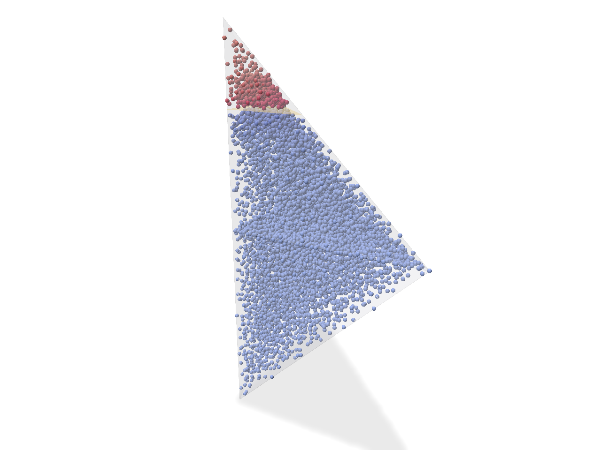 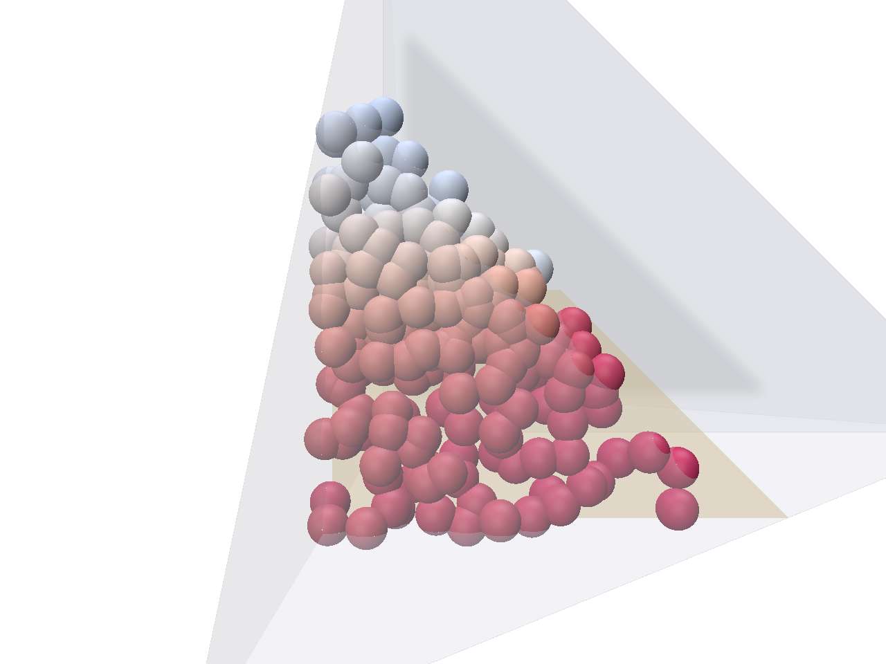 

**decomposed H (g = 1)**, colour range [-1, 1].

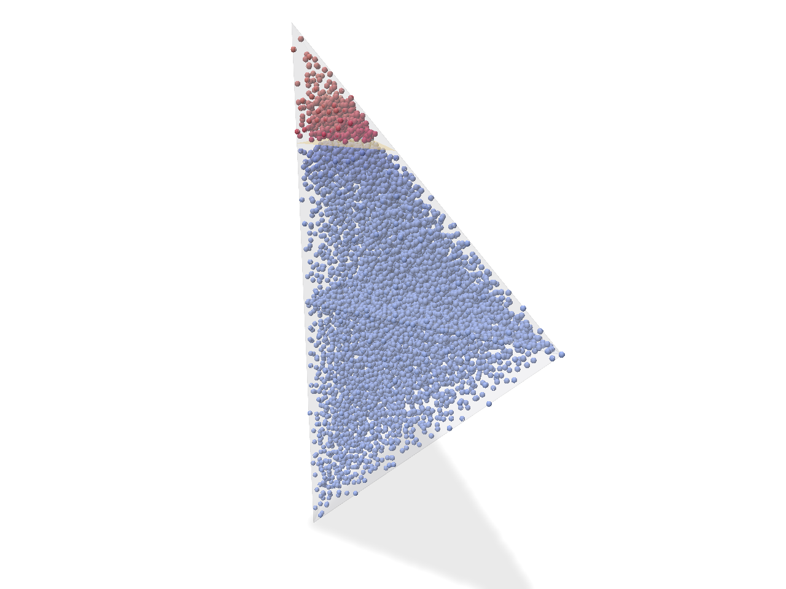  

**decomposed - reference (g = 1)**, colour range [-0.0251, 0.0251]; over A u B, / 2 g_max: H RMS 4.31e-03, max 2.51e-02.

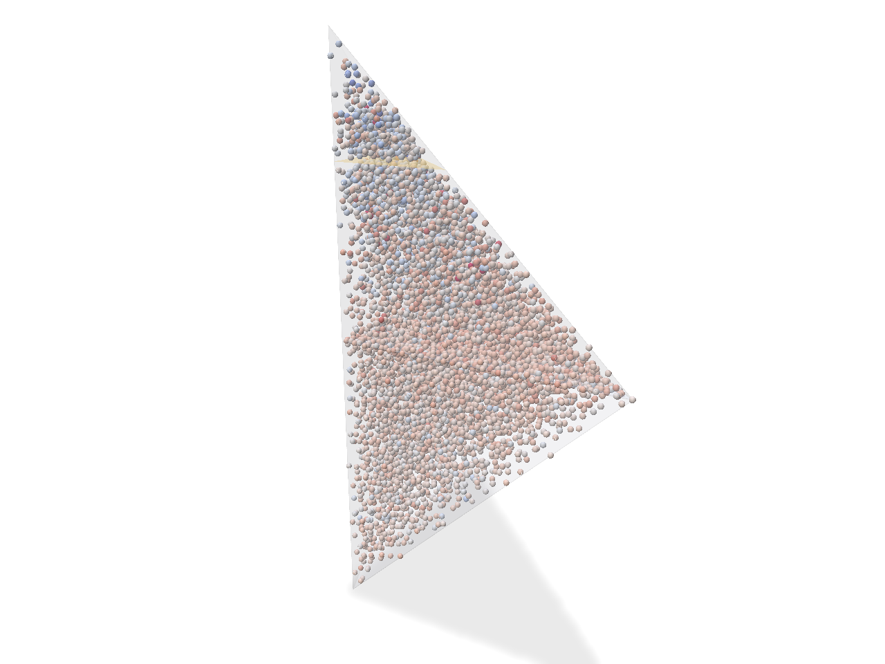 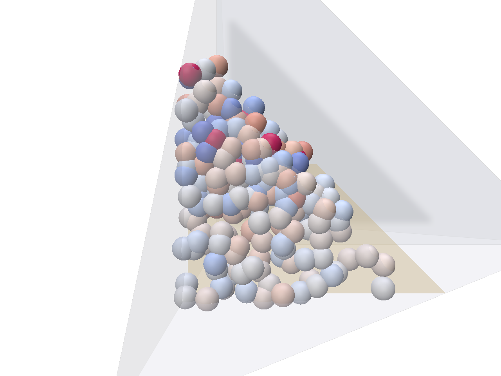 

<!-- END view_check2_config0 -->

<!-- BEGIN view_check3_config1 -->
## Polyscope view: check 3, y_f = 0.30: crack x = 0.30 (+g for x > 0.3), front y = 0.30, crack y < front

Written by `partial_cut --gate coupling --view --check 3 --config 1 --screenshot screenshots/gate_check3_yf0.30.png` on 2026-11-01 23:59:14. Values at the sample points of the check's main runs: the reference loaded from gate_cache/, the decomposed field from the check's recipe runs with the check's own seeds, so these are the fields behind the tables above (nothing re-solved). Left: the union A u B (a transparent tet mesh) with U's crack (orange), the sample points of A and B and the F points (on F the decomposed field is its glued trace), seen from the +x, -y, +z side. Right: a slice through the crack plane, the sample points within 0.05 of it on its +g side, seen face-on from that side (the eps-tube around the crack holds no points). Colour map coolwarm (blue negative, red positive); H on [-1, 1], a difference on a symmetric range at its 99th percentile of abs(value). Colour ranges are in units of H; the errors quoted with them are divided by 2 g_max = 2, as in the tables. Without --screenshot the same command opens the GUI with every field (both g modes; check 3 at both levels).

**reference H (g = 1)**, colour range [-1, 1].

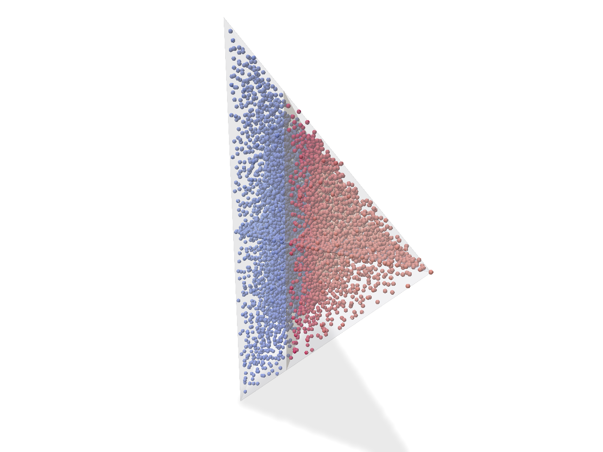 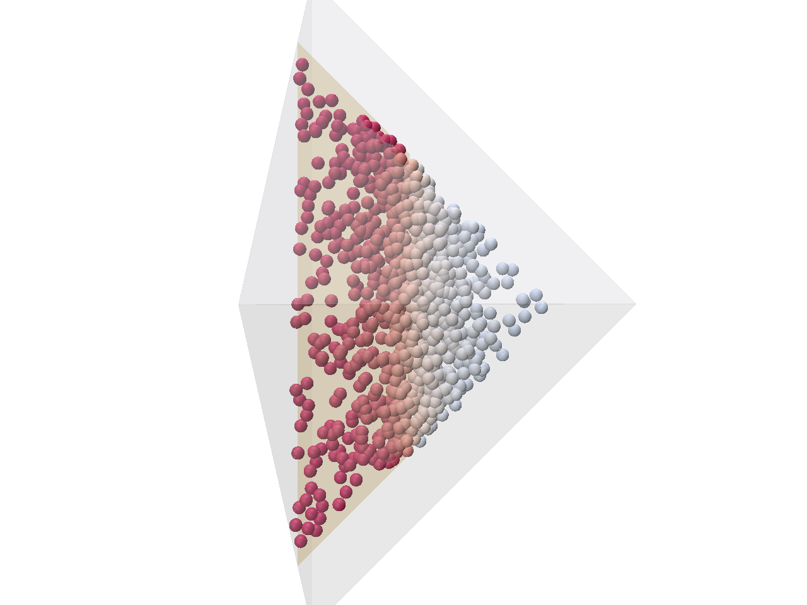 

**decomposed H, Level A (g = 1)**, colour range [-1, 1].

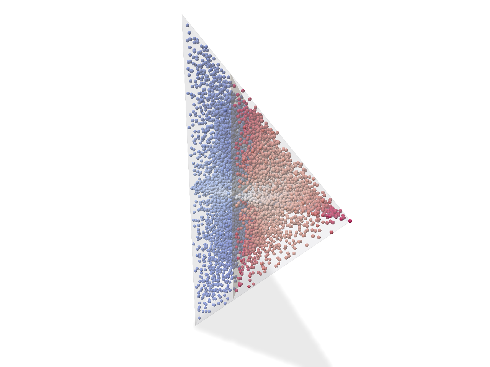 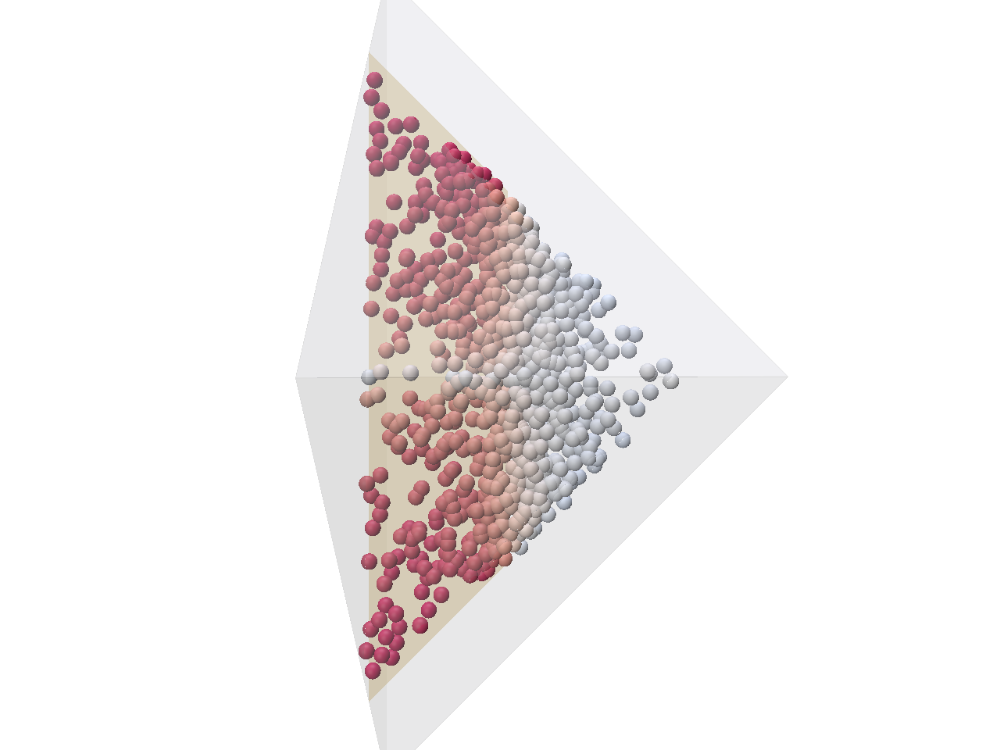 

**decomposed - reference, Level A (g = 1)**, colour range [-0.528, 0.528]; over A u B, / 2 g_max: H RMS 6.93e-02, max 5.01e-01.

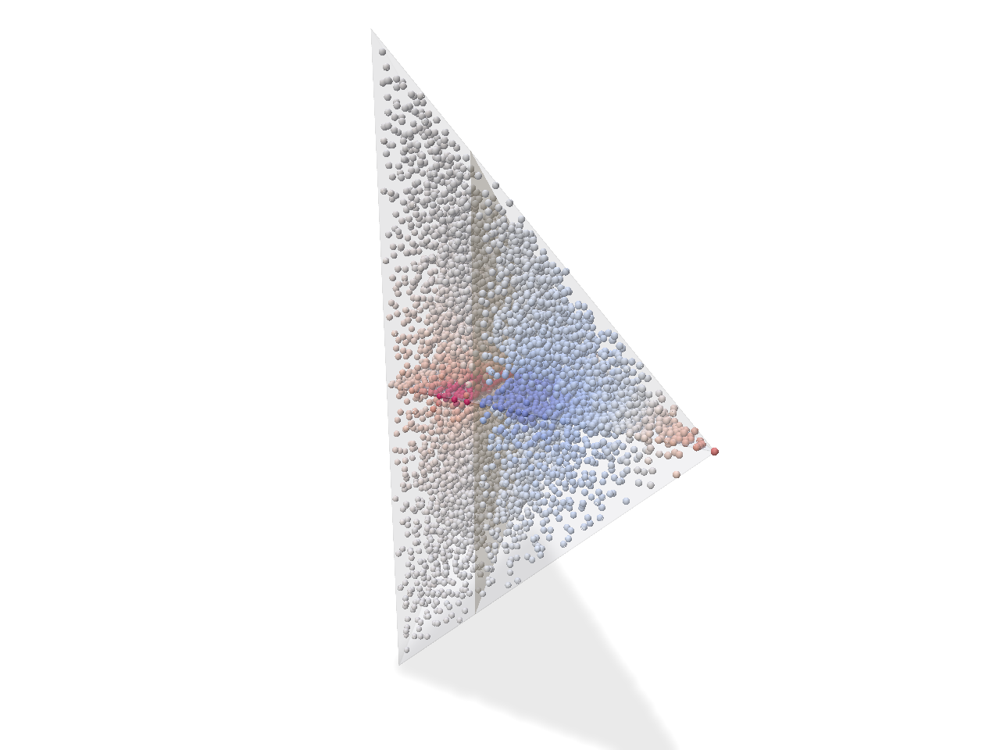 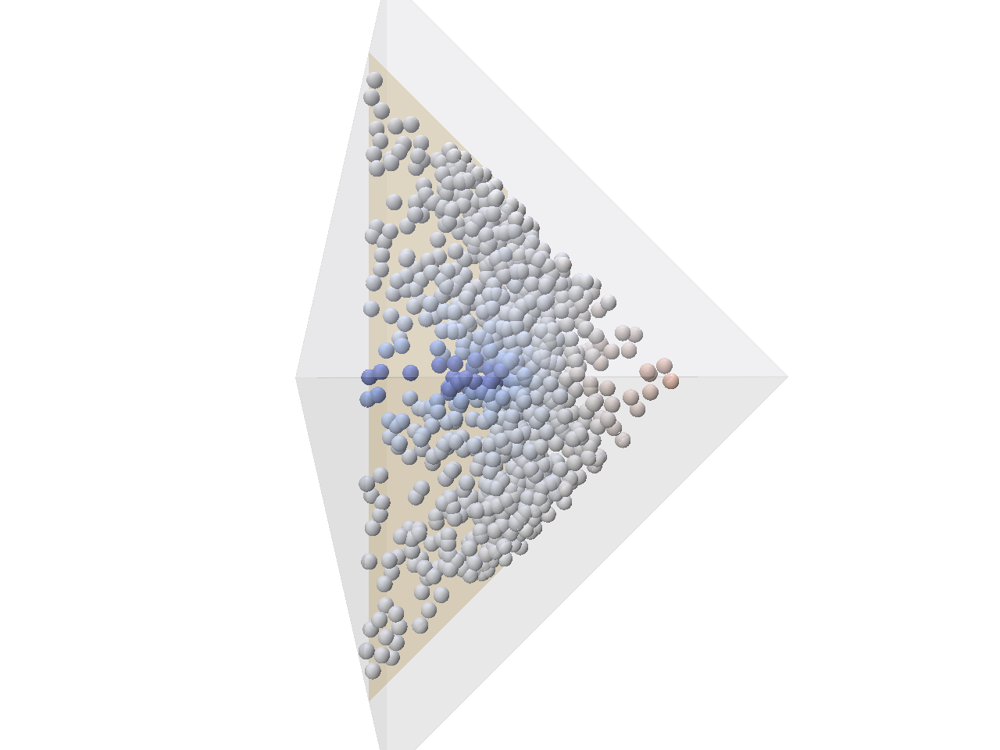 

**decomposed H, Level B (g = 1)**, colour range [-1, 1].

  

**decomposed - reference, Level B (g = 1)**, colour range [-0.258, 0.258]; over A u B, / 2 g_max: H RMS 4.08e-02, max 2.06e-01.

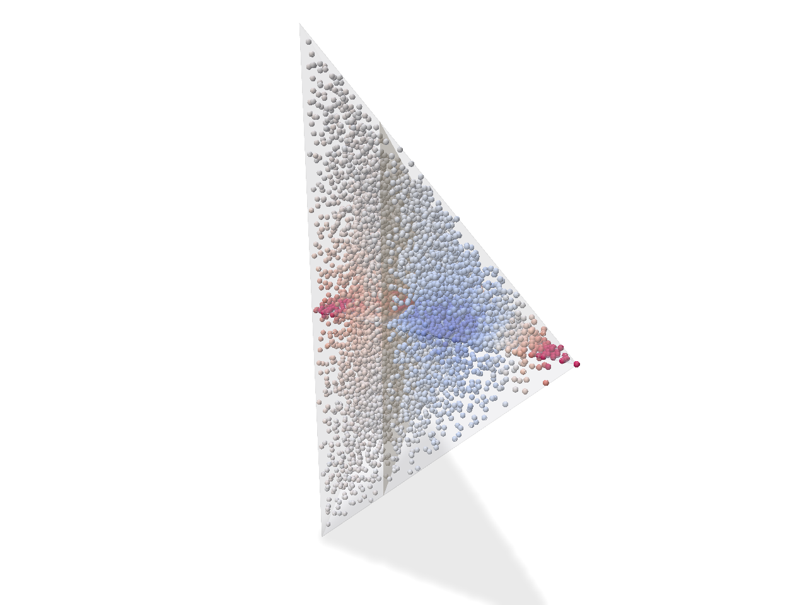 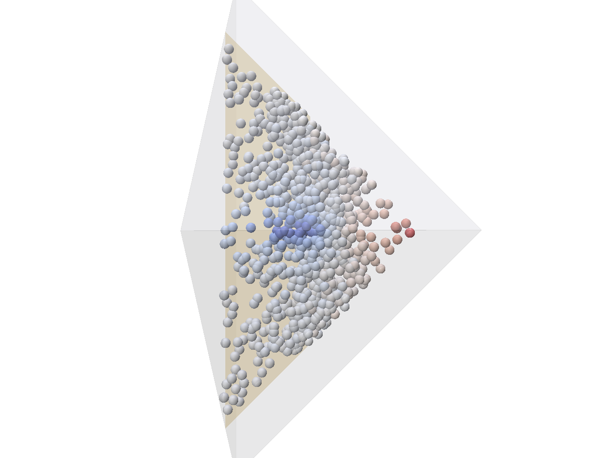 

<!-- END view_check3_config1 -->

<!-- BEGIN quadrature -->
## Appendix A: quadrature point sets (sanity tests, checks 0 and 1)

Stratified rule on Bey-refined leaves (exact leaf volumes), Halton points uniform in each leaf; weights V_leaf/m_leaf; points within eps of the crack dropped. Checks 2 and 3 list their own point sets.

| point set | kept points | dropped (eps) | max rel err, all points vs exact over T | max rel err, kept vs T minus tube | tube volume |
|---|---|---|---|---|---|
| A, no crack (sanity, check 0) | 4096 | 0 | 1.28e-03 | (no tube) | - |
| A, crack x = 0.3, y_f = 0.30 (check 1) | 4011 | 179 | 2.69e-03 | 3.93e-03 | 0.004787 |

F point set: 1024 points on 64 equal sub-triangles (area 0.5).

_Written by the run of 2026-11-02 00:28:02 (`partial_cut --gate coupling`)._
<!-- END quadrature -->

<!-- BEGIN geometry -->
## Appendix B: geometry setup

Printed by the run before the first solve: the vertices, the frames of A and B, U, F, the crack polygons per tet and for the union, and the per-face flags of every run. Appendices C and D add each configuration's own printout.

```
=== Coupling gate: geometry setup (physical coordinates X) ===
global vertices: v0 = (0, 0, 0), v1 = (1, 0, 0), v2 = (0, 1, 0), v3 = (0, 0, 1) (A's apex), v4 = (0, 0, -1) (B's apex)
tet A: local vertices 0..3 = global v0 v1 v2 v3 = (0, 0, 0) (1, 0, 0) (0, 1, 0) (0, 0, 1); X = X0 + J xi,
   J = [[1,0,0],[0,1,0],[0,0,1]], det J = +1, J^T J = I: yes (distances, eps and g are the same in xi); solved on the reference tet in xi
   face f0 (opposite local vertex 0): (1,1,1).X = 1, corners v1 v2 v3
   face f1 (opposite local vertex 1): (-1,0,0).X = 0, corners v0 v2 v3
   face f2 (opposite local vertex 2): (0,-1,0).X = 0, corners v0 v1 v3
   face f3 (opposite local vertex 3): (0,0,-1).X = 0, corners v0 v1 v2  <- F (xi_z = 0 in this frame)
tet B: local vertices 0..3 = global v0 v2 v1 v4 = (0, 0, 0) (0, 1, 0) (1, 0, 0) (0, 0, -1); X = X0 + J xi,
   J = [[0,1,0],[1,0,0],[0,0,-1]], det J = +1, J^T J = I: yes (distances, eps and g are the same in xi); solved on the reference tet in xi
   face f0 (opposite local vertex 0): (1,1,-1).X = 1, corners v2 v1 v4
   face f1 (opposite local vertex 1): (0,-1,0).X = 0, corners v0 v1 v4
   face f2 (opposite local vertex 2): (-1,0,0).X = 0, corners v0 v2 v4
   face f3 (opposite local vertex 3): (0,0,1).X = 0, corners v0 v2 v1  <- F (xi_z = 0 in this frame)
union U = A u B = conv{v1, v2, v3, v4} (a tetrahedron: x >= 0, y >= 0, x + y + |z| <= 1): faces (-1,0,0).X = 0 (0,-1,0).X = 0 (1,1,-1).X = 1 (1,1,1).X = 1;
   longest edge L_U = 2.0000 (v3-v4); the crack's g uses L = sqrt(2) = 1.414214 in A, B and U
shared face F = triangle z = 0 with corners v0 v1 v2; DOFs on F are indexed by global vertex (v1 and v2 swap
   between A's local frame (local 1 = v1, 2 = v2) and B's (local 1 = v2, 2 = v1))
hat check: hat_g (g = 0, 1, 2) at the corners v0, v1, v2 of F, in A's and B's frame, evaluated in X, at
   X = X0 + J xi, and as the tet's barycentric lambda_local(g): 0 of 18 (tet, hat, corner) cases wrong; every
   corner lies on xi_z = 0 in both frames -> OK
   B's local hats in xi: lambda_1(xi) = xi_x = y = hat_2, lambda_2(xi) = xi_y = x = hat_1 (the v1/v2 swap)

crack configurations (front direction +y, crack region y < y_f; t per frame from the physical extent):
  crack x = 0.30 (+g for x > 0.3), front y = 0.30, crack y < front  [check 1 (A alone) and check 3]
    A: t = 0.428571; xi plane n = (1.0000, 0.0000, 0.0000), d = 0.300000, front direction u = (0.0000, 1.0000, 0.0000), front s = 0.300000, L = 1.414214
       polygon (xi): (0.300, 0.000, 0.000) (0.300, 0.300, 0.000) (0.300, 0.300, 0.400) (0.300, 0.000, 0.700)
       polygon (X):  (0.300, 0.000, 0.000) (0.300, 0.300, 0.000) (0.300, 0.300, 0.400) (0.300, 0.000, 0.700)
       front vertices in X at y = y_f: 2 vertices, max |y - y_f| = 0.0e+00 -> OK
    B: t = 0.428571; xi plane n = (0.0000, 1.0000, 0.0000), d = 0.300000, front direction u = (1.0000, 0.0000, 0.0000), front s = 0.300000, L = 1.414214
       polygon (xi): (0.000, 0.300, 0.700) (0.300, 0.300, 0.400) (0.300, 0.300, 0.000) (0.000, 0.300, 0.000)
       polygon (X):  (0.300, 0.000, -0.700) (0.300, 0.300, -0.400) (0.300, 0.300, 0.000) (0.300, 0.000, 0.000)
       front vertices in X at y = y_f: 2 vertices, max |y - y_f| = 0.0e+00 -> OK
    U (physical, the reference): t = 0.428571, L overridden 2.0000 -> 1.414214; polygon (X): (0.300, 0.000, -0.700) (0.300, 0.300, -0.400) (0.300, 0.300, 0.400) (0.300, 0.000, 0.700)
       front vertices at y = y_f: 2, max |y - y_f| = 0.0e+00 -> OK
    +g side at 4000 random points (the frame's xi cut and U's cut, each against n.X - d in X): 0 disagree; |g_frame(xi) - g_U(X)| <= 0.0e+00
    over both g types (L = sqrt(2) everywhere) -> OK
  crack z = 0.60 (+g above), front y = 0.200, crack y < front  [check 2]
    A: t = 0.500000; xi plane n = (0.0000, 0.0000, 1.0000), d = 0.600000, front direction u = (0.0000, 1.0000, 0.0000), front s = 0.200000, L = 1.414214
       polygon (xi): (0.400, 0.000, 0.600) (0.200, 0.200, 0.600) (0.000, 0.200, 0.600) (0.000, 0.000, 0.600)
       polygon (X):  (0.400, 0.000, 0.600) (0.200, 0.200, 0.600) (0.000, 0.200, 0.600) (0.000, 0.000, 0.600)
       front vertices in X at y = y_f: 2 vertices, max |y - y_f| = 0.0e+00 -> OK
    B: no crack in this tet (the plane misses it or there is none)
    U (physical, the reference): t = 0.500000, L overridden 2.0000 -> 1.414214; polygon (X): (0.400, 0.000, 0.600) (0.200, 0.200, 0.600) (0.000, 0.200, 0.600) (0.000, 0.000, 0.600)
       front vertices at y = y_f: 2, max |y - y_f| = 0.0e+00 -> OK
    +g side at 2000 random points (the frame's xi cut and U's cut, each against n.X - d in X): 0 disagree; |g_frame(xi) - g_U(X)| <= 0.0e+00
    over both g types (L = sqrt(2) everywhere) -> OK
  crack z = 0.35 (+g above), front y = 0.325, crack y < front  [check 2]
    A: t = 0.500000; xi plane n = (0.0000, 0.0000, 1.0000), d = 0.350000, front direction u = (0.0000, 1.0000, 0.0000), front s = 0.325000, L = 1.414214
       polygon (xi): (0.650, 0.000, 0.350) (0.325, 0.325, 0.350) (0.000, 0.325, 0.350) (0.000, 0.000, 0.350)
       polygon (X):  (0.650, 0.000, 0.350) (0.325, 0.325, 0.350) (0.000, 0.325, 0.350) (0.000, 0.000, 0.350)
       front vertices in X at y = y_f: 2 vertices, max |y - y_f| = 0.0e+00 -> OK
    B: no crack in this tet (the plane misses it or there is none)
    U (physical, the reference): t = 0.500000, L overridden 2.0000 -> 1.414214; polygon (X): (0.650, 0.000, 0.350) (0.325, 0.325, 0.350) (0.000, 0.325, 0.350) (0.000, 0.000, 0.350)
       front vertices at y = y_f: 2, max |y - y_f| = 0.0e+00 -> OK
    +g side at 2000 random points (the frame's xi cut and U's cut, each against n.X - d in X): 0 disagree; |g_frame(xi) - g_U(X)| <= 0.0e+00
    over both g types (L = sqrt(2) everywhere) -> OK
  crack x = 0.30 (+g for x > 0.3), front y = 0.15, crack y < front  [check 3]
    A: t = 0.214286; xi plane n = (1.0000, 0.0000, 0.0000), d = 0.300000, front direction u = (0.0000, 1.0000, 0.0000), front s = 0.150000, L = 1.414214
       polygon (xi): (0.300, 0.000, 0.000) (0.300, 0.150, 0.000) (0.300, 0.150, 0.550) (0.300, 0.000, 0.700)
       polygon (X):  (0.300, 0.000, 0.000) (0.300, 0.150, 0.000) (0.300, 0.150, 0.550) (0.300, 0.000, 0.700)
       front vertices in X at y = y_f: 2 vertices, max |y - y_f| = 2.8e-17 -> OK
    B: t = 0.214286; xi plane n = (0.0000, 1.0000, 0.0000), d = 0.300000, front direction u = (1.0000, 0.0000, 0.0000), front s = 0.150000, L = 1.414214
       polygon (xi): (0.000, 0.300, 0.700) (0.150, 0.300, 0.550) (0.150, 0.300, 0.000) (0.000, 0.300, 0.000)
       polygon (X):  (0.300, 0.000, -0.700) (0.300, 0.150, -0.550) (0.300, 0.150, 0.000) (0.300, 0.000, 0.000)
       front vertices in X at y = y_f: 2 vertices, max |y - y_f| = 2.8e-17 -> OK
    U (physical, the reference): t = 0.214286, L overridden 2.0000 -> 1.414214; polygon (X): (0.300, 0.000, -0.700) (0.300, 0.150, -0.550) (0.300, 0.150, 0.550) (0.300, 0.000, 0.700)
       front vertices at y = y_f: 2, max |y - y_f| = 2.8e-17 -> OK
    +g side at 4000 random points (the frame's xi cut and U's cut, each against n.X - d in X): 0 disagree; |g_frame(xi) - g_U(X)| <= 0.0e+00
    over both g types (L = sqrt(2) everywhere) -> OK
  crack x = 0.30 (+g for x > 0.3), front y = 0.45, crack y < front  [check 3]
    A: t = 0.642857; xi plane n = (1.0000, 0.0000, 0.0000), d = 0.300000, front direction u = (0.0000, 1.0000, 0.0000), front s = 0.450000, L = 1.414214
       polygon (xi): (0.300, 0.000, 0.000) (0.300, 0.450, 0.000) (0.300, 0.450, 0.250) (0.300, 0.000, 0.700)
       polygon (X):  (0.300, 0.000, 0.000) (0.300, 0.450, 0.000) (0.300, 0.450, 0.250) (0.300, 0.000, 0.700)
       front vertices in X at y = y_f: 2 vertices, max |y - y_f| = 0.0e+00 -> OK
    B: t = 0.642857; xi plane n = (0.0000, 1.0000, 0.0000), d = 0.300000, front direction u = (1.0000, 0.0000, 0.0000), front s = 0.450000, L = 1.414214
       polygon (xi): (0.000, 0.300, 0.700) (0.450, 0.300, 0.250) (0.450, 0.300, 0.000) (0.000, 0.300, 0.000)
       polygon (X):  (0.300, 0.000, -0.700) (0.300, 0.450, -0.250) (0.300, 0.450, 0.000) (0.300, 0.000, 0.000)
       front vertices in X at y = y_f: 2 vertices, max |y - y_f| = 0.0e+00 -> OK
    U (physical, the reference): t = 0.642857, L overridden 2.0000 -> 1.414214; polygon (X): (0.300, 0.000, -0.700) (0.300, 0.450, -0.250) (0.300, 0.450, 0.250) (0.300, 0.000, 0.700)
       front vertices at y = y_f: 2, max |y - y_f| = 0.0e+00 -> OK
    +g side at 4000 random points (the frame's xi cut and U's cut, each against n.X - d in X): 0 disagree; |g_frame(xi) - g_U(X)| <= 0.0e+00
    over both g types (L = sqrt(2) everywhere) -> OK

runs and per-face flags (D = Dirichlet with the data named, N = Neumann):
  sanity (a) A, no crack: f0 (1,1,1).X = 1 [v1 v2 v3]: Neumann; f1 (-1,0,0).X = 0 [v0 v2 v3]: Neumann; f2 (0,-1,0).X = 0 [v0 v1 v3]: Neumann; f3 (0,0,-1).X = 0 [v0 v1 v2] = F: DIRICHLET H = 1
  sanity (b) A, no crack: f0 (1,1,1).X = 1 [v1 v2 v3]: Neumann; f1 (-1,0,0).X = 0 [v0 v2 v3]: Neumann; f2 (0,-1,0).X = 0 [v0 v1 v3]: Neumann; f3 (0,0,-1).X = 0 [v0 v1 v2] = F: DIRICHLET H = x + y
  sanity (c) A, no crack, exact solution H = x: f0 (1,1,1).X = 1 [v1 v2 v3]: DIRICHLET H = x; f1 (-1,0,0).X = 0 [v0 v2 v3]: DIRICHLET H = x; f2 (0,-1,0).X = 0 [v0 v1 v3]: Neumann; f3 (0,0,-1).X = 0 [v0 v1 v2] = F: Neumann
  check 0 A, no crack (t = 0): f0 (1,1,1).X = 1 [v1 v2 v3]: DIRICHLET (data per field below); f1 (-1,0,0).X = 0 [v0 v2 v3]: DIRICHLET (data per field below); f2 (0,-1,0).X = 0 [v0 v1 v3]: DIRICHLET (data per field below); f3 (0,0,-1).X = 0 [v0 v1 v2] = F: DIRICHLET (data per field below)
     H0: faces 0; P_k (k = v0..v3): faces lambda_k (the hat of vertex k on every face)
  check 1 A, crack x = 0.30, y_f = 0.30: f0 (1,1,1).X = 1 [v1 v2 v3]: Neumann; f1 (-1,0,0).X = 0 [v0 v2 v3]: Neumann; f2 (0,-1,0).X = 0 [v0 v1 v3]: Neumann; f3 (0,0,-1).X = 0 [v0 v1 v2] = F: DIRICHLET (data per field)
     H0: crack +-g, F 0; P_k (k = v0, v1, v2): crack 0, F hat_k; direct: crack +-g, F sum_k c_k hat_k
  check 2 (z_c = 0.60 and 0.35) A: f0 (1,1,1).X = 1 [v1 v2 v3]: Neumann; f1 (-1,0,0).X = 0 [v0 v2 v3]: Neumann; f2 (0,-1,0).X = 0 [v0 v1 v3]: Neumann; f3 (0,0,-1).X = 0 [v0 v1 v2] = F: DIRICHLET (data per field) (Level A: H0 crack +-g, F 0; P_k crack 0, F hat_k); B: uncut, no solve (linear,
     K only); reference U: f0 (-1,0,0).X = 0 [v2 v3 v4]: Neumann; f1 (0,-1,0).X = 0 [v1 v3 v4]: Neumann; f2 (1,1,-1).X = 1 [v1 v2 v4]: Neumann; f3 (1,1,1).X = 1 [v1 v2 v3]: Neumann
  check 3 (y_f = 0.15, 0.30 and 0.45) A: f0 (1,1,1).X = 1 [v1 v2 v3]: Neumann; f1 (-1,0,0).X = 0 [v0 v2 v3]: Neumann; f2 (0,-1,0).X = 0 [v0 v1 v3]: Neumann; f3 (0,0,-1).X = 0 [v0 v1 v2] = F: DIRICHLET (data per field);
     B (its own xi frame, the crack pulled back through J_B^-1): f0 (1,1,-1).X = 1 [v2 v1 v4]: Neumann; f1 (0,-1,0).X = 0 [v0 v1 v4]: Neumann; f2 (-1,0,0).X = 0 [v0 v2 v4]: Neumann; f3 (0,0,1).X = 0 [v0 v2 v1] = F: DIRICHLET (data per field);
     Level A, both tets: H0 crack +-g, F 0; P_k (k = v0, v1, v2) crack 0, F hat_k. Level B, both tets: H0 crack +-g, F J (the
     same physical J in A and B); the P_k of Level A reused. Reference U: f0 (-1,0,0).X = 0 [v2 v3 v4]: Neumann; f1 (0,-1,0).X = 0 [v1 v3 v4]: Neumann; f2 (1,1,-1).X = 1 [v1 v2 v4]: Neumann; f3 (1,1,1).X = 1 [v1 v2 v3]: Neumann
geometry assertions: all OK
```

_Written by the run of 2026-11-02 00:28:02 (`partial_cut --gate coupling`)._
<!-- END geometry -->

<!-- BEGIN geometry2 -->
## Appendix C: geometry of check 2, per configuration

Printed by the run before each configuration's first solve.

```

--- check 2, z_c = 0.60 (y_f = 0.200) ---
geometry of this configuration (physical coordinates X):
  A: vertices v0 v1 v2 v3 = (0, 0, 0) (1, 0, 0) (0, 1, 0) (0, 0, 1)
  B: vertices v0 v2 v1 v4 = (0, 0, 0) (0, 1, 0) (1, 0, 0) (0, 0, -1)
  U: vertices v1 v2 v3 v4 = (1, 0, 0) (0, 1, 0) (0, 0, 1) (0, 0, -1)
  crack z = 0.60 (+g above), front y = 0.200, crack y < front
    A: t = 0.500000; xi plane n = (0.0000, 0.0000, 1.0000), d = 0.600000, front direction u = (0.0000, 1.0000, 0.0000), front s = 0.200000, L = 1.414214
       polygon (xi): (0.400, 0.000, 0.600) (0.200, 0.200, 0.600) (0.000, 0.200, 0.600) (0.000, 0.000, 0.600)
       polygon (X):  (0.400, 0.000, 0.600) (0.200, 0.200, 0.600) (0.000, 0.200, 0.600) (0.000, 0.000, 0.600)
       front vertices in X at y = y_f: 2 vertices, max |y - y_f| = 0.0e+00 -> OK
    B: no crack in this tet (the plane misses it or there is none)
    U (physical, the reference): t = 0.500000, L overridden 2.0000 -> 1.414214; polygon (X): (0.400, 0.000, 0.600) (0.200, 0.200, 0.600) (0.000, 0.200, 0.600) (0.000, 0.000, 0.600)
       front vertices at y = y_f: 2, max |y - y_f| = 0.0e+00 -> OK
  strip cuts of the walks (the tets' in xi, U's in X): front line at y = y_f in X: max |y - y_f| = U 0.0e+00, A 0.0e+00; L = sqrt(2):
  yes; at 1959 random points of U (in the frame of the tet that holds them): 0 disagree on the +g side, max |g_tet(xi) -
  g_U(X)| = 0.0e+00 over both g types -> OK
  runs and per-face flags:
    reference U (own loop; Zombie cross-check): f0 (-1,0,0).X = 0 [v2 v3 v4]: Neumann; f1 (0,-1,0).X = 0 [v1 v3 v4]: Neumann; f2 (1,1,-1).X = 1 [v1 v2 v4]: Neumann; f3 (1,1,1).X = 1 [v1 v2 v3]: Neumann; crack +-g (both g types)
    A recipe (H0 g1, H0 g2: crack +-g, F 0; P_v0, P_v1, P_v2: crack 0, F hat_k): f0 (1,1,1).X = 1 [v1 v2 v3]: Neumann; f1 (-1,0,0).X = 0 [v0 v2 v3]: Neumann; f2 (0,-1,0).X = 0 [v0 v1 v3]: Neumann; f3 (0,0,-1).X = 0 [v0 v1 v2] = F: DIRICHLET (data per field)
    B: no solve (uncut): the linear interpolant of its corner values (local v0 v2 v1 v4), energy (1/2) e^T K_B e

--- check 2, z_c = 0.35 (y_f = 0.325) ---
geometry of this configuration (physical coordinates X):
  A: vertices v0 v1 v2 v3 = (0, 0, 0) (1, 0, 0) (0, 1, 0) (0, 0, 1)
  B: vertices v0 v2 v1 v4 = (0, 0, 0) (0, 1, 0) (1, 0, 0) (0, 0, -1)
  U: vertices v1 v2 v3 v4 = (1, 0, 0) (0, 1, 0) (0, 0, 1) (0, 0, -1)
  crack z = 0.35 (+g above), front y = 0.325, crack y < front
    A: t = 0.500000; xi plane n = (0.0000, 0.0000, 1.0000), d = 0.350000, front direction u = (0.0000, 1.0000, 0.0000), front s = 0.325000, L = 1.414214
       polygon (xi): (0.650, 0.000, 0.350) (0.325, 0.325, 0.350) (0.000, 0.325, 0.350) (0.000, 0.000, 0.350)
       polygon (X):  (0.650, 0.000, 0.350) (0.325, 0.325, 0.350) (0.000, 0.325, 0.350) (0.000, 0.000, 0.350)
       front vertices in X at y = y_f: 2 vertices, max |y - y_f| = 0.0e+00 -> OK
    B: no crack in this tet (the plane misses it or there is none)
    U (physical, the reference): t = 0.500000, L overridden 2.0000 -> 1.414214; polygon (X): (0.650, 0.000, 0.350) (0.325, 0.325, 0.350) (0.000, 0.325, 0.350) (0.000, 0.000, 0.350)
       front vertices at y = y_f: 2, max |y - y_f| = 0.0e+00 -> OK
  strip cuts of the walks (the tets' in xi, U's in X): front line at y = y_f in X: max |y - y_f| = U 0.0e+00, A 0.0e+00; L = sqrt(2):
  yes; at 2018 random points of U (in the frame of the tet that holds them): 0 disagree on the +g side, max |g_tet(xi) -
  g_U(X)| = 0.0e+00 over both g types -> OK
  runs and per-face flags:
    reference U (own loop; Zombie cross-check): f0 (-1,0,0).X = 0 [v2 v3 v4]: Neumann; f1 (0,-1,0).X = 0 [v1 v3 v4]: Neumann; f2 (1,1,-1).X = 1 [v1 v2 v4]: Neumann; f3 (1,1,1).X = 1 [v1 v2 v3]: Neumann; crack +-g (both g types)
    A recipe (H0 g1, H0 g2: crack +-g, F 0; P_v0, P_v1, P_v2: crack 0, F hat_k): f0 (1,1,1).X = 1 [v1 v2 v3]: Neumann; f1 (-1,0,0).X = 0 [v0 v2 v3]: Neumann; f2 (0,-1,0).X = 0 [v0 v1 v3]: Neumann; f3 (0,0,-1).X = 0 [v0 v1 v2] = F: DIRICHLET (data per field)
    B: no solve (uncut): the linear interpolant of its corner values (local v0 v2 v1 v4), energy (1/2) e^T K_B e
```

_Written by the run of 2026-11-02 00:28:02 (`partial_cut --gate coupling`)._
<!-- END geometry2 -->

<!-- BEGIN geometry3 -->
## Appendix D: geometry of check 3, per configuration

Printed by the run before each configuration's first solve, with Level B's face function J.

```

--- check 3, y_f = 0.15 ---
geometry of this configuration (physical coordinates X):
  A: vertices v0 v1 v2 v3 = (0, 0, 0) (1, 0, 0) (0, 1, 0) (0, 0, 1)
  B: vertices v0 v2 v1 v4 = (0, 0, 0) (0, 1, 0) (1, 0, 0) (0, 0, -1)
  U: vertices v1 v2 v3 v4 = (1, 0, 0) (0, 1, 0) (0, 0, 1) (0, 0, -1)
  crack x = 0.30 (+g for x > 0.3), front y = 0.15, crack y < front
    A: t = 0.214286; xi plane n = (1.0000, 0.0000, 0.0000), d = 0.300000, front direction u = (0.0000, 1.0000, 0.0000), front s = 0.150000, L = 1.414214
       polygon (xi): (0.300, 0.000, 0.000) (0.300, 0.150, 0.000) (0.300, 0.150, 0.550) (0.300, 0.000, 0.700)
       polygon (X):  (0.300, 0.000, 0.000) (0.300, 0.150, 0.000) (0.300, 0.150, 0.550) (0.300, 0.000, 0.700)
       front vertices in X at y = y_f: 2 vertices, max |y - y_f| = 2.8e-17 -> OK
    B: t = 0.214286; xi plane n = (0.0000, 1.0000, 0.0000), d = 0.300000, front direction u = (1.0000, 0.0000, 0.0000), front s = 0.150000, L = 1.414214
       polygon (xi): (0.000, 0.300, 0.700) (0.150, 0.300, 0.550) (0.150, 0.300, 0.000) (0.000, 0.300, 0.000)
       polygon (X):  (0.300, 0.000, -0.700) (0.300, 0.150, -0.550) (0.300, 0.150, 0.000) (0.300, 0.000, 0.000)
       front vertices in X at y = y_f: 2 vertices, max |y - y_f| = 2.8e-17 -> OK
    U (physical, the reference): t = 0.214286, L overridden 2.0000 -> 1.414214; polygon (X): (0.300, 0.000, -0.700) (0.300, 0.150, -0.550) (0.300, 0.150, 0.550) (0.300, 0.000, 0.700)
       front vertices at y = y_f: 2, max |y - y_f| = 2.8e-17 -> OK
  union of the tets' crack polygons = U's polygon: A's and B's vertices outside U's polygon: 0; on the wrong side
    of F (A: z >= 0, B: z <= 0): 0; area A 0.093750 + B 0.093750 - U 0.187500 = 0.0e+00; shared segment on F: (0.300, 0.000, 0.000) - (0.300, 0.150, 0.000) (A and B agree
    to 2.8e-17); 20000 random points of the plane (box around U's polygon): 9913 in U's polygon, 0 where membership in U's
    differs from membership in A's or B's -> OK
  mirror symmetry z -> -z: B's xi crack (n, d, u, s and the polygon) is A's with xi_x and xi_y swapped, max
    deviation 2.8e-17 -> OK (so S_B = S_A and b_B = b_A up to noise, tested after the solves)
  strip cuts of the walks (the tets' in xi, U's in X): front line at y = y_f in X: max |y - y_f| = U 0.0e+00, A 0.0e+00, B 0.0e+00; L = sqrt(2):
  yes; at 4000 random points of U (in the frame of the tet that holds them): 0 disagree on the +g side, max |g_tet(xi) -
  g_U(X)| = 0.0e+00 over both g types -> OK
  runs and per-face flags:
    reference U (own loop; Zombie cross-check): f0 (-1,0,0).X = 0 [v2 v3 v4]: Neumann; f1 (0,-1,0).X = 0 [v1 v3 v4]: Neumann; f2 (1,1,-1).X = 1 [v1 v2 v4]: Neumann; f3 (1,1,1).X = 1 [v1 v2 v3]: Neumann; crack +-g (both g types)
    A recipe (Level A; H0 g1, H0 g2: crack +-g, F 0; P_v0, P_v1, P_v2: crack 0, F hat_k): f0 (1,1,1).X = 1 [v1 v2 v3]: Neumann; f1 (-1,0,0).X = 0 [v0 v2 v3]: Neumann; f2 (0,-1,0).X = 0 [v0 v1 v3]: Neumann; f3 (0,0,-1).X = 0 [v0 v1 v2] = F: DIRICHLET (data per field)
    B recipe (the same fields in B's xi frame; the hats and J evaluated at X = J_B xi): f0 (1,1,-1).X = 1 [v2 v1 v4]: Neumann; f1 (0,-1,0).X = 0 [v0 v1 v4]: Neumann; f2 (-1,0,0).X = 0 [v0 v2 v4]: Neumann; f3 (0,0,1).X = 0 [v0 v2 v1] = F: DIRICHLET (data per field)
    A Level-B H0 (H0B g1, H0B g2: crack +-g, F J_g; plain first ball at F): f0 (1,1,1).X = 1 [v1 v2 v3]: Neumann; f1 (-1,0,0).X = 0 [v0 v2 v3]: Neumann; f2 (0,-1,0).X = 0 [v0 v1 v3]: Neumann; f3 (0,0,-1).X = 0 [v0 v1 v2] = F: DIRICHLET H = J_g
    B Level-B H0 (the same physical J_g): f0 (1,1,-1).X = 1 [v2 v1 v4]: Neumann; f1 (0,-1,0).X = 0 [v0 v1 v4]: Neumann; f2 (-1,0,0).X = 0 [v0 v2 v4]: Neumann; f3 (0,0,1).X = 0 [v0 v2 v1] = F: DIRICHLET H = J_g
    Level B's P_k: the A and B recipes' P_v0, P_v1, P_v2, reused (not re-solved)
  Level B face function on F (physical X): J = sigma g_face bump fade; sigma = +1 for x > 0.30, -1 below; g_face = the
  crack's g at (0.30, y, 0) (r = y_f - y); bump = max(0, 1 - |x - 0.30|/0.25); fade = sqrt(max(0, (y_f - y)/y_f)) for g = 1,
  1 for the ramp; J = 0 for y >= y_f. The same physical J in A and B: max |J(X0 + J_T xi(X)) - J(X)| over 2000 random
  points of F, both frames and both g types = 0.0e+00 -> OK. Samples at y = y_f/2: J(0.30 +- 0, .) = +0.7071 / -0.7071 (g = 1),
  +0.2303 / -0.2303 (ramp); J(0.425, .) = +0.3536 (g = 1), +0.1151 (ramp). Along the crack's edge on F (x = 0.30 +- 0, 0 <= y < y_f)
  max |J - (+-g)| = 0.900 for g = 1 (J = +-sqrt((y_f - y)/y_f) there, +-1 only at y = 0) and 5.6e-17 for the ramp (J = +-g)

--- check 3, y_f = 0.30 ---
geometry of this configuration (physical coordinates X):
  A: vertices v0 v1 v2 v3 = (0, 0, 0) (1, 0, 0) (0, 1, 0) (0, 0, 1)
  B: vertices v0 v2 v1 v4 = (0, 0, 0) (0, 1, 0) (1, 0, 0) (0, 0, -1)
  U: vertices v1 v2 v3 v4 = (1, 0, 0) (0, 1, 0) (0, 0, 1) (0, 0, -1)
  crack x = 0.30 (+g for x > 0.3), front y = 0.30, crack y < front
    A: t = 0.428571; xi plane n = (1.0000, 0.0000, 0.0000), d = 0.300000, front direction u = (0.0000, 1.0000, 0.0000), front s = 0.300000, L = 1.414214
       polygon (xi): (0.300, 0.000, 0.000) (0.300, 0.300, 0.000) (0.300, 0.300, 0.400) (0.300, 0.000, 0.700)
       polygon (X):  (0.300, 0.000, 0.000) (0.300, 0.300, 0.000) (0.300, 0.300, 0.400) (0.300, 0.000, 0.700)
       front vertices in X at y = y_f: 2 vertices, max |y - y_f| = 0.0e+00 -> OK
    B: t = 0.428571; xi plane n = (0.0000, 1.0000, 0.0000), d = 0.300000, front direction u = (1.0000, 0.0000, 0.0000), front s = 0.300000, L = 1.414214
       polygon (xi): (0.000, 0.300, 0.700) (0.300, 0.300, 0.400) (0.300, 0.300, 0.000) (0.000, 0.300, 0.000)
       polygon (X):  (0.300, 0.000, -0.700) (0.300, 0.300, -0.400) (0.300, 0.300, 0.000) (0.300, 0.000, 0.000)
       front vertices in X at y = y_f: 2 vertices, max |y - y_f| = 0.0e+00 -> OK
    U (physical, the reference): t = 0.428571, L overridden 2.0000 -> 1.414214; polygon (X): (0.300, 0.000, -0.700) (0.300, 0.300, -0.400) (0.300, 0.300, 0.400) (0.300, 0.000, 0.700)
       front vertices at y = y_f: 2, max |y - y_f| = 0.0e+00 -> OK
  union of the tets' crack polygons = U's polygon: A's and B's vertices outside U's polygon: 0; on the wrong side
    of F (A: z >= 0, B: z <= 0): 0; area A 0.165000 + B 0.165000 - U 0.330000 = 0.0e+00; shared segment on F: (0.300, 0.000, 0.000) - (0.300, 0.300, 0.000) (A and B agree
    to 0.0e+00); 20000 random points of the plane (box around U's polygon): 11024 in U's polygon, 0 where membership in U's
    differs from membership in A's or B's -> OK
  mirror symmetry z -> -z: B's xi crack (n, d, u, s and the polygon) is A's with xi_x and xi_y swapped, max
    deviation 0.0e+00 -> OK (so S_B = S_A and b_B = b_A up to noise, tested after the solves)
  strip cuts of the walks (the tets' in xi, U's in X): front line at y = y_f in X: max |y - y_f| = U 0.0e+00, A 0.0e+00, B 0.0e+00; L = sqrt(2):
  yes; at 4000 random points of U (in the frame of the tet that holds them): 0 disagree on the +g side, max |g_tet(xi) -
  g_U(X)| = 0.0e+00 over both g types -> OK
  runs and per-face flags:
    reference U (own loop; Zombie cross-check): f0 (-1,0,0).X = 0 [v2 v3 v4]: Neumann; f1 (0,-1,0).X = 0 [v1 v3 v4]: Neumann; f2 (1,1,-1).X = 1 [v1 v2 v4]: Neumann; f3 (1,1,1).X = 1 [v1 v2 v3]: Neumann; crack +-g (both g types)
    A recipe (Level A; H0 g1, H0 g2: crack +-g, F 0; P_v0, P_v1, P_v2: crack 0, F hat_k): f0 (1,1,1).X = 1 [v1 v2 v3]: Neumann; f1 (-1,0,0).X = 0 [v0 v2 v3]: Neumann; f2 (0,-1,0).X = 0 [v0 v1 v3]: Neumann; f3 (0,0,-1).X = 0 [v0 v1 v2] = F: DIRICHLET (data per field)
    B recipe (the same fields in B's xi frame; the hats and J evaluated at X = J_B xi): f0 (1,1,-1).X = 1 [v2 v1 v4]: Neumann; f1 (0,-1,0).X = 0 [v0 v1 v4]: Neumann; f2 (-1,0,0).X = 0 [v0 v2 v4]: Neumann; f3 (0,0,1).X = 0 [v0 v2 v1] = F: DIRICHLET (data per field)
    A Level-B H0 (H0B g1, H0B g2: crack +-g, F J_g; plain first ball at F): f0 (1,1,1).X = 1 [v1 v2 v3]: Neumann; f1 (-1,0,0).X = 0 [v0 v2 v3]: Neumann; f2 (0,-1,0).X = 0 [v0 v1 v3]: Neumann; f3 (0,0,-1).X = 0 [v0 v1 v2] = F: DIRICHLET H = J_g
    B Level-B H0 (the same physical J_g): f0 (1,1,-1).X = 1 [v2 v1 v4]: Neumann; f1 (0,-1,0).X = 0 [v0 v1 v4]: Neumann; f2 (-1,0,0).X = 0 [v0 v2 v4]: Neumann; f3 (0,0,1).X = 0 [v0 v2 v1] = F: DIRICHLET H = J_g
    Level B's P_k: the A and B recipes' P_v0, P_v1, P_v2, reused (not re-solved)
  Level B face function on F (physical X): J = sigma g_face bump fade; sigma = +1 for x > 0.30, -1 below; g_face = the
  crack's g at (0.30, y, 0) (r = y_f - y); bump = max(0, 1 - |x - 0.30|/0.25); fade = sqrt(max(0, (y_f - y)/y_f)) for g = 1,
  1 for the ramp; J = 0 for y >= y_f. The same physical J in A and B: max |J(X0 + J_T xi(X)) - J(X)| over 2000 random
  points of F, both frames and both g types = 0.0e+00 -> OK. Samples at y = y_f/2: J(0.30 +- 0, .) = +0.7071 / -0.7071 (g = 1),
  +0.3257 / -0.3257 (ramp); J(0.425, .) = +0.3536 (g = 1), +0.1628 (ramp). Along the crack's edge on F (x = 0.30 +- 0, 0 <= y < y_f)
  max |J - (+-g)| = 0.900 for g = 1 (J = +-sqrt((y_f - y)/y_f) there, +-1 only at y = 0) and 1.1e-16 for the ramp (J = +-g)

--- check 3, y_f = 0.45 ---
geometry of this configuration (physical coordinates X):
  A: vertices v0 v1 v2 v3 = (0, 0, 0) (1, 0, 0) (0, 1, 0) (0, 0, 1)
  B: vertices v0 v2 v1 v4 = (0, 0, 0) (0, 1, 0) (1, 0, 0) (0, 0, -1)
  U: vertices v1 v2 v3 v4 = (1, 0, 0) (0, 1, 0) (0, 0, 1) (0, 0, -1)
  crack x = 0.30 (+g for x > 0.3), front y = 0.45, crack y < front
    A: t = 0.642857; xi plane n = (1.0000, 0.0000, 0.0000), d = 0.300000, front direction u = (0.0000, 1.0000, 0.0000), front s = 0.450000, L = 1.414214
       polygon (xi): (0.300, 0.000, 0.000) (0.300, 0.450, 0.000) (0.300, 0.450, 0.250) (0.300, 0.000, 0.700)
       polygon (X):  (0.300, 0.000, 0.000) (0.300, 0.450, 0.000) (0.300, 0.450, 0.250) (0.300, 0.000, 0.700)
       front vertices in X at y = y_f: 2 vertices, max |y - y_f| = 0.0e+00 -> OK
    B: t = 0.642857; xi plane n = (0.0000, 1.0000, 0.0000), d = 0.300000, front direction u = (1.0000, 0.0000, 0.0000), front s = 0.450000, L = 1.414214
       polygon (xi): (0.000, 0.300, 0.700) (0.450, 0.300, 0.250) (0.450, 0.300, 0.000) (0.000, 0.300, 0.000)
       polygon (X):  (0.300, 0.000, -0.700) (0.300, 0.450, -0.250) (0.300, 0.450, 0.000) (0.300, 0.000, 0.000)
       front vertices in X at y = y_f: 2 vertices, max |y - y_f| = 0.0e+00 -> OK
    U (physical, the reference): t = 0.642857, L overridden 2.0000 -> 1.414214; polygon (X): (0.300, 0.000, -0.700) (0.300, 0.450, -0.250) (0.300, 0.450, 0.250) (0.300, 0.000, 0.700)
       front vertices at y = y_f: 2, max |y - y_f| = 0.0e+00 -> OK
  union of the tets' crack polygons = U's polygon: A's and B's vertices outside U's polygon: 0; on the wrong side
    of F (A: z >= 0, B: z <= 0): 0; area A 0.213750 + B 0.213750 - U 0.427500 = 0.0e+00; shared segment on F: (0.300, 0.000, 0.000) - (0.300, 0.450, 0.000) (A and B agree
    to 5.6e-17); 20000 random points of the plane (box around U's polygon): 10432 in U's polygon, 0 where membership in U's
    differs from membership in A's or B's -> OK
  mirror symmetry z -> -z: B's xi crack (n, d, u, s and the polygon) is A's with xi_x and xi_y swapped, max
    deviation 5.6e-17 -> OK (so S_B = S_A and b_B = b_A up to noise, tested after the solves)
  strip cuts of the walks (the tets' in xi, U's in X): front line at y = y_f in X: max |y - y_f| = U 0.0e+00, A 0.0e+00, B 0.0e+00; L = sqrt(2):
  yes; at 4000 random points of U (in the frame of the tet that holds them): 0 disagree on the +g side, max |g_tet(xi) -
  g_U(X)| = 0.0e+00 over both g types -> OK
  runs and per-face flags:
    reference U (own loop; Zombie cross-check): f0 (-1,0,0).X = 0 [v2 v3 v4]: Neumann; f1 (0,-1,0).X = 0 [v1 v3 v4]: Neumann; f2 (1,1,-1).X = 1 [v1 v2 v4]: Neumann; f3 (1,1,1).X = 1 [v1 v2 v3]: Neumann; crack +-g (both g types)
    A recipe (Level A; H0 g1, H0 g2: crack +-g, F 0; P_v0, P_v1, P_v2: crack 0, F hat_k): f0 (1,1,1).X = 1 [v1 v2 v3]: Neumann; f1 (-1,0,0).X = 0 [v0 v2 v3]: Neumann; f2 (0,-1,0).X = 0 [v0 v1 v3]: Neumann; f3 (0,0,-1).X = 0 [v0 v1 v2] = F: DIRICHLET (data per field)
    B recipe (the same fields in B's xi frame; the hats and J evaluated at X = J_B xi): f0 (1,1,-1).X = 1 [v2 v1 v4]: Neumann; f1 (0,-1,0).X = 0 [v0 v1 v4]: Neumann; f2 (-1,0,0).X = 0 [v0 v2 v4]: Neumann; f3 (0,0,1).X = 0 [v0 v2 v1] = F: DIRICHLET (data per field)
    A Level-B H0 (H0B g1, H0B g2: crack +-g, F J_g; plain first ball at F): f0 (1,1,1).X = 1 [v1 v2 v3]: Neumann; f1 (-1,0,0).X = 0 [v0 v2 v3]: Neumann; f2 (0,-1,0).X = 0 [v0 v1 v3]: Neumann; f3 (0,0,-1).X = 0 [v0 v1 v2] = F: DIRICHLET H = J_g
    B Level-B H0 (the same physical J_g): f0 (1,1,-1).X = 1 [v2 v1 v4]: Neumann; f1 (0,-1,0).X = 0 [v0 v1 v4]: Neumann; f2 (-1,0,0).X = 0 [v0 v2 v4]: Neumann; f3 (0,0,1).X = 0 [v0 v2 v1] = F: DIRICHLET H = J_g
    Level B's P_k: the A and B recipes' P_v0, P_v1, P_v2, reused (not re-solved)
  Level B face function on F (physical X): J = sigma g_face bump fade; sigma = +1 for x > 0.30, -1 below; g_face = the
  crack's g at (0.30, y, 0) (r = y_f - y); bump = max(0, 1 - |x - 0.30|/0.25); fade = sqrt(max(0, (y_f - y)/y_f)) for g = 1,
  1 for the ramp; J = 0 for y >= y_f. The same physical J in A and B: max |J(X0 + J_T xi(X)) - J(X)| over 2000 random
  points of F, both frames and both g types = 0.0e+00 -> OK. Samples at y = y_f/2: J(0.30 +- 0, .) = +0.7071 / -0.7071 (g = 1),
  +0.3989 / -0.3989 (ramp); J(0.425, .) = +0.3536 (g = 1), +0.1994 (ramp). Along the crack's edge on F (x = 0.30 +- 0, 0 <= y < y_f)
  max |J - (+-g)| = 0.900 for g = 1 (J = +-sqrt((y_f - y)/y_f) there, +-1 only at y = 0) and 1.1e-16 for the ramp (J = +-g)
```

_Written by the run of 2026-11-02 00:28:02 (`partial_cut --gate coupling`)._
<!-- END geometry3 -->

<!-- BEGIN geometry4 -->
## Appendix E: geometry of check 4

Printed by the run before its first solve: the rings, the cracks on O, and per ring and crack every tet's crack.

```
geometry (physical coordinates X), printed before the first solve:
  O = {|x| + |y| + |z| <= 1}: vertices v1..v6 = +e_x, -e_x, +e_y, -e_y, +e_z, -e_z; 8 face planes s.X <= 1, s in
  {+-1}^3 (outward unit normals s/sqrt(3)); volume 4/3, diameter L_O = 2

  ring 1 (congruent, c = 0): vertices v0 = c (0.00, 0.00, 0.00), v1 = +e_x (1.00, 0.00, 0.00), v2 = -e_x (-1.00, 0.00, 0.00), v3 = +e_y (0.00, 1.00, 0.00), v4 = -e_y (0.00, -1.00, 0.00), v5 = +e_z (0.00, 0.00, 1.00), v6 = -e_z (0.00, 0.00, -1.00)
    T+++: local 0..3 = v0 v1 v3 v5, det J = +1.000000, |J^T J - I| = 0.0e+00; face opposite local 0 on O's face (+1,+1,+1).X = 1
    T-++: local 0..3 = v0 v2 v5 v3, det J = +1.000000, |J^T J - I| = 0.0e+00; face opposite local 0 on O's face (-1,+1,+1).X = 1
    T+-+: local 0..3 = v0 v1 v5 v4, det J = +1.000000, |J^T J - I| = 0.0e+00; face opposite local 0 on O's face (+1,-1,+1).X = 1
    T--+: local 0..3 = v0 v2 v4 v5, det J = +1.000000, |J^T J - I| = 0.0e+00; face opposite local 0 on O's face (-1,-1,+1).X = 1
    T++-: local 0..3 = v0 v1 v6 v3, det J = +1.000000, |J^T J - I| = 0.0e+00; face opposite local 0 on O's face (+1,+1,-1).X = 1
    T-+-: local 0..3 = v0 v2 v3 v6, det J = +1.000000, |J^T J - I| = 0.0e+00; face opposite local 0 on O's face (-1,+1,-1).X = 1
    T+--: local 0..3 = v0 v1 v4 v6, det J = +1.000000, |J^T J - I| = 0.0e+00; face opposite local 0 on O's face (+1,-1,-1).X = 1
    T---: local 0..3 = v0 v2 v6 v4, det J = +1.000000, |J^T J - I| = 0.0e+00; face opposite local 0 on O's face (-1,-1,-1).X = 1
    sum of the tets' volumes 1.333333333333333 (4/3 = 1.333333333333333), every det J > 0, every outer face on O, 12 interior faces -> OK
    ring 1: every J_T orthogonal with det +1 (max |J^T J - I| = 0.0e+00) -> OK: xi distances, eps and g are the physical ones
    interior (shared) faces: v0v3v5 v0v1v5 v0v1v3 v0v2v3 v0v2v5 v0v4v5 v0v1v4 v0v2v4 v0v3v6 v0v1v6 v0v2v6 v0v4v6

  ring 2 (real mesh, c = (0.12, -0.08, 0.10)): vertices v0 = c (0.12, -0.08, 0.10), v1 = +e_x (1.00, 0.00, 0.00), v2 = -e_x (-1.00, 0.00, 0.00), v3 = +e_y (0.00, 1.00, 0.00), v4 = -e_y (0.00, -1.00, 0.00), v5 = +e_z (0.00, 0.00, 1.00), v6 = -e_z (0.00, 0.00, -1.00)
    T+++: local 0..3 = v0 v1 v3 v5, det J = +0.860000, |J^T J - I| = 4.3e-01; face opposite local 0 on O's face (+1,+1,+1).X = 1
    T-++: local 0..3 = v0 v2 v5 v3, det J = +1.100000, |J^T J - I| = 5.0e-01; face opposite local 0 on O's face (-1,+1,+1).X = 1
    T+-+: local 0..3 = v0 v1 v5 v4, det J = +0.700000, |J^T J - I| = 5.1e-01; face opposite local 0 on O's face (+1,-1,+1).X = 1
    T--+: local 0..3 = v0 v2 v4 v5, det J = +0.940000, |J^T J - I| = 4.2e-01; face opposite local 0 on O's face (-1,-1,+1).X = 1
    T++-: local 0..3 = v0 v1 v6 v3, det J = +1.060000, |J^T J - I| = 4.7e-01; face opposite local 0 on O's face (+1,+1,-1).X = 1
    T-+-: local 0..3 = v0 v2 v3 v6, det J = +1.300000, |J^T J - I| = 7.0e-01; face opposite local 0 on O's face (-1,+1,-1).X = 1
    T+--: local 0..3 = v0 v1 v4 v6, det J = +0.900000, |J^T J - I| = 4.2e-01; face opposite local 0 on O's face (+1,-1,-1).X = 1
    T---: local 0..3 = v0 v2 v6 v4, det J = +1.140000, |J^T J - I| = 5.3e-01; face opposite local 0 on O's face (-1,-1,-1).X = 1
    sum of the tets' volumes 1.333333333333333 (4/3 = 1.333333333333333), every det J > 0, every outer face on O, 12 interior faces -> OK
    ring 2: max |J^T J - I| = 0.70: the tets are not congruent to the reference tet, xi distances differ from X
    interior (shared) faces: v0v3v5 v0v1v5 v0v1v3 v0v2v3 v0v2v5 v0v4v5 v0v1v4 v0v2v4 v0v3v6 v0v1v6 v0v2v6 v0v4v6

  crack K1: n = normalize(1, 0.5, 0.2), d = 0.08, u = (0, 1, 0) projected into the plane; front at t = 0.50 of the section's extent along u
    plane n = (0.8805, 0.4402, 0.1761), d = +0.0800 (+g on n.X > d); u = (-0.4317, 0.8979, -0.0863), w = n x u = (-0.1961, 0.0000, 0.9806)
    O's section: 6 vertices, extent along u [-0.714243, +0.770724], area 1.427378; the crack u.X <= s = +0.028241 (t = 0.50):
    6 vertices, area 0.742978 (52.1% of the section), L of g = 1.414214; polygon (X): (-0.106, 0.061, 0.833) (-0.091, 0.000, 0.909) (-0.000, -0.156, 0.844) (0.394, -0.606, -0.000) (0.242, 0.000, -0.758) (0.207, 0.061, -0.732)
    front line {n.X = d, u.X = s}: through (0.0582, 0.0606, 0.0116) along w; its segment in O from (-0.106, 0.061, 0.833) to (0.207, 0.061, -0.732) (2 polygon vertices on it)
    the reference walks' strip cut on O: distance to it minus distance to this polygon <= 4.4e-16 at 20000 random points
    of O; its front s - this s = 0.0e+00; L of g = sqrt(2): yes -> OK
    J's r (distance to its front line) over O: at most 1.0622 = 0.751 L < L: the ramp's J is sqrt(r/L) sin(theta/2), unclipped, harmonic off the crack
    ring 1 (congruent, c = 0): node c: n.c - d = -0.0800, distance to the crack 0.0800 (eps = 0.0141)  <- close to the crack
      J at v0..v6 (g = 1 / ramp): -0.6080/-0.1999 +0.6660/+0.6993 -0.3734/-0.4751 +0.1250/+0.1592 -0.8371/-0.8384 +0.7779/+0.3056 -0.4290/-0.2689
    ring 2 (real mesh, c = (0.12, -0.08, 0.10)): node c: n.c - d = +0.0080, distance to the crack 0.0080 (eps = 0.0141)  <- WITHIN eps of the crack
      J at v0..v6 (g = 1 / ramp): +0.9841/+0.3370 +0.6660/+0.6993 -0.3734/-0.4751 +0.1250/+0.1592 -0.8371/-0.8384 +0.7779/+0.3056 -0.4290/-0.2689

  crack K2: n = normalize(0.3, -1, 0.6), d = -0.05, u = (1, 0.4, 0) projected into the plane; front at t = 0.30 of the section's extent along u
    plane n = (0.2491, -0.8305, 0.4983), d = -0.0500 (+g on n.X > d); u = (0.9505, 0.3083, 0.0385), w = n x u = (-0.1856, 0.4640, 0.8662)
    O's section: 6 vertices, extent along u [-0.832052, +0.772562], area 1.384751; the crack u.X <= s = -0.350667 (t = 0.30):
    4 vertices, area 0.276983 (20.0% of the section), L of g = 1.414214; polygon (X): (-0.439, 0.166, 0.395) (-0.734, -0.000, 0.266) (-0.816, -0.184, 0.000) (-0.257, -0.289, -0.454)
    front line {n.X = d, u.X = s}: through (-0.3458, -0.0666, -0.0384) along w; its segment in O from (-0.439, 0.166, 0.395) to (-0.257, -0.289, -0.454) (2 polygon vertices on it)
    the reference walks' strip cut on O: distance to it minus distance to this polygon <= 4.4e-16 at 20000 random points
    of O; its front s - this s = 0.0e+00; L of g = sqrt(2): yes -> OK
    J's r (distance to its front line) over O: at most 1.3351 = 0.944 L < L: the ramp's J is sqrt(r/L) sin(theta/2), unclipped, harmonic off the crack
    ring 1 (congruent, c = 0): node c: n.c - d = +0.0500, distance to the crack 0.3542 (eps = 0.0141)
      J at v0..v6 (g = 1 / ramp): +0.0451/+0.0354 +0.0719/+0.1095 -0.8980/-0.6600 -0.2768/-0.3580 +0.4847/+0.5447 +0.3035/+0.3164 -0.3064/-0.2877
    ring 2 (real mesh, c = (0.12, -0.08, 0.10)): node c: n.c - d = +0.1962, distance to the crack 0.4853 (eps = 0.0141)
      J at v0..v6 (g = 1 / ramp): +0.1324/+0.1210 +0.0719/+0.1095 -0.8980/-0.6600 -0.2768/-0.3580 +0.4847/+0.5447 +0.3035/+0.3164 -0.3064/-0.2877

  crack K3: K1's plane cut all the way through O (no front inside O); Level C's J has its front line 0.3 beyond O's section
    plane n = (0.8805, 0.4402, 0.1761), d = +0.0800 (+g on n.X > d); u = (-0.4317, 0.8979, -0.0863), w = n x u = (-0.1961, 0.0000, 0.9806)
    O's section: 6 vertices, extent along u [-0.714243, +0.770724], area 1.427378; the crack u.X <= s = +0.770724 (t = 1.00):
    6 vertices, area 1.427378 (100.0% of the section), L of g = 1.414214; polygon (X): (-0.273, 0.727, 0.000) (-0.091, 0.000, 0.909) (-0.000, -0.156, 0.844) (0.394, -0.606, -0.000) (0.242, 0.000, -0.758) (0.000, 0.416, -0.584)
    no front inside O: the whole section is cut (t = 1, s = s_max). Level C's J has its front line at u.X = +1.0707
    (s_max + 0.3), outside O; with g = 1 and O's faces Neumann the exact solution is H = +1 / -1 on the two sides
    the reference walks' strip cut on O: distance to it minus distance to this polygon <= 1.1e-16 at 20000 random points
    of O; its front s - this s = 0.0e+00; L of g = sqrt(2): yes -> OK
    J's r (distance to its front line) over O: at most 2.0362 = 1.440 L: the ramp's min(1, .) clips J somewhere in O (not harmonic there)
    ring 1 (congruent, c = 0): node c: n.c - d = -0.0800, distance to the crack 0.0800 (eps = 0.0141)  <- close to the crack
      J at v0..v6 (g = 1 / ramp): -0.9763/-0.8707 +0.8442/+0.9702 -0.6869/-0.7961 +0.6424/+0.4499 -0.9178/-0.9917 +0.9736/+0.9053 -0.9190/-0.8412
    ring 2 (real mesh, c = (0.12, -0.08, 0.10)): node c: n.c - d = +0.0080, distance to the crack 0.0080 (eps = 0.0141)  <- WITHIN eps of the crack
      J at v0..v6 (g = 1 / ramp): +0.9979/+0.9223 +0.8442/+0.9702 -0.6869/-0.7961 +0.6424/+0.4499 -0.9178/-0.9917 +0.9736/+0.9053 -0.9190/-0.8412

  ring 1 (congruent, c = 0), crack K1, per tet (t = the front's place in the tet's own extent along u, unclamped):
    T+++: CUT, t = +0.3333; xi plane n = (0.8805, 0.4402, 0.1761), d = +0.080000, u = (-0.4317, 0.8979, -0.0863), s = +0.028241, L = 1.4142; 3 crack-face segment(s), the front segment
       polygon (xi): (0.091, 0.000, 0.000) (0.061, 0.061, 0.000) (0.000, 0.061, 0.303) (0.000, 0.000, 0.454)
       polygon (X):  (0.091, 0.000, 0.000) (0.061, 0.061, 0.000) (0.000, 0.061, 0.303) (0.000, 0.000, 0.454)
       front vertices: 2, max |u.X - s| in X = 1.7e-17
    T-++: CUT, t = +0.0833; xi plane n = (-0.8805, 0.1761, 0.4402), d = +0.080000, u = (0.4317, -0.0863, 0.8979), s = +0.028241, L = 1.4142; 3 crack-face segment(s), the front segment
       polygon (xi): (0.106, 0.833, 0.061) (0.091, 0.909, 0.000) (0.000, 0.454, 0.000) (0.000, 0.303, 0.061)
       polygon (X):  (-0.106, 0.061, 0.833) (-0.091, 0.000, 0.909) (0.000, 0.000, 0.454) (0.000, 0.061, 0.303)
       front vertices: 2, max |u.X - s| in X = 4.2e-17
    T+-+: CUT, t = +1.0999 (>= 1: the whole section); xi plane n = (0.8805, 0.1761, -0.4402), d = +0.080000, u = (-0.4317, -0.0863, -0.8979), s = -0.039223, L = 1.4142; 4 crack-face segment(s)
       polygon (xi): (0.394, 0.000, 0.606) (0.091, 0.000, 0.000) (0.000, 0.454, 0.000) (0.000, 0.844, 0.156)
       polygon (X):  (0.394, -0.606, 0.000) (0.091, 0.000, 0.000) (0.000, 0.000, 0.454) (0.000, -0.156, 0.844)
    T--+: CUT, t = +1.3885 (>= 1: the whole section); xi plane n = (-0.8805, -0.4402, 0.1761), d = +0.080000, u = (0.4317, -0.8979, -0.0863), s = -0.039223, L = 1.4142; 3 crack-face segment(s)
       polygon (xi): (0.000, 0.000, 0.454) (0.091, 0.000, 0.909) (0.000, 0.156, 0.844)
       polygon (X):  (0.000, 0.000, 0.454) (-0.091, 0.000, 0.909) (0.000, -0.156, 0.844)
    T++-: CUT, t = +0.1458; xi plane n = (0.8805, -0.1761, 0.4402), d = +0.080000, u = (-0.4317, 0.0863, 0.8979), s = +0.028241, L = 1.4142; 3 crack-face segment(s), the front segment
       polygon (xi): (0.242, 0.758, 0.000) (0.207, 0.732, 0.061) (0.061, 0.000, 0.061) (0.091, 0.000, 0.000)
       polygon (X):  (0.242, 0.000, -0.758) (0.207, 0.061, -0.732) (0.061, 0.061, 0.000) (0.091, 0.000, 0.000)
       front vertices: 2, max |u.X - s| in X = 1.4e-17
    T-+-: the plane crosses it, the crack does not reach it (t = -0.2221)
    T+--: CUT, t = +1.0999 (>= 1: the whole section); xi plane n = (0.8805, -0.4402, -0.1761), d = +0.080000, u = (-0.4317, -0.8979, 0.0863), s = -0.039223, L = 1.4142; 3 crack-face segment(s)
       polygon (xi): (0.242, 0.000, 0.758) (0.091, 0.000, 0.000) (0.394, 0.606, 0.000)
       polygon (X):  (0.242, 0.000, -0.758) (0.091, 0.000, 0.000) (0.394, -0.606, 0.000)
    T---: the plane misses it
    6 of 8 tets cut. Union: the tets' physical crack areas sum to 0.742978, O's crack 0.742978 (difference 0.0e+00); 0 tet
    polygon vertices outside O's polygon; the xi polygons mapped to X match the physical ones to 0.0e+00; fronts at
    u.X = s to 4.2e-17 -> OK
    at 7000 random points of the tets the plane crosses: 0 disagree on the +g side (the tet's xi cut, O's cut, n.X - d);
    max |g_tet(xi) - g_O(X)| = 0.0e+00 for g = 1, 2.2e-16 for the ramp -> OK

  ring 1 (congruent, c = 0), crack K2, per tet (t = the front's place in the tet's own extent along u, unclamped):
    T+++: the plane crosses it, the crack does not reach it (t = -0.4897)
    T-++: CUT, t = +0.4019; xi plane n = (-0.2491, 0.4983, -0.8305), d = -0.050000, u = (-0.9505, 0.0385, 0.3083), s = -0.350667, L = 1.4142; 2 crack-face segment(s), the front segment
       polygon (xi): (0.439, 0.395, 0.166) (0.734, 0.266, 0.000) (0.372, 0.086, 0.000)
       polygon (X):  (-0.439, 0.166, 0.395) (-0.734, 0.000, 0.266) (-0.372, 0.000, 0.086)
       front vertices: 2, max |u.X - s| in X = 5.6e-17
    T+-+: the plane misses it
    T--+: CUT, t = +0.7507; xi plane n = (-0.2491, 0.8305, 0.4983), d = -0.050000, u = (-0.9505, -0.3083, 0.0385), s = -0.350667, L = 1.4142; 3 crack-face segment(s), the front segment
       polygon (xi): (0.816, 0.184, 0.000) (0.354, 0.046, 0.000) (0.372, 0.000, 0.086) (0.734, 0.000, 0.266)
       polygon (X):  (-0.816, -0.184, 0.000) (-0.354, -0.046, 0.000) (-0.372, 0.000, 0.086) (-0.734, 0.000, 0.266)
       front vertices: 2, max |u.X - s| in X = 5.6e-17
    T++-: the plane crosses it, the crack does not reach it (t = -0.4467)
    T-+-: the plane crosses it, the crack does not reach it (t = -0.7639)
    T+--: the plane crosses it, the crack does not reach it (t = -0.3232)
    T---: CUT, t = +0.5813; xi plane n = (-0.2491, -0.4983, 0.8305), d = -0.050000, u = (-0.9505, -0.0385, -0.3083), s = -0.350667, L = 1.4142; 2 crack-face segment(s), the front segment
       polygon (xi): (0.354, 0.000, 0.046) (0.816, 0.000, 0.184) (0.257, 0.454, 0.289)
       polygon (X):  (-0.354, -0.046, 0.000) (-0.816, -0.184, 0.000) (-0.257, -0.289, -0.454)
       front vertices: 2, max |u.X - s| in X = 5.6e-17
    3 of 8 tets cut. Union: the tets' physical crack areas sum to 0.276983, O's crack 0.276983 (difference 1.7e-16); 0 tet
    polygon vertices outside O's polygon; the xi polygons mapped to X match the physical ones to 5.6e-17; fronts at
    u.X = s to 5.6e-17 -> OK
    at 7000 random points of the tets the plane crosses: 0 disagree on the +g side (the tet's xi cut, O's cut, n.X - d);
    max |g_tet(xi) - g_O(X)| = 0.0e+00 for g = 1, 2.2e-16 for the ramp -> OK

  ring 1 (congruent, c = 0), crack K3, per tet (t = the front's place in the tet's own extent along u, unclamped):
    T+++: CUT, t = +4.0019 (>= 1: the whole section); xi plane n = (0.8805, 0.4402, 0.1761), d = +0.080000, u = (-0.4317, 0.8979, -0.0863), s = +0.163169, L = 1.4142; 3 crack-face segment(s)
       polygon (xi): (0.091, 0.000, 0.000) (0.000, 0.182, 0.000) (0.000, 0.000, 0.454)
       polygon (X):  (0.091, 0.000, 0.000) (0.000, 0.182, 0.000) (0.000, 0.000, 0.454)
    T-++: CUT, t = +1.0000 (>= 1: the whole section); xi plane n = (-0.8805, 0.1761, 0.4402), d = +0.080000, u = (0.4317, -0.0863, 0.8979), s = +0.770724, L = 1.4142; 4 crack-face segment(s)
       polygon (xi): (0.000, 0.000, 0.182) (0.273, 0.000, 0.727) (0.091, 0.909, 0.000) (0.000, 0.454, 0.000)
       polygon (X):  (0.000, 0.182, 0.000) (-0.273, 0.727, 0.000) (-0.091, 0.000, 0.909) (0.000, 0.000, 0.454)
    T+-+: CUT, t = +2.1999 (>= 1: the whole section); xi plane n = (0.8805, 0.1761, -0.4402), d = +0.080000, u = (-0.4317, -0.0863, -0.8979), s = -0.039223, L = 1.4142; 4 crack-face segment(s)
       polygon (xi): (0.394, 0.000, 0.606) (0.091, 0.000, 0.000) (0.000, 0.454, 0.000) (0.000, 0.844, 0.156)
       polygon (X):  (0.394, -0.606, 0.000) (0.091, 0.000, 0.000) (0.000, 0.000, 0.454) (0.000, -0.156, 0.844)
    T--+: CUT, t = +5.6645 (>= 1: the whole section); xi plane n = (-0.8805, -0.4402, 0.1761), d = +0.080000, u = (0.4317, -0.8979, -0.0863), s = -0.039223, L = 1.4142; 3 crack-face segment(s)
       polygon (xi): (0.000, 0.000, 0.454) (0.091, 0.000, 0.909) (0.000, 0.156, 0.844)
       polygon (X):  (0.000, 0.000, 0.454) (-0.091, 0.000, 0.909) (0.000, -0.156, 0.844)
    T++-: CUT, t = +1.7502 (>= 1: the whole section); xi plane n = (0.8805, -0.1761, 0.4402), d = +0.080000, u = (-0.4317, 0.0863, 0.8979), s = +0.423550, L = 1.4142; 4 crack-face segment(s)
       polygon (xi): (0.242, 0.758, 0.000) (0.000, 0.584, 0.416) (0.000, 0.000, 0.182) (0.091, 0.000, 0.000)
       polygon (X):  (0.242, 0.000, -0.758) (0.000, 0.416, -0.584) (0.000, 0.182, 0.000) (0.091, 0.000, 0.000)
    T-+-: CUT, t = +1.0000 (>= 1: the whole section); xi plane n = (-0.8805, 0.4402, -0.1761), d = +0.080000, u = (0.4317, 0.8979, 0.0863), s = +0.770724, L = 1.4142; 3 crack-face segment(s)
       polygon (xi): (0.000, 0.416, 0.584) (0.273, 0.727, 0.000) (0.000, 0.182, 0.000)
       polygon (X):  (0.000, 0.416, -0.584) (-0.273, 0.727, 0.000) (0.000, 0.182, 0.000)
    T+--: CUT, t = +2.1999 (>= 1: the whole section); xi plane n = (0.8805, -0.4402, -0.1761), d = +0.080000, u = (-0.4317, -0.8979, 0.0863), s = -0.039223, L = 1.4142; 3 crack-face segment(s)
       polygon (xi): (0.242, 0.000, 0.758) (0.091, 0.000, 0.000) (0.394, 0.606, 0.000)
       polygon (X):  (0.242, 0.000, -0.758) (0.091, 0.000, 0.000) (0.394, -0.606, 0.000)
    T---: the plane misses it
    7 of 8 tets cut. Union: the tets' physical crack areas sum to 1.427378, O's crack 1.427378 (difference 4.4e-16); 0 tet
    polygon vertices outside O's polygon; the xi polygons mapped to X match the physical ones to 0.0e+00; fronts at
    u.X = s to 0.0e+00 -> OK
    at 7000 random points of the tets the plane crosses: 0 disagree on the +g side (the tet's xi cut, O's cut, n.X - d);
    max |g_tet(xi) - g_O(X)| = 0.0e+00 for g = 1, 2.2e-16 for the ramp -> OK

  ring 2 (real mesh, c = (0.12, -0.08, 0.10)), crack K1, per tet (t = the front's place in the tet's own extent along u, unclamped):
    T+++: the plane misses it
    T-++: CUT, t = +0.1735; xi plane n = (-0.9364, 0.0851, 0.3405), d = -0.007778, u = (0.3455, 0.0522, 0.9370), s = +0.136916, L = 1.4142; 3 crack-face segment(s), the front segment
       polygon (xi): (0.008, 0.000, 0.000) (0.054, 0.000, 0.126) (0.106, 0.833, 0.061) (0.091, 0.909, 0.000)
       polygon (X):  (0.111, -0.079, 0.099) (0.044, 0.061, 0.082) (-0.106, 0.061, 0.833) (-0.091, 0.000, 0.909)
       front vertices: 2, max |u.X - s| in X = 3.5e-17
    T+-+: CUT, t = +1.3019 (>= 1: the whole section); xi plane n = (0.8285, 0.0921, -0.5523), d = -0.008412, u = (-0.5571, 0.0366, -0.8296), s = -0.012634, L = 1.4142; 3 crack-face segment(s)
       polygon (xi): (0.394, 0.000, 0.606) (0.000, 0.000, 0.015) (0.000, 0.844, 0.156)
       polygon (X):  (0.394, -0.606, 0.000) (0.118, -0.094, 0.098) (-0.000, -0.156, 0.844)
    T--+: CUT, t = +1.3885 (>= 1: the whole section); xi plane n = (-0.8751, -0.4773, 0.0796), d = -0.007269, u = (0.4822, -0.8741, 0.0591), s = +0.097620, L = 1.4142; 4 crack-face segment(s)
       polygon (xi): (0.000, 0.015, 0.000) (0.008, 0.000, 0.000) (0.091, 0.000, 0.909) (0.000, 0.156, 0.844)
       polygon (X):  (0.118, -0.094, 0.098) (0.111, -0.079, 0.099) (-0.091, 0.000, 0.909) (0.000, -0.156, 0.844)
    T++-: CUT, t = +0.2802; xi plane n = (0.8742, -0.2914, 0.3885), d = -0.008875, u = (-0.3340, 0.2201, 0.9165), s = +0.147555, L = 1.4142; 3 crack-face segment(s), the front segment
       polygon (xi): (0.242, 0.758, 0.000) (0.207, 0.732, 0.061) (0.000, 0.186, 0.116) (0.000, 0.030, 0.000)
       polygon (X):  (0.242, 0.000, -0.758) (0.207, 0.061, -0.732) (0.084, 0.061, -0.116) (0.116, -0.078, 0.066)
       front vertices: 2, max |u.X - s| in X = 4.9e-17
    T-+-: CUT, t = +0.1735; xi plane n = (-0.9104, 0.3310, -0.2483), d = -0.007562, u = (0.3049, 0.9423, 0.1384), s = +0.135386, L = 1.4142; 3 crack-face segment(s), the front segment
       polygon (xi): (0.054, 0.126, 0.000) (0.008, 0.000, 0.000) (0.000, 0.000, 0.030) (0.000, 0.116, 0.186)
       polygon (X):  (0.044, 0.061, 0.082) (0.111, -0.079, 0.099) (0.116, -0.078, 0.066) (0.084, 0.061, -0.116)
       front vertices: 2, max |u.X - s| in X = 4.9e-17
    T+--: CUT, t = +1.0999 (>= 1: the whole section); xi plane n = (0.8018, -0.5345, -0.2673), d = -0.008140, u = (-0.4603, -0.8376, 0.2943), s = +0.111386, L = 1.4142; 4 crack-face segment(s)
       polygon (xi): (0.242, 0.000, 0.758) (0.000, 0.000, 0.030) (0.000, 0.015, 0.000) (0.394, 0.606, 0.000)
       polygon (X):  (0.242, 0.000, -0.758) (0.116, -0.078, 0.066) (0.118, -0.094, 0.098) (0.394, -0.606, 0.000)
    T---: CUT, t = +9.3988 (>= 1: the whole section); xi plane n = (-0.8538, -0.2328, -0.4657), d = -0.007092, u = (0.4312, 0.1851, -0.8831), s = +0.005638, L = 1.4142; 3 crack-face segment(s)
       polygon (xi): (0.000, 0.030, 0.000) (0.008, 0.000, 0.000) (0.000, 0.000, 0.015)
       polygon (X):  (0.116, -0.078, 0.066) (0.111, -0.079, 0.099) (0.118, -0.094, 0.098)
    7 of 8 tets cut. Union: the tets' physical crack areas sum to 0.742978, O's crack 0.742978 (difference -1.1e-16); 0 tet
    polygon vertices outside O's polygon; the xi polygons mapped to X match the physical ones to 1.7e-16; fronts at
    u.X = s to 4.9e-17 -> OK
    at 7000 random points of the tets the plane crosses: 0 disagree on the +g side (the tet's xi cut, O's cut, n.X - d);
    max |g_tet(xi) - g_O(X)| = 0.0e+00 for g = 1, 9.8e-02 for the ramp (ring 2: r measured in each tet's xi is not the physical r, so the ramp's crack data would not match between neighbours on their shared faces; the ramp is not run in ring 2) -> OK

  ring 2 (real mesh, c = (0.12, -0.08, 0.10)), crack K2, per tet (t = the front's place in the tet's own extent along u, unclamped):
    T+++: the plane crosses it, the crack does not reach it (t = -0.7658)
    T-++: CUT, t = +0.4019; xi plane n = (-0.3558, 0.3170, -0.8791), d = -0.176583, u = (-0.9344, -0.1015, 0.3416), s = -0.393433, L = 1.4142; 3 crack-face segment(s), the front segment
       polygon (xi): (0.496, 0.000, 0.000) (0.431, 0.000, 0.027) (0.439, 0.395, 0.166) (0.734, 0.266, 0.000)
       polygon (X):  (-0.436, -0.040, 0.050) (-0.366, -0.017, 0.054) (-0.439, 0.166, 0.395) (-0.734, 0.000, 0.266)
       front vertices: 2, max |u.X - s| in X = 1.7e-16
    T+-+: the plane misses it
    T--+: CUT, t = +1.1817 (>= 1: the whole section); xi plane n = (-0.4569, 0.7909, 0.4070), d = -0.226733, u = (-0.8829, -0.4589, -0.0994), s = -0.438136, L = 1.4142; 3 crack-face segment(s)
       polygon (xi): (0.816, 0.184, 0.000) (0.496, 0.000, 0.000) (0.734, 0.000, 0.266)
       polygon (X):  (-0.816, -0.184, 0.000) (-0.436, -0.040, 0.050) (-0.734, 0.000, 0.266)
    T++-: the plane crosses it, the crack does not reach it (t = -0.5613)
    T-+-: CUT, t = +0.1319; xi plane n = (-0.3201, -0.7908, -0.5218), d = -0.158829, u = (-0.9246, 0.3807, -0.0098), s = -0.388207, L = 1.4142; 2 crack-face segment(s), the front segment
       polygon (xi): (0.431, 0.027, 0.000) (0.496, 0.000, 0.000) (0.419, 0.000, 0.047)
       polygon (X):  (-0.366, -0.017, 0.054) (-0.436, -0.040, 0.050) (-0.355, -0.043, 0.006)
       front vertices: 2, max |u.X - s| in X = 1.1e-16
    T+--: the plane crosses it, the crack does not reach it (t = -0.3232)
    T---: CUT, t = +0.5438; xi plane n = (-0.3877, -0.6320, 0.6711), d = -0.192368, u = (-0.8682, 0.0057, -0.4962), s = -0.363812, L = 1.4142; 3 crack-face segment(s), the front segment
       polygon (xi): (0.419, 0.047, 0.000) (0.496, 0.000, 0.000) (0.816, 0.000, 0.184) (0.257, 0.454, 0.289)
       polygon (X):  (-0.355, -0.043, 0.006) (-0.436, -0.040, 0.050) (-0.816, -0.184, 0.000) (-0.257, -0.289, -0.454)
       front vertices: 2, max |u.X - s| in X = 5.6e-17
    4 of 8 tets cut. Union: the tets' physical crack areas sum to 0.276983, O's crack 0.276983 (difference 1.7e-16); 0 tet
    polygon vertices outside O's polygon; the xi polygons mapped to X match the physical ones to 2.3e-16; fronts at
    u.X = s to 1.7e-16 -> OK
    at 7000 random points of the tets the plane crosses: 0 disagree on the +g side (the tet's xi cut, O's cut, n.X - d);
    max |g_tet(xi) - g_O(X)| = 0.0e+00 for g = 1, 7.3e-02 for the ramp (ring 2: r measured in each tet's xi is not the physical r, so the ramp's crack data would not match between neighbours on their shared faces; the ramp is not run in ring 2) -> OK

  ring 2 (real mesh, c = (0.12, -0.08, 0.10)), crack K3, per tet (t = the front's place in the tet's own extent along u, unclamped):
    T+++: the plane misses it
    T-++: CUT, t = +1.0000 (>= 1: the whole section); xi plane n = (-0.9364, 0.0851, 0.3405), d = -0.007778, u = (0.3455, 0.0522, 0.9370), s = +0.775638, L = 1.4142; 3 crack-face segment(s)
       polygon (xi): (0.008, 0.000, 0.000) (0.273, 0.000, 0.727) (0.091, 0.909, 0.000)
       polygon (X):  (0.111, -0.079, 0.099) (-0.273, 0.727, 0.000) (-0.091, 0.000, 0.909)
    T+-+: CUT, t = +2.6038 (>= 1: the whole section); xi plane n = (0.8285, 0.0921, -0.5523), d = -0.008412, u = (-0.5571, 0.0366, -0.8296), s = -0.012634, L = 1.4142; 3 crack-face segment(s)
       polygon (xi): (0.394, 0.000, 0.606) (0.000, 0.000, 0.015) (0.000, 0.844, 0.156)
       polygon (X):  (0.394, -0.606, 0.000) (0.118, -0.094, 0.098) (-0.000, -0.156, 0.844)
    T--+: CUT, t = +5.6645 (>= 1: the whole section); xi plane n = (-0.8751, -0.4773, 0.0796), d = -0.007269, u = (0.4822, -0.8741, 0.0591), s = +0.097620, L = 1.4142; 4 crack-face segment(s)
       polygon (xi): (0.000, 0.015, 0.000) (0.008, 0.000, 0.000) (0.091, 0.000, 0.909) (0.000, 0.156, 0.844)
       polygon (X):  (0.118, -0.094, 0.098) (0.111, -0.079, 0.099) (-0.091, 0.000, 0.909) (0.000, -0.156, 0.844)
    T++-: CUT, t = +1.6322 (>= 1: the whole section); xi plane n = (0.8742, -0.2914, 0.3885), d = -0.008875, u = (-0.3340, 0.2201, 0.9165), s = +0.509470, L = 1.4142; 3 crack-face segment(s)
       polygon (xi): (0.242, 0.758, 0.000) (0.000, 0.584, 0.416) (0.000, 0.030, 0.000)
       polygon (X):  (0.242, 0.000, -0.758) (0.000, 0.416, -0.584) (0.116, -0.078, 0.066)
    T-+-: CUT, t = +1.0000 (>= 1: the whole section); xi plane n = (-0.9104, 0.3310, -0.2483), d = -0.007562, u = (0.3049, 0.9423, 0.1384), s = +0.768425, L = 1.4142; 4 crack-face segment(s)
       polygon (xi): (0.000, 0.416, 0.584) (0.273, 0.727, 0.000) (0.008, 0.000, 0.000) (0.000, 0.000, 0.030)
       polygon (X):  (0.000, 0.416, -0.584) (-0.273, 0.727, 0.000) (0.111, -0.079, 0.099) (0.116, -0.078, 0.066)
    T+--: CUT, t = +2.1999 (>= 1: the whole section); xi plane n = (0.8018, -0.5345, -0.2673), d = -0.008140, u = (-0.4603, -0.8376, 0.2943), s = +0.111386, L = 1.4142; 4 crack-face segment(s)
       polygon (xi): (0.242, 0.000, 0.758) (0.000, 0.000, 0.030) (0.000, 0.015, 0.000) (0.394, 0.606, 0.000)
       polygon (X):  (0.242, 0.000, -0.758) (0.116, -0.078, 0.066) (0.118, -0.094, 0.098) (0.394, -0.606, 0.000)
    T---: CUT, t = +49.9319 (>= 1: the whole section); xi plane n = (-0.8538, -0.2328, -0.4657), d = -0.007092, u = (0.4312, 0.1851, -0.8831), s = +0.005638, L = 1.4142; 3 crack-face segment(s)
       polygon (xi): (0.000, 0.030, 0.000) (0.008, 0.000, 0.000) (0.000, 0.000, 0.015)
       polygon (X):  (0.116, -0.078, 0.066) (0.111, -0.079, 0.099) (0.118, -0.094, 0.098)
    7 of 8 tets cut. Union: the tets' physical crack areas sum to 1.427378, O's crack 1.427378 (difference 4.4e-16); 0 tet
    polygon vertices outside O's polygon; the xi polygons mapped to X match the physical ones to 1.6e-16; fronts at
    u.X = s to 0.0e+00 -> OK
    at 7000 random points of the tets the plane crosses: 0 disagree on the +g side (the tet's xi cut, O's cut, n.X - d);
    max |g_tet(xi) - g_O(X)| = 0.0e+00 for g = 1, 1.2e-01 for the ramp (ring 2: r measured in each tet's xi is not the physical r, so the ramp's crack data would not match between neighbours on their shared faces; the ramp is not run in ring 2) -> OK

geometry assertions of check 4: all OK
```

_Written by the run of 2026-11-02 13:14:35 (`partial_cut --gate coupling --check 4`)._
<!-- END geometry4 -->

